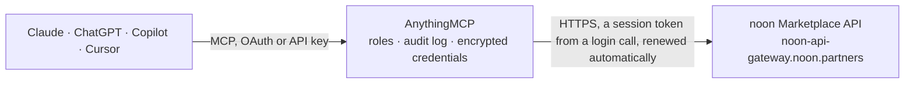

<!-- Generated by scripts/export-github-catalog.mjs in the anythingmcp-website repository. Do not edit by hand. -->

# noon Marketplace MCP connector

Sell on noon.com (UAE, Saudi Arabia, Egypt) from an AI agent through the noon Partner API: warehouses, catalog content, product groups and barcodes, offers, prices, stock, FBPI orders and shipments, … The AnythingMCP connector gives Claude, ChatGPT, Microsoft Copilot, Cursor and Gemini 29 MCP tools for noon Marketplace: 18 read and 11 can change data.

**Category:** [E-commerce](../e-commerce.md) · **Tools:** 29 · **Setup guide:** [anythingmcp.com](https://anythingmcp.com/guides/noon-marketplace-to-mcp) · [Deutsch](https://anythingmcp.com/de/guides/noon-marketplace-to-mcp) · [Italiano](https://anythingmcp.com/it/guides/noon-marketplace-to-mcp) · [Español](https://anythingmcp.com/es/guides/noon-marketplace-to-mcp) · [日本語](https://anythingmcp.com/ja/guides/noon-marketplace-to-mcp) · [Русский](https://anythingmcp.com/ru/guides/noon-marketplace-to-mcp) · [中文](https://anythingmcp.com/zh/guides/noon-marketplace-to-mcp)

## Start without code

No installation and no terminal: AnythingMCP Cloud runs the noon Marketplace connector for you, operated by helpcode.ai in Frankfurt, Germany.

1. **Click the button above** and create an account or sign in. The noon Marketplace connector opens, ready to install.
2. **Paste the API key or token from your noon Marketplace account.** Every click is in the [step-by-step guide](https://anythingmcp.com/guides/noon-marketplace-to-mcp).
3. **Click Install.** AnythingMCP shows the address of your MCP server.
4. **Add that address to your assistant:** [Claude](https://anythingmcp.com/guides/connect-noon-marketplace-to-claude) · [ChatGPT](https://anythingmcp.com/guides/connect-noon-marketplace-to-chatgpt) · [Microsoft Copilot](https://anythingmcp.com/guides/connect-noon-marketplace-to-copilot) · [Cursor](https://anythingmcp.com/guides/connect-noon-marketplace-to-cursor) · [Gemini CLI](https://anythingmcp.com/guides/connect-noon-marketplace-to-gemini) · [Meta Muse](https://anythingmcp.com/guides/connect-noon-marketplace-to-muse).
5. **Ask your first question**, for example: *Show FBPI order FBPI-2026-0789 details including items and statuses*

Prefer help with the setup? [Talk to us](https://anythingmcp.com/contact).

## How it works

- **The AI client** speaks MCP (Streamable HTTP) to AnythingMCP and only sees tool names, descriptions and results. It never gets the noon Marketplace credentials.
- **AnythingMCP** checks the client's role, builds the call from the tool definition, adds the credentials (a session token from a login call, renewed automatically), calls noon Marketplace, logs the call and returns the result.
- **noon Marketplace** sees an ordinary API client with the rights of the account the credentials belong to.

## Tools

| Tool | What it does | Access |
|---|---|---|
| [`noon_marketplace_whoami`](#noon_marketplace_whoami) | Show which service account the session belongs to (user_code and username). | read |
| [`noon_marketplace_list_warehouses`](#noon_marketplace_list_warehouses) | List the warehouses of the partner with warehouse_code, display name, fulfillment system code and whether each is active. | read |
| [`noon_marketplace_list_categories`](#noon_marketplace_list_categories) | List every product category code of the noon catalog, each a full family-type-subtype path such as electronics-mobiles-smartphones. | read |
| [`noon_marketplace_list_category_attributes`](#noon_marketplace_list_category_attributes) | List the attributes a category accepts, with is_mandatory, attribute_type, is_localizable (send EN and AR values), is_multivalued, the allowed options,… | read |
| [`noon_marketplace_get_content`](#noon_marketplace_get_content) | Read a product's content by sku_parent: its attribute values, images with review status, and per language the completeness, missing and invalid attributes,… | read |
| [`noon_marketplace_upsert_product`](#noon_marketplace_upsert_product) | Create a product, or update the one its partner SKUs belong to, in the noon catalog: brand, category, images and attribute values, plus one entry per… | write |
| [`noon_marketplace_get_product_group`](#noon_marketplace_get_product_group) | Read a product group (variants shown together on one page): the attribute codes it varies by and its member products with their values for those attributes. | read |
| [`noon_marketplace_upsert_product_group`](#noon_marketplace_upsert_product_group) | Create a product group or change one. | write |
| [`noon_marketplace_get_product_offers`](#noon_marketplace_get_product_offers) | Show a partner SKU's offers in every country and business model: noon sku, title, brand, and per offer the price and currency, whether it is active, the net… | read |
| [`noon_marketplace_get_prices`](#noon_marketplace_get_prices) | Read price, MSRP and active state for partner SKUs, one item per SKU and country. | read |
| [`noon_marketplace_upsert_prices`](#noon_marketplace_upsert_prices) | Set the selling price, MSRP (crossed-out reference price) and/or active state of partner SKUs, one item per SKU and country. | write |
| [`noon_marketplace_get_stock`](#noon_marketplace_get_stock) | Read the available quantity, processing time and last update time for warehouse and partner SKU pairs. | read |
| [`noon_marketplace_update_stock`](#noon_marketplace_update_stock) | Set the available quantity of partner SKUs in your warehouses. | write |
| [`noon_marketplace_list_orders`](#noon_marketplace_list_orders) | List FBPI orders (fulfilled from your own warehouse) of one integration warehouse, optionally created within a UTC window, 50 per page. | read |
| [`noon_marketplace_get_order`](#noon_marketplace_get_order) | Read one FBPI order: marketplace and order number, countries, merchant, currency, warehouse, creation time and the items with mp_item_nr, partner SKU,… | read |
| [`noon_marketplace_get_order_customer`](#noon_marketplace_get_order_customer) | Read the customer of an FBPI order: first and last name, city and administrative division, in Latin characters. | read |
| [`noon_marketplace_mark_items_unavailable`](#noon_marketplace_mark_items_unavailable) | Mark items of an FBPI order as out of stock before any shipment is created. | write |
| [`noon_marketplace_generate_awbs`](#noon_marketplace_generate_awbs) | Generate noon logistics AWB (air waybill) numbers for shipments handed to noon's courier, one per parcel or up to 1000 at once to keep in stock. | write |
| [`noon_marketplace_create_shipment`](#noon_marketplace_create_shipment) | Create a shipment for an FBPI order: your unique shipment number, the AWB (noon-generated or your courier's) and the items in the parcel. | write |
| [`noon_marketplace_get_shipment`](#noon_marketplace_get_shipment) | Read a shipment by warehouse and your shipment number: its FBPI order, AWBs with courier, and items. | read |
| [`noon_marketplace_cancel_shipment`](#noon_marketplace_cancel_shipment) | Cancel a shipment. | write |
| [`noon_marketplace_get_purchase_order`](#noon_marketplace_get_purchase_order) | Read a purchase order by number: currency, merchant, warehouse, status (pending or released), release date and the lines with partner SKU, quantity and unit… | read |
| [`noon_marketplace_list_return_references`](#noon_marketplace_list_return_references) | Find returned items by a barcode (an AWB number or a returns barcode): marketplace, order number, purchase item number, partner SKU, merchant and the… | read |
| [`noon_marketplace_list_export_categories`](#noon_marketplace_list_export_categories) | List the report types that can be exported (export_category_code) with the params each one takes. | read |
| [`noon_marketplace_create_export`](#noon_marketplace_create_export) | Start an export (a bulk report file) of one export category. | write |
| [`noon_marketplace_get_export_status`](#noon_marketplace_get_export_status) | Check an export: its status, parameters, who created it, timestamps and, once finished, the download_url of the file. | read |
| [`noon_marketplace_map_barcodes`](#noon_marketplace_map_barcodes) | Link barcodes (EAN, UPC or ISBN) to partner SKUs that already exist in your noon catalog, so noon's warehouse systems know which product a barcode stands for. | write |
| [`noon_marketplace_create_barcode_import`](#noon_marketplace_create_barcode_import) | Start a bulk import that links barcodes to partner SKUs already in your noon catalog: up to 10,000 mappings inline in items, or a file at file_url. | write |
| [`noon_marketplace_get_import_status`](#noon_marketplace_get_import_status) | Check a catalog import (barcode, SKU backfill or SKU grouping import): status (pending, processing, completed, failed, partial), sub-status, the processing… | read |

## Tool reference

Every parameter as the AI client sees it in `tools/list`. Source: [`packages/backend/src/adapters/intl/noon-marketplace.json`](../../../packages/backend/src/adapters/intl/noon-marketplace.json).

### `noon_marketplace_whoami`

Show which service account the session belongs to (user_code and username). A cheap way to check that the login works.

**Access:** read · **Call:** `GET /identity/v1/whoami`

No parameters.

### `noon_marketplace_list_warehouses`

List the warehouses of the partner with warehouse_code, display name, fulfillment system code and whether each is active. Use the codes for stock, orders and shipments. Up to 500 per page; call again with next_token while it is not empty. Read-only although it is a POST.

**Access:** read · **Call:** `POST /warehouse-platform/v1/warehouses/list`

| Parameter | Type | Required | Description |
|---|---|---|---|
| `fulfillment_system_code` | string | no | Only warehouses of this fulfillment system code. Leave empty for all. |
| `next_token` | string | no | next_token from the previous page; leave empty for the first page. Keep the same filter while paging. |

### `noon_marketplace_list_categories`

List every product category code of the noon catalog, each a full family-type-subtype path such as electronics-mobiles-smartphones. The list is long; pick the code that fits the product and pass it to noon_marketplace_list_category_attributes. Read-only although it is a POST.

**Access:** read · **Call:** `POST /content/v1/categories/list`

No parameters.

### `noon_marketplace_list_category_attributes`

List the attributes a category accepts, with is_mandatory, attribute_type, is_localizable (send EN and AR values), is_multivalued, the allowed options, metric units and length or range limits, and is_grouping (usable in product groups). Read it before noon_marketplace_upsert_product. Read-only although it is a POST.

**Access:** read · **Call:** `POST /content/v1/categories/attributes/list`

| Parameter | Type | Required | Description |
|---|---|---|---|
| `category_code` | string | yes | Category code from noon_marketplace_list_categories. |

### `noon_marketplace_get_content`

Read a product's content by sku_parent: its attribute values, images with review status, and per language the completeness, missing and invalid attributes, QC status with rejection reasons and the overall status. Use it to find out why a product is not live. Read-only although it is a POST.

**Access:** read · **Call:** `POST /content/v1/product/content/get`

| Parameter | Type | Required | Description |
|---|---|---|---|
| `sku_parent` | string | yes | sku_parent of the product (starts with Z), as returned by noon_marketplace_upsert_product. |

### `noon_marketplace_upsert_product`

Create a product, or update the one its partner SKUs belong to, in the noon catalog: brand, category, images and attribute values, plus one entry per variant SKU. Returns the sku_parent and the variants with their noon sku. status.status_id 3 means the product was stored but has content problems: check it with noon_marketplace_get_content. Submitted content goes to noon's QC and can go live. Installed switched off.

**Access:** write · **Call:** `POST /content/v1/product/upsert`

| Parameter | Type | Required | Description |
|---|---|---|---|
| `skus` | object[] | yes | Variants: one per partner SKU. Every SKU needs size when there is more than one; all must belong to the same product on an update. |
| `brand` | string | yes | Brand name. |
| `category` | string | yes | Category code from noon_marketplace_list_categories. |
| `images` | object[] | yes | Product images by public URL, ordered by sort starting at 1. |
| `attributes` | object | yes | Map of attribute_code to {"values": [...]}. Each value is {"value": ...}, plus "language": "LANGUAGE_EN" or "LANGUAGE_AR" for localizable attributes and "sort" (from 1) for multivalued ones. A metric attribute needs a matching <attribute_code>_unit attribute in the same call. Example: {"product_title": {"values": [{"value": "Acme Runner", "language": "LANGUAGE_EN"}, {"value": "...", "language": "LANGUAGE_AR"}]}}. |

### `noon_marketplace_get_product_group`

Read a product group (variants shown together on one page): the attribute codes it varies by and its member products with their values for those attributes. Identify the group by your partner_group_ref or by the sku_parent of any product in it. Large groups are paged: call again with next_token until it is empty. Read-only although it is a POST.

**Access:** read · **Call:** `POST /content/v1/product/group/get`

| Parameter | Type | Required | Description |
|---|---|---|---|
| `partner_group_ref` | string | no | Your reference for the group (max 255 characters). |
| `sku_parent` | string | no | sku_parent of any product in the group. |
| `page_size` | integer | no | Products per page, at most 200. |
| `next_token` | string | no | next_token from the previous page; leave empty for the first page. |

### `noon_marketplace_upsert_product_group`

Create a product group or change one. attribute_codes and sku_parents are FULL lists: what you send REPLACES the current list and anything left out is removed from the group (the products themselves stay). To add an entry, read the group with noon_marketplace_get_product_group and send the current list plus the new entry. Leave a list out on an update to keep it. A new group needs both lists and a category or brand. Installed switched off.

**Access:** write · **Call:** `POST /content/v1/product/group/upsert`

| Parameter | Type | Required | Description |
|---|---|---|---|
| `partner_group_ref` | string | yes | Your reference for the group, unique in your catalog (matched ignoring case and punctuation). |
| `category` | string | no | Category code; category or brand is required to create a group and cannot be changed later. |
| `brand` | string | no | Brand of the group; category or brand is required to create a group and cannot be changed later. |
| `attribute_codes` | string[] | no | Attributes the products vary by, e.g. colour_name; each must have is_grouping true. Max 100. Replaces the current list. |
| `sku_parents` | string[] | no | Products in the group, by sku_parent. Max 2000; a product can be in one group only. Replaces the current list. |

### `noon_marketplace_get_product_offers`

Show a partner SKU's offers in every country and business model: noon sku, title, brand, and per offer the price and currency, whether it is active, the net stock, whether it is live on the storefront and the issues keeping it offline.

**Access:** read · **Call:** `GET /offer/v1/product/{partner_sku}`

| Parameter | Type | Required | Description |
|---|---|---|---|
| `partner_sku` | string | yes | Your partner SKU, as used in your own system and in Seller Lab. |

### `noon_marketplace_get_prices`

Read price, MSRP and active state for partner SKUs, one item per SKU and country. Each item comes back with its own status; NOT_FOUND means the SKU has no pricing record in that country yet. Read-only although it is a POST.

**Access:** read · **Call:** `POST /pricing/v1/pricing/get`

| Parameter | Type | Required | Description |
|---|---|---|---|
| `items` | object[] | yes | SKU and country pairs to read. |

### `noon_marketplace_upsert_prices`

Set the selling price, MSRP (crossed-out reference price) and/or active state of partner SKUs, one item per SKU and country. Only the fields you send change; null never clears a value. is_active true puts a priced SKU on sale, false stops selling it. A 200 can still contain failed items: check status.status_code on each and resend only the failed ones. Changes live prices: installed switched off.

**Access:** write · **Call:** `POST /pricing/v1/pricing/upsert`

| Parameter | Type | Required | Description |
|---|---|---|---|
| `items` | object[] | yes | Price updates, one per SKU and country. |

### `noon_marketplace_get_stock`

Read the available quantity, processing time and last update time for warehouse and partner SKU pairs. Each item has its own status. Read-only although it is a POST.

**Access:** read · **Call:** `POST /stock/v1/stock-list`

| Parameter | Type | Required | Description |
|---|---|---|---|
| `items` | object[] | yes | Warehouse and SKU pairs to read. |

### `noon_marketplace_update_stock`

Set the available quantity of partner SKUs in your warehouses. qty is ABSOLUTE: it becomes the new quantity noon sells, it is not added to the current one. A 200 can still contain failed items (e.g. a SKU unknown to noon): check status on each. Changes what customers can buy: installed switched off.

**Access:** write · **Call:** `POST /stock/v1/stock-update`

| Parameter | Type | Required | Description |
|---|---|---|---|
| `items` | object[] | yes | Stock updates, one per warehouse and SKU. |

### `noon_marketplace_list_orders`

List FBPI orders (fulfilled from your own warehouse) of one integration warehouse, optionally created within a UTC window, 50 per page. Each order has its marketplace (noon or namshi_v2), country, currency and items with mp_item_nr, partner SKU, marketplace status, integration status and invoiced price. Call again with next_token and the same filters while it is not empty. Read-only although it is a POST.

**Access:** read · **Call:** `POST /fbpi/v1/fbpi-orders/list`

| Parameter | Type | Required | Description |
|---|---|---|---|
| `warehouse_code` | string | yes | Integration warehouse code, from noon_marketplace_list_warehouses. |
| `created_after` | string | no | Only orders created at or after this UTC time, YYYY-MM-DDTHH:MM:SSZ. |
| `created_before` | string | no | Only orders created at or before this UTC time, YYYY-MM-DDTHH:MM:SSZ. |
| `next_token` | string | no | next_token from the previous page; leave empty for the first page. |

### `noon_marketplace_get_order`

Read one FBPI order: marketplace and order number, countries, merchant, currency, warehouse, creation time and the items with mp_item_nr, partner SKU, marketplace status (confirmed or cancelled), integration status (acknowledged, out of stock, shipped), invoiced price and cancellation reason.

**Access:** read · **Call:** `GET /fbpi/v1/fbpi-order/{fbpi_order_nr}/get`

| Parameter | Type | Required | Description |
|---|---|---|---|
| `fbpi_order_nr` | string | yes | FBPI order number (fbpi_order_nr), from noon_marketplace_list_orders or the order webhook. |

### `noon_marketplace_get_order_customer`

Read the customer of an FBPI order: first and last name, city and administrative division, in Latin characters. Personal data: fetch it only when needed for the shipment or invoice.

**Access:** read · **Call:** `GET /fbpi/v1/fbpi-order/{fbpi_order_nr}/customer-details/get`

| Parameter | Type | Required | Description |
|---|---|---|---|
| `fbpi_order_nr` | string | yes | FBPI order number (fbpi_order_nr), from noon_marketplace_list_orders or the order webhook. |

### `noon_marketplace_mark_items_unavailable`

Mark items of an FBPI order as out of stock before any shipment is created. noon cancels those items for the customer; the rest of the order goes on to fulfilment. Cannot be undone: installed switched off.

**Access:** write · **Call:** `POST /fbpi/v1/fbpi-order/update`

| Parameter | Type | Required | Description |
|---|---|---|---|
| `fbpi_order_nr` | string | yes | FBPI order number (fbpi_order_nr), from noon_marketplace_list_orders or the order webhook. |
| `items` | object[] | yes | Items to cancel. |

### `noon_marketplace_generate_awbs`

Generate noon logistics AWB (air waybill) numbers for shipments handed to noon's courier, one per parcel or up to 1000 at once to keep in stock. Changes no order; the numbers are used with noon_marketplace_create_shipment and courier noon.

**Access:** write · **Call:** `POST /fbpi/v1/shipment/noon-logistics-awbs/get`

| Parameter | Type | Required | Description |
|---|---|---|---|
| `country_code` | `ae` \| `sa` \| `eg` | yes | Country of the listing: ae (UAE), sa (Saudi Arabia) or eg (Egypt). |
| `qty` | integer | yes | How many AWB numbers to generate, 1 to 1000. |

### `noon_marketplace_create_shipment`

Create a shipment for an FBPI order: your unique shipment number, the AWB (noon-generated or your courier's) and the items in the parcel. After this, complete the manifest in Seller Lab for noon's pickup. Installed switched off.

**Access:** write · **Call:** `POST /fbpi/v1/shipment/create`

| Parameter | Type | Required | Description |
|---|---|---|---|
| `warehouse_code` | string | yes | Integration warehouse code handling the order. |
| `integration_shipment_nr` | string | yes | Your unique number for this shipment, any format. |
| `fbpi_order_nr` | string | yes | FBPI order number (fbpi_order_nr), from noon_marketplace_list_orders or the order webhook. |
| `awbs` | object[] | yes | Courier and AWB pairs for the parcel. |
| `items` | object[] | yes | Items in this shipment. |

### `noon_marketplace_get_shipment`

Read a shipment by warehouse and your shipment number: its FBPI order, AWBs with courier, and items. Read-only although it is a POST.

**Access:** read · **Call:** `POST /fbpi/v1/shipment/get`

| Parameter | Type | Required | Description |
|---|---|---|---|
| `warehouse_code` | string | yes | Integration warehouse code. |
| `integration_shipment_nr` | string | yes | Your shipment number (integration_shipment_nr), the one sent when the shipment was created. |

### `noon_marketplace_cancel_shipment`

Cancel a shipment. Every item in it is cancelled too. Installed switched off.

**Access:** write · **Call:** `POST /fbpi/v1/shipment/cancel`

| Parameter | Type | Required | Description |
|---|---|---|---|
| `warehouse_code` | string | yes | Integration warehouse code. |
| `integration_shipment_nr` | string | yes | Your shipment number (integration_shipment_nr), the one sent when the shipment was created. |

### `noon_marketplace_get_purchase_order`

Read a purchase order by number: currency, merchant, warehouse, status (pending or released), release date and the lines with partner SKU, quantity and unit cost.

**Access:** read · **Call:** `GET /fbpo/v1/po/{po_nr}/get`

| Parameter | Type | Required | Description |
|---|---|---|---|
| `po_nr` | string | yes | Purchase order number. |

### `noon_marketplace_list_return_references`

Find returned items by a barcode (an AWB number or a returns barcode): marketplace, order number, purchase item number, partner SKU, merchant and the barcode references of each item, up to 200. Read-only although it is a POST.

**Access:** read · **Call:** `POST /returns/v1/return-references/list`

| Parameter | Type | Required | Description |
|---|---|---|---|
| `barcode` | string | yes | Barcode on the returned parcel or item. |
| `merchant_codes` | string[] | no | Merchant codes (STR...) to search in, at most 200. Leave out to search the project of this connector. |

### `noon_marketplace_list_export_categories`

List the report types that can be exported (export_category_code) with the params each one takes. Start here before noon_marketplace_create_export.

**Access:** read · **Call:** `GET /impex/v1/export/category/list`

No parameters.

### `noon_marketplace_create_export`

Start an export (a bulk report file) of one export category. Returns an export_code; poll noon_marketplace_get_export_status until it is done and has a download_url. Changes no data.

**Access:** write · **Call:** `POST /impex/v1/export/create`

| Parameter | Type | Required | Description |
|---|---|---|---|
| `export_category_code` | string | yes | Export category from noon_marketplace_list_export_categories. |
| `params` | object | yes | Parameters of the export, with the keys noon_marketplace_list_export_categories lists for that category. Send {} when it takes none. |

### `noon_marketplace_get_export_status`

Check an export: its status, parameters, who created it, timestamps and, once finished, the download_url of the file. Read-only although it is a POST.

**Access:** read · **Call:** `POST /impex/v1/export/status`

| Parameter | Type | Required | Description |
|---|---|---|---|
| `export_code` | string | yes | export_code returned by noon_marketplace_create_export. |

### `noon_marketplace_map_barcodes`

Link barcodes (EAN, UPC or ISBN) to partner SKUs that already exist in your noon catalog, so noon's warehouse systems know which product a barcode stands for. noon creates a barcode it does not know yet. A 200 can still contain failed items: check status on each and resend only those. For thousands of barcodes use noon_marketplace_create_barcode_import. Changes catalog data: installed switched off.

**Access:** write · **Call:** `POST /catplat/v1/barcode/map`

| Parameter | Type | Required | Description |
|---|---|---|---|
| `items` | object[] | yes | Mappings, one per barcode and partner SKU. |

### `noon_marketplace_create_barcode_import`

Start a bulk import that links barcodes to partner SKUs already in your noon catalog: up to 10,000 mappings inline in items, or a file at file_url. Give exactly one of the two. Returns an import_reference; poll noon_marketplace_get_import_status with it until the status is completed, failed or partial, and read the failure count in the report. For a few barcodes, noon_marketplace_map_barcodes answers right away. Changes catalog data: installed switched off.

**Access:** write · **Call:** `POST /catplat/v1/import/barcode`

| Parameter | Type | Required | Description |
|---|---|---|---|
| `client_reference` | string | yes | Your own reference for this import, unique across your imports, at most 100 characters. noon_marketplace_get_import_status also accepts it. |
| `items` | object | no | Inline mappings, as {"data": [...]}. Leave it out when you give file_url. |
| `file_url` | string | no | HTTP(S) or GCS URL of a CSV, TSV, XLSX, JSON or Parquet file with the mappings. Leave it out when you give items. |
| `force_sync` | boolean | no | Overwrite existing mappings for the whole import. Default false. |

### `noon_marketplace_get_import_status`

Check a catalog import (barcode, SKU backfill or SKU grouping import): status (pending, processing, completed, failed, partial), sub-status, the processing report with success and failure counts, and timestamps.

**Access:** read · **Call:** `GET /catplat/v1/import/status/{reference}`

| Parameter | Type | Required | Description |
|---|---|---|---|
| `reference` | string | yes | import_reference returned when the import was created, or your own client_reference. |

## Run it yourself

AnythingMCP is open source (AGPL-3.0). [Run it with Docker](../../../README.md#run-it-yourself), open **Connectors → Store**, pick **noon Marketplace** and enter `NOON_KEY_ID`, `NOON_PRIVATE_KEY`, `NOON_PROJECT_CODE`, then add your MCP server URL to the AI client.

[← E-commerce connectors](../e-commerce.md) · [All categories](../README.md)
