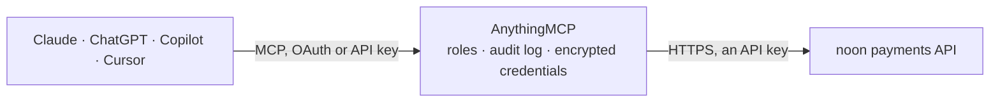

<!-- Generated by scripts/export-github-catalog.mjs in the anythingmcp-website repository. Do not edit by hand. -->

# noon payments MCP connector

noon payments gateway (UAE, Saudi Arabia, Egypt): order status by order id or merchant reference with authorized, captured and refunded totals and transactions, scheduled settlement and commission … The AnythingMCP connector gives Claude, ChatGPT, Microsoft Copilot, Cursor and Gemini 7 MCP tools for noon payments: 5 read and 2 can change data.

**Category:** [Payments](../payments.md) · **Tools:** 7 · **Setup guide:** [anythingmcp.com](https://anythingmcp.com/guides/noon-payments-to-mcp) · [Deutsch](https://anythingmcp.com/de/guides/noon-payments-to-mcp) · [Italiano](https://anythingmcp.com/it/guides/noon-payments-to-mcp) · [Español](https://anythingmcp.com/es/guides/noon-payments-to-mcp) · [日本語](https://anythingmcp.com/ja/guides/noon-payments-to-mcp) · [Русский](https://anythingmcp.com/ru/guides/noon-payments-to-mcp) · [中文](https://anythingmcp.com/zh/guides/noon-payments-to-mcp)

## Start without code

No installation and no terminal: AnythingMCP Cloud runs the noon payments connector for you, operated by helpcode.ai in Frankfurt, Germany.

1. **Click the button above** and create an account or sign in. The noon payments connector opens, ready to install.
2. **Paste the API key or token from your noon payments account.** Every click is in the [step-by-step guide](https://anythingmcp.com/guides/noon-payments-to-mcp).
3. **Click Install.** AnythingMCP shows the address of your MCP server.
4. **Add that address to your assistant:** [Claude](https://anythingmcp.com/guides/connect-noon-payments-to-claude) · [ChatGPT](https://anythingmcp.com/guides/connect-noon-payments-to-chatgpt) · [Microsoft Copilot](https://anythingmcp.com/guides/connect-noon-payments-to-copilot) · [Cursor](https://anythingmcp.com/guides/connect-noon-payments-to-cursor) · [Gemini CLI](https://anythingmcp.com/guides/connect-noon-payments-to-gemini) · [Meta Muse](https://anythingmcp.com/guides/connect-noon-payments-to-muse).
5. **Ask your first question**, for example: *Show me order by our reference GS-ORD-2026-0421, I need status and captured/refunded totals.*

Prefer help with the setup? [Talk to us](https://anythingmcp.com/contact).

## How it works

- **The AI client** speaks MCP (Streamable HTTP) to AnythingMCP and only sees tool names, descriptions and results. It never gets the noon payments credentials.
- **AnythingMCP** checks the client's role, builds the call from the tool definition, adds the credentials (an API key), calls noon payments, logs the call and returns the result.
- **noon payments** sees an ordinary API client with the rights of the account the credentials belong to.

## Tools

| Tool | What it does | Access |
|---|---|---|
| [`noon_payments_get_order`](#noon_payments_get_order) | Get a noon payments order by its order id: order status (INITIATED, AUTHORIZED, CAPTURED, PARTIALLY_CAPTURED, REFUNDED, REVERSED, CANCELLED, FAILED,… | read |
| [`noon_payments_get_order_by_reference`](#noon_payments_get_order_by_reference) | Get a noon payments order by your own order reference (order.reference sent at INITIATE, e.g. the shop order number) with the same details as… | read |
| [`noon_payments_list_scheduled_reports`](#noon_payments_list_scheduled_reports) | List the scheduled reports noon generated for a day or month, each with ReportName, ReportType and a time-limited ReportUrl to download the ZIP (Excel or… | read |
| [`noon_payments_get_subscription`](#noon_payments_get_subscription) | Get a recurring subscription by its identifier: creation date, status, validity, amount and schedule. | read |
| [`noon_payments_get_card_token`](#noon_payments_get_card_token) | Get the masked card behind a saved card token (brand, masked number, expiry, holder name, status). | read |
| [`noon_payments_capture_order`](#noon_payments_capture_order) | Capture an AUTHORIZED order in full or in part so the funds move to the merchant account. | write |
| [`noon_payments_refund_order`](#noon_payments_refund_order) | Refund a captured order in full or in part back to the customer card. | write |

## Tool reference

Every parameter as the AI client sees it in `tools/list`. Source: [`packages/backend/src/adapters/intl/noon-payments.json`](../../../packages/backend/src/adapters/intl/noon-payments.json).

### `noon_payments_get_order`

Get a noon payments order by its order id: order status (INITIATED, AUTHORIZED, CAPTURED, PARTIALLY_CAPTURED, REFUNDED, REVERSED, CANCELLED, FAILED, MARKED_FOR_REVIEW...), amount and currency, authorized, captured, refunded, reversed and remaining totals, merchant reference, the transactions (AUTHORIZATION, CAPTURE, REFUND... with status, amount, time and id), the masked payment details and nextActions. Not for reconciliation runs: noon throttles repeated polling.

**Access:** read · **Call:** `GET /payment/v1/order/{order_id}`

| Parameter | Type | Required | Description |
|---|---|---|---|
| `order_id` | string | yes | noon payments order id: the numeric order.id returned by INITIATE and stored with the shop order, passed as text so long ids keep every digit, e.g. 123456789012. |
| `verbose` | boolean | no | true adds the verbose details (heavier and slower); leave it out unless the extra fields are needed. |

### `noon_payments_get_order_by_reference`

Get a noon payments order by your own order reference (order.reference sent at INITIATE, e.g. the shop order number) with the same details as noon_payments_get_order. If several orders share the reference (retries), the newest is returned; use noon_payments_get_order with the id for an exact match.

**Access:** read · **Call:** `GET /payment/v1/order/getbyreference/{order_reference}`

| Parameter | Type | Required | Description |
|---|---|---|---|
| `order_reference` | string | yes | Your merchant order reference, e.g. NPORDTEST0001. |
| `verbose` | boolean | no | true adds the verbose details (heavier and slower); leave it out unless the extra fields are needed. |

### `noon_payments_list_scheduled_reports`

List the scheduled reports noon generated for a day or month, each with ReportName, ReportType and a time-limited ReportUrl to download the ZIP (Excel or tab-separated). ReconciliationSettlement is daily (captures and refunds to reconcile with the bank settlement); ActiveSubscriptions, PaymentTokens, MerchantCommissions and MerchantCommissionDetails are monthly. Needs the Financial Auditor role on the application.

**Access:** read · **Call:** `GET /report/v1/data/GetScheduleReports`

| Parameter | Type | Required | Description |
|---|---|---|---|
| `year` | integer | yes | Four-digit year, e.g. 2026. |
| `month` | integer | yes | Month 1 to 12. |
| `day` | integer | no | Day of the month, for daily reports. |
| `report_type` | `ReconciliationSettlement` \| `ActiveSubscriptions` \| `PaymentTokens` \| `MerchantCommissions` \| `MerchantCommissionDetails` | yes | Report type. |

### `noon_payments_get_subscription`

Get a recurring subscription by its identifier: creation date, status, validity, amount and schedule. Reads only (apiOperation RETRIEVE_SUBSCRIPTION).

**Access:** read · **Call:** `POST /payment/v1/order`

| Parameter | Type | Required | Description |
|---|---|---|---|
| `subscription_id` | string | yes | Subscription identifier (UUID) returned at INITIATE, e.g. 7852f7e2-cdae-424d-9d41-48179ff75444. |

### `noon_payments_get_card_token`

Get the masked card behind a saved card token (brand, masked number, expiry, holder name, status). Needs the Token Manager role. Not for bulk runs: noon throttles repeated calls.

**Access:** read · **Call:** `GET /payment/v1/token/{token_identifier}`

| Parameter | Type | Required | Description |
|---|---|---|---|
| `token_identifier` | string | yes | Card token identifier from a tokenized payment. |

### `noon_payments_capture_order`

Capture an AUTHORIZED order in full or in part so the funds move to the merchant account. This moves money: show the order, amount and currency to the user and wait for a yes. Installed switched off.

**Access:** write · **Call:** `POST /payment/v1/order`

| Parameter | Type | Required | Description |
|---|---|---|---|
| `order_id` | string | yes | noon payments order id: the numeric order.id returned by INITIATE and stored with the shop order, passed as text so long ids keep every digit, e.g. 123456789012. |
| `amount` | number | yes | Amount to capture. |
| `currency` | string | yes | Currency of the order, e.g. AED, SAR, EGP. |
| `final_capture` | boolean | no | true closes the order for further captures. |
| `transaction_reference` | string | no | Your unique reference for this capture, e.g. the shipment number. |
| `description` | string | no | Comment for the capture. |

### `noon_payments_refund_order`

Refund a captured order in full or in part back to the customer card. It cannot be undone: show the order, amount and currency to the user and wait for a yes. Needs the Refund Manager role. Installed switched off.

**Access:** write · **Call:** `POST /payment/v1/order`

| Parameter | Type | Required | Description |
|---|---|---|---|
| `order_id` | string | yes | noon payments order id: the numeric order.id returned by INITIATE and stored with the shop order, passed as text so long ids keep every digit, e.g. 123456789012. |
| `amount` | number | yes | Amount to refund. |
| `currency` | string | yes | Currency of the order, e.g. AED, SAR, EGP. |
| `capture_transaction_id` | string | no | Identifier of the CAPTURE transaction to refund (from noon_payments_get_order). |
| `transaction_reference` | string | no | Your unique reference for this refund, e.g. the credit note number. |
| `description` | string | no | Comment for the refund. |

## Run it yourself

AnythingMCP is open source (AGPL-3.0). [Run it with Docker](../../../README.md#run-it-yourself), open **Connectors → Store**, pick **noon payments** and enter `NOON_PAYMENTS_API_URL`, `NOON_PAYMENTS_AUTH_KEY`, then add your MCP server URL to the AI client.

[← Payments connectors](../payments.md) · [All categories](../README.md)
