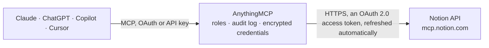

<!-- Generated by scripts/export-github-catalog.mjs in the anythingmcp-website repository. Do not edit by hand. -->

# Notion MCP connector

Search, read and update your Notion workspace from Claude, ChatGPT or Copilot through Notion's official MCP server: find pages and databases, create and edit pages, query databases with SQL, read … The AnythingMCP connector gives Claude, ChatGPT, Microsoft Copilot, Cursor and Gemini 36 MCP tools for Notion: 20 read and 16 can change data.

**Category:** [Knowledge Base](../knowledge.md) · **Tools:** 36 · **Setup guide:** [anythingmcp.com](https://anythingmcp.com/guides/notion-to-mcp) · [Deutsch](https://anythingmcp.com/de/guides/notion-to-mcp) · [Italiano](https://anythingmcp.com/it/guides/notion-to-mcp) · [Español](https://anythingmcp.com/es/guides/notion-to-mcp) · [日本語](https://anythingmcp.com/ja/guides/notion-to-mcp) · [Русский](https://anythingmcp.com/ru/guides/notion-to-mcp) · [中文](https://anythingmcp.com/zh/guides/notion-to-mcp)

## Start without code

No installation and no terminal: AnythingMCP Cloud runs the Notion connector for you, operated by helpcode.ai in Frankfurt, Germany.

1. **Click the button above** and create an account or sign in. The Notion connector opens, ready to install.
2. **Sign in with your Notion account** when AnythingMCP asks. The first time, an admin creates a small app in the Notion developer console. Every click is in the [step-by-step guide](https://anythingmcp.com/guides/notion-to-mcp).
3. **Click Install.** AnythingMCP shows the address of your MCP server.
4. **Add that address to your assistant:** [Claude](https://anythingmcp.com/guides/connect-notion-to-claude) · [ChatGPT](https://anythingmcp.com/guides/connect-notion-to-chatgpt) · [Microsoft Copilot](https://anythingmcp.com/guides/connect-notion-to-copilot) · [Cursor](https://anythingmcp.com/guides/connect-notion-to-cursor) · [Gemini CLI](https://anythingmcp.com/guides/connect-notion-to-gemini) · [Meta Muse](https://anythingmcp.com/guides/connect-notion-to-muse).
5. **Ask your first question**, for example: *Where is invoice INV-2026-0421 for Bergström Elektronik AB and what's the page status?*

Prefer help with the setup? [Talk to us](https://anythingmcp.com/contact).

## How it works

- **The AI client** speaks MCP (Streamable HTTP) to AnythingMCP and only sees tool names, descriptions and results. It never gets the Notion credentials.
- **AnythingMCP** checks the client's role, builds the call from the tool definition, adds the credentials (an OAuth 2.0 access token, refreshed automatically), calls Notion, logs the call and returns the result.
- **Notion** sees an ordinary API client with the rights of the account the credentials belong to.

## Tools

| Tool | What it does | Access |
|---|---|---|
| [`notion_search`](#notion_search) | Search the Notion workspace with short keywords, by location (page, data source or teamspace), creator or editor, date, title and content status, with… | read |
| [`notion_ai_search`](#notion_ai_search) | Search Notion and the sources connected to the workspace (Slack, Mail, Calendar, Google Drive, Jira and others) with keywords, a page title or a concise… | read |
| [`notion_get_tool_access`](#notion_get_tool_access) | Report which Notion MCP tools run on the connected workspace's plan, which of their parameters are restricted, and where to upgrade. | read |
| [`notion_download_skill`](#notion_download_skill) | Download a complete Notion Skill: pass the Skill page id and get its id, version_id and a signed URL (valid one hour) to a tar.gz archive with SKILL.md and… | read |
| [`notion_fetch`](#notion_fetch) | Retrieve a Notion page, database, data source or saved database view by URL or ID. | read |
| [`notion_create_file_upload`](#notion_create_file_upload) | Create a short-lived URL for uploading one local file (up to 20 MiB) directly to Notion. | write |
| [`notion_create_attachment`](#notion_create_attachment) | Create a Notion attachment from exactly one source: inline UTF-8 text (HTML, Markdown, CSV, JSON, SVG, up to 200 KiB), a file at a direct public HTTPS URL,… | write |
| [`notion_download_attachment`](#notion_download_attachment) | Download the complete UTF-8 text content of an attachment created with notion-create-attachment, up to 200 KiB. | read |
| [`notion_create_pages`](#notion_create_pages) | Create one or more Notion pages with properties and Markdown content, optionally from a database template, with an icon, a cover, or as a Notion Skill. | write |
| [`notion_update_page`](#notion_update_page) | Update a Notion page's properties, content, icon or cover, apply a database template, or change whether the page is a Skill. | write |
| [`notion_convert_page_to_skill`](#notion_convert_page_to_skill) | Mark a Notion page as a Notion Skill without changing its content. | write |
| [`notion_move_pages`](#notion_move_pages) | Move one or more Notion pages or databases to a new parent page, database or teamspace. | write |
| [`notion_duplicate_page`](#notion_duplicate_page) | Duplicate a Notion page within the workspace. | write |
| [`notion_create_database`](#notion_create_database) | Create a new Notion database with its initial data source and initial view, using the property schema you specify (for example name, type, priority and… | write |
| [`notion_create_folder`](#notion_create_folder) | Create an empty Folder under a parent Notion page, for example "Project files" under a project page, to group related pages and files. | write |
| [`notion_update_data_source`](#notion_update_data_source) | Update a Notion data source's properties (columns), name, description or other attributes. | write |
| [`notion_create_view`](#notion_create_view) | Create a new view on a Notion database: table, board, list, calendar, timeline, gallery, form, chart, map or dashboard, with an optional configuration in… | write |
| [`notion_update_view`](#notion_update_view) | Update a Notion view's name, filters, sorts or display configuration. | write |
| [`notion_query_data_sources`](#notion_query_data_sources) | Query Notion data sources with SQL (across one or more data sources), read rows from one data source with filter and sort (mode "rows", limit up to 100), or… | read |
| [`notion_query_meeting_notes`](#notion_query_meeting_notes) | Query the current user's Notion meeting notes, filtering by meeting properties such as a title keyword. | read |
| [`notion_list_agents`](#notion_list_agents) | List the Notion Custom Agents available to the connected user, to choose one before searching for it or starting a session. | read |
| [`notion_search_agents`](#notion_search_agents) | Search Notion Custom Agents by name and get the Custom Agent URL needed to start a session. | read |
| [`notion_query_sessions`](#notion_query_sessions) | List Notion Custom Agent sessions the connected user can access. | read |
| [`notion_search_sessions`](#notion_search_sessions) | Search past Notion Custom Agent sessions by text, up to 20 matches with titles and matching text spans. | read |
| [`notion_spawn_session`](#notion_spawn_session) | Start a new session with a Notion Custom Agent and send it a first message. | write |
| [`notion_get_session_status`](#notion_get_session_status) | Get the status of a Notion Custom Agent session (running, waiting, finished) by its session:// URL, as returned by the other session tools. | read |
| [`notion_wait_session`](#notion_wait_session) | Wait for the current run of a Notion Custom Agent session to finish and return its reply. | read |
| [`notion_stop_session`](#notion_stop_session) | Stop the run in progress in a Notion Custom Agent session. | write |
| [`notion_send_message_to_session`](#notion_send_message_to_session) | Send a follow-up message to an existing Notion Custom Agent session, which makes the agent run again on its own. | write |
| [`notion_list_session_events`](#notion_list_session_events) | List the events (messages, tool calls, results) of a Notion Custom Agent session, page by page. | read |
| [`notion_read_session_event`](#notion_read_session_event) | Read one event of a Notion Custom Agent session in full, for example a long agent reply listed by notion-list-session-events. | read |
| [`notion_create_comment`](#notion_create_comment) | Add a comment to a Notion page: a page-level comment, a comment on specific content (block-level, by selection), or a reply to an existing discussion. | write |
| [`notion_get_comments`](#notion_get_comments) | List all comments and discussions on a Notion page, optionally including block-level and inline discussions, resolved threads and full comment content. | read |
| [`notion_get_teams`](#notion_get_teams) | Retrieve the teams (teamspaces) in the current Notion workspace with your membership status in each, for example to get a teamspace ID to filter a search by. | read |
| [`notion_get_users`](#notion_get_users) | List Notion workspace members and guests with their IDs, names, emails (when available) and types (person or bot). | read |
| [`notion_get_async_task`](#notion_get_async_task) | Get the status of an async task started by notion-duplicate-page, notion-create-pages or notion-update-page: queued, running, retrying, succeeded (with the… | read |

## Tool reference

Every parameter as the AI client sees it in `tools/list`. Source: [`packages/backend/src/adapters/intl/notion.json`](../../../packages/backend/src/adapters/intl/notion.json).

### `notion_search`

Search the Notion workspace with short keywords, by location (page, data source or teamspace), creator or editor, date, title and content status, with sorting and up to 50 results. When the connection can use AI search, a plain keyword search runs AI search instead; with query_type "user" it looks up a workspace user. Fetch important matches before relying on them.

**Access:** read · **Call:** `notion-search /mcp`

| Parameter | Type | Required | Description |
|---|---|---|---|
| `query` | string | no | Short, specific keywords, a page title or a concise question (keep it under about 50 words). Empty only when a filter is given. |
| `query_type` | `internal` \| `user` | no | "internal" (default) for a content search, "user" to look up a workspace user by name or email. |
| `page_url` | string | no | Limit the search to this page and its descendants (URL or ID). |
| `data_source_url` | string | no | Limit the search to one data source, e.g. collection://<id> from a fetched database. |
| `teamspace_id` | string | no | Limit the search to one teamspace (ID from notion-get-teams). |
| `filters` | object | no | Exact filters: creator, editor, created or last-edited date range, teamspace_ids, title_only, content status. Editor, last-edited date, several teamspaces, title only and content status need Business or Enterprise; unavailable options are dropped with a notice. |
| `sort` | string | no | Sort order. "relevance" (default) or a date sort (date sorts need Business or Enterprise). |

### `notion_ai_search`

Search Notion and the sources connected to the workspace (Slack, Mail, Calendar, Google Drive, Jira and others) with keywords, a page title or a concise natural-language question. Can be narrowed to a page and its descendants, a data source or a teamspace, up to 50 results. Searching connected sources requires Notion AI; without it the tool falls back to a Notion-only keyword search with a notice.

**Access:** read · **Call:** `notion-ai-search /mcp`

| Parameter | Type | Required | Description |
|---|---|---|---|
| `query` | string | no | Short, specific keywords, a page title or a concise question (keep it under about 50 words). Empty only when a filter is given. |
| `query_type` | `internal` \| `user` | no | "internal" (default) for a content search, "user" to look up a workspace user by name or email. |
| `page_url` | string | no | Limit the search to this page and its descendants (URL or ID). |
| `data_source_url` | string | no | Limit the search to one data source, e.g. collection://<id> from a fetched database. |
| `teamspace_id` | string | no | Limit the search to one teamspace (ID from notion-get-teams). |
| `filters` | object | no | Exact filters: creator, editor, created or last-edited date range, teamspace_ids, title_only, content status. Editor, last-edited date, several teamspaces, title only and content status need Business or Enterprise; unavailable options are dropped with a notice. |
| `sort` | string | no | Sort order. "relevance" (default) or a date sort (date sorts need Business or Enterprise). |

### `notion_get_tool_access`

Report which Notion MCP tools run on the connected workspace's plan, which of their parameters are restricted, and where to upgrade. Call it once with {} and reuse the returned current_tool_access map before using a tool whose availability depends on the plan. It reads connection metadata only.

**Access:** read · **Call:** `notion-get-tool-access /mcp`

| Parameter | Type | Required | Description |
|---|---|---|---|
| `tool_names` | string[] | no | Narrow the response to these tool base names, e.g. ["search", "ai_search"]. Omit for every tool the connection can see. |

### `notion_download_skill`

Download a complete Notion Skill: pass the Skill page id and get its id, version_id and a signed URL (valid one hour) to a tar.gz archive with SKILL.md and its supporting files. Requires the Skills API to be enabled for the workspace.

**Access:** read · **Call:** `notion-download-skill /mcp`

| Parameter | Type | Required | Description |
|---|---|---|---|
| `id` | string | yes | ID of the Skill page. |

### `notion_fetch`

Retrieve a Notion page, database, data source or saved database view by URL or ID. Pages come back as Notion-flavoured Markdown with path, last-edited time, verification, icon and cover; databases include their data sources, schema and templates; a view:// URL returns a view's filters, sorts and display settings. Large pages report truncated subtrees you can fetch by ID.

**Access:** read · **Call:** `notion-fetch /mcp`

| Parameter | Type | Required | Description |
|---|---|---|---|
| `id` | string | yes | URL or ID of the page, database, data source (collection://...) or view (view://...) to fetch. |

### `notion_create_file_upload`

Create a short-lived URL for uploading one local file (up to 20 MiB) directly to Notion. The client then POSTs the file as multipart/form-data to that URL; the upload response includes suggested_markdown to place the file in a page or comment.

**Access:** write · **Call:** `notion-create-file-upload /mcp`

| Parameter | Type | Required | Description |
|---|---|---|---|
| `filename` | string | no | Name of the file to upload, with its extension. |
| `content_type` | string | no | MIME type of the file, e.g. image/png or application/pdf. |

### `notion_create_attachment`

Create a Notion attachment from exactly one source: inline UTF-8 text (HTML, Markdown, CSV, JSON, SVG, up to 200 KiB), a file at a direct public HTTPS URL, or a completed file upload. Returns suggested_markdown to place the attachment in a page or comment.

**Access:** write · **Call:** `notion-create-attachment /mcp`

| Parameter | Type | Required | Description |
|---|---|---|---|
| `content` | string | no | Inline UTF-8 text content of the attachment (up to 200 KiB). |
| `url` | string | no | Direct public HTTPS URL of the file to download (no redirects, no private addresses). |
| `source_file_id` | string | no | ID of a completed file upload created by this connection. |
| `filename` | string | no | File name to give the attachment, with its extension. |

### `notion_download_attachment`

Download the complete UTF-8 text content of an attachment created with notion-create-attachment, up to 200 KiB. Supports text formats such as HTML, Markdown, plain text, CSV, JSON, XML, YAML and SVG; it does not fetch arbitrary URLs or binary files.

**Access:** read · **Call:** `notion-download-attachment /mcp`

| Parameter | Type | Required | Description |
|---|---|---|---|
| `file_upload_id` | string | yes | The file_upload_id returned when the attachment was created. |

### `notion_create_pages`

Create one or more Notion pages with properties and Markdown content, optionally from a database template, with an icon, a cover, or as a Notion Skill. Without a parent a private page is created; creation_mode "draft" creates a workspace-level private draft. allow_async returns a task to poll with notion-get-async-task.

**Access:** write · **Call:** `notion-create-pages /mcp`

| Parameter | Type | Required | Description |
|---|---|---|---|
| `pages` | object[] | yes | The pages to create. Each has properties (title and database properties), content (Notion-flavoured Markdown), and optionally template_id, icon, cover and is_skill. |
| `parent` | object | no | Where to create the pages: { page_id }, { database_id } or { data_source_id }. Omit for a private page. |
| `creation_mode` | `draft` | no | "draft" for a private workspace-level draft when no destination was named. Cannot be combined with parent. |
| `allow_async` | boolean | no | Queue the write and return an async_task to poll with notion-get-async-task (recommended for most creates). |

### `notion_update_page`

Update a Notion page's properties, content, icon or cover, apply a database template, or change whether the page is a Skill. Commands include update_properties, update_content (batched search-and-replace on the page content) and replace_content. allow_async returns a task to poll with notion-get-async-task.

**Access:** write · **Call:** `notion-update-page /mcp`

| Parameter | Type | Required | Description |
|---|---|---|---|
| `page_id` | string | yes | ID or URL of the page to update. |
| `command` | string | yes | What to change: update_properties, update_content or replace_content (and the template command documented by the server). |
| `properties` | object | no | Property values to set, keyed by property name (update_properties). |
| `content_updates` | object[] | no | Search-and-replace operations for update_content: each has old_str (must match exactly one place unless replace_all_matches is true), new_str and optional replace_all_matches. |
| `new_str` | string | no | New Markdown content for replace_content. |
| `icon` | string | no | Emoji, custom emoji name (":rocket_ship:"), Notion icon id ("icons/pizza_blue") or external image URL. |
| `cover` | string | no | External image URL for the page cover. |
| `is_skill` | boolean | no | true to make the page a Notion Skill, false to stop treating it as one. |
| `allow_async` | boolean | no | Queue the write and return an async_task to poll with notion-get-async-task. |

### `notion_convert_page_to_skill`

Mark a Notion page as a Notion Skill without changing its content. Pass the page's full Notion URL; the page must be in the connected workspace and the connected user must be able to edit it.

**Access:** write · **Call:** `notion-convert-page-to-skill /mcp`

| Parameter | Type | Required | Description |
|---|---|---|---|
| `page_url` | string | yes | Full Notion URL of the page to convert. |

### `notion_move_pages`

Move one or more Notion pages or databases to a new parent page, database or teamspace. Moving changes where the content lives and who can see it through the new parent, so it ships switched off.

**Access:** write · **Call:** `notion-move-pages /mcp`

| Parameter | Type | Required | Description |
|---|---|---|---|
| `page_or_database_ids` | string[] | yes | IDs of the pages or databases to move. |
| `new_parent` | object | yes | The new parent: { page_id }, { database_id }, { data_source_id } or { teamspace_id }. |

### `notion_duplicate_page`

Duplicate a Notion page within the workspace. The copy is made asynchronously: poll notion-get-async-task with the returned task id until it has succeeded.

**Access:** write · **Call:** `notion-duplicate-page /mcp`

| Parameter | Type | Required | Description |
|---|---|---|---|
| `page_id` | string | yes | ID or URL of the page to duplicate. |

### `notion_create_database`

Create a new Notion database with its initial data source and initial view, using the property schema you specify (for example name, type, priority and status columns).

**Access:** write · **Call:** `notion-create-database /mcp`

| Parameter | Type | Required | Description |
|---|---|---|---|
| `parent` | object | no | Where to create the database: { page_id }. Omit for a private database. |
| `title` | string | no | Title of the new database. |
| `description` | string | no | Optional description of the database. |
| `properties` | object | no | Property schema of the initial data source, keyed by property name with the property type and options. |

### `notion_create_folder`

Create an empty Folder under a parent Notion page, for example "Project files" under a project page, to group related pages and files.

**Access:** write · **Call:** `notion-create-folder /mcp`

| Parameter | Type | Required | Description |
|---|---|---|---|
| `parent_page_id` | string | yes | ID or URL of the parent page. |
| `title` | string | yes | Name of the folder. |

### `notion_update_data_source`

Update a Notion data source's properties (columns), name, description or other attributes. Removing or retyping a property drops its values in every row, so this ships switched off: turn it on when the AI should change database schemas.

**Access:** write · **Call:** `notion-update-data-source /mcp`

| Parameter | Type | Required | Description |
|---|---|---|---|
| `data_source_id` | string | yes | ID of the data source (collection://<id> from a fetched database). |
| `title` | string | no | New name of the data source. |
| `description` | string | no | New description of the data source. |
| `properties` | object | no | Properties to add, rename, change or remove, keyed by property name. |

### `notion_create_view`

Create a new view on a Notion database: table, board, list, calendar, timeline, gallery, form, chart, map or dashboard, with an optional configuration in the view DSL for filters, sorts, grouping and display options (see the notion://docs/view-dsl-spec resource).

**Access:** write · **Call:** `notion-create-view /mcp`

| Parameter | Type | Required | Description |
|---|---|---|---|
| `database_id` | string | yes | ID or URL of the database to add the view to. |
| `data_source_id` | string | no | Data source the view shows, when the database has several. |
| `name` | string | no | Name of the view. |
| `type` | `table` \| `board` \| `list` \| `calendar` \| `timeline` \| `gallery` \| `form` \| `chart` \| `map` \| `dashboard` | yes | View type. |
| `configuration` | string | no | Optional view DSL for filters, sorts, grouping and display options. Use page URLs/IDs and user IDs (or "me") in filters, not names. |

### `notion_update_view`

Update a Notion view's name, filters, sorts or display configuration. Only the fields you specify change; existing filters, sorts and grouping can be cleared. Uses the same configuration DSL as notion-create-view.

**Access:** write · **Call:** `notion-update-view /mcp`

| Parameter | Type | Required | Description |
|---|---|---|---|
| `view_id` | string | yes | ID or view:// URL of the view to update. |
| `name` | string | no | New name of the view. |
| `configuration` | string | no | View DSL with the filters, sorts, grouping or display options to set or clear. |

### `notion_query_data_sources`

Query Notion data sources with SQL (across one or more data sources), read rows from one data source with filter and sort (mode "rows", limit up to 100), or run a saved view (mode "view"). View mode is available on every plan; SQL and rows mode are unlimited on Business and Enterprise with Notion AI and metered on other plans.

**Access:** read · **Call:** `notion-query-data-sources /mcp`

| Parameter | Type | Required | Description |
|---|---|---|---|
| `mode` | `sql` \| `rows` \| `view` | yes | "sql", "rows" or "view". |
| `query` | string | no | SQL query (mode "sql"). |
| `data_source_url` | string | no | Data source to read (mode "rows"), e.g. collection://<id>. |
| `view_url` | string | no | Saved view to run (mode "view"), e.g. view://<id>. |
| `filter` | object | no | Row filter for mode "rows", up to two levels of and/or groups. |
| `sort` | object[] | no | Sorts for mode "rows", applied in order. |
| `limit` | integer | no | Maximum rows for mode "rows" (default 50, maximum 100). |

### `notion_query_meeting_notes`

Query the current user's Notion meeting notes, filtering by meeting properties such as a title keyword. Returns meetings where the user is an attendee or creator. Needs a Business plan or higher with Notion AI; other plans get an upgrade prompt.

**Access:** read · **Call:** `notion-query-meeting-notes /mcp`

| Parameter | Type | Required | Description |
|---|---|---|---|
| `query` | string | no | Keyword to match in meeting titles. |
| `filters` | object | no | Meeting property filters, such as a date range or attendees. |

### `notion_list_agents`

List the Notion Custom Agents available to the connected user, to choose one before searching for it or starting a session. Requires Notion AI and access to Custom Agents.

**Access:** read · **Call:** `notion-list-agents /mcp`

| Parameter | Type | Required | Description |
|---|---|---|---|
| `cursor` | string | no | Cursor from the previous response, to read the next page. |

### `notion_search_agents`

Search Notion Custom Agents by name and get the Custom Agent URL needed to start a session. Without a query it pages through all agents (follow the cursor until none is returned).

**Access:** read · **Call:** `notion-search-agents /mcp`

| Parameter | Type | Required | Description |
|---|---|---|---|
| `query` | string | no | Name or keywords of the agent. |
| `cursor` | string | no | Cursor from the previous response (only without a query). |

### `notion_query_sessions`

List Notion Custom Agent sessions the connected user can access. Pages can be empty and still carry a cursor: keep following it until the response stops returning one. Use it when session search is unavailable.

**Access:** read · **Call:** `notion-query-sessions /mcp`

| Parameter | Type | Required | Description |
|---|---|---|---|
| `agent_url` | string | no | Only sessions of this Custom Agent. |
| `cursor` | string | no | Cursor from the previous response. |

### `notion_search_sessions`

Search past Notion Custom Agent sessions by text, up to 20 matches with titles and matching text spans. Returns a warning and no matches when the workspace search index is not ready.

**Access:** read · **Call:** `notion-search-sessions /mcp`

| Parameter | Type | Required | Description |
|---|---|---|---|
| `query` | string | yes | Text to search for in sessions. |

### `notion_spawn_session`

Start a new session with a Notion Custom Agent and send it a first message. The agent then works on its own with its own permissions and Notion AI credits, so this ships switched off.

**Access:** write · **Call:** `notion-spawn-session /mcp`

| Parameter | Type | Required | Description |
|---|---|---|---|
| `agent_url` | string | yes | Custom Agent URL from notion-search-agents. |
| `message` | string | yes | The first message to the agent. |

### `notion_get_session_status`

Get the status of a Notion Custom Agent session (running, waiting, finished) by its session:// URL, as returned by the other session tools.

**Access:** read · **Call:** `notion-get-session-status /mcp`

| Parameter | Type | Required | Description |
|---|---|---|---|
| `session_url` | string | yes | session://<spaceId>/<sessionId> (or the session://<sessionId> shorthand). |

### `notion_wait_session`

Wait for the current run of a Notion Custom Agent session to finish and return its reply. Use it before sending a follow-up message, which fails while a run is in progress.

**Access:** read · **Call:** `notion-wait-session /mcp`

| Parameter | Type | Required | Description |
|---|---|---|---|
| `session_url` | string | yes | session:// URL of the session to wait for. |

### `notion_stop_session`

Stop the run in progress in a Notion Custom Agent session. The session and its events stay; only the current run is cancelled.

**Access:** write · **Call:** `notion-stop-session /mcp`

| Parameter | Type | Required | Description |
|---|---|---|---|
| `session_url` | string | yes | session:// URL of the session to stop. |

### `notion_send_message_to_session`

Send a follow-up message to an existing Notion Custom Agent session, which makes the agent run again on its own. Returns a conflict error while a run is in progress. Ships switched off.

**Access:** write · **Call:** `notion-send-message-to-session /mcp`

| Parameter | Type | Required | Description |
|---|---|---|---|
| `session_url` | string | yes | session:// URL of the session. |
| `message` | string | yes | The message to send. |

### `notion_list_session_events`

List the events (messages, tool calls, results) of a Notion Custom Agent session, page by page.

**Access:** read · **Call:** `notion-list-session-events /mcp`

| Parameter | Type | Required | Description |
|---|---|---|---|
| `session_url` | string | yes | session:// URL of the session. |
| `cursor` | string | no | Cursor from the previous response. |

### `notion_read_session_event`

Read one event of a Notion Custom Agent session in full, for example a long agent reply listed by notion-list-session-events.

**Access:** read · **Call:** `notion-read-session-event /mcp`

| Parameter | Type | Required | Description |
|---|---|---|---|
| `session_url` | string | yes | session:// URL of the session. |
| `event_id` | string | yes | ID of the event to read. |

### `notion_create_comment`

Add a comment to a Notion page: a page-level comment, a comment on specific content (block-level, by selection), or a reply to an existing discussion. The comment is Markdown and can include an uploaded file on its own line.

**Access:** write · **Call:** `notion-create-comment /mcp`

| Parameter | Type | Required | Description |
|---|---|---|---|
| `page_id` | string | yes | ID or URL of the page to comment on. |
| `content` | string | yes | The comment text in Markdown. |
| `discussion_id` | string | no | Reply to this existing discussion instead of starting a new one. |
| `selection_with_ellipsis` | string | no | The content to comment on: its first and last few words joined with "...". |

### `notion_get_comments`

List all comments and discussions on a Notion page, optionally including block-level and inline discussions, resolved threads and full comment content.

**Access:** read · **Call:** `notion-get-comments /mcp`

| Parameter | Type | Required | Description |
|---|---|---|---|
| `page_id` | string | yes | ID or URL of the page. |
| `discussion_id` | string | no | Only this discussion. |
| `include_all_blocks` | boolean | no | Include block-level and inline discussions, not only page-level ones. |
| `include_resolved` | boolean | no | Include resolved discussions. |

### `notion_get_teams`

Retrieve the teams (teamspaces) in the current Notion workspace with your membership status in each, for example to get a teamspace ID to filter a search by.

**Access:** read · **Call:** `notion-get-teams /mcp`

| Parameter | Type | Required | Description |
|---|---|---|---|
| `query` | string | no | Filter teamspaces by name. |

### `notion_get_users`

List Notion workspace members and guests with their IDs, names, emails (when available) and types (person or bot). Supports pagination and search by name or email, a specific user by ID, or the current user with "self".

**Access:** read · **Call:** `notion-get-users /mcp`

| Parameter | Type | Required | Description |
|---|---|---|---|
| `query` | string | no | Name or email to search for. |
| `user_id` | string | no | A specific user ID, or "self" for the connected user. |
| `start_cursor` | string | no | Cursor from the previous page. |
| `page_size` | integer | no | Number of users per page. |

### `notion_get_async_task`

Get the status of an async task started by notion-duplicate-page, notion-create-pages or notion-update-page: queued, running, retrying, succeeded (with the result) or failed (with the error). Wait the suggested poll_after_seconds between polls.

**Access:** read · **Call:** `notion-get-async-task /mcp`

| Parameter | Type | Required | Description |
|---|---|---|---|
| `task_id` | string | yes | The id from the async_task returned by the originating tool. |

## Run it yourself

AnythingMCP is open source (AGPL-3.0). [Run it with Docker](../../../README.md#run-it-yourself), open **Connectors → Store**, pick **Notion**, then add your MCP server URL to the AI client.

[← Knowledge Base connectors](../knowledge.md) · [All categories](../README.md)
