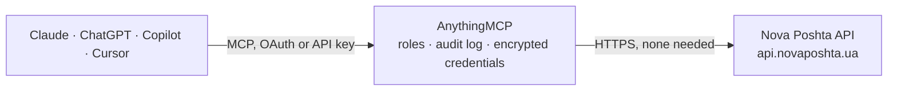

<!-- Generated by scripts/export-github-catalog.mjs in the anythingmcp-website repository. Do not edit by hand. -->

# Nova Poshta MCP connector

Nova Poshta (Нова Пошта), Ukraine's parcel carrier: track up to 100 waybills at once, find cities and branches or parcel lockers, calculate delivery price and date, and list your own shipments. The AnythingMCP connector gives Claude, ChatGPT, Microsoft Copilot, Cursor and Gemini 7 MCP tools for Nova Poshta, all read-only.

**Category:** [Logistics](../logistics.md) · **Tools:** 7 · **Setup guide:** [anythingmcp.com](https://anythingmcp.com/guides/nova-poshta-to-mcp) · [Deutsch](https://anythingmcp.com/de/guides/nova-poshta-to-mcp) · [Italiano](https://anythingmcp.com/it/guides/nova-poshta-to-mcp) · [Español](https://anythingmcp.com/es/guides/nova-poshta-to-mcp) · [日本語](https://anythingmcp.com/ja/guides/nova-poshta-to-mcp) · [Русский](https://anythingmcp.com/ru/guides/nova-poshta-to-mcp) · [中文](https://anythingmcp.com/zh/guides/nova-poshta-to-mcp)

## Start without code

No installation and no terminal: AnythingMCP Cloud runs the Nova Poshta connector for you, operated by helpcode.ai in Frankfurt, Germany.

1. **Click the button above** and create an account or sign in. The Nova Poshta connector opens, ready to install.
2. **Nothing to enter:** this connector needs no credentials. Every click is in the [step-by-step guide](https://anythingmcp.com/guides/nova-poshta-to-mcp).
3. **Click Install.** AnythingMCP shows the address of your MCP server.
4. **Add that address to your assistant:** [Claude](https://anythingmcp.com/guides/connect-nova-poshta-to-claude) · [ChatGPT](https://anythingmcp.com/guides/connect-nova-poshta-to-chatgpt) · [Microsoft Copilot](https://anythingmcp.com/guides/connect-nova-poshta-to-copilot) · [Cursor](https://anythingmcp.com/guides/connect-nova-poshta-to-cursor) · [Gemini CLI](https://anythingmcp.com/guides/connect-nova-poshta-to-gemini) · [Meta Muse](https://anythingmcp.com/guides/connect-nova-poshta-to-muse).
5. **Ask your first question**, for example: *Track TTN 3812090456 for customer Mriya Textile and include recipient phone +380671112233*

Prefer help with the setup? [Talk to us](https://anythingmcp.com/contact).

## How it works

- **The AI client** speaks MCP (Streamable HTTP) to AnythingMCP and only sees tool names, descriptions and results. It never gets the Nova Poshta credentials.
- **AnythingMCP** checks the client's role, builds the call from the tool definition, adds the credentials (none needed), calls Nova Poshta, logs the call and returns the result.
- **Nova Poshta** sees an ordinary API client with the rights of the account the credentials belong to.

## Tools

| Tool | What it does | Access |
|---|---|---|
| [`nova_poshta_track_parcels`](#nova_poshta_track_parcels) | Get the current status of one or more Nova Poshta shipments by waybill (TTN) number: status text and code, dates, cities, branch, weight, cost and payment. | read |
| [`nova_poshta_search_settlements`](#nova_poshta_search_settlements) | Search Ukrainian cities, towns and villages served by Nova Poshta by name. | read |
| [`nova_poshta_list_warehouses`](#nova_poshta_list_warehouses) | List Nova Poshta branches and parcel lockers (postomats) of a city with address, number, schedule, weight limits and reference. | read |
| [`nova_poshta_list_warehouse_types`](#nova_poshta_list_warehouse_types) | List the Nova Poshta branch types (post office, cargo branch, parcel locker and so on) with their references, for filtering nova_poshta_list_warehouses. | read |
| [`nova_poshta_get_delivery_price`](#nova_poshta_get_delivery_price) | Calculate the Nova Poshta delivery price for a shipment between two cities: returns Cost (delivery price in UAH) and AssessedCost (declared value). | read |
| [`nova_poshta_get_delivery_date`](#nova_poshta_get_delivery_date) | Estimate when a Nova Poshta shipment sent on a given day will arrive, for a pair of cities and a service type. | read |
| [`nova_poshta_list_shipments`](#nova_poshta_list_shipments) | List the waybills (express invoices) created by the account that owns NOVA_POSHTA_API_KEY within a date range, with number, recipient, cities, cost and state. | read |

## Tool reference

Every parameter as the AI client sees it in `tools/list`. Source: [`packages/backend/src/adapters/intl/nova-poshta.json`](../../../packages/backend/src/adapters/intl/nova-poshta.json).

### `nova_poshta_track_parcels`

Get the current status of one or more Nova Poshta shipments by waybill (TTN) number: status text and code, dates, cities, branch, weight, cost and payment. Pass the phone number of the sender or recipient with a number to get the full record. Up to 100 numbers per call.

**Access:** read · **Call:** `POST /json/`

| Parameter | Type | Required | Description |
|---|---|---|---|
| `documents` | object[] | yes | Shipments to track, at most 100. Each item is {"DocumentNumber": "20450000000000", "Phone": "380501234567"}; Phone is optional. |

### `nova_poshta_search_settlements`

Search Ukrainian cities, towns and villages served by Nova Poshta by name. Each match carries DeliveryCity, the city reference the branch, price and delivery-date tools need, plus region and the number of branches.

**Access:** read · **Call:** `POST /json/`

| Parameter | Type | Required | Description |
|---|---|---|---|
| `city_name` | string | yes | Full or partial place name, in Ukrainian for best results, e.g. Київ, Львів, Одеса. |
| `limit` | integer | no | Matches per page (default 20). |
| `page` | integer | no | Page number, starting at 1. |

### `nova_poshta_list_warehouses`

List Nova Poshta branches and parcel lockers (postomats) of a city with address, number, schedule, weight limits and reference. Filter by street or number text, branch number or branch type. Use the Ref of a branch when the user needs a pickup point.

**Access:** read · **Call:** `POST /json/`

| Parameter | Type | Required | Description |
|---|---|---|---|
| `city_ref` | string | no | City reference (UUID): the DeliveryCity value from nova_poshta_search_settlements, e.g. 8d5a980d-391c-11dd-90d9-001a92567626 for Kyiv. |
| `city_name` | string | no | City name in Ukrainian, used when city_ref is not known, e.g. Львів. |
| `find_by_string` | string | no | Text to match in the branch description, e.g. a street name such as Хрещатик. |
| `warehouse_id` | string | no | Branch number within the city, e.g. 5 for branch No. 5. |
| `type_of_warehouse_ref` | string | no | Branch type reference from nova_poshta_list_warehouse_types, e.g. the parcel locker type. |
| `limit` | integer | no | Branches per page (default 50). |
| `page` | integer | no | Page number, starting at 1. |

### `nova_poshta_list_warehouse_types`

List the Nova Poshta branch types (post office, cargo branch, parcel locker and so on) with their references, for filtering nova_poshta_list_warehouses.

**Access:** read · **Call:** `POST /json/`

No parameters.

### `nova_poshta_get_delivery_price`

Calculate the Nova Poshta delivery price for a shipment between two cities: returns Cost (delivery price in UAH) and AssessedCost (declared value). Needs city references from nova_poshta_search_settlements.

**Access:** read · **Call:** `POST /json/`

| Parameter | Type | Required | Description |
|---|---|---|---|
| `city_sender` | string | yes | Sender city reference. City reference (UUID): the DeliveryCity value from nova_poshta_search_settlements, e.g. 8d5a980d-391c-11dd-90d9-001a92567626 for Kyiv. |
| `city_recipient` | string | yes | Recipient city reference, same format as city_sender. |
| `weight` | number | yes | Actual weight in kg, e.g. 2.5. |
| `service_type` | `WarehouseWarehouse` \| `WarehouseDoors` \| `DoorsWarehouse` \| `DoorsDoors` \| `WarehousePostomat` \| `DoorsPostomat` | no | Pickup and drop-off: Warehouse = branch, Doors = address, Postomat = parcel locker. Default WarehouseWarehouse. |
| `cost` | number | yes | Declared value in UAH, e.g. 500. |
| `cargo_type` | `Parcel` \| `Cargo` \| `Documents` \| `TiresWheels` \| `Pallet` | no | Cargo type (default Parcel). |
| `seats_amount` | integer | no | Number of packages (default 1). |
| `date` | string | no | Shipping date DD.MM.YYYY, e.g. 09.10.2026. Today when omitted. |

### `nova_poshta_get_delivery_date`

Estimate when a Nova Poshta shipment sent on a given day will arrive, for a pair of cities and a service type. Returns DeliveryDate with date and time in Kyiv time.

**Access:** read · **Call:** `POST /json/`

| Parameter | Type | Required | Description |
|---|---|---|---|
| `city_sender` | string | yes | Sender city reference. City reference (UUID): the DeliveryCity value from nova_poshta_search_settlements, e.g. 8d5a980d-391c-11dd-90d9-001a92567626 for Kyiv. |
| `city_recipient` | string | yes | Recipient city reference, same format as city_sender. |
| `service_type` | `WarehouseWarehouse` \| `WarehouseDoors` \| `DoorsWarehouse` \| `DoorsDoors` \| `WarehousePostomat` \| `DoorsPostomat` | no | Pickup and drop-off: Warehouse = branch, Doors = address, Postomat = parcel locker. Default WarehouseWarehouse. |
| `date` | string | no | Shipping date DD.MM.YYYY, e.g. 09.10.2026. Today when omitted. |

### `nova_poshta_list_shipments`

List the waybills (express invoices) created by the account that owns NOVA_POSHTA_API_KEY within a date range, with number, recipient, cities, cost and state. Requires the API key; without it Nova Poshta answers "User is undefined".

**Access:** read · **Call:** `POST /json/`

| Parameter | Type | Required | Description |
|---|---|---|---|
| `date_from` | string | yes | First creation date, DD.MM.YYYY, e.g. 01.10.2026. |
| `date_to` | string | yes | Last creation date, DD.MM.YYYY, e.g. 07.10.2026. |
| `page` | integer | no | Page number, starting at 1. |
| `get_full_list` | `0` \| `1` | no | 1 returns every waybill of the range in one response and ignores page; 0 (default) pages the result. |

## Run it yourself

AnythingMCP is open source (AGPL-3.0). [Run it with Docker](../../../README.md#run-it-yourself), open **Connectors → Store**, pick **Nova Poshta**, then add your MCP server URL to the AI client.

[← Logistics connectors](../logistics.md) · [All categories](../README.md)
