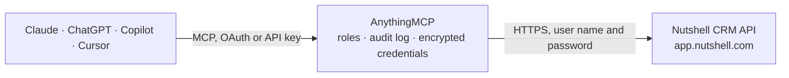

<!-- Generated by scripts/export-github-catalog.mjs in the anythingmcp-website repository. Do not edit by hand. -->

# Nutshell CRM MCP connector

Manage Nutshell CRM (leads, contacts, accounts, activities, tasks) from any AI agent. 9 tools, basic-auth with API token. The AnythingMCP connector gives Claude, ChatGPT, Microsoft Copilot, Cursor and Gemini 9 MCP tools for Nutshell CRM: 5 read and 4 can change data.

**Category:** [CRM](../crm.md) · **Tools:** 9 · **Setup guide:** [anythingmcp.com](https://anythingmcp.com/guides/nutshell-crm-to-mcp) · [Deutsch](https://anythingmcp.com/de/guides/nutshell-crm-to-mcp) · [Italiano](https://anythingmcp.com/it/guides/nutshell-crm-to-mcp) · [Español](https://anythingmcp.com/es/guides/nutshell-crm-to-mcp) · [日本語](https://anythingmcp.com/ja/guides/nutshell-crm-to-mcp) · [Русский](https://anythingmcp.com/ru/guides/nutshell-crm-to-mcp) · [中文](https://anythingmcp.com/zh/guides/nutshell-crm-to-mcp)

## Start without code

No installation and no terminal: AnythingMCP Cloud runs the Nutshell CRM connector for you, operated by helpcode.ai in Frankfurt, Germany.

1. **Click the button above** and create an account or sign in. The Nutshell CRM connector opens, ready to install.
2. **Paste the API key or token from your Nutshell CRM account.** Every click is in the [step-by-step guide](https://anythingmcp.com/guides/nutshell-crm-to-mcp).
3. **Click Install.** AnythingMCP shows the address of your MCP server.
4. **Add that address to your assistant:** [Claude](https://anythingmcp.com/guides/connect-nutshell-crm-to-claude) · [ChatGPT](https://anythingmcp.com/guides/connect-nutshell-crm-to-chatgpt) · [Microsoft Copilot](https://anythingmcp.com/guides/connect-nutshell-crm-to-copilot) · [Cursor](https://anythingmcp.com/guides/connect-nutshell-crm-to-cursor) · [Gemini CLI](https://anythingmcp.com/guides/connect-nutshell-crm-to-gemini) · [Meta Muse](https://anythingmcp.com/guides/connect-nutshell-crm-to-muse).
5. **Ask your first question**, for example: *Show me the contact record for emma.lopez@greenfieldsolar.co and her primary company.*

Prefer help with the setup? [Talk to us](https://anythingmcp.com/contact).

## How it works

- **The AI client** speaks MCP (Streamable HTTP) to AnythingMCP and only sees tool names, descriptions and results. It never gets the Nutshell CRM credentials.
- **AnythingMCP** checks the client's role, builds the call from the tool definition, adds the credentials (user name and password), calls Nutshell CRM, logs the call and returns the result.
- **Nutshell CRM** sees an ordinary API client with the rights of the account the credentials belong to.

## Tools

| Tool | What it does | Access |
|---|---|---|
| [`nutshell_list_leads`](#nutshell_list_leads) | List leads. | read |
| [`nutshell_get_lead`](#nutshell_get_lead) | Get one lead by ID with full custom fields, products, activities. | read |
| [`nutshell_create_lead`](#nutshell_create_lead) | Create a lead. | write |
| [`nutshell_list_contacts`](#nutshell_list_contacts) | List contacts. | read |
| [`nutshell_create_contact`](#nutshell_create_contact) | Create a contact. | write |
| [`nutshell_list_accounts`](#nutshell_list_accounts) | List accounts (companies). | read |
| [`nutshell_create_account`](#nutshell_create_account) | Create a company. | write |
| [`nutshell_list_activities`](#nutshell_list_activities) | List activities (calls, meetings, emails, log notes). | read |
| [`nutshell_create_task`](#nutshell_create_task) | Create a task assigned to a user, optionally linked to a lead/contact/account. | write |

## Tool reference

Every parameter as the AI client sees it in `tools/list`. Source: [`packages/backend/src/adapters/intl/nutshell-crm.json`](../../../packages/backend/src/adapters/intl/nutshell-crm.json).

### `nutshell_list_leads`

List leads. Filter by status (open, won, lost, cancelled), assignee, source.

**Access:** read · **Call:** `GET /leads`

| Parameter | Type | Required | Description |
|---|---|---|---|
| `status` | string | no | open, won, lost, cancelled. |
| `assignee_id` | integer | no | User ID. |
| `page` | integer | no | 1-based. |
| `limit` | integer | no | Max 100. |
| `sort` | string | no | id, value, name, createdTime, modifiedTime — prefix with - for desc. |

### `nutshell_get_lead`

Get one lead by ID with full custom fields, products, activities.

**Access:** read · **Call:** `GET /leads/{id}`

| Parameter | Type | Required | Description |
|---|---|---|---|
| `id` | integer | yes | Lead ID. |

### `nutshell_create_lead`

Create a lead. Required: `description`. Useful optional: `primaryAccount.id`, `primaryContact.id`, `assignee.id`, `value.amount`, `confidence`.

**Access:** write · **Call:** `POST /leads`

| Parameter | Type | Required | Description |
|---|---|---|---|
| `description` | string | yes | Lead description. |
| `primaryAccount` | object | no | {id} of the account. |
| `primaryContact` | object | no | {id} of the contact. |
| `assignee` | object | no | {id} of the user. |
| `value` | object | no | {amount, currency} of the deal. |
| `confidence` | integer | no | 0-100 probability. |
| `stage_id` | integer | no | Pipeline stage ID. |

### `nutshell_list_contacts`

List contacts. Filter by name, email, account.

**Access:** read · **Call:** `GET /contacts`

| Parameter | Type | Required | Description |
|---|---|---|---|
| `name` | string | no | Filter by name substring. |
| `email` | string | no | Exact email match. |
| `account_id` | integer | no | Filter to one account. |
| `page` | integer | no | 1-based. |
| `limit` | integer | no | Max 100. |

### `nutshell_create_contact`

Create a contact. Required: `name`. Common optional: `email`, `phone`, `accounts` (array of {id}).

**Access:** write · **Call:** `POST /contacts`

| Parameter | Type | Required | Description |
|---|---|---|---|
| `name` | string | yes | Full name. |
| `email` | any[] | no | Array of {value, type:'work'\|'personal'}. |
| `phone` | any[] | no | Array of {value, type}. |
| `accounts` | any[] | no | Array of {id} account refs. |
| `description` | string | no | Notes. |

### `nutshell_list_accounts`

List accounts (companies).

**Access:** read · **Call:** `GET /accounts`

| Parameter | Type | Required | Description |
|---|---|---|---|
| `name` | string | no | Filter by name substring. |
| `page` | integer | no | 1-based. |
| `limit` | integer | no | Max 100. |

### `nutshell_create_account`

Create a company. Required: `name`.

**Access:** write · **Call:** `POST /accounts`

| Parameter | Type | Required | Description |
|---|---|---|---|
| `name` | string | yes | Company name. |
| `url` | any[] | no | Array of {value}. |
| `phone` | any[] | no | Array of {value, type}. |
| `industry` | object | no | {id} industry ref. |

### `nutshell_list_activities`

List activities (calls, meetings, emails, log notes).

**Access:** read · **Call:** `GET /activities`

| Parameter | Type | Required | Description |
|---|---|---|---|
| `type` | string | no | Activity type code. |
| `user_id` | integer | no | Filter by user. |
| `lead_id` | integer | no | Filter to one lead. |
| `from` | string | no | ISO 8601 date. |
| `to` | string | no | ISO 8601 date. |
| `page` | integer | no | 1-based. |
| `limit` | integer | no | Max 100. |

### `nutshell_create_task`

Create a task assigned to a user, optionally linked to a lead/contact/account.

**Access:** write · **Call:** `POST /tasks`

| Parameter | Type | Required | Description |
|---|---|---|---|
| `title` | string | yes | Task title. |
| `description` | string | no | Task body. |
| `assignee_id` | integer | no | User ID. |
| `due_time` | string | no | ISO 8601 datetime. |
| `lead_id` | integer | no | Related lead. |
| `contact_id` | integer | no | Related contact. |
| `account_id` | integer | no | Related account. |

## Run it yourself

AnythingMCP is open source (AGPL-3.0). [Run it with Docker](../../../README.md#run-it-yourself), open **Connectors → Store**, pick **Nutshell CRM** and enter `NUTSHELL_USERNAME`, `NUTSHELL_API_KEY`, then add your MCP server URL to the AI client.

[← CRM connectors](../crm.md) · [All categories](../README.md)
