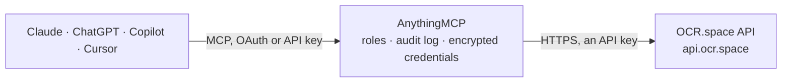

<!-- Generated by scripts/export-github-catalog.mjs in the anythingmcp-website repository. Do not edit by hand. -->

# OCR.space MCP connector

OCR.space OCR API: read the text of images and PDFs (receipts, invoices, scans, screenshots, photos of documents) from a public URL, with automatic language detection, table mode for receipts and a searchable-PDF export. The AnythingMCP connector gives Claude, ChatGPT, Microsoft Copilot, Cursor and Gemini 2 MCP tools for OCR.space, all read-only.

**Category:** [Public Data](../data.md) · **Tools:** 2 · **Setup guide:** [anythingmcp.com](https://anythingmcp.com/guides/ocr-space-to-mcp) · [Deutsch](https://anythingmcp.com/de/guides/ocr-space-to-mcp) · [Italiano](https://anythingmcp.com/it/guides/ocr-space-to-mcp) · [Español](https://anythingmcp.com/es/guides/ocr-space-to-mcp) · [日本語](https://anythingmcp.com/ja/guides/ocr-space-to-mcp) · [Русский](https://anythingmcp.com/ru/guides/ocr-space-to-mcp) · [中文](https://anythingmcp.com/zh/guides/ocr-space-to-mcp)

## Start without code

No installation and no terminal: AnythingMCP Cloud runs the OCR.space connector for you, operated by helpcode.ai in Frankfurt, Germany.

1. **Click the button above** and create an account or sign in. The OCR.space connector opens, ready to install.
2. **Paste the API key or token from your OCR.space account.** Every click is in the [step-by-step guide](https://anythingmcp.com/guides/ocr-space-to-mcp).
3. **Click Install.** AnythingMCP shows the address of your MCP server.
4. **Add that address to your assistant:** [Claude](https://anythingmcp.com/guides/connect-ocr-space-to-claude) · [ChatGPT](https://anythingmcp.com/guides/connect-ocr-space-to-chatgpt) · [Microsoft Copilot](https://anythingmcp.com/guides/connect-ocr-space-to-copilot) · [Cursor](https://anythingmcp.com/guides/connect-ocr-space-to-cursor) · [Gemini CLI](https://anythingmcp.com/guides/connect-ocr-space-to-gemini) · [Meta Muse](https://anythingmcp.com/guides/connect-ocr-space-to-muse).
5. **Ask your first question**, for example: *Read the invoice at https://files.anythingmcp.local/invoices/inv-2026-0413.jpg and give supplier, date and total.*

Prefer help with the setup? [Talk to us](https://anythingmcp.com/contact).

## How it works

- **The AI client** speaks MCP (Streamable HTTP) to AnythingMCP and only sees tool names, descriptions and results. It never gets the OCR.space credentials.
- **AnythingMCP** checks the client's role, builds the call from the tool definition, adds the credentials (an API key), calls OCR.space, logs the call and returns the result.
- **OCR.space** sees an ordinary API client with the rights of the account the credentials belong to.

## Tools

| Tool | What it does | Access |
|---|---|---|
| [`ocr_space_read_url`](#ocr_space_read_url) | Read the text in an image or PDF at a public URL with OCR (receipts, invoices, scans, screenshots, photos of documents): one text per page, plus exit codes. | read |
| [`ocr_space_make_searchable_pdf`](#ocr_space_make_searchable_pdf) | Turn a scanned PDF or an image at a public URL into a searchable PDF (an invisible text layer over the original), and return its download link… | read |

## Tool reference

Every parameter as the AI client sees it in `tools/list`. Source: [`packages/backend/src/adapters/intl/ocr-space.json`](../../../packages/backend/src/adapters/intl/ocr-space.json).

### `ocr_space_read_url`

Read the text in an image or PDF at a public URL with OCR (receipts, invoices, scans, screenshots, photos of documents): one text per page, plus exit codes. On the free plan files may be up to 1 MB and PDFs up to 3 pages. Read-only, although it is a POST.

**Access:** read · **Call:** `POST /parse/image`

| Parameter | Type | Required | Description |
|---|---|---|---|
| `url` | string | yes | Public http(s) URL of the image (JPG, PNG, GIF, TIF, BMP, WEBP) or PDF. |
| `language` | string | no | Language of the text. auto (default, engines 2 and 3) detects it; or a code such as eng, ger, fre, ita, spa, por, rus, ara, chs, jpn, kor. |
| `engine` | `2` \| `3` | no | OCR engine: 2 (default, fast, auto language detection, good on numbers and special characters) or 3 (most accurate, 200+ languages and handwriting, slower; 1,000 pages a month on the free plan). |
| `is_table` | boolean | no | true for receipts and tables: keeps the text line by line in reading order. |
| `scale` | boolean | no | true to upscale small or low-resolution images first; improves results on scans and screenshots. |
| `detect_orientation` | boolean | no | true to rotate the image to the right orientation first. |
| `filetype` | `PDF` \| `JPG` \| `PNG` \| `GIF` \| `TIF` \| `BMP` \| `WEBP` | no | File type when the URL has no file extension. |

### `ocr_space_make_searchable_pdf`

Turn a scanned PDF or an image at a public URL into a searchable PDF (an invisible text layer over the original), and return its download link (SearchablePDFURL, valid for about an hour) together with the recognised text. On the free plan the PDF carries a watermark. Read-only, although it is a POST.

**Access:** read · **Call:** `POST /parse/image`

| Parameter | Type | Required | Description |
|---|---|---|---|
| `url` | string | yes | Public http(s) URL of the scanned PDF or image. |
| `hide_text_layer` | boolean | no | true to keep the text layer invisible in viewers (default false shows it highlighted). |
| `language` | string | no | Language of the text. auto (default, engines 2 and 3) detects it; or a code such as eng, ger, fre, ita, spa, por, rus, ara, chs, jpn, kor. |
| `engine` | `2` \| `3` | no | OCR engine: 2 (default, fast, auto language detection, good on numbers and special characters) or 3 (most accurate, 200+ languages and handwriting, slower; 1,000 pages a month on the free plan). |
| `is_table` | boolean | no | true for receipts and tables: keeps the text line by line in reading order. |
| `scale` | boolean | no | true to upscale small or low-resolution images first; improves results on scans and screenshots. |
| `detect_orientation` | boolean | no | true to rotate the image to the right orientation first. |
| `filetype` | `PDF` \| `JPG` \| `PNG` \| `GIF` \| `TIF` \| `BMP` \| `WEBP` | no | File type when the URL has no file extension. |

## Run it yourself

AnythingMCP is open source (AGPL-3.0). [Run it with Docker](../../../README.md#run-it-yourself), open **Connectors → Store**, pick **OCR.space** and enter `OCR_SPACE_API_KEY`, then add your MCP server URL to the AI client.

[← Public Data connectors](../data.md) · [All categories](../README.md)
