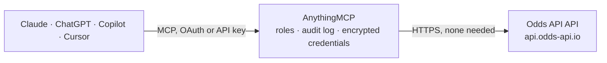

<!-- Generated by scripts/export-github-catalog.mjs in the anythingmcp-website repository. Do not edit by hand. -->

# Odds API MCP connector

Live and pre-match sports betting odds (football, basketball, tennis, baseball, American football, ice hockey, MMA, boxing and more) from dozens of bookmakers via odds-api.io. The AnythingMCP connector gives Claude, ChatGPT, Microsoft Copilot, Cursor and Gemini 5 MCP tools for Odds API, all read-only.

**Category:** [Sports](../sports.md) · **Tools:** 5 · **Setup guide:** [anythingmcp.com](https://anythingmcp.com/guides/odds-api-to-mcp) · [Deutsch](https://anythingmcp.com/de/guides/odds-api-to-mcp) · [Italiano](https://anythingmcp.com/it/guides/odds-api-to-mcp) · [Español](https://anythingmcp.com/es/guides/odds-api-to-mcp) · [日本語](https://anythingmcp.com/ja/guides/odds-api-to-mcp) · [Русский](https://anythingmcp.com/ru/guides/odds-api-to-mcp) · [中文](https://anythingmcp.com/zh/guides/odds-api-to-mcp)

## Start without code

No installation and no terminal: AnythingMCP Cloud runs the Odds API connector for you, operated by helpcode.ai in Frankfurt, Germany.

1. **Click the button above** and create an account or sign in. The Odds API connector opens, ready to install.
2. **Nothing to enter:** this connector needs no credentials. Every click is in the [step-by-step guide](https://anythingmcp.com/guides/odds-api-to-mcp).
3. **Click Install.** AnythingMCP shows the address of your MCP server.
4. **Add that address to your assistant:** [Claude](https://anythingmcp.com/guides/connect-odds-api-to-claude) · [ChatGPT](https://anythingmcp.com/guides/connect-odds-api-to-chatgpt) · [Microsoft Copilot](https://anythingmcp.com/guides/connect-odds-api-to-copilot) · [Cursor](https://anythingmcp.com/guides/connect-odds-api-to-cursor) · [Gemini CLI](https://anythingmcp.com/guides/connect-odds-api-to-gemini) · [Meta Muse](https://anythingmcp.com/guides/connect-odds-api-to-muse).
5. **Ask your first question**, for example: *Give me the eventId for Manchester United vs Arsenal in the England Premier League on 2026-08-15*

Prefer help with the setup? [Talk to us](https://anythingmcp.com/contact).

## How it works

- **The AI client** speaks MCP (Streamable HTTP) to AnythingMCP and only sees tool names, descriptions and results. It never gets the Odds API credentials.
- **AnythingMCP** checks the client's role, builds the call from the tool definition, adds the credentials (none needed), calls Odds API, logs the call and returns the result.
- **Odds API** sees an ordinary API client with the rights of the account the credentials belong to.

## Tools

| Tool | What it does | Access |
|---|---|---|
| [`odds_list_sports`](#odds_list_sports) | List the sports supported by odds-api.io. | read |
| [`odds_list_bookmakers`](#odds_list_bookmakers) | List the bookmakers known to odds-api.io. | read |
| [`odds_list_leagues`](#odds_list_leagues) | List the leagues/competitions available for a sport. | read |
| [`odds_list_events`](#odds_list_events) | List events (matches/fixtures) for a sport, optionally filtered by league. | read |
| [`odds_get_event_odds`](#odds_get_event_odds) | Get betting odds for a single event from one or more bookmakers. | read |

## Tool reference

Every parameter as the AI client sees it in `tools/list`. Source: [`packages/backend/src/adapters/intl/odds-api.json`](../../../packages/backend/src/adapters/intl/odds-api.json).

### `odds_list_sports`

List the sports supported by odds-api.io. Returns each sport's display `name` and `slug`. Use the slug for odds_list_leagues / odds_list_events (e.g. `football`, `basketball`, `tennis`, `baseball`, `american-football`, `ice-hockey`, `mixed-martial-arts`, `boxing`). There is no `soccer_world_cup` slug — use `football` plus a league slug.

**Access:** read · **Call:** `GET /sports`

No parameters.

### `odds_list_bookmakers`

List the bookmakers known to odds-api.io. Returns each bookmaker's `name` and whether it is `active`. The exact `name` value (e.g. `Bet365`, `1xbet`) is what you pass in the `bookmakers` parameter of odds_get_event_odds. Free plans only allow a limited number of selected bookmakers.

**Access:** read · **Call:** `GET /bookmakers`

No parameters.

### `odds_list_leagues`

List the leagues/competitions available for a sport. Returns each league's `name`, `slug` and `eventsCount`. Use the `slug` to narrow odds_list_events.

**Access:** read · **Call:** `GET /leagues`

| Parameter | Type | Required | Description |
|---|---|---|---|
| `sport` | string | yes | Sport slug from odds_list_sports, e.g. `football`. |

### `odds_list_events`

List events (matches/fixtures) for a sport, optionally filtered by league. Each event has a numeric `id` (the `eventId` for odds_get_event_odds), `home`/`away` team names, `date` (ISO-8601 UTC), `league` and `status` (`notstarted` / `inprogress` / `settled`).

**Access:** read · **Call:** `GET /events`

| Parameter | Type | Required | Description |
|---|---|---|---|
| `sport` | string | yes | Sport slug from odds_list_sports, e.g. `football`. |
| `league` | string | no | Optional league slug from odds_list_leagues to narrow the list. |

### `odds_get_event_odds`

Get betting odds for a single event from one or more bookmakers. BOTH `eventId` and `bookmakers` are required — get `eventId` from odds_list_events and valid bookmaker names from odds_list_bookmakers (the literal `all` is rejected, and your plan caps how many you may select). Returns the event plus a `bookmakers` map of odds by market.

**Access:** read · **Call:** `GET /odds`

| Parameter | Type | Required | Description |
|---|---|---|---|
| `eventId` | string | yes | Numeric event id from odds_list_events. Required. |
| `bookmakers` | string | yes | Comma-separated bookmaker names from odds_list_bookmakers, e.g. `Bet365` or `Bet365,Betano PE`. Required. Do NOT pass `all`. |
| `markets` | string | no | Optional comma-separated markets to return, e.g. `h2h` (match winner), `totals`, `spreads`. Omit to return all available markets. |

## Run it yourself

AnythingMCP is open source (AGPL-3.0). [Run it with Docker](../../../README.md#run-it-yourself), open **Connectors → Store**, pick **Odds API** and enter `ODDS_API_KEY`, then add your MCP server URL to the AI client.

[← Sports connectors](../sports.md) · [All categories](../README.md)
