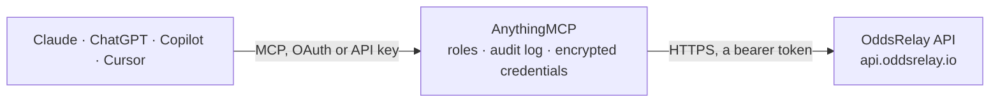

<!-- Generated by scripts/export-github-catalog.mjs in the anythingmcp-website repository. Do not edit by hand. -->

# OddsRelay MCP connector

Pre-match odds from UK and Irish bookmakers with exchange lay prices. The AnythingMCP connector gives Claude, ChatGPT, Microsoft Copilot, Cursor and Gemini 9 MCP tools for OddsRelay: 7 read and 2 can change data.

**Category:** [Sports](../sports.md) · **Tools:** 9 · **Setup guide:** [anythingmcp.com](https://anythingmcp.com/guides/oddsrelay-to-mcp) · [Deutsch](https://anythingmcp.com/de/guides/oddsrelay-to-mcp) · [Italiano](https://anythingmcp.com/it/guides/oddsrelay-to-mcp) · [Español](https://anythingmcp.com/es/guides/oddsrelay-to-mcp) · [日本語](https://anythingmcp.com/ja/guides/oddsrelay-to-mcp) · [Русский](https://anythingmcp.com/ru/guides/oddsrelay-to-mcp) · [中文](https://anythingmcp.com/zh/guides/oddsrelay-to-mcp)

## Start without code

No installation and no terminal: AnythingMCP Cloud runs the OddsRelay connector for you, operated by helpcode.ai in Frankfurt, Germany.

1. **Click the button above** and create an account or sign in. The OddsRelay connector opens, ready to install.
2. **Paste the API key or token from your OddsRelay account.** Every click is in the [step-by-step guide](https://anythingmcp.com/guides/oddsrelay-to-mcp).
3. **Click Install.** AnythingMCP shows the address of your MCP server.
4. **Add that address to your assistant:** [Claude](https://anythingmcp.com/guides/connect-oddsrelay-to-claude) · [ChatGPT](https://anythingmcp.com/guides/connect-oddsrelay-to-chatgpt) · [Microsoft Copilot](https://anythingmcp.com/guides/connect-oddsrelay-to-copilot) · [Cursor](https://anythingmcp.com/guides/connect-oddsrelay-to-cursor) · [Gemini CLI](https://anythingmcp.com/guides/connect-oddsrelay-to-gemini) · [Meta Muse](https://anythingmcp.com/guides/connect-oddsrelay-to-muse).
5. **Ask your first question**, for example: *Which bookmakers and exchanges have prices on soccer boards covering 2026-11-05T00:00:00Z to 2026-11-06T00:00:00Z?*

Prefer help with the setup? [Talk to us](https://anythingmcp.com/contact).

## How it works

- **The AI client** speaks MCP (Streamable HTTP) to AnythingMCP and only sees tool names, descriptions and results. It never gets the OddsRelay credentials.
- **AnythingMCP** checks the client's role, builds the call from the tool definition, adds the credentials (a bearer token), calls OddsRelay, logs the call and returns the result.
- **OddsRelay** sees an ordinary API client with the rights of the account the credentials belong to.

## Tools

| Tool | What it does | Access |
|---|---|---|
| [`oddsrelay_list_sports`](#oddsrelay_list_sports) | Lists the competition keys for the sport argument of the board and event tools. | read |
| [`oddsrelay_list_events`](#oddsrelay_list_events) | Lists the events of one sport with their event ids, teams and start times, for oddsrelay_get_event_odds. | read |
| [`oddsrelay_list_bookmakers`](#oddsrelay_list_bookmakers) | Lists the bookmaker and exchange keys (such as william_hill or betfair_exchange) that the board tools take. | read |
| [`oddsrelay_get_coverage`](#oddsrelay_get_coverage) | Shows, for each matched board the key can read, which bookmakers and exchanges have prices now and for which sports. | read |
| [`oddsrelay_quote_board`](#oddsrelay_quote_board) | Returns what a matched board request would cost in tokens, and the tokens remaining, without reading the board. | read |
| [`oddsrelay_get_board`](#oddsrelay_get_board) | Reads one matched board: bookmaker back prices beside exchange lay prices, for one sport at the bookmakers you name. | write |
| [`oddsrelay_quote_event_odds`](#oddsrelay_quote_event_odds) | Returns what one event's odds would cost in tokens, and the tokens remaining, without reading them. | read |
| [`oddsrelay_get_event_odds`](#oddsrelay_get_event_odds) | Reads one event's prices at every bookmaker and exchange carrying it, market by market. | write |
| [`oddsrelay_get_usage`](#oddsrelay_get_usage) | Shows the key's token balance and when it resets, and which boards the key can read. | read |

## Tool reference

Every parameter as the AI client sees it in `tools/list`. Source: [`packages/backend/src/adapters/gb/oddsrelay.json`](../../../packages/backend/src/adapters/gb/oddsrelay.json).

### `oddsrelay_list_sports`

Lists the competition keys for the sport argument of the board and event tools. Each starts with its sport (such as soccer), which alone covers all of that sport's competitions. Costs no tokens. Paged: pass meta.next_cursor back as cursor until it is null.

**Access:** read · **Call:** `GET /v2/sports`

| Parameter | Type | Required | Description |
|---|---|---|---|
| `cursor` | string | no | meta.next_cursor from the previous page. Leave out for the first page. |

### `oddsrelay_list_events`

Lists the events of one sport with their event ids, teams and start times, for oddsrelay_get_event_odds. Costs no tokens. Paged: pass meta.next_cursor back as cursor until it is null.

**Access:** read · **Call:** `GET /v2/events`

| Parameter | Type | Required | Description |
|---|---|---|---|
| `sport` | string | yes | One competition key from oddsrelay_list_sports, or a sport such as tennis for all of its competitions. |
| `commenceTimeFrom` | string | no | Only events starting at or after this time, ISO 8601 in UTC. |
| `commenceTimeTo` | string | no | Only events starting at or before this time, ISO 8601 in UTC. |
| `cursor` | string | no | meta.next_cursor from the previous page, with the same other arguments. |

### `oddsrelay_list_bookmakers`

Lists the bookmaker and exchange keys (such as william_hill or betfair_exchange) that the board tools take. Costs no tokens.

**Access:** read · **Call:** `GET /v2/bookmakers`

No parameters.

### `oddsrelay_get_coverage`

Shows, for each matched board the key can read, which bookmakers and exchanges have prices now and for which sports. Costs no tokens.

**Access:** read · **Call:** `GET /v2/coverage`

No parameters.

### `oddsrelay_quote_board`

Returns what a matched board request would cost in tokens, and the tokens remaining, without reading the board. Costs no tokens. Call it with exactly the arguments you will pass to oddsrelay_get_board, and confirm the cost with the user first.

**Access:** read · **Call:** `GET /v2/odds/{type}`

| Parameter | Type | Required | Description |
|---|---|---|---|
| `type` | `standard` \| `2up` \| `dutching` \| `each-way` \| `extra-place` \| `bog` | yes | Which matched board. oddsrelay_get_coverage lists the bookmakers and sports on each. |
| `sport` | string | yes | One competition key from oddsrelay_list_sports, or a sport such as soccer for all of its competitions. A competition key spends fewer tokens than a whole sport. |
| `bookmakers` | string | yes | Bookmaker keys from oddsrelay_list_bookmakers, comma-separated, such as ladbrokes,william_hill. At most five keys; fewer keys spend fewer tokens. |
| `exchanges` | string | no | Optional exchange keys, comma-separated, such as betfair_exchange. Left out, every exchange on the board. |
| `markets` | string | no | Optional market keys for this board, comma-separated, such as h2h. Left out, every market on the board. An unknown key is refused with the valid keys listed. |
| `commenceTimeFrom` | string | no | Optional: only events starting at or after this time, ISO 8601 in UTC. |
| `commenceTimeTo` | string | no | Optional: only events starting at or before this time, ISO 8601 in UTC. |

### `oddsrelay_get_board`

Reads one matched board: bookmaker back prices beside exchange lay prices, for one sport at the bookmakers you name. Spends tokens, and this connector has no cap: run oddsrelay_quote_board with the same arguments first and confirm the cost with the user.

**Access:** write · **Call:** `GET /v2/odds/{type}`

| Parameter | Type | Required | Description |
|---|---|---|---|
| `type` | `standard` \| `2up` \| `dutching` \| `each-way` \| `extra-place` \| `bog` | yes | Which matched board. oddsrelay_get_coverage lists the bookmakers and sports on each. |
| `sport` | string | yes | One competition key from oddsrelay_list_sports, or a sport such as soccer for all of its competitions. A competition key spends fewer tokens than a whole sport. |
| `bookmakers` | string | yes | Bookmaker keys from oddsrelay_list_bookmakers, comma-separated, such as ladbrokes,william_hill. At most five keys; fewer keys spend fewer tokens. |
| `exchanges` | string | no | Optional exchange keys, comma-separated, such as betfair_exchange. Left out, every exchange on the board. |
| `markets` | string | no | Optional market keys for this board, comma-separated, such as h2h. Left out, every market on the board. An unknown key is refused with the valid keys listed. |
| `commenceTimeFrom` | string | no | Optional: only events starting at or after this time, ISO 8601 in UTC. |
| `commenceTimeTo` | string | no | Optional: only events starting at or before this time, ISO 8601 in UTC. |

### `oddsrelay_quote_event_odds`

Returns what one event's odds would cost in tokens, and the tokens remaining, without reading them. Costs no tokens. Call it with the event_id you will pass to oddsrelay_get_event_odds, and confirm the cost with the user first.

**Access:** read · **Call:** `GET /v2/odds/event/{event_id}`

| Parameter | Type | Required | Description |
|---|---|---|---|
| `event_id` | string | yes | An event id such as or_evt_917dd44bce05, from a board or oddsrelay_list_events. |

### `oddsrelay_get_event_odds`

Reads one event's prices at every bookmaker and exchange carrying it, market by market. Needs a key that can read raw odds. Spends tokens, and this connector has no cap: run oddsrelay_quote_event_odds first and confirm the cost with the user.

**Access:** write · **Call:** `GET /v2/odds/event/{event_id}`

| Parameter | Type | Required | Description |
|---|---|---|---|
| `event_id` | string | yes | An event id such as or_evt_917dd44bce05, from a board or oddsrelay_list_events. |

### `oddsrelay_get_usage`

Shows the key's token balance and when it resets, and which boards the key can read. Costs no tokens, and is the connection check.

**Access:** read · **Call:** `GET /v2/usage`

No parameters.

## Run it yourself

AnythingMCP is open source (AGPL-3.0). [Run it with Docker](../../../README.md#run-it-yourself), open **Connectors → Store**, pick **OddsRelay** and enter `ODDSRELAY_KEY`, then add your MCP server URL to the AI client.

[← Sports connectors](../sports.md) · [All categories](../README.md)
