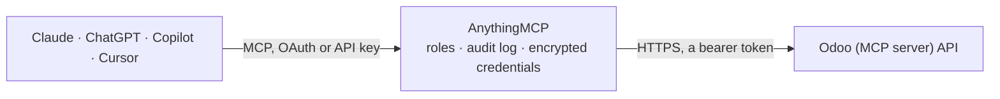

<!-- Generated by scripts/export-github-catalog.mjs in the anythingmcp-website repository. Do not edit by hand. -->

# Odoo (MCP server) MCP connector

Connect Claude, ChatGPT or Copilot to Odoo through Odoo's own MCP server (Odoo AI, Odoo Online saas-19.4 and Odoo 20): search any model, group and total records, list models and fields, and, when … The AnythingMCP connector gives Claude, ChatGPT, Microsoft Copilot, Cursor and Gemini 7 MCP tools for Odoo (MCP server): 5 read and 2 can change data.

**Category:** [ERP](../erp.md) · **Tools:** 7 · **Setup guide:** [anythingmcp.com](https://anythingmcp.com/guides/odoo-mcp-to-mcp) · [Deutsch](https://anythingmcp.com/de/guides/odoo-mcp-to-mcp) · [Italiano](https://anythingmcp.com/it/guides/odoo-mcp-to-mcp) · [Español](https://anythingmcp.com/es/guides/odoo-mcp-to-mcp) · [日本語](https://anythingmcp.com/ja/guides/odoo-mcp-to-mcp) · [Русский](https://anythingmcp.com/ru/guides/odoo-mcp-to-mcp) · [中文](https://anythingmcp.com/zh/guides/odoo-mcp-to-mcp)

## Start without code

No installation and no terminal: AnythingMCP Cloud runs the Odoo (MCP server) connector for you, operated by helpcode.ai in Frankfurt, Germany.

1. **Click the button above** and create an account or sign in. The Odoo (MCP server) connector opens, ready to install.
2. **Paste the API key or token from your Odoo (MCP server) account.** Every click is in the [step-by-step guide](https://anythingmcp.com/guides/odoo-mcp-to-mcp).
3. **Click Install.** AnythingMCP shows the address of your MCP server.
4. **Add that address to your assistant:** [Claude](https://anythingmcp.com/guides/connect-odoo-mcp-to-claude) · [ChatGPT](https://anythingmcp.com/guides/connect-odoo-mcp-to-chatgpt) · [Microsoft Copilot](https://anythingmcp.com/guides/connect-odoo-mcp-to-copilot) · [Cursor](https://anythingmcp.com/guides/connect-odoo-mcp-to-cursor) · [Gemini CLI](https://anythingmcp.com/guides/connect-odoo-mcp-to-gemini) · [Meta Muse](https://anythingmcp.com/guides/connect-odoo-mcp-to-muse).
5. **Ask your first question**, for example: *Find invoice INV-2026-0412 for customer Marinex GmbH and show status, date and residual.*

Prefer help with the setup? [Talk to us](https://anythingmcp.com/contact).

## How it works

- **The AI client** speaks MCP (Streamable HTTP) to AnythingMCP and only sees tool names, descriptions and results. It never gets the Odoo (MCP server) credentials.
- **AnythingMCP** checks the client's role, builds the call from the tool definition, adds the credentials (a bearer token), calls Odoo (MCP server), logs the call and returns the result.
- **Odoo (MCP server)** sees an ordinary API client with the rights of the account the credentials belong to.

## Tools

| Tool | What it does | Access |
|---|---|---|
| [`odoo_mcp_ai_tool_mcp_retrieve_initial_context`](#odoo_mcp_ai_tool_mcp_retrieve_initial_context) | Odoo's AI Tool: MCP Retrieve initial context. | read |
| [`odoo_mcp_ai_tool_get_models`](#odoo_mcp_ai_tool_get_models) | Odoo's AI Tool: Get Models. | read |
| [`odoo_mcp_ai_tool_get_fields`](#odoo_mcp_ai_tool_get_fields) | Odoo's AI Tool: Get Fields. | read |
| [`odoo_mcp_ai_tool_search`](#odoo_mcp_ai_tool_search) | Odoo's AI Tool: Search. | read |
| [`odoo_mcp_ai_tool_read_group`](#odoo_mcp_ai_tool_read_group) | Odoo's AI Tool: Read group. | read |
| [`odoo_mcp_ai_tool_create_records`](#odoo_mcp_ai_tool_create_records) | Odoo's AI Tool: Create Records. | write |
| [`odoo_mcp_ai_tool_update_records`](#odoo_mcp_ai_tool_update_records) | Odoo's AI Tool: Update Records. | write |

## Tool reference

Every parameter as the AI client sees it in `tools/list`. Source: [`packages/backend/src/adapters/intl/odoo-mcp.json`](../../../packages/backend/src/adapters/intl/odoo-mcp.json).

### `odoo_mcp_ai_tool_mcp_retrieve_initial_context`

Odoo's AI Tool: MCP Retrieve initial context. Returns the signed-in user, their time zone, the active company and every company they can switch to, plus Odoo's general instructions. Call it once at the start of a conversation, before other Odoo tools.

**Access:** read · **Call:** `ai_tool_mcp_retrieve_initial_context /mcp`

No parameters.

### `odoo_mcp_ai_tool_get_models`

Odoo's AI Tool: Get Models. Lists every Odoo model the user may access (no transient or abstract ones) with its technical name and description, e.g. res.partner, sale.order, account.move. Use it to find the right model before searching.

**Access:** read · **Call:** `ai_tool_get_models /mcp`

No parameters.

### `odoo_mcp_ai_tool_get_fields`

Odoo's AI Tool: Get Fields. Lists the searchable fields of one model with their type and relations. Only fields it returns may be used in domains, group-bys and updates, so call it before building a domain on an unfamiliar model.

**Access:** read · **Call:** `ai_tool_get_fields /mcp`

| Parameter | Type | Required | Description |
|---|---|---|---|
| `model_name` | string | yes | Technical model name, e.g. res.partner or account.move. |
| `include_description` | boolean | yes | true to include each field's help text (longer answer), false for names and types only. Odoo needs it on every call. |

### `odoo_mcp_ai_tool_search`

Odoo's AI Tool: Search. Finds records of a model with an Odoo domain and returns {records, total_count} plus a hint when more rows remain. Only display_name comes back unless you list fields; at most 50 rows by default, 200 per call, page with offset.

**Access:** read · **Call:** `ai_tool_search /mcp`

| Parameter | Type | Required | Description |
|---|---|---|---|
| `model_name` | string | yes | Technical model name (e.g., 'sale.order', 'product.product', 'res.partner') |
| `domain` | string | yes | Search domain. Use an empty list to match all records |
| `fields` | string[] | no | list of fields to fetch. DEFAULT: display_name only: pass explicit field names to retrieve more (do NOT omit to get all fields). |
| `offset` | number | no | number of results to skip (default 0). Use with `limit` to paginate. |
| `limit` | number | no | max rows to return (default 50, max 200). Use `offset` to paginate. |
| `order` | string | no | Optional 'order by' specification. This field should have the form `field_name DESC` (or ASC for ascending order) |

### `odoo_mcp_ai_tool_read_group`

Odoo's AI Tool: Read group. Groups the records matching a domain by one or more fields (dates by day, week, month, quarter or year) and computes aggregates such as amount_total:sum or id:count. The tool for totals, statistics and breakdowns.

**Access:** read · **Call:** `ai_tool_read_group /mcp`

| Parameter | Type | Required | Description |
|---|---|---|---|
| `model_name` | string | yes | Technical model name (e.g., 'sale.order', 'product.product', 'res.partner') |
| `domain` | string | yes | Search domain. Use an empty list to match all records |
| `groupby` | string[] | no | list of groupby descriptions by which the records will be grouped. A groupby description is either a field (then it will be grouped by that field) or a string `'field:granularity'`. Right now, the only supported granularities are `'day'`, `'week'`, `'month'`, `'quarter'` or `'year'`, and they only make sense for date/datetime fields. Additionally integer date parts are also supported: `'year_number'`, `'quarter_number'`, `'month_number'`, `'iso_week_number'`, `'day_of_year'`, `'day_of_month'`, 'day_of_week', 'hour_number', 'minute_number' and 'second_number'. |
| `aggregates` | string[] | no | list of aggregates specification. Each element is `'field:agg'` (aggregate field with aggregation function `'agg'`). The possible aggregation functions are the ones provided by `PostgreSQL`, `'count_distinct'` with the expected meaning and `'recordset'` to act like `'array_agg'` converted into a recordset. Only stored fields can be used for aggregation. |
| `having` | string | no | A domain where the valid 'fields' are the aggregates. The provided field names must exist in the aggregate elements. Example `[('amount_total:sum', '>', 1000)]` |
| `offset` | number | no | optional number of groups to skip. Use with `limit` to paginate. |
| `limit` | number | no | max groups to return (default 100, max 500). Use `offset` to paginate. |
| `order` | string | no | optional 'order by' specification, for overriding the natural sort ordering of the groups. The order must be a valid PostgreSQL group by, it must use a valid `aggregate` or `groupby element. The provided fields must exist in the group by or aggregate elements. DO NOT make up any field name. i.e. For an aggregate `amount_total:sum`, the valid order is `amount_total:sum`. |

### `odoo_mcp_ai_tool_create_records`

Odoo's AI Tool: Create Records. Creates one or more records of a model with the given field values, optionally with a preview link. Hidden in Odoo until an admin exposes it to MCP, and installed switched off here: confirm every record with the user first.

**Access:** write · **Call:** `ai_tool_create_records /mcp`

| Parameter | Type | Required | Description |
|---|---|---|---|
| `explanation` | string | yes | An explanation of the tool call. It MUST end with a question asking for user's CONFIRMATION. |
| `model_name` | string | yes | technical name of the model (i.e. 'mail.message') |
| `preview_menu_id` | integer | no | The id of a menu linked to the model specified in `model_name`, used to generate the preview link for created records. It must be a valid menu for that model, preferably its default view menu. This field should almost always be filled: only leave it empty if the model has absolutely no associated menu. |
| `values` | object[] | yes | list of records to create along with their fields |

### `odoo_mcp_ai_tool_update_records`

Odoo's AI Tool: Update Records. Changes field values on existing records that match a domain. Hidden in Odoo until an admin exposes it to MCP, and installed switched off here: confirm the records and values with the user first.

**Access:** write · **Call:** `ai_tool_update_records /mcp`

| Parameter | Type | Required | Description |
|---|---|---|---|
| `explanation` | string | yes | What will change and why, ending with a question asking the user to confirm. |
| `updates` | object[] | yes | The updates: per model a domain or ids and the field values to set, as the tool's schema on your server describes. |
| `preview_menus` | object[] | no | Menus to open to preview the changed records, per model. |

## Run it yourself

AnythingMCP is open source (AGPL-3.0). [Run it with Docker](../../../README.md#run-it-yourself), open **Connectors → Store**, pick **Odoo (MCP server)** and enter `ODOO_URL`, `ODOO_MCP_API_KEY`, then add your MCP server URL to the AI client.

[← ERP connectors](../erp.md) · [All categories](../README.md)
