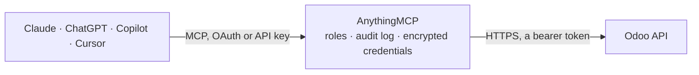

<!-- Generated by scripts/export-github-catalog.mjs in the anythingmcp-website repository. Do not edit by hand. -->

# Odoo MCP connector

Odoo ERP 19 and newer over the JSON-2 API: search, read, create and update any model, plus purpose-built tools for partners, sales orders, invoices and products. The AnythingMCP connector gives Claude, ChatGPT, Microsoft Copilot, Cursor and Gemini 11 MCP tools for Odoo: 8 read and 3 can change data.

**Category:** [ERP](../erp.md) · **Tools:** 11 · **Setup guide:** [anythingmcp.com](https://anythingmcp.com/guides/odoo-to-mcp) · [Deutsch](https://anythingmcp.com/de/guides/odoo-to-mcp) · [Italiano](https://anythingmcp.com/it/guides/odoo-to-mcp) · [Español](https://anythingmcp.com/es/guides/odoo-to-mcp) · [日本語](https://anythingmcp.com/ja/guides/odoo-to-mcp) · [Русский](https://anythingmcp.com/ru/guides/odoo-to-mcp) · [中文](https://anythingmcp.com/zh/guides/odoo-to-mcp)

## Start without code

No installation and no terminal: AnythingMCP Cloud runs the Odoo connector for you, operated by helpcode.ai in Frankfurt, Germany.

1. **Click the button above** and create an account or sign in. The Odoo connector opens, ready to install.
2. **Paste the API key or token from your Odoo account.** Every click is in the [step-by-step guide](https://anythingmcp.com/guides/odoo-to-mcp).
3. **Click Install.** AnythingMCP shows the address of your MCP server.
4. **Add that address to your assistant:** [Claude](https://anythingmcp.com/guides/connect-odoo-to-claude) · [ChatGPT](https://anythingmcp.com/guides/connect-odoo-to-chatgpt) · [Microsoft Copilot](https://anythingmcp.com/guides/connect-odoo-to-copilot) · [Cursor](https://anythingmcp.com/guides/connect-odoo-to-cursor) · [Gemini CLI](https://anythingmcp.com/guides/connect-odoo-to-gemini) · [Meta Muse](https://anythingmcp.com/guides/connect-odoo-to-muse).
5. **Ask your first question**, for example: *What is the status and unpaid amount for invoice INV/2026/045 for Atelier Lumière SARL?*

Prefer help with the setup? [Talk to us](https://anythingmcp.com/contact).

## How it works

- **The AI client** speaks MCP (Streamable HTTP) to AnythingMCP and only sees tool names, descriptions and results. It never gets the Odoo credentials.
- **AnythingMCP** checks the client's role, builds the call from the tool definition, adds the credentials (a bearer token), calls Odoo, logs the call and returns the result.
- **Odoo** sees an ordinary API client with the rights of the account the credentials belong to.

## Tools

| Tool | What it does | Access |
|---|---|---|
| [`odoo_search_read`](#odoo_search_read) | Search and read any Odoo model in one call. | read |
| [`odoo_read`](#odoo_read) | Read specific records of a model by their ids — the follow-up call when a search has returned ids and you now want the detail of a few of them. | read |
| [`odoo_search_count`](#odoo_search_count) | Count the records of a model matching a domain, without transferring them. | read |
| [`odoo_fields_get`](#odoo_fields_get) | Describe a model's fields: name, type, label, whether it is required or readonly, and the related model for relational fields. | read |
| [`odoo_list_partners`](#odoo_list_partners) | List partners — Odoo's customers, suppliers and contacts — with name, e-mail, phone, city and country. | read |
| [`odoo_list_sale_orders`](#odoo_list_sale_orders) | List sales orders with their customer, date, state and total. | read |
| [`odoo_list_invoices`](#odoo_list_invoices) | List customer invoices and vendor bills with their partner, date, due date, state and residual amount — the answer to 'what is still unpaid'. | read |
| [`odoo_list_products`](#odoo_list_products) | List products with their internal reference, sale price, cost, product type and unit of measure. | read |
| [`odoo_create`](#odoo_create) | Create a record in any Odoo model and return its id (as a one-element list). | write |
| [`odoo_write`](#odoo_write) | Update existing records in any Odoo model. | write |
| [`odoo_call_method`](#odoo_call_method) | Call an arbitrary public method on an Odoo model — the escape hatch for workflow actions such as action_confirm on a sale order or action_post on an invoice. | write |

## Tool reference

Every parameter as the AI client sees it in `tools/list`. Source: [`packages/backend/src/adapters/intl/odoo.json`](../../../packages/backend/src/adapters/intl/odoo.json).

### `odoo_search_read`

Search and read any Odoo model in one call. The general-purpose tool: pass a model, an Odoo domain and the fields you want. Always name the fields — Odoo models have hundreds of columns.

**Access:** read · **Call:** `POST /{model}/search_read`

| Parameter | Type | Required | Description |
|---|---|---|---|
| `model` | string | yes | Technical model name, e.g. res.partner, sale.order, account.move, product.product. |
| `domain` | any[][] | no | Odoo domain as a list of triples, e.g. [["state","=","sale"]]. Empty list matches everything. |
| `fields` | string[] | no | Field names to return. Omitting this returns every column. On res.partner ask for `phone`, not `mobile`: Odoo 19 removed `mobile`. |
| `limit` | number | no | Maximum rows to return (default 80). |
| `offset` | number | no | Rows to skip, for paging. |
| `order` | string | no | Sort expression, e.g. `date_order desc`. |

### `odoo_read`

Read specific records of a model by their ids — the follow-up call when a search has returned ids and you now want the detail of a few of them.

**Access:** read · **Call:** `POST /{model}/read`

| Parameter | Type | Required | Description |
|---|---|---|---|
| `model` | string | yes | Technical model name, e.g. sale.order. |
| `ids` | number[] | yes | Record ids to read. |
| `fields` | string[] | no | Field names to return. On res.partner ask for `phone`, not `mobile`: Odoo 19 removed `mobile`. |

### `odoo_search_count`

Count the records of a model matching a domain, without transferring them. Use this before a search_read to find out whether the answer is 12 rows or 120,000.

**Access:** read · **Call:** `POST /{model}/search_count`

| Parameter | Type | Required | Description |
|---|---|---|---|
| `model` | string | yes | Technical model name, e.g. account.move. |
| `domain` | any[][] | yes | Odoo domain as a list of triples. Required by Odoo; pass [] to count every record. |

### `odoo_fields_get`

Describe a model's fields: name, type, label, whether it is required or readonly, and the related model for relational fields. Read this before composing a domain against an unfamiliar model.

**Access:** read · **Call:** `POST /{model}/fields_get`

| Parameter | Type | Required | Description |
|---|---|---|---|
| `model` | string | yes | Technical model name, e.g. res.partner. |
| `attributes` | string[] | no | Field attributes to return, e.g. ["string","type","required","relation"]. |

### `odoo_list_partners`

List partners — Odoo's customers, suppliers and contacts — with name, e-mail, phone, city and country. Convenience wrapper over res.partner.

**Access:** read · **Call:** `POST /res.partner/search_read`

| Parameter | Type | Required | Description |
|---|---|---|---|
| `limit` | number | no | Maximum rows to return (default 50). |
| `offset` | number | no | Rows to skip, for paging. |
| `domain` | any[][] | no | Extra Odoo domain, e.g. [["customer_rank",">",0]] for customers only. |

### `odoo_list_sale_orders`

List sales orders with their customer, date, state and total. Convenience wrapper over sale.order; state `sale` means confirmed, `draft` a quotation.

**Access:** read · **Call:** `POST /sale.order/search_read`

| Parameter | Type | Required | Description |
|---|---|---|---|
| `limit` | number | no | Maximum rows to return (default 50). |
| `offset` | number | no | Rows to skip, for paging. |
| `domain` | any[][] | no | Extra Odoo domain, e.g. [["state","=","sale"]]. |

### `odoo_list_invoices`

List customer invoices and vendor bills with their partner, date, due date, state and residual amount — the answer to 'what is still unpaid'.

**Access:** read · **Call:** `POST /account.move/search_read`

| Parameter | Type | Required | Description |
|---|---|---|---|
| `limit` | number | no | Maximum rows to return (default 50). |
| `offset` | number | no | Rows to skip, for paging. |
| `domain` | any[][] | no | Extra Odoo domain, e.g. [["move_type","=","out_invoice"],["payment_state","!=","paid"]]. |

### `odoo_list_products`

List products with their internal reference, sale price, cost, product type and unit of measure. Convenience wrapper over product.product. Stock on hand (`qty_available`) only exists when the Inventory app is installed, so it is not requested here: ask for it with odoo_search_read on product.product when the database has Inventory.

**Access:** read · **Call:** `POST /product.product/search_read`

| Parameter | Type | Required | Description |
|---|---|---|---|
| `limit` | number | no | Maximum rows to return (default 50). |
| `offset` | number | no | Rows to skip, for paging. |
| `domain` | any[][] | no | Extra Odoo domain, e.g. [["sale_ok","=",true]]. |

### `odoo_create`

Create a record in any Odoo model and return its id (as a one-element list). Writes to the live database and fires Odoo's automations — mail, stock moves and accounting entries all behave as if a person had done it.

**Access:** write · **Call:** `POST /{model}/create`

| Parameter | Type | Required | Description |
|---|---|---|---|
| `model` | string | yes | Technical model name, e.g. res.partner. |
| `values` | object | yes | Field values for the new record, e.g. {"name": "Muster GmbH", "email": "info@muster.de"}. On res.partner put any phone number in `phone`: Odoo 19 has no `mobile`. |

### `odoo_write`

Update existing records in any Odoo model. Writes to the live database; a domain that matches more rows than you expected will update all of them.

**Access:** write · **Call:** `POST /{model}/write`

| Parameter | Type | Required | Description |
|---|---|---|---|
| `model` | string | yes | Technical model name, e.g. sale.order. |
| `ids` | number[] | yes | Ids of the records to update. |
| `values` | object | yes | Field values to set, e.g. {"note": "Called 2026-09-17"}. On res.partner put any phone number in `phone`: Odoo 19 has no `mobile`. |

### `odoo_call_method`

Call an arbitrary public method on an Odoo model — the escape hatch for workflow actions such as action_confirm on a sale order or action_post on an invoice. For totals per group use formatted_read_group (read_group does not exist on Odoo 19).

**Access:** write · **Call:** `POST /{model}/{method}`

| Parameter | Type | Required | Description |
|---|---|---|---|
| `model` | string | yes | Technical model name, e.g. sale.order. |
| `method` | string | yes | Public method name, e.g. action_confirm, action_post, button_cancel, formatted_read_group. |
| `ids` | number[] | yes | Record ids the method operates on. Use [] for model-level methods such as name_search or create. Many workflow actions handle one record at a time and fail with "Expected singleton" on several ids, message_post (a chatter message or note) among them: call those once per id. |
| `kwargs` | object | no | The method's keyword arguments, by name; they are sent as top-level keys of the request, which is how Odoo binds them. E.g. {"summary": "Call back", "date_deadline": "2026-10-16", "activity_type_id": 2} for activity_schedule on crm.lead. Omit for methods that take only the records, such as action_confirm. Required arguments go here under their Odoo parameter name too, not as loose fields: write needs {"vals": {...}}, create needs {"vals_list": [{...}]}, search needs {"domain": [...]}; Odoo answers "missing a required argument" otherwise. For plain create and write, odoo_create and odoo_write are simpler. |

## Run it yourself

AnythingMCP is open source (AGPL-3.0). [Run it with Docker](../../../README.md#run-it-yourself), open **Connectors → Store**, pick **Odoo** and enter `ODOO_URL`, `ODOO_DB`, `ODOO_API_KEY`, then add your MCP server URL to the AI client.

[← ERP connectors](../erp.md) · [All categories](../README.md)
