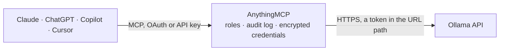

<!-- Generated by scripts/export-github-catalog.mjs in the anythingmcp-website repository. Do not edit by hand. -->

# Ollama MCP connector

Let your AI use open-weight models such as Gemma, Llama, Qwen, Mistral and DeepSeek running on your own Ollama server (or Ollama Cloud): list installed and loaded models, read a model's details and … The AnythingMCP connector gives Claude, ChatGPT, Microsoft Copilot, Cursor and Gemini 7 MCP tools for Ollama, all read-only.

**Category:** [Public Data](../data.md) · **Tools:** 7 · **Setup guide:** [anythingmcp.com](https://anythingmcp.com/guides/ollama-to-mcp) · [Deutsch](https://anythingmcp.com/de/guides/ollama-to-mcp) · [Italiano](https://anythingmcp.com/it/guides/ollama-to-mcp) · [Español](https://anythingmcp.com/es/guides/ollama-to-mcp) · [日本語](https://anythingmcp.com/ja/guides/ollama-to-mcp) · [Русский](https://anythingmcp.com/ru/guides/ollama-to-mcp) · [中文](https://anythingmcp.com/zh/guides/ollama-to-mcp)

## Start without code

No installation and no terminal: AnythingMCP Cloud runs the Ollama connector for you, operated by helpcode.ai in Frankfurt, Germany.

1. **Click the button above** and create an account or sign in. The Ollama connector opens, ready to install.
2. **Paste the API key or token from your Ollama account.** Every click is in the [step-by-step guide](https://anythingmcp.com/guides/ollama-to-mcp).
3. **Click Install.** AnythingMCP shows the address of your MCP server.
4. **Add that address to your assistant:** [Claude](https://anythingmcp.com/guides/connect-ollama-to-claude) · [ChatGPT](https://anythingmcp.com/guides/connect-ollama-to-chatgpt) · [Microsoft Copilot](https://anythingmcp.com/guides/connect-ollama-to-copilot) · [Cursor](https://anythingmcp.com/guides/connect-ollama-to-cursor) · [Gemini CLI](https://anythingmcp.com/guides/connect-ollama-to-gemini) · [Meta Muse](https://anythingmcp.com/guides/connect-ollama-to-muse).
5. **Ask your first question**, for example: *Which models are currently loaded on our Ollama server right now? I need names, context lengths and VRAM sizes.*

Prefer help with the setup? [Talk to us](https://anythingmcp.com/contact).

## How it works

- **The AI client** speaks MCP (Streamable HTTP) to AnythingMCP and only sees tool names, descriptions and results. It never gets the Ollama credentials.
- **AnythingMCP** checks the client's role, builds the call from the tool definition, adds the credentials (a token in the URL path), calls Ollama, logs the call and returns the result.
- **Ollama** sees an ordinary API client with the rights of the account the credentials belong to.

## Tools

| Tool | What it does | Access |
|---|---|---|
| [`ollama_get_version`](#ollama_get_version) | Show the Ollama server version. | read |
| [`ollama_list_models`](#ollama_list_models) | List the models installed on the Ollama server: name, size, last change, format, family, parameter size (e.g. 4.3B) and quantization (e.g. Q4_K_M). | read |
| [`ollama_list_running_models`](#ollama_list_running_models) | List the models currently loaded in memory on the Ollama server, with total size, how much is in GPU memory (size_vram), context length and when each will… | read |
| [`ollama_show_model`](#ollama_show_model) | Show one installed model's details: capabilities (completion, vision, tools, thinking, insert, embedding), family, parameter size, quantization,… | read |
| [`ollama_chat`](#ollama_chat) | Chat with a model on the Ollama server (no streaming). | read |
| [`ollama_generate`](#ollama_generate) | Generate a completion for one prompt on the Ollama server (no streaming), with an optional system prompt, images for vision models, structured JSON output… | read |
| [`ollama_embed`](#ollama_embed) | Create embedding vectors for one text or a list of texts with an embedding model on the Ollama server (e.g. embeddinggemma, nomic-embed-text,… | read |

## Tool reference

Every parameter as the AI client sees it in `tools/list`. Source: [`packages/backend/src/adapters/intl/ollama.json`](../../../packages/backend/src/adapters/intl/ollama.json).

### `ollama_get_version`

Show the Ollama server version. Use it to check that the server answers. Free. Read-only.

**Access:** read · **Call:** `GET /api/version`

No parameters.

### `ollama_list_models`

List the models installed on the Ollama server: name, size, last change, format, family, parameter size (e.g. 4.3B) and quantization (e.g. Q4_K_M). Sizes are in bytes. Free. Read-only.

**Access:** read · **Call:** `GET /api/tags`

No parameters.

### `ollama_list_running_models`

List the models currently loaded in memory on the Ollama server, with total size, how much is in GPU memory (size_vram), context length and when each will be unloaded (expires_at). Sizes are in bytes. Free. Read-only.

**Access:** read · **Call:** `GET /api/ps`

No parameters.

### `ollama_show_model`

Show one installed model's details: capabilities (completion, vision, tools, thinking, insert, embedding), family, parameter size, quantization, architecture and context length (model_info), default parameters, prompt template and license. Check capabilities before sending images, tools or thinking requests. Free. Read-only.

**Access:** read · **Call:** `POST /api/show`

| Parameter | Type | Required | Description |
|---|---|---|---|
| `model` | string | yes | Model name as Ollama lists it, e.g. 'gemma3', 'gemma3:4b', 'llama3.2' or 'qwen3:8b'. Use ollama_list_models to see what is installed. |

### `ollama_chat`

Chat with a model on the Ollama server (no streaming). Supports a system prompt and conversation history, images for vision models, tool calling, structured JSON output and thinking. Returns the answer, any thinking and tool_calls, done_reason (length means it was cut: raise num_predict in options) and token counts. Runs on the user's own server; read-only.

**Access:** read · **Call:** `POST /api/chat`

| Parameter | Type | Required | Description |
|---|---|---|---|
| `model` | string | yes | Model name as Ollama lists it, e.g. 'gemma3', 'gemma3:4b', 'llama3.2' or 'qwen3:8b'. Use ollama_list_models to see what is installed. |
| `messages` | object[] | yes | The conversation, e.g. [{"role": "system", "content": "Answer briefly."}, {"role": "user", "content": "Why is the sky blue?"}]. Roles: system, user, assistant, tool. For vision models a user message can carry "images": ["<base64>"]; a tool result is {"role": "tool", "tool_name": "get_weather", "content": "..."}. |
| `tools` | object[] | no | Functions the model may call, in OpenAI format: [{"type": "function", "function": {"name": "get_weather", "description": "...", "parameters": {JSON schema}}}]. Only for models with the tools capability. |
| `format` | string,object | no | Structured output: 'json' for any JSON object, or a JSON schema object the answer must match, e.g. {"type": "object", "properties": {"city": {"type": "string"}}, "required": ["city"]}. |
| `options` | object | no | Model options, e.g. {"temperature": 0.2, "num_ctx": 8192, "num_predict": 512, "seed": 42, "stop": ["\n\n"]}. Model defaults when left out. |
| `think` | boolean,string | no | Thinking models only (qwen3, deepseek-r1, gpt-oss): true or false, or 'low', 'medium', 'high' for gpt-oss. The reasoning is returned separately as 'thinking'. Leave out for the model default. |
| `keep_alive` | string,number | no | How long the model stays loaded in memory after this request, e.g. '5m' (Ollama default), '1h', 0 to unload right away. |

### `ollama_generate`

Generate a completion for one prompt on the Ollama server (no streaming), with an optional system prompt, images for vision models, structured JSON output and thinking. With suffix, code models that support insert fill in the middle between prompt and suffix. Returns the response, any thinking, done_reason and token counts. Runs on the user's own server; read-only.

**Access:** read · **Call:** `POST /api/generate`

| Parameter | Type | Required | Description |
|---|---|---|---|
| `model` | string | yes | Model name as Ollama lists it, e.g. 'gemma3', 'gemma3:4b', 'llama3.2' or 'qwen3:8b'. Use ollama_list_models to see what is installed. |
| `prompt` | string | yes | The prompt text. |
| `system` | string | no | System prompt that replaces the model's default one. |
| `suffix` | string | no | Text after the gap, for fill-in-the-middle on models with the insert capability (e.g. qwen2.5-coder, codellama:code). |
| `images` | string[] | no | Base64-encoded images for vision models such as gemma3 or llava. |
| `format` | string,object | no | Structured output: 'json' for any JSON object, or a JSON schema object the answer must match, e.g. {"type": "object", "properties": {"city": {"type": "string"}}, "required": ["city"]}. |
| `options` | object | no | Model options, e.g. {"temperature": 0.2, "num_ctx": 8192, "num_predict": 512, "seed": 42, "stop": ["\n\n"]}. Model defaults when left out. |
| `think` | boolean,string | no | Thinking models only (qwen3, deepseek-r1, gpt-oss): true or false, or 'low', 'medium', 'high' for gpt-oss. The reasoning is returned separately as 'thinking'. Leave out for the model default. |
| `keep_alive` | string,number | no | How long the model stays loaded in memory after this request, e.g. '5m' (Ollama default), '1h', 0 to unload right away. |

### `ollama_embed`

Create embedding vectors for one text or a list of texts with an embedding model on the Ollama server (e.g. embeddinggemma, nomic-embed-text, mxbai-embed-large, qwen3-embedding). Returns one vector per input, in input order. Runs on the user's own server; read-only.

**Access:** read · **Call:** `POST /api/embed`

| Parameter | Type | Required | Description |
|---|---|---|---|
| `model` | string | yes | An installed embedding model, e.g. 'embeddinggemma' or 'nomic-embed-text'. |
| `input` | string,array | yes | A text, or a list of texts to embed in one call. |
| `truncate` | boolean | no | Cut inputs that are longer than the model's context instead of failing. Ollama default true. |
| `dimensions` | integer | no | Shorter vectors, for models that support it (e.g. embeddinggemma, qwen3-embedding). |
| `keep_alive` | string,number | no | How long the model stays loaded in memory after this request, e.g. '5m' (Ollama default), '1h', 0 to unload right away. |

## Run it yourself

AnythingMCP is open source (AGPL-3.0). [Run it with Docker](../../../README.md#run-it-yourself), open **Connectors → Store**, pick **Ollama** and enter `OLLAMA_URL`, then add your MCP server URL to the AI client.

[← Public Data connectors](../data.md) · [All categories](../README.md)
