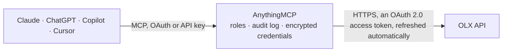

<!-- Generated by scripts/export-github-catalog.mjs in the anythingmcp-website repository. Do not edit by hand. -->

# OLX MCP connector

Manage your OLX classifieds account (Poland, Romania, Bulgaria, Portugal, Ukraine, Kazakhstan, Uzbekistan) from Claude, ChatGPT or Copilot: your adverts with status, statistics and moderation … The AnythingMCP connector gives Claude, ChatGPT, Microsoft Copilot, Cursor and Gemini 27 MCP tools for OLX: 23 read and 4 can change data.

**Category:** [E-commerce](../e-commerce.md) · **Tools:** 27 · **Setup guide:** [anythingmcp.com](https://anythingmcp.com/guides/olx-to-mcp) · [Deutsch](https://anythingmcp.com/de/guides/olx-to-mcp) · [Italiano](https://anythingmcp.com/it/guides/olx-to-mcp) · [Español](https://anythingmcp.com/es/guides/olx-to-mcp) · [日本語](https://anythingmcp.com/ja/guides/olx-to-mcp) · [Русский](https://anythingmcp.com/ru/guides/olx-to-mcp) · [中文](https://anythingmcp.com/zh/guides/olx-to-mcp)

## Start without code

No installation and no terminal: AnythingMCP Cloud runs the OLX connector for you, operated by helpcode.ai in Frankfurt, Germany.

1. **Click the button above** and create an account or sign in. The OLX connector opens, ready to install.
2. **Sign in with your OLX account** when AnythingMCP asks. The first time, an admin creates a small app in the OLX developer console. Every click is in the [step-by-step guide](https://anythingmcp.com/guides/olx-to-mcp).
3. **Click Install.** AnythingMCP shows the address of your MCP server.
4. **Add that address to your assistant:** [Claude](https://anythingmcp.com/guides/connect-olx-to-claude) · [ChatGPT](https://anythingmcp.com/guides/connect-olx-to-chatgpt) · [Microsoft Copilot](https://anythingmcp.com/guides/connect-olx-to-copilot) · [Cursor](https://anythingmcp.com/guides/connect-olx-to-cursor) · [Gemini CLI](https://anythingmcp.com/guides/connect-olx-to-gemini) · [Meta Muse](https://anythingmcp.com/guides/connect-olx-to-muse).
5. **Ask your first question**, for example: *List our prepaid invoices for March 2026 and show invoice number INV-2026-031 details.*

Prefer help with the setup? [Talk to us](https://anythingmcp.com/contact).

## How it works

- **The AI client** speaks MCP (Streamable HTTP) to AnythingMCP and only sees tool names, descriptions and results. It never gets the OLX credentials.
- **AnythingMCP** checks the client's role, builds the call from the tool definition, adds the credentials (an OAuth 2.0 access token, refreshed automatically), calls OLX, logs the call and returns the result.
- **OLX** sees an ordinary API client with the rights of the account the credentials belong to.

## Tools

| Tool | What it does | Access |
|---|---|---|
| [`olx_get_me`](#olx_get_me) | Read the OLX user the connector is signed in as: id, email, name, status, phone and account type. | read |
| [`olx_get_user`](#olx_get_user) | Read the public profile of another OLX user by id (name, avatar, when they joined), e.g. the person behind a message thread (interlocutor_id). | read |
| [`olx_get_business_profile`](#olx_get_business_profile) | Read the business profile of the signed-in account (company name, description, address, website, logos and banners). | read |
| [`olx_get_account_balance`](#olx_get_account_balance) | Read the account's OLX wallet: the balance and bonus credits available for paid features and packets, by currency. | read |
| [`olx_list_billing`](#olx_list_billing) | List the account's billing history: what was charged for adverts, paid features and packets, with date, amount and the advert concerned. | read |
| [`olx_list_prepaid_invoices`](#olx_list_prepaid_invoices) | List the account's prepaid invoices (top-ups and prepaid purchases) with number, date, amount and download link. | read |
| [`olx_list_postpaid_invoices`](#olx_list_postpaid_invoices) | List the account's postpaid invoices (for business accounts billed after the fact) with number, date, amount and download link. | read |
| [`olx_list_adverts`](#olx_list_adverts) | List the signed-in account's own adverts (listings) with id, status (for example active, limited, outdated, moderated or blocked), title, price, category,… | read |
| [`olx_get_advert`](#olx_get_advert) | Get one of the account's adverts by id with all fields: title, description, category and attributes, price, images, location, contact, status, creation and… | read |
| [`olx_get_advert_statistics`](#olx_get_advert_statistics) | Read an advert's statistics: page views, phone number reveals and how many users saved it as a favourite. | read |
| [`olx_get_advert_moderation_reason`](#olx_get_advert_moderation_reason) | Read why OLX moderation rejected or blocked an advert (status moderated or blocked), so the user can fix it. | read |
| [`olx_list_advert_paid_features`](#olx_list_advert_paid_features) | List the paid features (promotions such as top ads or refreshes) currently active on an advert, with their end dates. | read |
| [`olx_list_threads`](#olx_list_threads) | List the account's message threads with buyers and sellers: thread id, advert id, the other person (interlocutor_id), total and unread message count, last… | read |
| [`olx_get_thread`](#olx_get_thread) | Get one message thread by id: advert, the other person, message counts, unread state and favourite flag. | read |
| [`olx_list_messages`](#olx_list_messages) | Read the messages of a thread, with text, sender type (sent or received), time, read state and attachments. | read |
| [`olx_list_categories`](#olx_list_categories) | List OLX categories of this country with id, name, parent and whether adverts can be posted in it. | read |
| [`olx_get_category`](#olx_get_category) | Get one category by id: name, parent, whether it is a leaf you can post in, and its photo and price rules. | read |
| [`olx_get_category_attributes`](#olx_get_category_attributes) | List the attributes an advert in this category needs or may have (e.g. size, condition, brand), with code, label, type, whether required, and allowed values. | read |
| [`olx_suggest_category`](#olx_suggest_category) | Suggest the best OLX categories for an advert title, e.g. iphone 13 128gb. | read |
| [`olx_list_regions`](#olx_list_regions) | List the regions (voivodeships, counties, oblasts) of this OLX country with id and name. | read |
| [`olx_list_cities`](#olx_list_cities) | List cities of this OLX country with id, name, region, county, municipality and coordinates. | read |
| [`olx_get_city_districts`](#olx_get_city_districts) | List the districts of a city (for larger cities that have them), with id and name, for an advert's location. | read |
| [`olx_find_location`](#olx_find_location) | Find the OLX city and district for a latitude and longitude, to set an advert's location. | read |
| [`olx_send_message`](#olx_send_message) | Send a message in an existing thread, as the signed-in account, to the buyer or seller on the other side. | write |
| [`olx_mark_thread_read`](#olx_mark_thread_read) | Mark every message of a thread as read for the signed-in account. | write |
| [`olx_deactivate_advert`](#olx_deactivate_advert) | Take an active advert off OLX (it stops being visible to buyers). | write |
| [`olx_delete_advert`](#olx_delete_advert) | Delete an advert for good, with its statistics and messages. | write |

## Tool reference

Every parameter as the AI client sees it in `tools/list`. Source: [`packages/backend/src/adapters/intl/olx.json`](../../../packages/backend/src/adapters/intl/olx.json).

### `olx_get_me`

Read the OLX user the connector is signed in as: id, email, name, status, phone and account type. The quickest check that the sign-in worked and that OLX_HOST is the right country.

**Access:** read · **Call:** `GET /users/me`

No parameters.

### `olx_get_user`

Read the public profile of another OLX user by id (name, avatar, when they joined), e.g. the person behind a message thread (interlocutor_id).

**Access:** read · **Call:** `GET /users/{userId}`

| Parameter | Type | Required | Description |
|---|---|---|---|
| `userId` | integer | yes | Numeric OLX user id. |

### `olx_get_business_profile`

Read the business profile of the signed-in account (company name, description, address, website, logos and banners). Only business accounts have one; others answer 404.

**Access:** read · **Call:** `GET /users-business/me`

No parameters.

### `olx_get_account_balance`

Read the account's OLX wallet: the balance and bonus credits available for paid features and packets, by currency. Read-only; nothing here spends it.

**Access:** read · **Call:** `GET /users/me/account-balance`

No parameters.

### `olx_list_billing`

List the account's billing history: what was charged for adverts, paid features and packets, with date, amount and the advert concerned. Pages with page and limit.

**Access:** read · **Call:** `GET /users/me/billing`

| Parameter | Type | Required | Description |
|---|---|---|---|
| `page` | integer | no | Page number, starting at 1. |
| `limit` | integer | no | Items per page. |

### `olx_list_prepaid_invoices`

List the account's prepaid invoices (top-ups and prepaid purchases) with number, date, amount and download link. Pages with page and limit.

**Access:** read · **Call:** `GET /users/me/prepaid-invoices`

| Parameter | Type | Required | Description |
|---|---|---|---|
| `page` | integer | no | Page number, starting at 1. |
| `limit` | integer | no | Items per page. |

### `olx_list_postpaid_invoices`

List the account's postpaid invoices (for business accounts billed after the fact) with number, date, amount and download link. Pages with page and limit.

**Access:** read · **Call:** `GET /users/me/postpaid-invoices`

| Parameter | Type | Required | Description |
|---|---|---|---|
| `page` | integer | no | Page number, starting at 1. |
| `limit` | integer | no | Items per page. |

### `olx_list_adverts`

List the signed-in account's own adverts (listings) with id, status (for example active, limited, outdated, moderated or blocked), title, price, category, location, contact, validity dates and URL. Filter by your external_id or category ids; page with offset and limit. OLX has no API for searching other people's adverts.

**Access:** read · **Call:** `GET /adverts`

| Parameter | Type | Required | Description |
|---|---|---|---|
| `offset` | integer | no | Number of items to skip, for paging. |
| `limit` | integer | no | Items per page. |
| `external_id` | string | no | Your own reference stored on the advert when it was created by an integration. |
| `category_ids` | string | no | Comma-separated category ids. |

### `olx_get_advert`

Get one of the account's adverts by id with all fields: title, description, category and attributes, price, images, location, contact, status, creation and validity dates, and the public URL.

**Access:** read · **Call:** `GET /adverts/{advertId}`

| Parameter | Type | Required | Description |
|---|---|---|---|
| `advertId` | integer | yes | Numeric advert id from olx_list_adverts. |

### `olx_get_advert_statistics`

Read an advert's statistics: page views, phone number reveals and how many users saved it as a favourite.

**Access:** read · **Call:** `GET /adverts/{advertId}/statistics`

| Parameter | Type | Required | Description |
|---|---|---|---|
| `advertId` | integer | yes | Numeric advert id from olx_list_adverts. |

### `olx_get_advert_moderation_reason`

Read why OLX moderation rejected or blocked an advert (status moderated or blocked), so the user can fix it.

**Access:** read · **Call:** `GET /adverts/{advertId}/moderation-reason`

| Parameter | Type | Required | Description |
|---|---|---|---|
| `advertId` | integer | yes | Numeric advert id from olx_list_adverts. |

### `olx_list_advert_paid_features`

List the paid features (promotions such as top ads or refreshes) currently active on an advert, with their end dates. Read-only: buying features is not part of this connector.

**Access:** read · **Call:** `GET /adverts/{advertId}/paid-features`

| Parameter | Type | Required | Description |
|---|---|---|---|
| `advertId` | integer | yes | Numeric advert id from olx_list_adverts. |

### `olx_list_threads`

List the account's message threads with buyers and sellers: thread id, advert id, the other person (interlocutor_id), total and unread message count, last message time and whether it is a favourite. Filter by advert or person; page with offset and limit.

**Access:** read · **Call:** `GET /threads`

| Parameter | Type | Required | Description |
|---|---|---|---|
| `offset` | integer | no | Number of items to skip, for paging. |
| `limit` | integer | no | Items per page. |
| `advert_id` | integer | no | Only threads about this advert. |
| `interlocutor_id` | integer | no | Only threads with this OLX user. |

### `olx_get_thread`

Get one message thread by id: advert, the other person, message counts, unread state and favourite flag.

**Access:** read · **Call:** `GET /threads/{threadId}`

| Parameter | Type | Required | Description |
|---|---|---|---|
| `threadId` | integer | yes | Numeric thread id from olx_list_threads. |

### `olx_list_messages`

Read the messages of a thread, with text, sender type (sent or received), time, read state and attachments. Page with offset and limit.

**Access:** read · **Call:** `GET /threads/{threadId}/messages`

| Parameter | Type | Required | Description |
|---|---|---|---|
| `threadId` | integer | yes | Numeric thread id from olx_list_threads. |
| `offset` | integer | no | Number of items to skip, for paging. |
| `limit` | integer | no | Items per page. |

### `olx_list_categories`

List OLX categories of this country with id, name, parent and whether adverts can be posted in it. Without parent_id the top level; pass a category id as parent_id for its children.

**Access:** read · **Call:** `GET /categories`

| Parameter | Type | Required | Description |
|---|---|---|---|
| `parent_id` | integer | no | List the children of this category id. |

### `olx_get_category`

Get one category by id: name, parent, whether it is a leaf you can post in, and its photo and price rules.

**Access:** read · **Call:** `GET /categories/{categoryId}`

| Parameter | Type | Required | Description |
|---|---|---|---|
| `categoryId` | integer | yes | Numeric category id from olx_list_categories or olx_suggest_category. |

### `olx_get_category_attributes`

List the attributes an advert in this category needs or may have (e.g. size, condition, brand), with code, label, type, whether required, and allowed values.

**Access:** read · **Call:** `GET /categories/{categoryId}/attributes`

| Parameter | Type | Required | Description |
|---|---|---|---|
| `categoryId` | integer | yes | Numeric category id from olx_list_categories or olx_suggest_category. |

### `olx_suggest_category`

Suggest the best OLX categories for an advert title, e.g. iphone 13 128gb. Returns category ids to use with olx_get_category_attributes.

**Access:** read · **Call:** `GET /categories/suggestion`

| Parameter | Type | Required | Description |
|---|---|---|---|
| `q` | string | yes | Advert title or keywords. |

### `olx_list_regions`

List the regions (voivodeships, counties, oblasts) of this OLX country with id and name.

**Access:** read · **Call:** `GET /regions`

No parameters.

### `olx_list_cities`

List cities of this OLX country with id, name, region, county, municipality and coordinates. Page with offset and limit; the list is long, so prefer olx_find_location when you have coordinates.

**Access:** read · **Call:** `GET /cities`

| Parameter | Type | Required | Description |
|---|---|---|---|
| `offset` | integer | no | Number of items to skip, for paging. |
| `limit` | integer | no | Items per page. |

### `olx_get_city_districts`

List the districts of a city (for larger cities that have them), with id and name, for an advert's location.

**Access:** read · **Call:** `GET /cities/{cityId}/districts`

| Parameter | Type | Required | Description |
|---|---|---|---|
| `cityId` | integer | yes | Numeric city id from olx_list_cities or olx_find_location. |

### `olx_find_location`

Find the OLX city and district for a latitude and longitude, to set an advert's location.

**Access:** read · **Call:** `GET /locations`

| Parameter | Type | Required | Description |
|---|---|---|---|
| `latitude` | number | yes | Latitude, e.g. 52.2297. |
| `longitude` | number | yes | Longitude, e.g. 21.0122. |

### `olx_send_message`

Send a message in an existing thread, as the signed-in account, to the buyer or seller on the other side. It is delivered at once and cannot be taken back: show the user the thread and the exact text and wait for a yes.

**Access:** write · **Call:** `POST /threads/{threadId}/messages`

| Parameter | Type | Required | Description |
|---|---|---|---|
| `threadId` | integer | yes | Numeric thread id from olx_list_threads. |
| `text` | string | yes | Message text. |

### `olx_mark_thread_read`

Mark every message of a thread as read for the signed-in account.

**Access:** write · **Call:** `POST /threads/{threadId}/commands`

| Parameter | Type | Required | Description |
|---|---|---|---|
| `threadId` | integer | yes | Numeric thread id from olx_list_threads. |

### `olx_deactivate_advert`

Take an active advert off OLX (it stops being visible to buyers). is_success true tells OLX the item was sold through OLX. Show the user which advert it is and wait for a yes; reactivating may cost a fee, so it is not offered here.

**Access:** write · **Call:** `POST /adverts/{advertId}/commands`

| Parameter | Type | Required | Description |
|---|---|---|---|
| `advertId` | integer | yes | Numeric advert id from olx_list_adverts. |
| `is_success` | boolean | yes | true if the item was sold on OLX, false otherwise. |

### `olx_delete_advert`

Delete an advert for good, with its statistics and messages. OLX may refuse to delete an active advert, so deactivate it first. It cannot be undone: show the user which advert it is and wait for a yes. Installed switched off.

**Access:** write · **Call:** `DELETE /adverts/{advertId}`

| Parameter | Type | Required | Description |
|---|---|---|---|
| `advertId` | integer | yes | Numeric advert id from olx_list_adverts. |

## Run it yourself

AnythingMCP is open source (AGPL-3.0). [Run it with Docker](../../../README.md#run-it-yourself), open **Connectors → Store**, pick **OLX** and enter `OLX_HOST`, `OLX_CLIENT_ID`, `OLX_CLIENT_SECRET`, then add your MCP server URL to the AI client.

[← E-commerce connectors](../e-commerce.md) · [All categories](../README.md)
