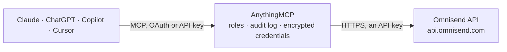

<!-- Generated by scripts/export-github-catalog.mjs in the anythingmcp-website repository. Do not edit by hand. -->

# Omnisend MCP connector

Manage Omnisend (e-commerce marketing automation: contacts, campaigns, events, products, categories) from any AI agent. 9 tools, X-API-KEY auth. The AnythingMCP connector gives Claude, ChatGPT, Microsoft Copilot, Cursor and Gemini 9 MCP tools for Omnisend: 6 read and 3 can change data.

**Category:** [Email](../email.md) · **Tools:** 9 · **Setup guide:** [anythingmcp.com](https://anythingmcp.com/guides/omnisend-to-mcp) · [Deutsch](https://anythingmcp.com/de/guides/omnisend-to-mcp) · [Italiano](https://anythingmcp.com/it/guides/omnisend-to-mcp) · [Español](https://anythingmcp.com/es/guides/omnisend-to-mcp) · [日本語](https://anythingmcp.com/ja/guides/omnisend-to-mcp) · [Русский](https://anythingmcp.com/ru/guides/omnisend-to-mcp) · [中文](https://anythingmcp.com/zh/guides/omnisend-to-mcp)

## Start without code

No installation and no terminal: AnythingMCP Cloud runs the Omnisend connector for you, operated by helpcode.ai in Frankfurt, Germany.

1. **Click the button above** and create an account or sign in. The Omnisend connector opens, ready to install.
2. **Paste the API key or token from your Omnisend account.** Every click is in the [step-by-step guide](https://anythingmcp.com/guides/omnisend-to-mcp).
3. **Click Install.** AnythingMCP shows the address of your MCP server.
4. **Add that address to your assistant:** [Claude](https://anythingmcp.com/guides/connect-omnisend-to-claude) · [ChatGPT](https://anythingmcp.com/guides/connect-omnisend-to-chatgpt) · [Microsoft Copilot](https://anythingmcp.com/guides/connect-omnisend-to-copilot) · [Cursor](https://anythingmcp.com/guides/connect-omnisend-to-cursor) · [Gemini CLI](https://anythingmcp.com/guides/connect-omnisend-to-gemini) · [Meta Muse](https://anythingmcp.com/guides/connect-omnisend-to-muse).
5. **Ask your first question**, for example: *Do we have contact invoices@madeforme.shop in Omnisend? Show contactID, email status and tags.*

Prefer help with the setup? [Talk to us](https://anythingmcp.com/contact).

## How it works

- **The AI client** speaks MCP (Streamable HTTP) to AnythingMCP and only sees tool names, descriptions and results. It never gets the Omnisend credentials.
- **AnythingMCP** checks the client's role, builds the call from the tool definition, adds the credentials (an API key), calls Omnisend, logs the call and returns the result.
- **Omnisend** sees an ordinary API client with the rights of the account the credentials belong to.

## Tools

| Tool | What it does | Access |
|---|---|---|
| [`omnisend_list_contacts`](#omnisend_list_contacts) | List contacts. | read |
| [`omnisend_get_contact`](#omnisend_get_contact) | Get one contact by Omnisend contactID OR email. | read |
| [`omnisend_upsert_contact`](#omnisend_upsert_contact) | Create or update a contact. | write |
| [`omnisend_trigger_event`](#omnisend_trigger_event) | Trigger a custom event for a contact. | write |
| [`omnisend_list_campaigns`](#omnisend_list_campaigns) | List campaigns. | read |
| [`omnisend_get_campaign`](#omnisend_get_campaign) | Get one campaign with stats. | read |
| [`omnisend_list_products`](#omnisend_list_products) | List products in the Omnisend catalog (used by product-recommendation blocks). | read |
| [`omnisend_upsert_product`](#omnisend_upsert_product) | Add or update a product in the catalog. | write |
| [`omnisend_list_categories`](#omnisend_list_categories) | List product categories. | read |

## Tool reference

Every parameter as the AI client sees it in `tools/list`. Source: [`packages/backend/src/adapters/intl/omnisend.json`](../../../packages/backend/src/adapters/intl/omnisend.json).

### `omnisend_list_contacts`

List contacts. Filter by email, status, channel.

**Access:** read · **Call:** `GET /contacts`

| Parameter | Type | Required | Description |
|---|---|---|---|
| `email` | string | no | Filter by email. |
| `status` | string | no | subscribed, unsubscribed, nonSubscribed. |
| `channel` | string | no | email or sms. |
| `limit` | integer | no | Max 250. |
| `offset` | integer | no | 0-based offset. |

### `omnisend_get_contact`

Get one contact by Omnisend contactID OR email.

**Access:** read · **Call:** `GET /contacts/{contact_id}`

| Parameter | Type | Required | Description |
|---|---|---|---|
| `contact_id` | string | yes | Contact ID. |

### `omnisend_upsert_contact`

Create or update a contact. Required: `identifiers` (array of {type: 'email'|'phone', id, channels: {email: {status}}}). `tags`, `customProperties` optional.

**Access:** write · **Call:** `POST /contacts`

| Parameter | Type | Required | Description |
|---|---|---|---|
| `identifiers` | any[] | yes | Array of identifier objects. |
| `firstName` | string | no | First name. |
| `lastName` | string | no | Last name. |
| `tags` | any[] | no | Array of tag strings. |
| `customProperties` | object | no | Free-form custom field map. |
| `country` | string | no | ISO 3166-1 alpha-2 country code. |

### `omnisend_trigger_event`

Trigger a custom event for a contact. Used by Omnisend automations as a workflow start node.

**Access:** write · **Call:** `POST /events`

| Parameter | Type | Required | Description |
|---|---|---|---|
| `eventName` | string | yes | Custom event name (matches workflow trigger). |
| `email` | string | no | Contact email. |
| `phone` | string | no | Contact phone. |
| `contactID` | string | no | Omnisend contact ID (alternative to email/phone). |
| `fields` | object | no | Event payload — free-form key/value. |

### `omnisend_list_campaigns`

List campaigns.

**Access:** read · **Call:** `GET /campaigns`

| Parameter | Type | Required | Description |
|---|---|---|---|
| `status` | string | no | draft, sending, sent, paused, scheduled, ... |
| `type` | string | no | standard, ab, sms. |
| `limit` | integer | no | Max 250. |
| `offset` | integer | no | 0-based. |

### `omnisend_get_campaign`

Get one campaign with stats.

**Access:** read · **Call:** `GET /campaigns/{campaign_id}`

| Parameter | Type | Required | Description |
|---|---|---|---|
| `campaign_id` | string | yes | Campaign ID. |

### `omnisend_list_products`

List products in the Omnisend catalog (used by product-recommendation blocks).

**Access:** read · **Call:** `GET /products`

| Parameter | Type | Required | Description |
|---|---|---|---|
| `limit` | integer | no | Max 250. |
| `offset` | integer | no | 0-based. |

### `omnisend_upsert_product`

Add or update a product in the catalog.

**Access:** write · **Call:** `POST /products`

| Parameter | Type | Required | Description |
|---|---|---|---|
| `productID` | string | yes | Your internal product ID. |
| `title` | string | yes | Product title. |
| `status` | string | no | inStock, outOfStock, notAvailable. |
| `description` | string | no | Description. |
| `currency` | string | no | ISO 4217. |
| `productUrl` | string | no | Public URL. |
| `imageUrl` | string | no | Product image URL. |
| `variants` | any[] | no | Array of variant objects. |

### `omnisend_list_categories`

List product categories.

**Access:** read · **Call:** `GET /categories`

No parameters.

## Run it yourself

AnythingMCP is open source (AGPL-3.0). [Run it with Docker](../../../README.md#run-it-yourself), open **Connectors → Store**, pick **Omnisend** and enter `OMNISEND_API_KEY`, then add your MCP server URL to the AI client.

[← Email connectors](../email.md) · [All categories](../README.md)
