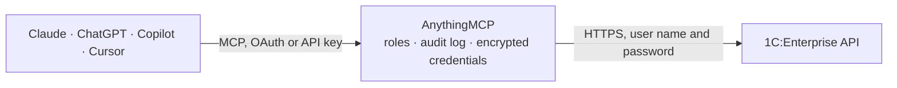

<!-- Generated by scripts/export-github-catalog.mjs in the anythingmcp-website repository. Do not edit by hand. -->

# 1C:Enterprise MCP connector

Read your 1C:Enterprise 8.3 infobase (1С:Бухгалтерия, Управление торговлей, 1С:ERP, УНФ and other configurations) through its standard OData interface: catalogs, documents with their tabular … The AnythingMCP connector gives Claude, ChatGPT, Microsoft Copilot, Cursor and Gemini 7 MCP tools for 1C:Enterprise, all read-only.

**Category:** [ERP](../erp.md) · **Tools:** 7 · **Setup guide:** [anythingmcp.com](https://anythingmcp.com/guides/onec-enterprise-to-mcp) · [Deutsch](https://anythingmcp.com/de/guides/onec-enterprise-to-mcp) · [Italiano](https://anythingmcp.com/it/guides/onec-enterprise-to-mcp) · [Español](https://anythingmcp.com/es/guides/onec-enterprise-to-mcp) · [日本語](https://anythingmcp.com/ja/guides/onec-enterprise-to-mcp) · [Русский](https://anythingmcp.com/ru/guides/onec-enterprise-to-mcp) · [中文](https://anythingmcp.com/zh/guides/onec-enterprise-to-mcp)

## Start without code

No installation and no terminal: AnythingMCP Cloud runs the 1C:Enterprise connector for you, operated by helpcode.ai in Frankfurt, Germany.

1. **Click the button above** and create an account or sign in. The 1C:Enterprise connector opens, ready to install.
2. **Paste the API key or token from your 1C:Enterprise account.** Every click is in the [step-by-step guide](https://anythingmcp.com/guides/onec-enterprise-to-mcp).
3. **Click Install.** AnythingMCP shows the address of your MCP server.
4. **Add that address to your assistant:** [Claude](https://anythingmcp.com/guides/connect-onec-enterprise-to-claude) · [ChatGPT](https://anythingmcp.com/guides/connect-onec-enterprise-to-chatgpt) · [Microsoft Copilot](https://anythingmcp.com/guides/connect-onec-enterprise-to-copilot) · [Cursor](https://anythingmcp.com/guides/connect-onec-enterprise-to-cursor) · [Gemini CLI](https://anythingmcp.com/guides/connect-onec-enterprise-to-gemini) · [Meta Muse](https://anythingmcp.com/guides/connect-onec-enterprise-to-muse).
5. **Ask your first question**, for example: *Show invoice INV-2026-089 for customer ООО Солярис Трейд: date, amount, VAT, residual.*

Prefer help with the setup? [Talk to us](https://anythingmcp.com/contact).

## How it works

- **The AI client** speaks MCP (Streamable HTTP) to AnythingMCP and only sees tool names, descriptions and results. It never gets the 1C:Enterprise credentials.
- **AnythingMCP** checks the client's role, builds the call from the tool definition, adds the credentials (user name and password), calls 1C:Enterprise, logs the call and returns the result.
- **1C:Enterprise** sees an ordinary API client with the rights of the account the credentials belong to.

## Tools

| Tool | What it does | Access |
|---|---|---|
| [`onec_enterprise_list_services`](#onec_enterprise_list_services) | Where the OData service lives. | read |
| [`onec_enterprise_describe_service`](#onec_enterprise_describe_service) | The entity sets of an OData service with their business labels, keys and whether they are analytical or parameterised. | read |
| [`onec_enterprise_describe_entity`](#onec_enterprise_describe_entity) | The fields of one entity set: labels, types, keys, the currency or unit field of each amount, dimensions and measures, and required filters. | read |
| [`onec_enterprise_query`](#onec_enterprise_query) | Read rows from an entity set, with field names checked against the service model and server paging followed. | read |
| [`onec_enterprise_get_entity`](#onec_enterprise_get_entity) | Read one entity by its key, optionally with related entities. | read |
| [`onec_enterprise_guide`](#onec_enterprise_guide) | How to read 1C:Enterprise through OData: the workflow, object and field names, filter syntax, register virtual tables (balances, turnovers, slices),… | read |
| [`onec_enterprise_get`](#onec_enterprise_get) | Read from the 1C infobase with an OData path and query written out, for what onec_enterprise_query cannot address: register virtual tables (Balance,… | read |

## Tool reference

Every parameter as the AI client sees it in `tools/list`. Source: [`packages/backend/src/adapters/intl/onec-enterprise.json`](../../../packages/backend/src/adapters/intl/onec-enterprise.json).

### `onec_enterprise_list_services`

Where the OData service lives.

**Access:** read

No parameters.

### `onec_enterprise_describe_service`

The entity sets of an OData service with their business labels, keys and whether they are analytical or parameterised.

**Access:** read

No parameters.

### `onec_enterprise_describe_entity`

The fields of one entity set: labels, types, keys, the currency or unit field of each amount, dimensions and measures, and required filters.

**Access:** read

No parameters.

### `onec_enterprise_query`

Read rows from an entity set, with field names checked against the service model and server paging followed.

**Access:** read

No parameters.

### `onec_enterprise_get_entity`

Read one entity by its key, optionally with related entities.

**Access:** read

No parameters.

### `onec_enterprise_guide`

How to read 1C:Enterprise through OData: the workflow, object and field names, filter syntax, register virtual tables (balances, turnovers, slices), documents and pitfalls. Costs nothing; read it before the first query.

**Access:** read

| Parameter | Type | Required | Description |
|---|---|---|---|
| `topic` | `names` \| `filters` \| `registers` \| `documents` \| `pitfalls` | no | Chapter to read. Omit for the overview. |

### `onec_enterprise_get`

Read from the 1C infobase with an OData path and query written out, for what onec_enterprise_query cannot address: register virtual tables (Balance, Turnovers, BalanceAndTurnovers, SliceLast, SliceFirst) and navigation from one object to related data, e.g. a document's tabular section. Returns the rows as JSON. Use onec_enterprise_query for plain lists of catalogs and documents; always include $top and $select on large objects.

**Access:** read · **Call:** `GET /{resource}`

| Parameter | Type | Required | Description |
|---|---|---|---|
| `resource` | string | yes | Path below the OData root, with the query written out. Examples: Catalog_Номенклатура?$filter=substringof('кабель', Description) and DeletionMark eq false&$select=Ref_Key,Code,Description&$top=50 ; Document_СчетНаОплатуПокупателю?$filter=Date ge datetime'2026-10-01T00:00:00'&$orderby=Date desc&$top=20 ; AccumulationRegister_ТоварыНаСкладах/Balance(Period=datetime'2026-10-20T23:59:59')?$top=200 ; Document_РеализацияТоваровУслуг(guid'0f8fad5b-d9cb-469f-a165-70867728950e')/Товары. Write spaces and Cyrillic as they are; do not add $format, the connector asks for JSON. |

## Run it yourself

AnythingMCP is open source (AGPL-3.0). [Run it with Docker](../../../README.md#run-it-yourself), open **Connectors → Store**, pick **1C:Enterprise** and enter `ONEC_BASE_URL`, `ONEC_USER`, `ONEC_PASSWORD`, then add your MCP server URL to the AI client.

[← ERP connectors](../erp.md) · [All categories](../README.md)
