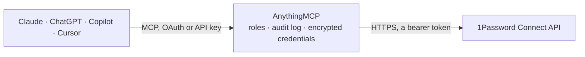

<!-- Generated by scripts/export-github-catalog.mjs in the anythingmcp-website repository. Do not edit by hand. -->

# 1Password Connect MCP connector

Vaults and items of 1Password through a self-hosted 1Password Connect server: list vaults and items, read items with their secret values and attached files, create items with generated passwords, … The AnythingMCP connector gives Claude, ChatGPT, Microsoft Copilot, Cursor and Gemini 12 MCP tools for 1Password Connect: 9 read and 3 can change data.

**Category:** [Infrastructure](../infrastructure.md) · **Tools:** 12 · **Setup guide:** [anythingmcp.com](https://anythingmcp.com/guides/onepassword-connect-to-mcp) · [Deutsch](https://anythingmcp.com/de/guides/onepassword-connect-to-mcp) · [Italiano](https://anythingmcp.com/it/guides/onepassword-connect-to-mcp) · [Español](https://anythingmcp.com/es/guides/onepassword-connect-to-mcp) · [日本語](https://anythingmcp.com/ja/guides/onepassword-connect-to-mcp) · [Русский](https://anythingmcp.com/ru/guides/onepassword-connect-to-mcp) · [中文](https://anythingmcp.com/zh/guides/onepassword-connect-to-mcp)

## Start without code

No installation and no terminal: AnythingMCP Cloud runs the 1Password Connect connector for you, operated by helpcode.ai in Frankfurt, Germany.

1. **Click the button above** and create an account or sign in. The 1Password Connect connector opens, ready to install.
2. **Paste the API key or token from your 1Password Connect account.** Every click is in the [step-by-step guide](https://anythingmcp.com/guides/onepassword-connect-to-mcp).
3. **Click Install.** AnythingMCP shows the address of your MCP server.
4. **Add that address to your assistant:** [Claude](https://anythingmcp.com/guides/connect-onepassword-connect-to-claude) · [ChatGPT](https://anythingmcp.com/guides/connect-onepassword-connect-to-chatgpt) · [Microsoft Copilot](https://anythingmcp.com/guides/connect-onepassword-connect-to-copilot) · [Cursor](https://anythingmcp.com/guides/connect-onepassword-connect-to-cursor) · [Gemini CLI](https://anythingmcp.com/guides/connect-onepassword-connect-to-gemini) · [Meta Muse](https://anythingmcp.com/guides/connect-onepassword-connect-to-muse).
5. **Ask your first question**, for example: *Do we have a client SSH key item for deploy@orionhosting.fi in the Infrastructure vault?*

Prefer help with the setup? [Talk to us](https://anythingmcp.com/contact).

## How it works

- **The AI client** speaks MCP (Streamable HTTP) to AnythingMCP and only sees tool names, descriptions and results. It never gets the 1Password Connect credentials.
- **AnythingMCP** checks the client's role, builds the call from the tool definition, adds the credentials (a bearer token), calls 1Password Connect, logs the call and returns the result.
- **1Password Connect** sees an ordinary API client with the rights of the account the credentials belong to.

## Tools

| Tool | What it does | Access |
|---|---|---|
| [`onepassword_connect_list_vaults`](#onepassword_connect_list_vaults) | List the vaults this Connect token can reach: id, name, description, type, number of items, versions and dates. | read |
| [`onepassword_connect_get_vault`](#onepassword_connect_get_vault) | One vault's details and metadata: name, description, type, item count, attribute and content versions, created and updated dates. | read |
| [`onepassword_connect_list_items`](#onepassword_connect_list_items) | List the items in a vault as metadata only: id, title, category, tags, urls, favorite, version, state and dates. | read |
| [`onepassword_connect_get_item`](#onepassword_connect_get_item) | Read one item in full. | read |
| [`onepassword_connect_list_files`](#onepassword_connect_list_files) | List the files attached to an item (Document items and file fields): id, name, size in bytes, section and content_path. | read |
| [`onepassword_connect_get_file`](#onepassword_connect_get_file) | Details of one file attached to an item: id, name, size in bytes, section and content_path. | read |
| [`onepassword_connect_get_file_content`](#onepassword_connect_get_file_content) | Download the content of a file attached to an item (certificates, key files, documents). | read |
| [`onepassword_connect_list_activity`](#onepassword_connect_list_activity) | Requests this Connect server has handled, newest first: requestId, timestamp, action (READ, CREATE, UPDATE, DELETE), result (SUCCESS, DENY), the token used… | read |
| [`onepassword_connect_get_health`](#onepassword_connect_get_health) | State of the Connect server: name, version and its dependencies (the sync service and the account connection) with their status. | read |
| [`onepassword_connect_create_item`](#onepassword_connect_create_item) | Create an item in a vault. | write |
| [`onepassword_connect_update_item`](#onepassword_connect_update_item) | Change part of an item with RFC 6902 JSON Patch operations (add, remove, replace). | write |
| [`onepassword_connect_delete_item`](#onepassword_connect_delete_item) | Delete an item from a vault. | write |

## Tool reference

Every parameter as the AI client sees it in `tools/list`. Source: [`packages/backend/src/adapters/intl/onepassword-connect.json`](../../../packages/backend/src/adapters/intl/onepassword-connect.json).

### `onepassword_connect_list_vaults`

List the vaults this Connect token can reach: id, name, description, type, number of items, versions and dates. Metadata only, no item contents.

**Access:** read · **Call:** `GET /v1/vaults`

| Parameter | Type | Required | Description |
|---|---|---|---|
| `filter` | string | no | Optional SCIM filter on the vault name, e.g. name eq "Production". |

### `onepassword_connect_get_vault`

One vault's details and metadata: name, description, type, item count, attribute and content versions, created and updated dates. No item contents.

**Access:** read · **Call:** `GET /v1/vaults/{vault_id}`

| Parameter | Type | Required | Description |
|---|---|---|---|
| `vault_id` | string | yes | Vault id: the 26-character id from onepassword_connect_list_vaults (e.g. ftz4pm2xxwmwrsd7rjqn7grzfz). |

### `onepassword_connect_list_items`

List the items in a vault as metadata only: id, title, category, tags, urls, favorite, version, state and dates. It returns no field values, passwords or files; use onepassword_connect_get_item for those.

**Access:** read · **Call:** `GET /v1/vaults/{vault_id}/items`

| Parameter | Type | Required | Description |
|---|---|---|---|
| `vault_id` | string | yes | Vault id: the 26-character id from onepassword_connect_list_vaults (e.g. ftz4pm2xxwmwrsd7rjqn7grzfz). |
| `filter` | string | no | Optional SCIM filter on title or tag, e.g. title eq "Stripe API" or tag eq "prod". |

### `onepassword_connect_get_item`

Read one item in full. WARNING: this returns the item's SECRET VALUES in plain text (passwords, API keys, TOTP seeds, concealed fields, notes) in fields[].value, together with sections, urls, tags and file references. Call it only when the user needs that secret, and never repeat a value back unless asked.

**Access:** read · **Call:** `GET /v1/vaults/{vault_id}/items/{item_id}`

| Parameter | Type | Required | Description |
|---|---|---|---|
| `vault_id` | string | yes | Vault id: the 26-character id from onepassword_connect_list_vaults (e.g. ftz4pm2xxwmwrsd7rjqn7grzfz). |
| `item_id` | string | yes | Item id: the 26-character id from onepassword_connect_list_items. |

### `onepassword_connect_list_files`

List the files attached to an item (Document items and file fields): id, name, size in bytes, section and content_path. Metadata only; onepassword_connect_get_file_content downloads one.

**Access:** read · **Call:** `GET /v1/vaults/{vault_id}/items/{item_id}/files`

| Parameter | Type | Required | Description |
|---|---|---|---|
| `vault_id` | string | yes | Vault id: the 26-character id from onepassword_connect_list_vaults (e.g. ftz4pm2xxwmwrsd7rjqn7grzfz). |
| `item_id` | string | yes | Item id: the 26-character id from onepassword_connect_list_items. |

### `onepassword_connect_get_file`

Details of one file attached to an item: id, name, size in bytes, section and content_path. Metadata only.

**Access:** read · **Call:** `GET /v1/vaults/{vault_id}/items/{item_id}/files/{file_id}`

| Parameter | Type | Required | Description |
|---|---|---|---|
| `vault_id` | string | yes | Vault id: the 26-character id from onepassword_connect_list_vaults (e.g. ftz4pm2xxwmwrsd7rjqn7grzfz). |
| `item_id` | string | yes | Item id: the 26-character id from onepassword_connect_list_items. |
| `file_id` | string | yes | File id from onepassword_connect_list_files or the item's files array. |

### `onepassword_connect_get_file_content`

Download the content of a file attached to an item (certificates, key files, documents). WARNING: files kept in 1Password are often secret themselves; the content is returned to the AI. Images and other files are attached to the result, up to 4 MB.

**Access:** read · **Call:** `GET /v1/vaults/{vault_id}/items/{item_id}/files/{file_id}/content`

| Parameter | Type | Required | Description |
|---|---|---|---|
| `vault_id` | string | yes | Vault id: the 26-character id from onepassword_connect_list_vaults (e.g. ftz4pm2xxwmwrsd7rjqn7grzfz). |
| `item_id` | string | yes | Item id: the 26-character id from onepassword_connect_list_items. |
| `file_id` | string | yes | File id from onepassword_connect_list_files or the item's files array. |

### `onepassword_connect_list_activity`

Requests this Connect server has handled, newest first: requestId, timestamp, action (READ, CREATE, UPDATE, DELETE), result (SUCCESS, DENY), the token used (actor.jti, userAgent, requestIp) and the vault and item touched. The content-range header (e.g. 1-50/1134) gives the total.

**Access:** read · **Call:** `GET /v1/activity`

| Parameter | Type | Required | Description |
|---|---|---|---|
| `limit` | integer | no | Requests per page (default 50). |
| `offset` | integer | no | How many requests to skip (default 0); add limit to page on. |

### `onepassword_connect_get_health`

State of the Connect server: name, version and its dependencies (the sync service and the account connection) with their status. Use it when calls fail to tell a server problem from a token problem.

**Access:** read · **Call:** `GET /health`

No parameters.

### `onepassword_connect_create_item`

Create an item in a vault. Pass the category, a title and its fields; a field with generate true and a recipe gets a new random value from 1Password (the generated value is returned in the answer). Returns the full item, including its secret values.

**Access:** write · **Call:** `POST /v1/vaults/{vault_id}/items`

| Parameter | Type | Required | Description |
|---|---|---|---|
| `vault_id` | string | yes | Vault id: the 26-character id from onepassword_connect_list_vaults (e.g. ftz4pm2xxwmwrsd7rjqn7grzfz). |
| `title` | string | yes | Item title as shown in 1Password. |
| `category` | `LOGIN` \| `PASSWORD` \| `API_CREDENTIAL` \| `SERVER` \| `DATABASE` \| `CREDIT_CARD` \| `MEMBERSHIP` \| `PASSPORT` \| `SOFTWARE_LICENSE` \| `OUTDOOR_LICENSE` \| `SECURE_NOTE` \| `WIRELESS_ROUTER` \| `BANK_ACCOUNT` \| `DRIVER_LICENSE` \| `IDENTITY` \| `REWARD_PROGRAM` \| `DOCUMENT` \| `EMAIL_ACCOUNT` \| `SOCIAL_SECURITY_NUMBER` \| `MEDICAL_RECORD` \| `SSH_KEY` \| `CUSTOM` | yes | Item category; LOGIN, PASSWORD, API_CREDENTIAL, SERVER, DATABASE and SECURE_NOTE are the usual ones for infrastructure secrets. |
| `fields` | object[] | no | Item fields. Each: {label, type (STRING, EMAIL, CONCEALED, URL, TOTP, DATE, MONTH_YEAR, MENU), value, purpose (USERNAME, PASSWORD or NOTES, for LOGIN and PASSWORD items), section: {id}, generate: true with recipe: {length 1 to 64, characterSets [LETTERS, DIGITS, SYMBOLS], excludeCharacters}}. |
| `sections` | object[] | no | Sections fields can refer to: [{id, label}]. The id is any string you choose. |
| `tags` | string[] | no | Tags for the item. |
| `urls` | object[] | no | Websites: [{href, label, primary}]. |
| `favorite` | boolean | no | Mark the item as a favourite. |

### `onepassword_connect_update_item`

Change part of an item with RFC 6902 JSON Patch operations (add, remove, replace). Paths: /title, /favorite, /tags, /urls, /fields to add a field, /fields/<field id> to replace or remove one, /fields/<field id>/value or /label for one attribute, / to replace the whole item. Field ids come from onepassword_connect_get_item. 1Password keeps the previous version in the item's history. Returns the full updated item, including its secret values.

**Access:** write · **Call:** `PATCH /v1/vaults/{vault_id}/items/{item_id}`

| Parameter | Type | Required | Description |
|---|---|---|---|
| `vault_id` | string | yes | Vault id: the 26-character id from onepassword_connect_list_vaults (e.g. ftz4pm2xxwmwrsd7rjqn7grzfz). |
| `item_id` | string | yes | Item id: the 26-character id from onepassword_connect_list_items. |
| `operations` | object[] | yes | JSON Patch operations, e.g. [{"op": "replace", "path": "/fields/password/value", "value": "new-secret"}, {"op": "add", "path": "/tags", "value": ["rotated"]}]. |

### `onepassword_connect_delete_item`

Delete an item from a vault. Applications that read this secret through Connect stop finding it at once. Switched off at install.

**Access:** write · **Call:** `DELETE /v1/vaults/{vault_id}/items/{item_id}`

| Parameter | Type | Required | Description |
|---|---|---|---|
| `vault_id` | string | yes | Vault id: the 26-character id from onepassword_connect_list_vaults (e.g. ftz4pm2xxwmwrsd7rjqn7grzfz). |
| `item_id` | string | yes | Item id: the 26-character id from onepassword_connect_list_items. |

## Run it yourself

AnythingMCP is open source (AGPL-3.0). [Run it with Docker](../../../README.md#run-it-yourself), open **Connectors → Store**, pick **1Password Connect** and enter `ONEPASSWORD_CONNECT_URL`, `ONEPASSWORD_CONNECT_TOKEN`, then add your MCP server URL to the AI client.

[← Infrastructure connectors](../infrastructure.md) · [All categories](../README.md)
