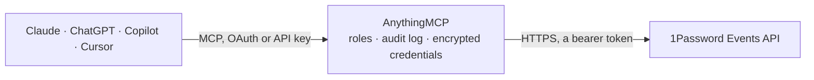

<!-- Generated by scripts/export-github-catalog.mjs in the anythingmcp-website repository. Do not edit by hand. -->

# 1Password Events MCP connector

Activity feed of a 1Password Business account from the 1Password Events API: sign-in attempts with outcome, client and location, item usage events (fill, reveal, copy, export, share) and audit events … The AnythingMCP connector gives Claude, ChatGPT, Microsoft Copilot, Cursor and Gemini 4 MCP tools for 1Password Events, all read-only.

**Category:** [Monitoring](../monitoring.md) · **Tools:** 4 · **Setup guide:** [anythingmcp.com](https://anythingmcp.com/guides/onepassword-events-to-mcp) · [Deutsch](https://anythingmcp.com/de/guides/onepassword-events-to-mcp) · [Italiano](https://anythingmcp.com/it/guides/onepassword-events-to-mcp) · [Español](https://anythingmcp.com/es/guides/onepassword-events-to-mcp) · [日本語](https://anythingmcp.com/ja/guides/onepassword-events-to-mcp) · [Русский](https://anythingmcp.com/ru/guides/onepassword-events-to-mcp) · [中文](https://anythingmcp.com/zh/guides/onepassword-events-to-mcp)

## Start without code

No installation and no terminal: AnythingMCP Cloud runs the 1Password Events connector for you, operated by helpcode.ai in Frankfurt, Germany.

1. **Click the button above** and create an account or sign in. The 1Password Events connector opens, ready to install.
2. **Paste the API key or token from your 1Password Events account.** Every click is in the [step-by-step guide](https://anythingmcp.com/guides/onepassword-events-to-mcp).
3. **Click Install.** AnythingMCP shows the address of your MCP server.
4. **Add that address to your assistant:** [Claude](https://anythingmcp.com/guides/connect-onepassword-events-to-claude) · [ChatGPT](https://anythingmcp.com/guides/connect-onepassword-events-to-chatgpt) · [Microsoft Copilot](https://anythingmcp.com/guides/connect-onepassword-events-to-copilot) · [Cursor](https://anythingmcp.com/guides/connect-onepassword-events-to-cursor) · [Gemini CLI](https://anythingmcp.com/guides/connect-onepassword-events-to-gemini) · [Meta Muse](https://anythingmcp.com/guides/connect-onepassword-events-to-muse).
5. **Ask your first question**, for example: *Show sign-in attempts for maria.kehrer@brightline.de between 2026-09-01 and 2026-09-02*

Prefer help with the setup? [Talk to us](https://anythingmcp.com/contact).

## How it works

- **The AI client** speaks MCP (Streamable HTTP) to AnythingMCP and only sees tool names, descriptions and results. It never gets the 1Password Events credentials.
- **AnythingMCP** checks the client's role, builds the call from the tool definition, adds the credentials (a bearer token), calls 1Password Events, logs the call and returns the result.
- **1Password Events** sees an ordinary API client with the rights of the account the credentials belong to.

## Tools

| Tool | What it does | Access |
|---|---|---|
| [`onepassword_events_introspect`](#onepassword_events_introspect) | Check the Events API bearer token: returns its uuid, issued_at, the account_uuid and the features it may read (auditevents, itemusages, signinattempts). | read |
| [`onepassword_events_list_signin_attempts`](#onepassword_events_list_signin_attempts) | Sign-in attempts to the 1Password account, successful and failed, oldest first: who (target_user name, email, uuid), when, outcome (category: success,… | read |
| [`onepassword_events_list_item_usages`](#onepassword_events_list_item_usages) | Item usage events: when a user filled, revealed, copied, exported, shared or edited an item, or an integration fetched, created or updated it (action: fill,… | read |
| [`onepassword_events_list_audit_events`](#onepassword_events_list_audit_events) | Audit events for actions team members took in the account: action (create, update, delete, activate, suspend, reactive, join, leave, grant, revoke, role,… | read |

## Tool reference

Every parameter as the AI client sees it in `tools/list`. Source: [`packages/backend/src/adapters/intl/onepassword-events.json`](../../../packages/backend/src/adapters/intl/onepassword-events.json).

### `onepassword_events_introspect`

Check the Events API bearer token: returns its uuid, issued_at, the account_uuid and the features it may read (auditevents, itemusages, signinattempts). Call it first to see which of the other three tools this token can use.

**Access:** read · **Call:** `GET /api/v2/auth/introspect`

No parameters.

### `onepassword_events_list_signin_attempts`

Sign-in attempts to the 1Password account, successful and failed, oldest first: who (target_user name, email, uuid), when, outcome (category: success, credentials_failed, mfa_failed, sso_failed, firewall_failed, ...; type: credentials_ok, mfa_ok, password_secret_bad, totp_bad, country_blocked, ...), client app and version, OS, IP address and location. Needs the signinattempts feature. Returns items, cursor and has_more. Read-only although it is a POST.

**Access:** read · **Call:** `POST /api/v2/signinattempts`

| Parameter | Type | Required | Description |
|---|---|---|---|
| `cursor` | string | no | Continue from where the previous call stopped: the `cursor` of the last response. When you pass it, leave limit, start_time and end_time out: the cursor already carries them. |
| `limit` | integer | no | Events per page on a first call, 1 to 1000 (default 100). |
| `start_time` | string | no | First call only: earliest event time, RFC 3339 (e.g. 2026-10-29T00:00:00Z). Default: one hour before end_time, or one hour ago. |
| `end_time` | string | no | First call only: latest event time, RFC 3339 (e.g. 2026-10-30T00:00:00Z). Default: now. |

### `onepassword_events_list_item_usages`

Item usage events: when a user filled, revealed, copied, exported, shared or edited an item, or an integration fetched, created or updated it (action: fill, reveal, secure-copy, export, share, enter-item-edit-mode, select-sso-provider, server-fetch, server-create, server-update, other). Each event names the item_uuid, vault_uuid, used_version, the user, client and location; it never contains the item's secret values. Needs the itemusages feature. Returns items, cursor and has_more. Read-only although it is a POST.

**Access:** read · **Call:** `POST /api/v2/itemusages`

| Parameter | Type | Required | Description |
|---|---|---|---|
| `cursor` | string | no | Continue from where the previous call stopped: the `cursor` of the last response. When you pass it, leave limit, start_time and end_time out: the cursor already carries them. |
| `limit` | integer | no | Events per page on a first call, 1 to 1000 (default 100). |
| `start_time` | string | no | First call only: earliest event time, RFC 3339 (e.g. 2026-10-29T00:00:00Z). Default: one hour before end_time, or one hour ago. |
| `end_time` | string | no | First call only: latest event time, RFC 3339 (e.g. 2026-10-30T00:00:00Z). Default: now. |

### `onepassword_events_list_audit_events`

Audit events for actions team members took in the account: action (create, update, delete, activate, suspend, reactive, join, leave, grant, revoke, role, export, share, purge, ...), object_type (user, vault, item, group, device, invite, sso, sa (service account), satoken, ...), the actor (actor_uuid, actor_details), the object and aux object, session (ip, device, login time) and location. Needs the auditevents feature. Returns items, cursor and has_more. Read-only although it is a POST.

**Access:** read · **Call:** `POST /api/v2/auditevents`

| Parameter | Type | Required | Description |
|---|---|---|---|
| `cursor` | string | no | Continue from where the previous call stopped: the `cursor` of the last response. When you pass it, leave limit, start_time and end_time out: the cursor already carries them. |
| `limit` | integer | no | Events per page on a first call, 1 to 1000 (default 100). |
| `start_time` | string | no | First call only: earliest event time, RFC 3339 (e.g. 2026-10-29T00:00:00Z). Default: one hour before end_time, or one hour ago. |
| `end_time` | string | no | First call only: latest event time, RFC 3339 (e.g. 2026-10-30T00:00:00Z). Default: now. |

## Run it yourself

AnythingMCP is open source (AGPL-3.0). [Run it with Docker](../../../README.md#run-it-yourself), open **Connectors → Store**, pick **1Password Events** and enter `ONEPASSWORD_EVENTS_URL`, `ONEPASSWORD_EVENTS_TOKEN`, then add your MCP server URL to the AI client.

[← Monitoring connectors](../monitoring.md) · [All categories](../README.md)
