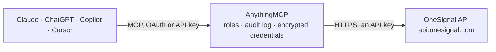

<!-- Generated by scripts/export-github-catalog.mjs in the anythingmcp-website repository. Do not edit by hand. -->

# OneSignal MCP connector

Let your AI work with OneSignal: review sent push, email and SMS messages with their delivery results and outcomes, look up segments, users and templates, and send or schedule messages, cancel them, … The AnythingMCP connector gives Claude, ChatGPT, Microsoft Copilot, Cursor and Gemini 16 MCP tools for OneSignal: 9 read and 7 can change data.

**Category:** [Marketing Automation](../marketing-automation.md) · **Tools:** 16 · **Setup guide:** [anythingmcp.com](https://anythingmcp.com/guides/onesignal-to-mcp) · [Deutsch](https://anythingmcp.com/de/guides/onesignal-to-mcp) · [Italiano](https://anythingmcp.com/it/guides/onesignal-to-mcp) · [Español](https://anythingmcp.com/es/guides/onesignal-to-mcp) · [日本語](https://anythingmcp.com/ja/guides/onesignal-to-mcp) · [Русский](https://anythingmcp.com/ru/guides/onesignal-to-mcp) · [中文](https://anythingmcp.com/zh/guides/onesignal-to-mcp)

## Start without code

No installation and no terminal: AnythingMCP Cloud runs the OneSignal connector for you, operated by helpcode.ai in Frankfurt, Germany.

1. **Click the button above** and create an account or sign in. The OneSignal connector opens, ready to install.
2. **Paste the API key or token from your OneSignal account.** Every click is in the [step-by-step guide](https://anythingmcp.com/guides/onesignal-to-mcp).
3. **Click Install.** AnythingMCP shows the address of your MCP server.
4. **Add that address to your assistant:** [Claude](https://anythingmcp.com/guides/connect-onesignal-to-claude) · [ChatGPT](https://anythingmcp.com/guides/connect-onesignal-to-chatgpt) · [Microsoft Copilot](https://anythingmcp.com/guides/connect-onesignal-to-copilot) · [Cursor](https://anythingmcp.com/guides/connect-onesignal-to-cursor) · [Gemini CLI](https://anythingmcp.com/guides/connect-onesignal-to-gemini) · [Meta Muse](https://anythingmcp.com/guides/connect-onesignal-to-muse).
5. **Ask your first question**, for example: *Show OneSignal user with external_id CUST-2026-17 and their subscription states and tags*

Prefer help with the setup? [Talk to us](https://anythingmcp.com/contact).

## How it works

- **The AI client** speaks MCP (Streamable HTTP) to AnythingMCP and only sees tool names, descriptions and results. It never gets the OneSignal credentials.
- **AnythingMCP** checks the client's role, builds the call from the tool definition, adds the credentials (an API key), calls OneSignal, logs the call and returns the result.
- **OneSignal** sees an ordinary API client with the rights of the account the credentials belong to.

## Tools

| Tool | What it does | Access |
|---|---|---|
| [`onesignal_view_app`](#onesignal_view_app) | Get the OneSignal app this connector is set up for: id, name, total and messageable subscriptions, created and updated times and organization. | read |
| [`onesignal_list_messages`](#onesignal_list_messages) | List the app's messages (push, email, SMS), newest first, 50 at most per page: id, name, contents or subject, segments, schedule, completion, delivery… | read |
| [`onesignal_view_message`](#onesignal_view_message) | Get one OneSignal message with its content, targeting, schedule, delivery counts, per-platform stats and, on request, outcomes (clicks, confirmed… | read |
| [`onesignal_view_outcomes`](#onesignal_view_outcomes) | Get the app's outcome totals for the last hour, day or month: clicks (os__click.count), confirmed deliveries (os__confirmed_delivery.count), sessions… | read |
| [`onesignal_export_message_history`](#onesignal_export_message_history) | Start an export of who received (events sent) or clicked (events clicked) one message: OneSignal builds a CSV file and returns its download URL… | read |
| [`onesignal_list_segments`](#onesignal_list_segments) | List the app's segments: id, name, description, created and updated times, read-only and active flags. | read |
| [`onesignal_view_user`](#onesignal_view_user) | Get a OneSignal user by alias (usually external_id): identity aliases, properties (tags, language, timezone, country, first and last active) and… | read |
| [`onesignal_list_templates`](#onesignal_list_templates) | List the app's message templates: id, name, created and updated times, optionally only push, email or SMS ones. | read |
| [`onesignal_view_template`](#onesignal_view_template) | Get one OneSignal template with its channel and content (headings, contents, email subject and body, platforms). | read |
| [`onesignal_send_push`](#onesignal_send_push) | Send a push notification with OneSignal to segments (included_segments) or to specific users by alias (include_aliases with target_channel push), now or at… | write |
| [`onesignal_send_email`](#onesignal_send_email) | Send an email with OneSignal to segments (included_segments) or to specific users by alias (include_aliases with target_channel email), now or at send_after. | write |
| [`onesignal_send_sms`](#onesignal_send_sms) | Send an SMS with OneSignal to segments (included_segments) or to specific users by alias (include_aliases with target_channel sms), now or at send_after. | write |
| [`onesignal_cancel_message`](#onesignal_cancel_message) | Stop a scheduled or still outgoing OneSignal message; what was already delivered stays delivered. | write |
| [`onesignal_create_segment`](#onesignal_create_segment) | Create a segment in the OneSignal app from filters on tags, sessions, language, app version, location or country. | write |
| [`onesignal_update_user`](#onesignal_update_user) | Update a OneSignal user's properties by alias (usually external_id): set tags (string key-value pairs) and language, timezone or country. | write |
| [`onesignal_delete_user`](#onesignal_delete_user) | Permanently delete a OneSignal user with all aliases, properties and subscriptions, by alias. | write |

## Tool reference

Every parameter as the AI client sees it in `tools/list`. Source: [`packages/backend/src/adapters/intl/onesignal.json`](../../../packages/backend/src/adapters/intl/onesignal.json).

### `onesignal_view_app`

Get the OneSignal app this connector is set up for: id, name, total and messageable subscriptions, created and updated times and organization. Push credentials are left out. Also checks that the App ID and the key belong together. Read-only.

**Access:** read · **Call:** `GET /apps/{{ONESIGNAL_APP_ID}}`

No parameters.

### `onesignal_list_messages`

List the app's messages (push, email, SMS), newest first, 50 at most per page: id, name, contents or subject, segments, schedule, completion, delivery counts (successful, failed, errored, converted, received) and per-platform stats. Read-only.

**Access:** read · **Call:** `GET /notifications`

| Parameter | Type | Required | Description |
|---|---|---|---|
| `limit` | integer | no | Messages per page, up to 50. Default 20. |
| `offset` | integer | no | Messages to skip, for the next page. |
| `kind` | `0` \| `1` \| `3` | no | Only messages created this way: 0 dashboard, 1 API, 3 automated (journeys). Default all. |
| `template_id` | string | no | Only messages that used this template. |
| `time_offset` | string | no | Start from this time (ISO 8601) or the next_time_offset token of the previous answer. |

### `onesignal_view_message`

Get one OneSignal message with its content, targeting, schedule, delivery counts, per-platform stats and, on request, outcomes (clicks, confirmed deliveries, session counts or custom outcomes). Read-only.

**Access:** read · **Call:** `GET /notifications/{message_id}`

| Parameter | Type | Required | Description |
|---|---|---|---|
| `message_id` | string | yes | Message id (UUID) from onesignal_list_messages or a send. |
| `outcome_names` | string | no | Outcomes to include, comma-separated, each with .count or .sum, e.g. os__click.count,os__confirmed_delivery.count,Purchase.sum. |
| `outcome_time_range` | `1h` \| `1d` \| `1mo` | no | Time range of the outcomes: 1h, 1d or 1mo. |
| `outcome_attribution` | `direct` \| `influenced` \| `unattributed` \| `total` | no | direct, influenced, unattributed or total (default). |

### `onesignal_view_outcomes`

Get the app's outcome totals for the last hour, day or month: clicks (os__click.count), confirmed deliveries (os__confirmed_delivery.count), sessions (os__session_duration.count) or your custom outcomes, by attribution and platform. Outcomes are kept about 30 days. Read-only.

**Access:** read · **Call:** `GET /apps/{{ONESIGNAL_APP_ID}}/outcomes`

| Parameter | Type | Required | Description |
|---|---|---|---|
| `outcome_names` | string | no | Comma-separated outcomes with .count or .sum. Default: os__click.count,os__confirmed_delivery.count,os__session_duration.count. |
| `outcome_time_range` | `1h` \| `1d` \| `1mo` | no | 1h (default), 1d or 1mo. |
| `outcome_platforms` | string | no | Comma-separated device types: 0 iOS, 1 Android, 2 Amazon, 5 Chrome, 8 Firefox, 11 Email, 14 SMS, 17 Safari. Default all. |
| `outcome_attribution` | `direct` \| `influenced` \| `unattributed` \| `total` | no | direct, influenced, unattributed or total (default). |

### `onesignal_export_message_history`

Start an export of who received (events sent) or clicked (events clicked) one message: OneSignal builds a CSV file and returns its download URL (destination_url), optionally also emailing it. Sent events exist only for messages to 1,000 or more recipients. Sent as a POST but only reads. Read-only.

**Access:** read · **Call:** `POST /notifications/{message_id}/history`

| Parameter | Type | Required | Description |
|---|---|---|---|
| `message_id` | string | yes | Message id (UUID) from onesignal_list_messages. |
| `events` | `sent` \| `clicked` | no | sent or clicked. |
| `email` | string | no | Optional address that also gets the report by email. |

### `onesignal_list_segments`

List the app's segments: id, name, description, created and updated times, read-only and active flags. Use the names in included_segments when sending. Read-only.

**Access:** read · **Call:** `GET /apps/{{ONESIGNAL_APP_ID}}/segments`

| Parameter | Type | Required | Description |
|---|---|---|---|
| `offset` | integer | no | Segments to skip, for the next page. |
| `limit` | integer | no | Segments per page, up to 300 (default). |

### `onesignal_view_user`

Get a OneSignal user by alias (usually external_id): identity aliases, properties (tags, language, timezone, country, first and last active) and subscriptions (push, email, SMS) with their enabled state. Read-only.

**Access:** read · **Call:** `GET /apps/{{ONESIGNAL_APP_ID}}/users/by/{alias_label}/{alias_id}`

| Parameter | Type | Required | Description |
|---|---|---|---|
| `alias_label` | string | no | Alias that identifies the user: external_id (your user id, most common), onesignal_id or a custom alias label. |
| `alias_id` | string | yes | The value of that alias for the user, e.g. the external_id. |

### `onesignal_list_templates`

List the app's message templates: id, name, created and updated times, optionally only push, email or SMS ones. Read-only.

**Access:** read · **Call:** `GET /templates`

| Parameter | Type | Required | Description |
|---|---|---|---|
| `channel` | `push` \| `email` \| `sms` | no | Only templates of this channel. |
| `limit` | integer | no | Templates per page, up to 50 (default). |
| `offset` | integer | no | Templates to skip, for the next page. |

### `onesignal_view_template`

Get one OneSignal template with its channel and content (headings, contents, email subject and body, platforms). Read-only.

**Access:** read · **Call:** `GET /templates/{template_id}`

| Parameter | Type | Required | Description |
|---|---|---|---|
| `template_id` | string | yes | Template id (UUID) from onesignal_list_templates. |

### `onesignal_send_push`

Send a push notification with OneSignal to segments (included_segments) or to specific users by alias (include_aliases with target_channel push), now or at send_after. This sends real messages to real people. Before calling, show the user the content, the audience and the time, and call only after the user confirms; for a segment or more than one recipient the user must answer with an explicit "yes, send". Returns the message id (empty id: nobody matched).

**Access:** write · **Call:** `POST /notifications`

| Parameter | Type | Required | Description |
|---|---|---|---|
| `contents` | object | no | Message text by language; English is required: {"en": "Your order shipped", "de": "..."}. |
| `headings` | object | no | Title by language: {"en": "Order update"}. Required for web push. |
| `included_segments` | string[] | no | Send to these segments by name, e.g. ["Subscribed Users"] or ["Active Users"]. Users in several segments get it once. |
| `excluded_segments` | string[] | no | Leave out users in these segments. |
| `include_aliases` | object | no | Send to specific users instead of segments: {"external_id": ["u1", "u2"]} (up to 20,000). Do not combine with segments. |
| `send_after` | string | no | Schedule for later, e.g. 2026-10-20T09:00:00Z. Leave out to send now; a scheduled message can be stopped with onesignal_cancel_message. |
| `name` | string | no | Internal name of the message, shown in OneSignal reports only. |
| `template_id` | string | no | Use this template (from onesignal_list_templates) for the content. |
| `custom_data` | object | no | Data for the template's personalization tags. |
| `idempotency_key` | string | no | A unique key (UUID) so a retried request is not sent twice. |
| `target_channel` | `push` | no | push. Needed with include_aliases. |
| `url` | string | no | https URL opened when the notification is tapped. |
| `data` | object | no | Extra data passed to the app with the notification. |

### `onesignal_send_email`

Send an email with OneSignal to segments (included_segments) or to specific users by alias (include_aliases with target_channel email), now or at send_after. This sends real messages to real people. Before calling, show the user the content, the audience and the time, and call only after the user confirms; for a segment or more than one recipient the user must answer with an explicit "yes, send". Returns the message id (empty id: nobody matched).

**Access:** write · **Call:** `POST /notifications`

| Parameter | Type | Required | Description |
|---|---|---|---|
| `email_subject` | string | yes | Subject of the email. |
| `email_body` | string | no | HTML body of the email. Not needed with template_id. |
| `included_segments` | string[] | no | Send to these segments by name, e.g. ["Subscribed Users"] or ["Active Users"]. Users in several segments get it once. |
| `excluded_segments` | string[] | no | Leave out users in these segments. |
| `include_aliases` | object | no | Send to specific users instead of segments: {"external_id": ["u1", "u2"]} (up to 20,000). Do not combine with segments. |
| `send_after` | string | no | Schedule for later, e.g. 2026-10-20T09:00:00Z. Leave out to send now; a scheduled message can be stopped with onesignal_cancel_message. |
| `name` | string | no | Internal name of the message, shown in OneSignal reports only. |
| `template_id` | string | no | Use this template (from onesignal_list_templates) for the content. |
| `custom_data` | object | no | Data for the template's personalization tags. |
| `idempotency_key` | string | no | A unique key (UUID) so a retried request is not sent twice. |
| `target_channel` | `email` | no | email. Needed with include_aliases. |
| `email_to` | string[] | no | Send to these addresses directly (up to 20,000). Do not combine with segments or aliases. |
| `email_from_name` | string | no | Sender name; default from the app's email settings. |
| `email_from_address` | string | no | Sender address on a verified domain; default from the app's email settings. |
| `email_reply_to_address` | string | no | Reply-to address. |
| `email_preheader` | string | no | Preview text shown after the subject. |
| `include_unsubscribed` | boolean | no | Also send to unsubscribed addresses; only for required account or transactional emails. Default false. |

### `onesignal_send_sms`

Send an SMS with OneSignal to segments (included_segments) or to specific users by alias (include_aliases with target_channel sms), now or at send_after. This sends real messages to real people. Before calling, show the user the content, the audience and the time, and call only after the user confirms; for a segment or more than one recipient the user must answer with an explicit "yes, send". Returns the message id (empty id: nobody matched).

**Access:** write · **Call:** `POST /notifications`

| Parameter | Type | Required | Description |
|---|---|---|---|
| `contents` | object | no | Message text by language; English is required: {"en": "Your code is 123456"}. Long texts are split and billed as several SMS. |
| `included_segments` | string[] | no | Send to these segments by name, e.g. ["Subscribed Users"] or ["Active Users"]. Users in several segments get it once. |
| `excluded_segments` | string[] | no | Leave out users in these segments. |
| `include_aliases` | object | no | Send to specific users instead of segments: {"external_id": ["u1", "u2"]} (up to 20,000). Do not combine with segments. |
| `send_after` | string | no | Schedule for later, e.g. 2026-10-20T09:00:00Z. Leave out to send now; a scheduled message can be stopped with onesignal_cancel_message. |
| `name` | string | no | Internal name of the message, shown in OneSignal reports only. |
| `template_id` | string | no | Use this template (from onesignal_list_templates) for the content. |
| `custom_data` | object | no | Data for the template's personalization tags. |
| `idempotency_key` | string | no | A unique key (UUID) so a retried request is not sent twice. |
| `target_channel` | `sms` | no | sms. Always sent for SMS. |
| `include_phone_numbers` | string[] | no | Send to these numbers directly, E.164 format such as +4915112345678. Do not combine with segments or aliases. |
| `sms_from` | string | no | Sender phone number or messaging service id; default from the app's SMS settings. |
| `sms_media_urls` | string[] | no | Image URLs to send as MMS (extra cost). |

### `onesignal_cancel_message`

Stop a scheduled or still outgoing OneSignal message; what was already delivered stays delivered. Confirm the message (show its name, content and schedule from onesignal_view_message) with the user before calling.

**Access:** write · **Call:** `DELETE /notifications/{message_id}`

| Parameter | Type | Required | Description |
|---|---|---|---|
| `message_id` | string | yes | Id (UUID) of the scheduled or sending message. |

### `onesignal_create_segment`

Create a segment in the OneSignal app from filters on tags, sessions, language, app version, location or country. A new segment changes nothing by itself, but can be used for sends; confirm its name and filters with the user before calling. Returns the segment id.

**Access:** write · **Call:** `POST /apps/{{ONESIGNAL_APP_ID}}/segments`

| Parameter | Type | Required | Description |
|---|---|---|---|
| `name` | string | yes | Segment name, up to 128 characters. |
| `description` | string | no | Optional description, up to 255 characters. |
| `filters` | object[] | yes | Filters joined by AND unless an {"operator": "OR"} sits between them, e.g. [{"field": "tag", "key": "plan", "relation": "=", "value": "pro"}, {"operator": "OR"}, {"field": "session_count", "relation": ">", "value": "10"}]. Fields: tag, last_session, first_session, session_count, session_time, language, app_version, location, country. |

### `onesignal_update_user`

Update a OneSignal user's properties by alias (usually external_id): set tags (string key-value pairs) and language, timezone or country. Tags drive segments and journeys, so show the user the changes and confirm before calling.

**Access:** write · **Call:** `PATCH /apps/{{ONESIGNAL_APP_ID}}/users/by/{alias_label}/{alias_id}`

| Parameter | Type | Required | Description |
|---|---|---|---|
| `alias_label` | string | no | Alias that identifies the user: external_id (your user id, most common), onesignal_id or a custom alias label. |
| `alias_id` | string | yes | The value of that alias for the user, e.g. the external_id. |
| `tags` | object | no | Tags to set or change, string values only, no nested objects: {"plan": "pro", "region": "eu"}. |
| `language` | string | no | Language code, ISO 639-1 lower case, e.g. de. |
| `timezone_id` | string | no | Time zone, e.g. Europe/Berlin. |
| `country` | string | no | Country code, ISO 3166-1 alpha-2 upper case, e.g. DE. |

### `onesignal_delete_user`

Permanently delete a OneSignal user with all aliases, properties and subscriptions, by alias. Cannot be undone. Installed switched off: an administrator turns it on deliberately. Show the user with onesignal_view_user first and only call this after the user confirms the exact alias.

**Access:** write · **Call:** `DELETE /apps/{{ONESIGNAL_APP_ID}}/users/by/{alias_label}/{alias_id}`

| Parameter | Type | Required | Description |
|---|---|---|---|
| `alias_label` | string | no | Alias that identifies the user: external_id (your user id, most common), onesignal_id or a custom alias label. |
| `alias_id` | string | yes | The value of that alias for the user to delete, exactly as confirmed by the user. |

## Run it yourself

AnythingMCP is open source (AGPL-3.0). [Run it with Docker](../../../README.md#run-it-yourself), open **Connectors → Store**, pick **OneSignal** and enter `ONESIGNAL_APP_ID`, `ONESIGNAL_APP_API_KEY`, then add your MCP server URL to the AI client.

[← Marketing Automation connectors](../marketing-automation.md) · [All categories](../README.md)
