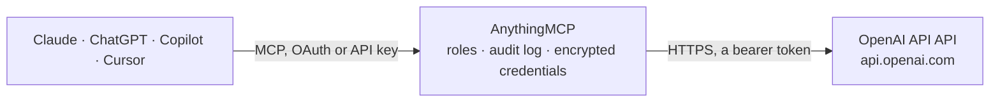

<!-- Generated by scripts/export-github-catalog.mjs in the anythingmcp-website repository. Do not edit by hand. -->

# OpenAI API MCP connector

Let your AI use the OpenAI API with your own key: ask GPT models through the Responses API, analyse pictures from a link, generate and edit images that appear right in the chat, create embeddings, … The AnythingMCP connector gives Claude, ChatGPT, Microsoft Copilot, Cursor and Gemini 12 MCP tools for OpenAI API: 9 read and 3 can change data.

**Category:** [Public Data](../data.md) · **Tools:** 12 · **Setup guide:** [anythingmcp.com](https://anythingmcp.com/guides/openai-to-mcp) · [Deutsch](https://anythingmcp.com/de/guides/openai-to-mcp) · [Italiano](https://anythingmcp.com/it/guides/openai-to-mcp) · [Español](https://anythingmcp.com/es/guides/openai-to-mcp) · [日本語](https://anythingmcp.com/ja/guides/openai-to-mcp) · [Русский](https://anythingmcp.com/ru/guides/openai-to-mcp) · [中文](https://anythingmcp.com/zh/guides/openai-to-mcp)

## Start without code

No installation and no terminal: AnythingMCP Cloud runs the OpenAI API connector for you, operated by helpcode.ai in Frankfurt, Germany.

1. **Click the button above** and create an account or sign in. The OpenAI API connector opens, ready to install.
2. **Paste the API key or token from your OpenAI API account.** Every click is in the [step-by-step guide](https://anythingmcp.com/guides/openai-to-mcp).
3. **Click Install.** AnythingMCP shows the address of your MCP server.
4. **Add that address to your assistant:** [Claude](https://anythingmcp.com/guides/connect-openai-to-claude) · [ChatGPT](https://anythingmcp.com/guides/connect-openai-to-chatgpt) · [Microsoft Copilot](https://anythingmcp.com/guides/connect-openai-to-copilot) · [Cursor](https://anythingmcp.com/guides/connect-openai-to-cursor) · [Gemini CLI](https://anythingmcp.com/guides/connect-openai-to-gemini) · [Meta Muse](https://anythingmcp.com/guides/connect-openai-to-muse).
5. **Ask your first question**, for example: *Find the OpenAI file record for invoice_INV-2026-1147.pdf in our account*

Prefer help with the setup? [Talk to us](https://anythingmcp.com/contact).

## How it works

- **The AI client** speaks MCP (Streamable HTTP) to AnythingMCP and only sees tool names, descriptions and results. It never gets the OpenAI API credentials.
- **AnythingMCP** checks the client's role, builds the call from the tool definition, adds the credentials (a bearer token), calls OpenAI API, logs the call and returns the result.
- **OpenAI API** sees an ordinary API client with the rights of the account the credentials belong to.

## Tools

| Tool | What it does | Access |
|---|---|---|
| [`openai_list_models`](#openai_list_models) | List the OpenAI models this API key can use (chat and reasoning, image, embedding, moderation, audio), with owner, creation time and announced shutdown date. | read |
| [`openai_get_model`](#openai_get_model) | Read one OpenAI model: id, owner, creation time and shutdown date when one is announced. | read |
| [`openai_create_response`](#openai_create_response) | Ask an OpenAI model and get its answer (Responses API). | read |
| [`openai_generate_image`](#openai_generate_image) | Create pictures from a text description with an OpenAI GPT image model and return them as images the user can see. | write |
| [`openai_edit_image`](#openai_edit_image) | Change existing pictures with an OpenAI GPT image model, or combine several into a new one: describe the edit and pass the pictures by public link or… | write |
| [`openai_create_embeddings`](#openai_create_embeddings) | Turn one text, or a list of up to 20 texts, into embedding vectors for semantic search, clustering or similarity. | read |
| [`openai_moderate`](#openai_moderate) | Check text, or text with images, against OpenAI's content policy categories (harassment, hate, self-harm, sexual, violence, illicit and their… | read |
| [`openai_list_files`](#openai_list_files) | List the files stored in the OpenAI account (for batches, fine-tuning, assistants, vision or user data), newest first, with id, name, size, purpose and expiry. | read |
| [`openai_get_file`](#openai_get_file) | Read the details of one file in the OpenAI account: name, size in bytes, purpose, creation time and expiry. | read |
| [`openai_delete_file`](#openai_delete_file) | Delete a file from the OpenAI account. | write |
| [`openai_list_batches`](#openai_list_batches) | List the Batch API jobs of the account, newest first: endpoint, model, status (validating, in_progress, finalizing, completed, failed, expired, cancelled),… | read |
| [`openai_get_batch`](#openai_get_batch) | Read one Batch API job: status, timestamps of each stage, request counts (total, completed, failed), token usage, errors and the output_file_id and… | read |

## Tool reference

Every parameter as the AI client sees it in `tools/list`. Source: [`packages/backend/src/adapters/intl/openai.json`](../../../packages/backend/src/adapters/intl/openai.json).

### `openai_list_models`

List the OpenAI models this API key can use (chat and reasoning, image, embedding, moderation, audio), with owner, creation time and announced shutdown date. Free: nothing is billed.

**Access:** read · **Call:** `GET /models`

No parameters.

### `openai_get_model`

Read one OpenAI model: id, owner, creation time and shutdown date when one is announced. Answers 404 when the key has no access to it. Free.

**Access:** read · **Call:** `GET /models/{model}`

| Parameter | Type | Required | Description |
|---|---|---|---|
| `model` | string | yes | Model id, e.g. gpt-6-luna or gpt-image-1-mini. |

### `openai_create_response`

Ask an OpenAI model and get its answer (Responses API). input is either a plain prompt string or a list of items, e.g. [{"role": "user", "content": [{"type": "input_text", "text": "What is in this picture?"}, {"type": "input_image", "image_url": "https://...", "detail": "auto"}]}] for images by public link, or earlier turns for a conversation. Billed per token to the user's key; the default gpt-6-luna is OpenAI's cheapest current model. Returns output_text, status (incomplete with reason max_output_tokens means the answer was cut) and usage. Read-only: it changes nothing in the account (the response is not stored unless store is true).

**Access:** read · **Call:** `POST /responses`

| Parameter | Type | Required | Description |
|---|---|---|---|
| `input` | string,array | yes | The prompt as text, or a list of input items (messages with input_text, input_image or input_file parts). |
| `model` | string | no | Model id. Default gpt-6-luna (fast and cheap); gpt-6.1-sol or gpt-6-astra for harder work, at 20 to 100 times the price. Other ids: openai_list_models. |
| `instructions` | string | no | System or developer instructions: role, tone, language, format. |
| `max_output_tokens` | integer | no | Upper limit for the answer in tokens, reasoning tokens included. Model default when left out. |
| `reasoning` | object | no | Reasoning settings for reasoning models, e.g. {"effort": "low"} (none, minimal, low, medium, high, xhigh, max; not every model supports every value). Lower effort is faster and cheaper. Leave out for models without reasoning. |
| `text` | object | no | Output format, e.g. {"format": {"type": "json_schema", "name": "invoice", "schema": {...}, "strict": true}} for structured output, or {"verbosity": "low"}. |
| `temperature` | number | no | Randomness from 0 to 2. Not accepted by most reasoning models; leave out unless needed. |
| `tools` | any[] | no | Built-in tools, e.g. [{"type": "web_search"}] for answers from the web (billed per search on top of tokens). Leave out for a plain answer. |
| `previous_response_id` | string | no | id of an earlier response to continue the conversation from; that response must have been created with store true. |
| `store` | boolean | no | Keep the response at OpenAI for 30 days so previous_response_id can continue it. Default false. |

### `openai_generate_image`

Create pictures from a text description with an OpenAI GPT image model and return them as images the user can see. COSTS MONEY, billed to the user's key: with the default gpt-image-1-mini at medium quality about $0.01 per 1024x1024 picture; gpt-image-2 or gpt-image-2.5-flare at high quality cost several times more per picture. Confirm with the user before calling, and before calling it again. GPT image models need a verified OpenAI organization.

**Access:** write · **Call:** `POST /images/generations`

| Parameter | Type | Required | Description |
|---|---|---|---|
| `prompt` | string | yes | A full description of the picture: subject, setting, style, lighting, any text to show (up to 32,000 characters). |
| `model` | string | no | Image model. Default gpt-image-1-mini (cheapest); gpt-image-2.5-flare (fast, everyday), gpt-image-2.5-sunburst (most capable), gpt-image-2, gpt-image-1.5. |
| `size` | string | no | 1024x1024 (default), 1536x1024 (landscape), 1024x1536 (portrait) or auto. gpt-image-2 and newer also take any WIDTHxHEIGHT with both sides divisible by 16, up to 3840x2160. |
| `quality` | `low` \| `medium` \| `high` \| `auto` \| `xhigh` \| `max` | no | low, medium (default), high or auto; xhigh and max only on gpt-image-2.5 models. Higher quality costs more. |
| `n` | integer | no | Number of pictures, 1 to 4 (each one is billed). Default 1. |
| `output_format` | `jpeg` \| `png` \| `webp` | no | File format. Default jpeg, which keeps pictures small; png or webp for a transparent background. |
| `output_compression` | integer | no | Compression 0 to 100 for jpeg and webp only (100 is the API default). Do not send it with png. |
| `background` | `auto` \| `opaque` \| `transparent` | no | transparent needs output_format png or webp. |
| `moderation` | `auto` \| `low` | no | Content filtering level. Default auto. |

### `openai_edit_image`

Change existing pictures with an OpenAI GPT image model, or combine several into a new one: describe the edit and pass the pictures by public link or uploaded file id. Returns the new pictures as images. An optional mask (a PNG with transparent areas) limits the edit to those areas. COSTS MONEY, billed to the user's key: about $0.01 per picture with the default gpt-image-1-mini at medium quality, plus the input pictures. Confirm with the user before calling.

**Access:** write · **Call:** `POST /images/edits`

| Parameter | Type | Required | Description |
|---|---|---|---|
| `prompt` | string | yes | The change to make, in full sentences. Say what must stay the same. |
| `images` | any[] | yes | Up to 16 input pictures, each {"image_url": "https://..."} (or a data: URL) or {"file_id": "file-..."}. PNG, JPEG or WebP. |
| `mask` | object | no | Optional mask for the first picture, {"image_url": "https://..."} or {"file_id": "file-..."}: transparent areas are edited, the rest is kept. Same size as the picture. |
| `model` | string | no | Image model. Default gpt-image-1-mini. Always set: the API default for edits is the most expensive model. |
| `size` | string | no | 1024x1024, 1536x1024, 1024x1536 or auto (the API default, which follows the input). |
| `quality` | `low` \| `medium` \| `high` \| `auto` \| `xhigh` \| `max` | no | low, medium (default), high or auto. |
| `n` | integer | no | Number of results, 1 to 4 (each one is billed). Default 1. |
| `output_format` | `jpeg` \| `png` \| `webp` | no | File format. Default jpeg; png or webp for transparency. |
| `input_fidelity` | `low` \| `high` | no | How closely faces and details of the input are kept: high on gpt-image-1 and gpt-image-1.5 only; gpt-image-1-mini supports only low; leave out for gpt-image-2. |
| `background` | `auto` \| `opaque` \| `transparent` | no | transparent needs output_format png or webp. |

### `openai_create_embeddings`

Turn one text, or a list of up to 20 texts, into embedding vectors for semantic search, clustering or similarity. Default text-embedding-3-small with 256 dimensions, which keeps the answer small; up to 1536 (3072 on text-embedding-3-large) for the full vector. Billed per input token to the user's key (about $0.02 per million tokens). Read-only.

**Access:** read · **Call:** `POST /embeddings`

| Parameter | Type | Required | Description |
|---|---|---|---|
| `input` | string,array | yes | A text, or a list of texts (each up to 8,192 tokens). |
| `model` | string | no | Embedding model. Default text-embedding-3-small; text-embedding-3-large for higher quality. |
| `dimensions` | integer | no | Vector length. Default 256. |

### `openai_moderate`

Check text, or text with images, against OpenAI's content policy categories (harassment, hate, self-harm, sexual, violence, illicit and their subcategories): flagged, the categories hit and a score per category. Free of charge with omni-moderation-latest. Read-only.

**Access:** read · **Call:** `POST /moderations`

| Parameter | Type | Required | Description |
|---|---|---|---|
| `input` | string,array | yes | A text, a list of texts, or a list of parts such as [{"type": "text", "text": "..."}, {"type": "image_url", "image_url": {"url": "https://..."}}]. |
| `model` | string | no | Moderation model. Default omni-moderation-latest. |

### `openai_list_files`

List the files stored in the OpenAI account (for batches, fine-tuning, assistants, vision or user data), newest first, with id, name, size, purpose and expiry. Call again with after = the last id while has_more is true.

**Access:** read · **Call:** `GET /files`

| Parameter | Type | Required | Description |
|---|---|---|---|
| `purpose` | string | no | Only files with this purpose: assistants, batch, batch_output, fine-tune, fine-tune-results, vision or user_data. |
| `limit` | integer | no | Files per page, 1 to 10,000. Default 20. |
| `order` | `desc` \| `asc` | no | By creation time. Default desc (newest first). |
| `after` | string | no | File id to continue after (last_id of the previous page). |

### `openai_get_file`

Read the details of one file in the OpenAI account: name, size in bytes, purpose, creation time and expiry. Does not download the content.

**Access:** read · **Call:** `GET /files/{file_id}`

| Parameter | Type | Required | Description |
|---|---|---|---|
| `file_id` | string | yes | File id, e.g. file-abc123. |

### `openai_delete_file`

Delete a file from the OpenAI account. It cannot be restored, and batches, fine-tuning jobs or vector stores that use it lose it. Confirm with the user first. Installed switched off.

**Access:** write · **Call:** `DELETE /files/{file_id}`

| Parameter | Type | Required | Description |
|---|---|---|---|
| `file_id` | string | yes | File id, e.g. file-abc123. |

### `openai_list_batches`

List the Batch API jobs of the account, newest first: endpoint, model, status (validating, in_progress, finalizing, completed, failed, expired, cancelled), request counts and the ids of the output and error files. Call again with after = the last id while has_more is true.

**Access:** read · **Call:** `GET /batches`

| Parameter | Type | Required | Description |
|---|---|---|---|
| `limit` | integer | no | Batches per page, 1 to 100. Default 20. |
| `after` | string | no | Batch id to continue after (last_id of the previous page). |

### `openai_get_batch`

Read one Batch API job: status, timestamps of each stage, request counts (total, completed, failed), token usage, errors and the output_file_id and error_file_id once it has finished.

**Access:** read · **Call:** `GET /batches/{batch_id}`

| Parameter | Type | Required | Description |
|---|---|---|---|
| `batch_id` | string | yes | Batch id, e.g. batch_abc123. |

## Run it yourself

AnythingMCP is open source (AGPL-3.0). [Run it with Docker](../../../README.md#run-it-yourself), open **Connectors → Store**, pick **OpenAI API** and enter `OPENAI_API_KEY`, then add your MCP server URL to the AI client.

[← Public Data connectors](../data.md) · [All categories](../README.md)
