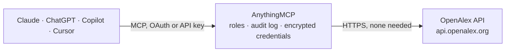

<!-- Generated by scripts/export-github-catalog.mjs in the anythingmcp-website repository. Do not edit by hand. -->

# OpenAlex MCP connector

Search the open research catalog OpenAlex: about 324 million scholarly works with authors, institutions, journals, topics, publishers and funders, citation links, open access status and counts grouped by any field. The AnythingMCP connector gives Claude, ChatGPT, Microsoft Copilot, Cursor and Gemini 16 MCP tools for OpenAlex, all read-only.

**Category:** [Public Data](../data.md) · **Tools:** 16 · **Setup guide:** [anythingmcp.com](https://anythingmcp.com/guides/openalex-to-mcp) · [Deutsch](https://anythingmcp.com/de/guides/openalex-to-mcp) · [Italiano](https://anythingmcp.com/it/guides/openalex-to-mcp) · [Español](https://anythingmcp.com/es/guides/openalex-to-mcp) · [日本語](https://anythingmcp.com/ja/guides/openalex-to-mcp) · [Русский](https://anythingmcp.com/ru/guides/openalex-to-mcp) · [中文](https://anythingmcp.com/zh/guides/openalex-to-mcp)

## Start without code

No installation and no terminal: AnythingMCP Cloud runs the OpenAlex connector for you, operated by helpcode.ai in Frankfurt, Germany.

1. **Click the button above** and create an account or sign in. The OpenAlex connector opens, ready to install.
2. **Nothing to enter:** this connector needs no credentials. Every click is in the [step-by-step guide](https://anythingmcp.com/guides/openalex-to-mcp).
3. **Click Install.** AnythingMCP shows the address of your MCP server.
4. **Add that address to your assistant:** [Claude](https://anythingmcp.com/guides/connect-openalex-to-claude) · [ChatGPT](https://anythingmcp.com/guides/connect-openalex-to-chatgpt) · [Microsoft Copilot](https://anythingmcp.com/guides/connect-openalex-to-copilot) · [Cursor](https://anythingmcp.com/guides/connect-openalex-to-cursor) · [Gemini CLI](https://anythingmcp.com/guides/connect-openalex-to-gemini) · [Meta Muse](https://anythingmcp.com/guides/connect-openalex-to-muse).
5. **Ask your first question**, for example: *Show me the OpenAlex record for DOI 10.5555/zenodo.2026001 — I need title, publication year and citation count.*

Prefer help with the setup? [Talk to us](https://anythingmcp.com/contact).

## How it works

- **The AI client** speaks MCP (Streamable HTTP) to AnythingMCP and only sees tool names, descriptions and results. It never gets the OpenAlex credentials.
- **AnythingMCP** checks the client's role, builds the call from the tool definition, adds the credentials (none needed), calls OpenAlex, logs the call and returns the result.
- **OpenAlex** sees an ordinary API client with the rights of the account the credentials belong to.

## Tools

| Tool | What it does | Access |
|---|---|---|
| [`openalex_search_works`](#openalex_search_works) | Search and filter OpenAlex works (articles, books, datasets, preprints, theses): by words, by meaning, or by author, institution, source, topic, funder,… | read |
| [`openalex_get_work`](#openalex_get_work) | Get one OpenAlex work by OpenAlex id, DOI, PubMed id or other id: title, abstract (as an inverted index), authors with institutions, source, topics,… | read |
| [`openalex_search_authors`](#openalex_search_authors) | Search and filter OpenAlex authors (disambiguated researcher profiles): id, ORCID, name, works and citation counts, h-index and last known institutions. | read |
| [`openalex_get_author`](#openalex_get_author) | Get one OpenAlex author: names, ORCID, affiliations over time, works and citation counts per year, h-index and i10-index, main topics. | read |
| [`openalex_search_sources`](#openalex_search_sources) | Search and filter OpenAlex sources (journals, repositories, conferences, book series): id, ISSN, name, type, publisher, open access and DOAJ status, works… | read |
| [`openalex_get_source`](#openalex_get_source) | Get one OpenAlex source: ISSNs, publisher lineage, type, open access and DOAJ status, APC price, works and citation counts per year, main topics. | read |
| [`openalex_search_institutions`](#openalex_search_institutions) | Search and filter OpenAlex institutions (universities, companies, hospitals, government bodies): id, ROR, name, type, country, city, works and citation counts. | read |
| [`openalex_get_institution`](#openalex_get_institution) | Get one OpenAlex institution: ROR, type, location, parent and child institutions, repositories, works and citation counts per year, main topics. | read |
| [`openalex_search_topics`](#openalex_search_topics) | Search and filter the about 4,500 OpenAlex research topics, organised as domain > field > subfield > topic: id, name, description, keywords and hierarchy,… | read |
| [`openalex_get_topic`](#openalex_get_topic) | Get one OpenAlex topic: description, keywords, subfield, field and domain, sibling topics, works and citation counts. | read |
| [`openalex_search_publishers`](#openalex_search_publishers) | Search and filter OpenAlex publishers: id, name, place in the publisher hierarchy, countries, works and citation counts, h-index. | read |
| [`openalex_get_publisher`](#openalex_get_publisher) | Get one OpenAlex publisher: alternate names, parent publisher and lineage, countries, homepage, works and citation counts per year. | read |
| [`openalex_search_funders`](#openalex_search_funders) | Search and filter OpenAlex funders (agencies, foundations, companies that fund research): id, name, country, description, number of awards, funded works and… | read |
| [`openalex_get_funder`](#openalex_get_funder) | Get one OpenAlex funder: alternate names, country, description, homepage, awards and funded works and citations per year. | read |
| [`openalex_group_by`](#openalex_group_by) | Count OpenAlex records grouped by a field, e.g. works per publication year, per open access status, per institution, per country or per topic, for a… | read |
| [`openalex_autocomplete`](#openalex_autocomplete) | Type-ahead lookup of OpenAlex works, authors, sources, institutions, topics, keywords, publishers or funders: the fastest way to turn a name into an… | read |

## Tool reference

Every parameter as the AI client sees it in `tools/list`. Source: [`packages/backend/src/adapters/intl/openalex.json`](../../../packages/backend/src/adapters/intl/openalex.json).

### `openalex_search_works`

Search and filter OpenAlex works (articles, books, datasets, preprints, theses): by words, by meaning, or by author, institution, source, topic, funder, year, type, open access and citation filters. Returns per work the OpenAlex id, DOI, title, year, type, citation count, open access status and URL, source and author names.

**Access:** read · **Call:** `GET /works`

| Parameter | Type | Required | Description |
|---|---|---|---|
| `search` | string | no | Full-text search over titles, abstracts and full texts (stemmed, AND/OR/NOT and "phrases" allowed). Only one of search, search_exact and search_semantic. |
| `filter` | string | no | Filters as field:value, comma = AND, \| = OR (up to 100 values), ! = NOT, > < for numbers and ranges a-b. Works: publication_year:2024, publication_year:2020-2024, type:article\|review, is_oa:true, cited_by_count:>100, authorships.author.id:A5023888391, authorships.institutions.id:I63966007, primary_location.source.id:S137773608, topics.id:T10017, funders.id:F4320306076, doi:10.7717/peerj.4375\|10.1038/nature12373, language:en, has_fulltext:true. Resolve names to ids first. |
| `sort` | string | no | Sort field with :desc or :asc, e.g. cited_by_count:desc, publication_date:desc. With search the default is relevance_score:desc. |
| `per_page` | integer | no | Results per page, 1 to 100. |
| `page` | integer | no | Page number for basic paging (up to 10,000 results in total). |
| `cursor` | string | no | Cursor paging: * for the first page, then meta.next_cursor of the previous answer. Pages past the first need an API key. |
| `sample` | integer | no | Return a random sample of this many results (combine with seed to repeat it). |
| `seed` | integer | no | Seed for a reproducible sample. |
| `search_exact` | string | no | Search without stemming, for exact words. Only one of search, search_exact and search_semantic. |
| `search_semantic` | string | no | Search by meaning with AI embeddings: a sentence or paragraph (up to 2,000 characters), at most 50 results, 1 request per second; cited_by_count and country filters are not allowed with it. |
| `corpus` | `core` \| `expansion` \| `all` | no | core (default, about 324 million curated works), expansion (about 193 million extra works) or all. |

### `openalex_get_work`

Get one OpenAlex work by OpenAlex id, DOI, PubMed id or other id: title, abstract (as an inverted index), authors with institutions, source, topics, keywords, funders and awards, open access locations, references, related works and citations per year. Single-record lookups are free.

**Access:** read · **Call:** `GET /works/{work_id}`

| Parameter | Type | Required | Description |
|---|---|---|---|
| `work_id` | string | yes | W2741809807, https://openalex.org/W2741809807, doi:10.7717/peerj.4375, https://doi.org/10.7717/peerj.4375, pmid:29456894, pmcid:PMC5815332 or mag:2741809807. |
| `select` | string | no | Comma-separated top-level fields to return, e.g. id,display_name,cited_by_count. Leave empty for the full record. |

### `openalex_search_authors`

Search and filter OpenAlex authors (disambiguated researcher profiles): id, ORCID, name, works and citation counts, h-index and last known institutions. Several profiles can share a name: compare institutions and counts.

**Access:** read · **Call:** `GET /authors`

| Parameter | Type | Required | Description |
|---|---|---|---|
| `search` | string | no | Author name to search, e.g. Heather Piwowar (also matches alternative spellings). |
| `filter` | string | no | Filters as field:value, comma = AND, \| = OR (up to 100 values), ! = NOT, > < for numbers and ranges a-b. Authors: last_known_institutions.id:I63966007, works_count:>50, cited_by_count:>1000, orcid:0000-0003-1613-5981, has_orcid:true, last_known_institutions.country_code:DE. |
| `sort` | string | no | Sort field with :desc or :asc, e.g. cited_by_count:desc, works_count:desc. With search the default is relevance_score:desc. |
| `per_page` | integer | no | Results per page, 1 to 100. |
| `page` | integer | no | Page number for basic paging (up to 10,000 results in total). |
| `cursor` | string | no | Cursor paging: * for the first page, then meta.next_cursor of the previous answer. Pages past the first need an API key. |
| `sample` | integer | no | Return a random sample of this many results (combine with seed to repeat it). |
| `seed` | integer | no | Seed for a reproducible sample. |

### `openalex_get_author`

Get one OpenAlex author: names, ORCID, affiliations over time, works and citation counts per year, h-index and i10-index, main topics.

**Access:** read · **Call:** `GET /authors/{author_id}`

| Parameter | Type | Required | Description |
|---|---|---|---|
| `author_id` | string | yes | OpenAlex id such as A5023888391 (or https://openalex.org/A5023888391), or orcid:0000-0003-1613-5981. |
| `select` | string | no | Comma-separated top-level fields to return, e.g. id,display_name,cited_by_count. Leave empty for the full record. |

### `openalex_search_sources`

Search and filter OpenAlex sources (journals, repositories, conferences, book series): id, ISSN, name, type, publisher, open access and DOAJ status, works and citation counts, h-index.

**Access:** read · **Call:** `GET /sources`

| Parameter | Type | Required | Description |
|---|---|---|---|
| `search` | string | no | Name of a journal, repository or conference to search, e.g. Nature. |
| `filter` | string | no | Filters as field:value, comma = AND, \| = OR (up to 100 values), ! = NOT, > < for numbers and ranges a-b. Sources: type:journal\|repository\|conference, is_oa:true, is_in_doaj:true, issn:0028-0836, host_organization.id:P4310320990, country_code:US, works_count:>1000. |
| `sort` | string | no | Sort field with :desc or :asc, e.g. cited_by_count:desc, works_count:desc. With search the default is relevance_score:desc. |
| `per_page` | integer | no | Results per page, 1 to 100. |
| `page` | integer | no | Page number for basic paging (up to 10,000 results in total). |
| `cursor` | string | no | Cursor paging: * for the first page, then meta.next_cursor of the previous answer. Pages past the first need an API key. |
| `sample` | integer | no | Return a random sample of this many results (combine with seed to repeat it). |
| `seed` | integer | no | Seed for a reproducible sample. |

### `openalex_get_source`

Get one OpenAlex source: ISSNs, publisher lineage, type, open access and DOAJ status, APC price, works and citation counts per year, main topics.

**Access:** read · **Call:** `GET /sources/{source_id}`

| Parameter | Type | Required | Description |
|---|---|---|---|
| `source_id` | string | yes | OpenAlex id such as S137773608 (or https://openalex.org/S137773608), or issn:0028-0836. |
| `select` | string | no | Comma-separated top-level fields to return, e.g. id,display_name,cited_by_count. Leave empty for the full record. |

### `openalex_search_institutions`

Search and filter OpenAlex institutions (universities, companies, hospitals, government bodies): id, ROR, name, type, country, city, works and citation counts.

**Access:** read · **Call:** `GET /institutions`

| Parameter | Type | Required | Description |
|---|---|---|---|
| `search` | string | no | Institution name to search, e.g. Massachusetts Institute of Technology (acronyms match too). |
| `filter` | string | no | Filters as field:value, comma = AND, \| = OR (up to 100 values), ! = NOT, > < for numbers and ranges a-b. Institutions: country_code:DE, type:education\|company\|healthcare\|government\|facility\|nonprofit\|archive\|funder, ror:https://ror.org/042nb2s44, works_count:>1000, is_super_system:false. |
| `sort` | string | no | Sort field with :desc or :asc, e.g. cited_by_count:desc, works_count:desc. With search the default is relevance_score:desc. |
| `per_page` | integer | no | Results per page, 1 to 100. |
| `page` | integer | no | Page number for basic paging (up to 10,000 results in total). |
| `cursor` | string | no | Cursor paging: * for the first page, then meta.next_cursor of the previous answer. Pages past the first need an API key. |
| `sample` | integer | no | Return a random sample of this many results (combine with seed to repeat it). |
| `seed` | integer | no | Seed for a reproducible sample. |

### `openalex_get_institution`

Get one OpenAlex institution: ROR, type, location, parent and child institutions, repositories, works and citation counts per year, main topics.

**Access:** read · **Call:** `GET /institutions/{institution_id}`

| Parameter | Type | Required | Description |
|---|---|---|---|
| `institution_id` | string | yes | OpenAlex id such as I63966007 (or https://openalex.org/I63966007), or ror:042nb2s44. |
| `select` | string | no | Comma-separated top-level fields to return, e.g. id,display_name,cited_by_count. Leave empty for the full record. |

### `openalex_search_topics`

Search and filter the about 4,500 OpenAlex research topics, organised as domain > field > subfield > topic: id, name, description, keywords and hierarchy, works count. Use a topic id in a works filter (topics.id).

**Access:** read · **Call:** `GET /topics`

| Parameter | Type | Required | Description |
|---|---|---|---|
| `search` | string | no | Words to search in topic names, descriptions and keywords, e.g. machine learning. |
| `filter` | string | no | Filters as field:value, comma = AND, \| = OR (up to 100 values), ! = NOT, > < for numbers and ranges a-b. Topics: domain.id:3, field.id:17, subfield.id:1702, works_count:>10000. |
| `sort` | string | no | Sort field with :desc or :asc, e.g. works_count:desc, cited_by_count:desc. With search the default is relevance_score:desc. |
| `per_page` | integer | no | Results per page, 1 to 100. |
| `page` | integer | no | Page number for basic paging (up to 10,000 results in total). |
| `cursor` | string | no | Cursor paging: * for the first page, then meta.next_cursor of the previous answer. Pages past the first need an API key. |
| `sample` | integer | no | Return a random sample of this many results (combine with seed to repeat it). |
| `seed` | integer | no | Seed for a reproducible sample. |

### `openalex_get_topic`

Get one OpenAlex topic: description, keywords, subfield, field and domain, sibling topics, works and citation counts.

**Access:** read · **Call:** `GET /topics/{topic_id}`

| Parameter | Type | Required | Description |
|---|---|---|---|
| `topic_id` | string | yes | OpenAlex id such as T10017 (or https://openalex.org/T10017). |
| `select` | string | no | Comma-separated top-level fields to return, e.g. id,display_name,cited_by_count. Leave empty for the full record. |

### `openalex_search_publishers`

Search and filter OpenAlex publishers: id, name, place in the publisher hierarchy, countries, works and citation counts, h-index. Their journals are sources with host_organization.id = the publisher id.

**Access:** read · **Call:** `GET /publishers`

| Parameter | Type | Required | Description |
|---|---|---|---|
| `search` | string | no | Publisher name to search, e.g. Springer Nature. |
| `filter` | string | no | Filters as field:value, comma = AND, \| = OR (up to 100 values), ! = NOT, > < for numbers and ranges a-b. Publishers: hierarchy_level:0 (top-level groups), parent_publisher:P4310319965, country_codes:GB, works_count:>10000. |
| `sort` | string | no | Sort field with :desc or :asc, e.g. works_count:desc, cited_by_count:desc. With search the default is relevance_score:desc. |
| `per_page` | integer | no | Results per page, 1 to 100. |
| `page` | integer | no | Page number for basic paging (up to 10,000 results in total). |
| `cursor` | string | no | Cursor paging: * for the first page, then meta.next_cursor of the previous answer. Pages past the first need an API key. |
| `sample` | integer | no | Return a random sample of this many results (combine with seed to repeat it). |
| `seed` | integer | no | Seed for a reproducible sample. |

### `openalex_get_publisher`

Get one OpenAlex publisher: alternate names, parent publisher and lineage, countries, homepage, works and citation counts per year.

**Access:** read · **Call:** `GET /publishers/{publisher_id}`

| Parameter | Type | Required | Description |
|---|---|---|---|
| `publisher_id` | string | yes | OpenAlex id such as P4310320990 (or https://openalex.org/P4310320990). |
| `select` | string | no | Comma-separated top-level fields to return, e.g. id,display_name,cited_by_count. Leave empty for the full record. |

### `openalex_search_funders`

Search and filter OpenAlex funders (agencies, foundations, companies that fund research): id, name, country, description, number of awards, funded works and their citations.

**Access:** read · **Call:** `GET /funders`

| Parameter | Type | Required | Description |
|---|---|---|---|
| `search` | string | no | Funder name to search, e.g. National Science Foundation or European Research Council. |
| `filter` | string | no | Filters as field:value, comma = AND, \| = OR (up to 100 values), ! = NOT, > < for numbers and ranges a-b. Funders: country_code:US, awards_count:>100, works_count:>1000. |
| `sort` | string | no | Sort field with :desc or :asc, e.g. works_count:desc, cited_by_count:desc. With search the default is relevance_score:desc. |
| `per_page` | integer | no | Results per page, 1 to 100. |
| `page` | integer | no | Page number for basic paging (up to 10,000 results in total). |
| `cursor` | string | no | Cursor paging: * for the first page, then meta.next_cursor of the previous answer. Pages past the first need an API key. |
| `sample` | integer | no | Return a random sample of this many results (combine with seed to repeat it). |
| `seed` | integer | no | Seed for a reproducible sample. |

### `openalex_get_funder`

Get one OpenAlex funder: alternate names, country, description, homepage, awards and funded works and citations per year. Funded works: openalex_search_works with filter funders.id:<id>.

**Access:** read · **Call:** `GET /funders/{funder_id}`

| Parameter | Type | Required | Description |
|---|---|---|---|
| `funder_id` | string | yes | OpenAlex id such as F4320306076 (or https://openalex.org/F4320306076), or ror:021nxhr62. |
| `select` | string | no | Comma-separated top-level fields to return, e.g. id,display_name,cited_by_count. Leave empty for the full record. |

### `openalex_group_by`

Count OpenAlex records grouped by a field, e.g. works per publication year, per open access status, per institution, per country or per topic, for a filtered or searched set. Returns up to 200 groups with key, display name and count; the cheapest way to answer how-many and top-N questions.

**Access:** read · **Call:** `GET /{entity}`

| Parameter | Type | Required | Description |
|---|---|---|---|
| `entity` | `works` \| `authors` \| `sources` \| `institutions` \| `topics` \| `publishers` \| `funders` | yes | What to count: works (default), authors, sources, institutions, topics, publishers or funders. |
| `group_by` | string | yes | Field to group by. Works: publication_year, type, open_access.oa_status, open_access.is_oa, authorships.institutions.id, authorships.countries, authorships.author.id, primary_location.source.id, topics.id, primary_topic.field.id, funders.id, language, sustainable_development_goals.id. Authors: last_known_institutions.country_code. Institutions: type, country_code. Sources: type, is_oa. |
| `filter` | string | no | Filters of the chosen entity, same syntax as the search tools, e.g. authorships.institutions.id:I63966007,publication_year:2020-2025. |
| `search` | string | no | Optional full-text search to restrict the counted set, e.g. "climate adaptation". |

### `openalex_autocomplete`

Type-ahead lookup of OpenAlex works, authors, sources, institutions, topics, keywords, publishers or funders: the fastest way to turn a name into an OpenAlex id. Returns up to 10 matches with id, name, a hint (authors, institution or location), citation and works counts and the external id (DOI, ORCID, ROR, ISSN). Also resolves an ORCID, DOI or OpenAlex id typed as q.

**Access:** read · **Call:** `GET /autocomplete/{entity_type}`

| Parameter | Type | Required | Description |
|---|---|---|---|
| `entity_type` | `works` \| `authors` \| `sources` \| `institutions` \| `topics` \| `keywords` \| `publishers` \| `funders` | yes | Kind of record to suggest. |
| `q` | string | yes | The partial name, e.g. stanf, or an id such as https://orcid.org/0000-0002-7436-3176. |
| `filter` | string | no | Optional filter of that entity, e.g. country_code:US for institutions or publication_year:2024 for works. |

## Run it yourself

AnythingMCP is open source (AGPL-3.0). [Run it with Docker](../../../README.md#run-it-yourself), open **Connectors → Store**, pick **OpenAlex**, then add your MCP server URL to the AI client.

[← Public Data connectors](../data.md) · [All categories](../README.md)
