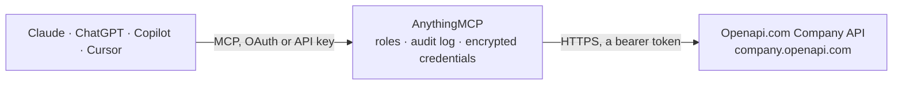

<!-- Generated by scripts/export-github-catalog.mjs in the anythingmcp-website repository. Do not edit by hand. -->

# Openapi.com Company MCP connector

Italian and international company data from Openapi.com by VAT number or tax code: company profile at three levels, PEC, SDI code, address, shareholders, stakeholders, beneficial owners, cessation … The AnythingMCP connector gives Claude, ChatGPT, Microsoft Copilot, Cursor and Gemini 21 MCP tools for Openapi.com Company, all read-only.

**Category:** [Data Enrichment](../enrichment.md) · **Tools:** 21 · **Setup guide:** [anythingmcp.com](https://anythingmcp.com/guides/openapi-company-to-mcp) · [Deutsch](https://anythingmcp.com/de/guides/openapi-company-to-mcp) · [Italiano](https://anythingmcp.com/it/guides/openapi-company-to-mcp) · [Español](https://anythingmcp.com/es/guides/openapi-company-to-mcp) · [日本語](https://anythingmcp.com/ja/guides/openapi-company-to-mcp) · [Русский](https://anythingmcp.com/ru/guides/openapi-company-to-mcp) · [中文](https://anythingmcp.com/zh/guides/openapi-company-to-mcp)

## Start without code

No installation and no terminal: AnythingMCP Cloud runs the Openapi.com Company connector for you, operated by helpcode.ai in Frankfurt, Germany.

1. **Click the button above** and create an account or sign in. The Openapi.com Company connector opens, ready to install.
2. **Paste the API key or token from your Openapi.com Company account.** Every click is in the [step-by-step guide](https://anythingmcp.com/guides/openapi-company-to-mcp).
3. **Click Install.** AnythingMCP shows the address of your MCP server.
4. **Add that address to your assistant:** [Claude](https://anythingmcp.com/guides/connect-openapi-company-to-claude) · [ChatGPT](https://anythingmcp.com/guides/connect-openapi-company-to-chatgpt) · [Microsoft Copilot](https://anythingmcp.com/guides/connect-openapi-company-to-copilot) · [Cursor](https://anythingmcp.com/guides/connect-openapi-company-to-cursor) · [Gemini CLI](https://anythingmcp.com/guides/connect-openapi-company-to-gemini) · [Meta Muse](https://anythingmcp.com/guides/connect-openapi-company-to-muse).
5. **Ask your first question.**

Prefer help with the setup? [Talk to us](https://anythingmcp.com/contact).

## How it works

- **The AI client** speaks MCP (Streamable HTTP) to AnythingMCP and only sees tool names, descriptions and results. It never gets the Openapi.com Company credentials.
- **AnythingMCP** checks the client's role, builds the call from the tool definition, adds the credentials (a bearer token), calls Openapi.com Company, logs the call and returns the result.
- **Openapi.com Company** sees an ordinary API client with the rights of the account the credentials belong to.

## Tools

| Tool | What it does | Access |
|---|---|---|
| [`openapi_company_it_start`](#openapi_company_it_start) | Basic data of an Italian company (paid call): company name, VAT number, tax code, registered office address, activity status and the Openapi company id. | read |
| [`openapi_company_it_advanced`](#openapi_company_it_advanced) | Advanced data of an Italian company (paid call): everything in it_start plus ATECO activity code, legal form, REA number and chamber of commerce, PEC, SDI… | read |
| [`openapi_company_it_full`](#openapi_company_it_full) | All available data of an Italian company in one answer (the most expensive call of the API): the advanced data plus managers, shareholders, stakeholders and… | read |
| [`openapi_company_it_name`](#openapi_company_it_name) | Name and town of an Italian company (paid call): company name, VAT number, tax code and town. | read |
| [`openapi_company_it_address`](#openapi_company_it_address) | Registered office address of an Italian company (paid call): street, number, ZIP code, town, province, region and coordinates when available. | read |
| [`openapi_company_it_pec`](#openapi_company_it_pec) | Certified e-mail address (PEC) of an Italian company (paid call), with its history of earlier PEC addresses. | read |
| [`openapi_company_it_sdi_code`](#openapi_company_it_sdi_code) | SDI recipient code (codice destinatario) of an Italian company for electronic invoices through the Sistema di Interscambio, updated in real time (paid call). | read |
| [`openapi_company_it_shareholders`](#openapi_company_it_shareholders) | Shareholders of an Italian company holding more than 10 percent (paid call): name or company name, tax code and share percentage. | read |
| [`openapi_company_it_stakeholders`](#openapi_company_it_stakeholders) | Stakeholders of an Italian company (paid call): managers and officers with their roles, shareholders and the companies it holds stakes in. | read |
| [`openapi_company_it_ubo`](#openapi_company_it_ubo) | Ultimate beneficial owners of an Italian company (paid call): name, surname, tax code and the share or criterion that makes each person a beneficial owner. | read |
| [`openapi_company_it_closed`](#openapi_company_it_closed) | Whether an Italian VAT number has ceased according to the Italian Revenue Agency, checked in real time (paid call): taxCodeCeased true or false, with the… | read |
| [`openapi_company_it_vat_group`](#openapi_company_it_vat_group) | Whether an Italian company belongs to a VAT group and leads it (paid call). | read |
| [`openapi_company_it_public_administration`](#openapi_company_it_public_administration) | Data of an Italian public administration by tax code or VAT number (paid call): institution id, name, type, address, PEC and its IPA offices with their SDI… | read |
| [`openapi_company_it_split_payment`](#openapi_company_it_split_payment) | Whether a company is on the Italian split-payment (scissione dei pagamenti) lists, with name and category (paid call). | read |
| [`openapi_company_it_search`](#openapi_company_it_search) | Search Italian companies by name, place, ATECO code, legal form, status, turnover, employees, shareholder, PEC or SDI code (paid call, priced by results and… | read |
| [`openapi_company_it_legal_forms`](#openapi_company_it_legal_forms) | List the codes and descriptions of Italian legal forms (e.g. SR for S.R.L.), for reading legal-form codes in answers or filtering it_search. | read |
| [`openapi_company_check_request`](#openapi_company_check_request) | Get the result of a lookup that did not finish within 30 seconds (it_full, it_stakeholders and other heavy calls answer with a request id and state PENDING… | read |
| [`openapi_company_eu_vies_check`](#openapi_company_eu_vies_check) | Check in the EU VIES system whether a European VAT number is valid for intra-EU cross-border transactions (paid call): valid, normalised VAT number, company… | read |
| [`openapi_company_eu_start`](#openapi_company_eu_start) | Basic data of a European company by VAT number with its country prefix (paid call): whether the VAT number is valid and formally valid, country, company… | read |
| [`openapi_company_ww_start`](#openapi_company_ww_start) | Basic data of a company in any country (paid call): name, identifiers, address and status. | read |
| [`openapi_company_ww_advanced`](#openapi_company_ww_advanced) | Advanced data of a company in any country (paid call): basic data plus activity codes, legal form, balance-sheet figures and employees where the country's… | read |

## Tool reference

Every parameter as the AI client sees it in `tools/list`. Source: [`packages/backend/src/adapters/it/openapi-company.json`](../../../packages/backend/src/adapters/it/openapi-company.json).

### `openapi_company_it_start`

Basic data of an Italian company (paid call): company name, VAT number, tax code, registered office address, activity status and the Openapi company id. The cheapest full lookup by VAT number or tax code; start here.

**Access:** read · **Call:** `GET /IT-start/{id}`

| Parameter | Type | Required | Description |
|---|---|---|---|
| `id` | string | yes | Italian VAT number (partita IVA, 11 digits, e.g. 12485671007), tax code (codice fiscale) or the Openapi company id from an earlier answer. |

### `openapi_company_it_advanced`

Advanced data of an Italian company (paid call): everything in it_start plus ATECO activity code, legal form, REA number and chamber of commerce, PEC, SDI code, share capital, turnover and employees of the latest balance sheets, registration and cessation dates. Use it for a company profile.

**Access:** read · **Call:** `GET /IT-advanced/{id}`

| Parameter | Type | Required | Description |
|---|---|---|---|
| `id` | string | yes | Italian VAT number (partita IVA, 11 digits, e.g. 12485671007), tax code (codice fiscale) or the Openapi company id from an earlier answer. |

### `openapi_company_it_full`

All available data of an Italian company in one answer (the most expensive call of the API): the advanced data plus managers, shareholders, stakeholders and over 400 balance-sheet figures. Use it only when the user needs the complete file; otherwise prefer it_advanced. May answer with a request id to poll with check_request.

**Access:** read · **Call:** `GET /IT-full/{vat_or_tax_code}`

| Parameter | Type | Required | Description |
|---|---|---|---|
| `vat_or_tax_code` | string | yes | Italian VAT number or tax code. |

### `openapi_company_it_name`

Name and town of an Italian company (paid call): company name, VAT number, tax code and town. Use it to confirm whose VAT number it is.

**Access:** read · **Call:** `GET /IT-name/{id}`

| Parameter | Type | Required | Description |
|---|---|---|---|
| `id` | string | yes | Italian VAT number (partita IVA, 11 digits, e.g. 12485671007), tax code (codice fiscale) or the Openapi company id from an earlier answer. |

### `openapi_company_it_address`

Registered office address of an Italian company (paid call): street, number, ZIP code, town, province, region and coordinates when available.

**Access:** read · **Call:** `GET /IT-address/{id}`

| Parameter | Type | Required | Description |
|---|---|---|---|
| `id` | string | yes | Italian VAT number (partita IVA, 11 digits, e.g. 12485671007), tax code (codice fiscale) or the Openapi company id from an earlier answer. |

### `openapi_company_it_pec`

Certified e-mail address (PEC) of an Italian company (paid call), with its history of earlier PEC addresses.

**Access:** read · **Call:** `GET /IT-pec/{id}`

| Parameter | Type | Required | Description |
|---|---|---|---|
| `id` | string | yes | Italian VAT number (partita IVA, 11 digits, e.g. 12485671007), tax code (codice fiscale) or the Openapi company id from an earlier answer. |

### `openapi_company_it_sdi_code`

SDI recipient code (codice destinatario) of an Italian company for electronic invoices through the Sistema di Interscambio, updated in real time (paid call). Use it before issuing an e-invoice.

**Access:** read · **Call:** `GET /IT-sdicode/{id}`

| Parameter | Type | Required | Description |
|---|---|---|---|
| `id` | string | yes | Italian VAT number (partita IVA, 11 digits, e.g. 12485671007), tax code (codice fiscale) or the Openapi company id from an earlier answer. |

### `openapi_company_it_shareholders`

Shareholders of an Italian company holding more than 10 percent (paid call): name or company name, tax code and share percentage.

**Access:** read · **Call:** `GET /IT-shareholders/{id}`

| Parameter | Type | Required | Description |
|---|---|---|---|
| `id` | string | yes | Italian VAT number (partita IVA, 11 digits, e.g. 12485671007), tax code (codice fiscale) or the Openapi company id from an earlier answer. |

### `openapi_company_it_stakeholders`

Stakeholders of an Italian company (paid call): managers and officers with their roles, shareholders and the companies it holds stakes in. May answer with a request id to poll with check_request.

**Access:** read · **Call:** `GET /IT-stakeholders/{vat_or_tax_code}`

| Parameter | Type | Required | Description |
|---|---|---|---|
| `vat_or_tax_code` | string | yes | Italian VAT number or tax code. |

### `openapi_company_it_ubo`

Ultimate beneficial owners of an Italian company (paid call): name, surname, tax code and the share or criterion that makes each person a beneficial owner.

**Access:** read · **Call:** `GET /IT-ubo/{id}`

| Parameter | Type | Required | Description |
|---|---|---|---|
| `id` | string | yes | Italian VAT number (partita IVA, 11 digits, e.g. 12485671007), tax code (codice fiscale) or the Openapi company id from an earlier answer. |

### `openapi_company_it_closed`

Whether an Italian VAT number has ceased according to the Italian Revenue Agency, checked in real time (paid call): taxCodeCeased true or false, with the cessation date when known.

**Access:** read · **Call:** `GET /IT-closed/{id}`

| Parameter | Type | Required | Description |
|---|---|---|---|
| `id` | string | yes | Italian VAT number (partita IVA, 11 digits, e.g. 12485671007), tax code (codice fiscale) or the Openapi company id from an earlier answer. |
| `date` | string | no | Optional reference date, YYYY-MM-DD. |

### `openapi_company_it_vat_group`

Whether an Italian company belongs to a VAT group and leads it (paid call). With tax_code it also tells whether that tax code is consistent with the VAT number.

**Access:** read · **Call:** `GET /IT-vatgroup/{vat_code}`

| Parameter | Type | Required | Description |
|---|---|---|---|
| `vat_code` | string | yes | Italian VAT number (or Openapi company id). |
| `tax_code` | string | no | Tax code to check against the VAT number. |

### `openapi_company_it_public_administration`

Data of an Italian public administration by tax code or VAT number (paid call): institution id, name, type, address, PEC and its IPA offices with their SDI codes.

**Access:** read · **Call:** `GET /IT-pa/{tax_or_vat_code}`

| Parameter | Type | Required | Description |
|---|---|---|---|
| `tax_or_vat_code` | string | yes | Tax code or VAT number of the public body. |

### `openapi_company_it_split_payment`

Whether a company is on the Italian split-payment (scissione dei pagamenti) lists, with name and category (paid call). Use it to decide whether an invoice needs split payment.

**Access:** read · **Call:** `GET /IT-splitpayment/{tax_or_vat_code}`

| Parameter | Type | Required | Description |
|---|---|---|---|
| `tax_or_vat_code` | string | yes | Tax code or VAT number. |

### `openapi_company_it_search`

Search Italian companies by name, place, ATECO code, legal form, status, turnover, employees, shareholder, PEC or SDI code (paid call, priced by results and enrichment). Returns ids, or company data with dataEnrichment. Run with dryRun 1 first to get the number of matches and the price, and tell the user before the real search. At most 1000 results per call.

**Access:** read · **Call:** `GET /IT-search`

| Parameter | Type | Required | Description |
|---|---|---|---|
| `companyName` | string | no | Company name words (at least 3 characters); * as wildcard at the start or end. |
| `autocomplete` | string | no | Names beginning with this text. |
| `province` | string | no | Province code, e.g. MI, RM. |
| `townCode` | string | no | Cadastral (Belfiore) code of the town, e.g. F205 for Milan. |
| `atecoCode` | string | no | ATECO activity code, e.g. 62.01.00. |
| `cciaa` | string | no | Chamber of commerce province code. |
| `reaCode` | string | no | REA number. |
| `sdiCode` | string | no | SDI recipient code. |
| `pec` | string | no | PEC address. |
| `legalFormCode` | string | no | Legal form code (see it_legal_forms). |
| `shareHolderTaxCode` | string | no | Tax code of a shareholder: companies where this person or company holds shares. |
| `activityStatus` | `ATTIVA` \| `CESSATA` \| `REGISTRATA` \| `INATTIVA` \| `SOSPESA` \| `IN_ISCRIZIONE` | no | Chamber of commerce status. |
| `minTurnover` | integer | no | Minimum turnover in euro. |
| `maxTurnover` | integer | no | Maximum turnover in euro. |
| `minEmployees` | integer | no | Minimum number of employees. |
| `maxEmployees` | integer | no | Maximum number of employees. |
| `lat` | number | no | Latitude for a radius search. |
| `long` | number | no | Longitude for a radius search. |
| `radius` | integer | no | Radius in meters around lat/long. |
| `creationTimestamp` | integer | no | Only companies created after this Unix timestamp. |
| `lastUpdateTimestamp` | integer | no | Only companies updated after this Unix timestamp. |
| `dataEnrichment` | `start` \| `advanced` \| `pec` \| `address` \| `shareholders` \| `name` | no | Data to return for each hit; without it only ids are returned. Enrichment is billed per result. |
| `dryRun` | `0` \| `1` | no | 1: return only the number of matches and the price, without results. Use it first. |
| `skip` | integer | no | Results to skip, for paging. |
| `limit` | integer | no | Results to return, at most 1000. |

### `openapi_company_it_legal_forms`

List the codes and descriptions of Italian legal forms (e.g. SR for S.R.L.), for reading legal-form codes in answers or filtering it_search.

**Access:** read · **Call:** `GET /IT-legalforms`

No parameters.

### `openapi_company_check_request`

Get the result of a lookup that did not finish within 30 seconds (it_full, it_stakeholders and other heavy calls answer with a request id and state PENDING when the official sources are slow). Returns state and, once DONE, the company data.

**Access:** read · **Call:** `GET /IT-check_id/{request_id}`

| Parameter | Type | Required | Description |
|---|---|---|---|
| `request_id` | string | yes | The id returned with state PENDING. |

### `openapi_company_eu_vies_check`

Check in the EU VIES system whether a European VAT number is valid for intra-EU cross-border transactions (paid call): valid, normalised VAT number, company name and address when the member state publishes them. 429 means the national registry is busy; retry after a short wait.

**Access:** read · **Call:** `GET /EU-vies/{country}/{vat_code}`

| Parameter | Type | Required | Description |
|---|---|---|---|
| `country` | string | yes | Two-letter country code, e.g. DE, FR, IT (EL for Greece). |
| `vat_code` | string | yes | VAT number without the country prefix. |

### `openapi_company_eu_start`

Basic data of a European company by VAT number with its country prefix (paid call): whether the VAT number is valid and formally valid, country, company name and address. Accepted prefixes: AT, BE, BG, CY, CZ, DE, DK, EE, EL, ES, FI, FR, GB, HR, HU, IE, IT, LT, LU, LV, MT, NL, PL, PT, RO, SE, SI, SK.

**Access:** read · **Call:** `GET /EU-start/{vat_code}`

| Parameter | Type | Required | Description |
|---|---|---|---|
| `vat_code` | string | yes | VAT number with country prefix, e.g. DE123456789. |

### `openapi_company_ww_start`

Basic data of a company in any country (paid call): name, identifiers, address and status. Use it for companies outside Italy.

**Access:** read · **Call:** `GET /WW-start/{country}/{company_id}`

| Parameter | Type | Required | Description |
|---|---|---|---|
| `country` | string | yes | ISO two-letter country code, e.g. FR, DE, US. |
| `company_id` | string | yes | VAT number, tax code, company number or Openapi company id. |

### `openapi_company_ww_advanced`

Advanced data of a company in any country (paid call): basic data plus activity codes, legal form, balance-sheet figures and employees where the country's sources provide them. Use it for companies outside Italy.

**Access:** read · **Call:** `GET /WW-advanced/{country}/{company_id}`

| Parameter | Type | Required | Description |
|---|---|---|---|
| `country` | string | yes | ISO two-letter country code, e.g. FR, DE, US. |
| `company_id` | string | yes | VAT number, tax code, company number or Openapi company id. |

## Run it yourself

AnythingMCP is open source (AGPL-3.0). [Run it with Docker](../../../README.md#run-it-yourself), open **Connectors → Store**, pick **Openapi.com Company** and enter `OPENAPI_COMPANY_TOKEN`, then add your MCP server URL to the AI client.

[← Data Enrichment connectors](../enrichment.md) · [All categories](../README.md)
