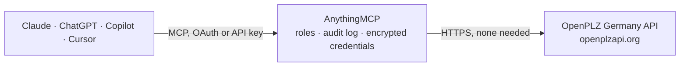

<!-- Generated by scripts/export-github-catalog.mjs in the anythingmcp-website repository. Do not edit by hand. -->

# OpenPLZ Germany MCP connector

Look up German postal codes, localities, and streets via the OpenPLZ API. The AnythingMCP connector gives Claude, ChatGPT, Microsoft Copilot, Cursor and Gemini 5 MCP tools for OpenPLZ Germany, all read-only.

**Category:** [Government](../government.md) · **Tools:** 5 · **Setup guide:** [anythingmcp.com](https://anythingmcp.com/guides/openplz-to-mcp) · [Deutsch](https://anythingmcp.com/de/guides/openplz-to-mcp) · [Italiano](https://anythingmcp.com/it/guides/openplz-to-mcp) · [Español](https://anythingmcp.com/es/guides/openplz-to-mcp) · [日本語](https://anythingmcp.com/ja/guides/openplz-to-mcp) · [Русский](https://anythingmcp.com/ru/guides/openplz-to-mcp) · [中文](https://anythingmcp.com/zh/guides/openplz-to-mcp)

## Start without code

No installation and no terminal: AnythingMCP Cloud runs the OpenPLZ Germany connector for you, operated by helpcode.ai in Frankfurt, Germany.

1. **Click the button above** and create an account or sign in. The OpenPLZ Germany connector opens, ready to install.
2. **Nothing to enter:** this connector needs no credentials. Every click is in the [step-by-step guide](https://anythingmcp.com/guides/openplz-to-mcp).
3. **Click Install.** AnythingMCP shows the address of your MCP server.
4. **Add that address to your assistant:** [Claude](https://anythingmcp.com/guides/connect-openplz-to-claude) · [ChatGPT](https://anythingmcp.com/guides/connect-openplz-to-chatgpt) · [Microsoft Copilot](https://anythingmcp.com/guides/connect-openplz-to-copilot) · [Cursor](https://anythingmcp.com/guides/connect-openplz-to-cursor) · [Gemini CLI](https://anythingmcp.com/guides/connect-openplz-to-gemini) · [Meta Muse](https://anythingmcp.com/guides/connect-openplz-to-muse).
5. **Ask your first question**, for example: *Which localities and districts are listed for PLZ 10115?*

Prefer help with the setup? [Talk to us](https://anythingmcp.com/contact).

## How it works

- **The AI client** speaks MCP (Streamable HTTP) to AnythingMCP and only sees tool names, descriptions and results. It never gets the OpenPLZ Germany credentials.
- **AnythingMCP** checks the client's role, builds the call from the tool definition, adds the credentials (none needed), calls OpenPLZ Germany, logs the call and returns the result.
- **OpenPLZ Germany** sees an ordinary API client with the rights of the account the credentials belong to.

## Tools

| Tool | What it does | Access |
|---|---|---|
| [`openplz_lookup_postalcode`](#openplz_lookup_postalcode) | Look up all localities associated with a German postal code (PLZ). | read |
| [`openplz_search_localities`](#openplz_search_localities) | Search localities by name, optionally filtered by federal state. | read |
| [`openplz_search_streets`](#openplz_search_streets) | Search streets within a locality. | read |
| [`openplz_list_federal_states`](#openplz_list_federal_states) | List all 16 German federal states (Bundesländer) with their Regional Key (RS), name, and seat of government. | read |
| [`openplz_list_districts`](#openplz_list_districts) | List all districts (Kreise/kreisfreie Städte) of a federal state. | read |

## Tool reference

Every parameter as the AI client sees it in `tools/list`. Source: [`packages/backend/src/adapters/de/openplz.json`](../../../packages/backend/src/adapters/de/openplz.json).

### `openplz_lookup_postalcode`

Look up all localities associated with a German postal code (PLZ). Returns each locality's name, federal state, district, and AGS.

**Access:** read · **Call:** `GET /Localities`

| Parameter | Type | Required | Description |
|---|---|---|---|
| `postalCode` | string | yes | 5-digit German postal code (e.g. '79098' for Freiburg im Breisgau). |

### `openplz_search_localities`

Search localities by name, optionally filtered by federal state. Returns name, PLZ, federal state, district.

**Access:** read · **Call:** `GET /Localities`

| Parameter | Type | Required | Description |
|---|---|---|---|
| `name` | string | yes | Locality name or prefix (e.g. 'Freiburg', 'Muench'). |
| `federalState` | string | no | Federal state name (e.g. 'Baden-Württemberg', 'Bayern'). Optional filter. |
| `page` | number | no | Page number (default: 1). |
| `pageSize` | number | no | Page size (default: 50, max: 100). |

### `openplz_search_streets`

Search streets within a locality. Useful for address autocomplete. Returns street names, borough (Ortsteil), PLZ.

**Access:** read · **Call:** `GET /Streets`

| Parameter | Type | Required | Description |
|---|---|---|---|
| `name` | string | yes | Street name or prefix (e.g. 'Kaiser-Joseph'). |
| `postalCode` | string | no | Optional filter — 5-digit PLZ to restrict to one postal area. |
| `locality` | string | no | Optional filter — locality name. |
| `page` | number | no | Page number (default: 1). |
| `pageSize` | number | no | Page size (default: 50, max: 100). |

### `openplz_list_federal_states`

List all 16 German federal states (Bundesländer) with their Regional Key (RS), name, and seat of government.

**Access:** read · **Call:** `GET /FederalStates`

No parameters.

### `openplz_list_districts`

List all districts (Kreise/kreisfreie Städte) of a federal state. Returns RS, name, type, and administrative seat.

**Access:** read · **Call:** `GET /FederalStates/{federalStateKey}/Districts`

| Parameter | Type | Required | Description |
|---|---|---|---|
| `federalStateKey` | string | yes | Federal state Regional Key (e.g. '08' for Baden-Württemberg, '09' for Bayern). |

## Run it yourself

AnythingMCP is open source (AGPL-3.0). [Run it with Docker](../../../README.md#run-it-yourself), open **Connectors → Store**, pick **OpenPLZ Germany**, then add your MCP server URL to the AI client.

[← Government connectors](../government.md) · [All categories](../README.md)
