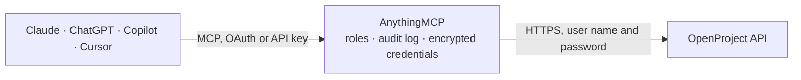

<!-- Generated by scripts/export-github-catalog.mjs in the anythingmcp-website repository. Do not edit by hand. -->

# OpenProject MCP connector

OpenProject: projects, work packages with their activities, versions, time entries, users and statuses, queried with OpenProject's filter grammar. The AnythingMCP connector gives Claude, ChatGPT, Microsoft Copilot, Cursor and Gemini 10 MCP tools for OpenProject, all read-only.

**Category:** [Project Management](../project-management.md) · **Tools:** 10 · **Setup guide:** [anythingmcp.com](https://anythingmcp.com/guides/openproject-to-mcp) · [Deutsch](https://anythingmcp.com/de/guides/openproject-to-mcp) · [Italiano](https://anythingmcp.com/it/guides/openproject-to-mcp) · [Español](https://anythingmcp.com/es/guides/openproject-to-mcp) · [日本語](https://anythingmcp.com/ja/guides/openproject-to-mcp) · [Русский](https://anythingmcp.com/ru/guides/openproject-to-mcp) · [中文](https://anythingmcp.com/zh/guides/openproject-to-mcp)

## Start without code

No installation and no terminal: AnythingMCP Cloud runs the OpenProject connector for you, operated by helpcode.ai in Frankfurt, Germany.

1. **Click the button above** and create an account or sign in. The OpenProject connector opens, ready to install.
2. **Paste the API key or token from your OpenProject account.** Every click is in the [step-by-step guide](https://anythingmcp.com/guides/openproject-to-mcp).
3. **Click Install.** AnythingMCP shows the address of your MCP server.
4. **Add that address to your assistant:** [Claude](https://anythingmcp.com/guides/connect-openproject-to-claude) · [ChatGPT](https://anythingmcp.com/guides/connect-openproject-to-chatgpt) · [Microsoft Copilot](https://anythingmcp.com/guides/connect-openproject-to-copilot) · [Cursor](https://anythingmcp.com/guides/connect-openproject-to-cursor) · [Gemini CLI](https://anythingmcp.com/guides/connect-openproject-to-gemini) · [Meta Muse](https://anythingmcp.com/guides/connect-openproject-to-muse).
5. **Ask your first question**, for example: *What's the current status and assignee of work package 482 in project 'Stella GmbH website'?*

Prefer help with the setup? [Talk to us](https://anythingmcp.com/contact).

## How it works

- **The AI client** speaks MCP (Streamable HTTP) to AnythingMCP and only sees tool names, descriptions and results. It never gets the OpenProject credentials.
- **AnythingMCP** checks the client's role, builds the call from the tool definition, adds the credentials (user name and password), calls OpenProject, logs the call and returns the result.
- **OpenProject** sees an ordinary API client with the rights of the account the credentials belong to.

## Tools

| Tool | What it does | Access |
|---|---|---|
| [`openproject_get_me`](#openproject_get_me) | Read the user the API token belongs to, with their name, e-mail, language and admin flag. | read |
| [`openproject_list_projects`](#openproject_list_projects) | List projects with their identifier, name, status, description and active flag. | read |
| [`openproject_list_work_packages`](#openproject_list_work_packages) | List work packages — tasks, bugs, features, milestones — across all projects, with their type, status, assignee, dates and priority. | read |
| [`openproject_list_project_work_packages`](#openproject_list_project_work_packages) | List the work packages inside one project — the usual scope for 'what is open on this project' and much cheaper than filtering globally. | read |
| [`openproject_get_work_package`](#openproject_get_work_package) | Read one work package in full: description, type, status, assignee, dates, estimated and spent time, and its custom fields. | read |
| [`openproject_list_work_package_activities`](#openproject_list_work_package_activities) | Read the activity stream of one work package: every comment and field change in order, with author and timestamp. | read |
| [`openproject_list_time_entries`](#openproject_list_time_entries) | List logged time entries with their user, work package, date, hours and comment — the raw data behind any effort report. | read |
| [`openproject_list_versions`](#openproject_list_versions) | List versions (releases and sprints) with their name, status, due date and the project they belong to. | read |
| [`openproject_list_users`](#openproject_list_users) | List users with their name, e-mail, login and status, to resolve who a work package is assigned to. | read |
| [`openproject_list_statuses`](#openproject_list_statuses) | List the work-package statuses this instance defines, with their id, name and whether each counts as closed. | read |

## Tool reference

Every parameter as the AI client sees it in `tools/list`. Source: [`packages/backend/src/adapters/de/openproject.json`](../../../packages/backend/src/adapters/de/openproject.json).

### `openproject_get_me`

Read the user the API token belongs to, with their name, e-mail, language and admin flag. The fastest way to see whose projects this connector can see.

**Access:** read · **Call:** `GET /users/me`

No parameters.

### `openproject_list_projects`

List projects with their identifier, name, status, description and active flag. The map of what this token can reach.

**Access:** read · **Call:** `GET /projects`

| Parameter | Type | Required | Description |
|---|---|---|---|
| `filters` | string | no | OpenProject filter JSON, e.g. [{"active":{"operator":"=","values":["t"]}}]. |
| `pageSize` | number | no | Rows per page (default 20, max 200). |
| `offset` | number | no | Page number, starting at 1. |
| `sortBy` | string | no | Sort JSON, e.g. [["name","asc"]]. |

### `openproject_list_work_packages`

List work packages — tasks, bugs, features, milestones — across all projects, with their type, status, assignee, dates and priority.

**Access:** read · **Call:** `GET /work_packages`

| Parameter | Type | Required | Description |
|---|---|---|---|
| `filters` | string | no | Filter JSON, e.g. [{"status":{"operator":"o","values":[]}}] for open ones. |
| `pageSize` | number | no | Rows per page (default 20, max 200). |
| `offset` | number | no | Page number, starting at 1. |
| `sortBy` | string | no | Sort JSON, e.g. [["dueDate","asc"]]. |

### `openproject_list_project_work_packages`

List the work packages inside one project — the usual scope for 'what is open on this project' and much cheaper than filtering globally.

**Access:** read · **Call:** `GET /projects/{projectId}/work_packages`

| Parameter | Type | Required | Description |
|---|---|---|---|
| `projectId` | string | yes | Project id or identifier. |
| `filters` | string | no | Filter JSON, e.g. [{"status":{"operator":"o","values":[]}}]. |
| `pageSize` | number | no | Rows per page (max 200). |
| `offset` | number | no | Page number, starting at 1. |
| `sortBy` | string | no | Sort JSON, e.g. [["priority","desc"]]. |

### `openproject_get_work_package`

Read one work package in full: description, type, status, assignee, dates, estimated and spent time, and its custom fields.

**Access:** read · **Call:** `GET /work_packages/{id}`

| Parameter | Type | Required | Description |
|---|---|---|---|
| `id` | number | yes | Numeric work package id. |

### `openproject_list_work_package_activities`

Read the activity stream of one work package: every comment and field change in order, with author and timestamp. Returned in one response; this collection is not paginated.

**Access:** read · **Call:** `GET /work_packages/{id}/activities`

| Parameter | Type | Required | Description |
|---|---|---|---|
| `id` | number | yes | Numeric work package id. |

### `openproject_list_time_entries`

List logged time entries with their user, work package, date, hours and comment — the raw data behind any effort report.

**Access:** read · **Call:** `GET /time_entries`

| Parameter | Type | Required | Description |
|---|---|---|---|
| `filters` | string | no | Filter JSON, e.g. [{"spentOn":{"operator":"<>d","values":["2026-09-01","2026-09-30"]}}]. |
| `pageSize` | number | no | Rows per page (max 200). |
| `offset` | number | no | Page number, starting at 1. |

### `openproject_list_versions`

List versions (releases and sprints) with their name, status, due date and the project they belong to. Returned in one response; this collection is not paginated.

**Access:** read · **Call:** `GET /versions`

No parameters.

### `openproject_list_users`

List users with their name, e-mail, login and status, to resolve who a work package is assigned to. Requires an administrator token on most instances.

**Access:** read · **Call:** `GET /users`

| Parameter | Type | Required | Description |
|---|---|---|---|
| `filters` | string | no | Filter JSON, e.g. [{"status":{"operator":"=","values":["active"]}}]. |
| `pageSize` | number | no | Rows per page. |
| `offset` | number | no | Page number, starting at 1. |

### `openproject_list_statuses`

List the work-package statuses this instance defines, with their id, name and whether each counts as closed. Needed to read a status filter correctly.

**Access:** read · **Call:** `GET /statuses`

No parameters.

## Run it yourself

AnythingMCP is open source (AGPL-3.0). [Run it with Docker](../../../README.md#run-it-yourself), open **Connectors → Store**, pick **OpenProject** and enter `OPENPROJECT_URL`, `OPENPROJECT_API_KEY`, then add your MCP server URL to the AI client.

[← Project Management connectors](../project-management.md) · [All categories](../README.md)
