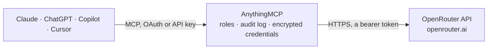

<!-- Generated by scripts/export-github-catalog.mjs in the anythingmcp-website repository. Do not edit by hand. -->

# OpenRouter MCP connector

OpenRouter, one API for hundreds of AI models: search the model catalog with prices, providers, benchmarks and rankings, check the key's spending, look up past generations, and send chat completions, … The AnythingMCP connector gives Claude, ChatGPT, Microsoft Copilot, Cursor and Gemini 13 MCP tools for OpenRouter: 12 read and 1 can change data.

**Category:** [Public Data](../data.md) · **Tools:** 13 · **Setup guide:** [anythingmcp.com](https://anythingmcp.com/guides/openrouter-to-mcp) · [Deutsch](https://anythingmcp.com/de/guides/openrouter-to-mcp) · [Italiano](https://anythingmcp.com/it/guides/openrouter-to-mcp) · [Español](https://anythingmcp.com/es/guides/openrouter-to-mcp) · [日本語](https://anythingmcp.com/ja/guides/openrouter-to-mcp) · [Русский](https://anythingmcp.com/ru/guides/openrouter-to-mcp) · [中文](https://anythingmcp.com/zh/guides/openrouter-to-mcp)

## Start without code

No installation and no terminal: AnythingMCP Cloud runs the OpenRouter connector for you, operated by helpcode.ai in Frankfurt, Germany.

1. **Click the button above** and create an account or sign in. The OpenRouter connector opens, ready to install.
2. **Paste the API key or token from your OpenRouter account.** Every click is in the [step-by-step guide](https://anythingmcp.com/guides/openrouter-to-mcp).
3. **Click Install.** AnythingMCP shows the address of your MCP server.
4. **Add that address to your assistant:** [Claude](https://anythingmcp.com/guides/connect-openrouter-to-claude) · [ChatGPT](https://anythingmcp.com/guides/connect-openrouter-to-chatgpt) · [Microsoft Copilot](https://anythingmcp.com/guides/connect-openrouter-to-copilot) · [Cursor](https://anythingmcp.com/guides/connect-openrouter-to-cursor) · [Gemini CLI](https://anythingmcp.com/guides/connect-openrouter-to-gemini) · [Meta Muse](https://anythingmcp.com/guides/connect-openrouter-to-muse).
5. **Ask your first question**, for example: *What's our OpenRouter API key 'DeployBot' credit remaining and usage this month and today?*

Prefer help with the setup? [Talk to us](https://anythingmcp.com/contact).

## How it works

- **The AI client** speaks MCP (Streamable HTTP) to AnythingMCP and only sees tool names, descriptions and results. It never gets the OpenRouter credentials.
- **AnythingMCP** checks the client's role, builds the call from the tool definition, adds the credentials (a bearer token), calls OpenRouter, logs the call and returns the result.
- **OpenRouter** sees an ordinary API client with the rights of the account the credentials belong to.

## Tools

| Tool | What it does | Access |
|---|---|---|
| [`openrouter_list_models`](#openrouter_list_models) | Search the OpenRouter model catalog (public, no cost): model ids, context length, prices per token, input and output modalities, supported parameters and… | read |
| [`openrouter_list_user_models`](#openrouter_list_user_models) | List the models this API key may actually use, after the account's provider preferences, privacy settings and guardrails are applied. | read |
| [`openrouter_get_model`](#openrouter_get_model) | Full details of one model by author and slug (openai/gpt-4o): description, context length, pricing, modalities, supported and default parameters, reasoning… | read |
| [`openrouter_list_model_endpoints`](#openrouter_list_model_endpoints) | List the provider endpoints that serve one model: provider name and tag, price per token, context and output limits, quantization, supported parameters,… | read |
| [`openrouter_list_providers`](#openrouter_list_providers) | List the inference providers OpenRouter routes to, with slug, name, headquarters, datacenter countries and links to their privacy policy, terms and status page. | read |
| [`openrouter_list_benchmarks`](#openrouter_list_benchmarks) | Benchmark scores of models from Artificial Analysis (intelligence, coding and agentic indices), Design Arena (ELO) and OpenRouter's own evals (GPQA,… | read |
| [`openrouter_get_model_rankings`](#openrouter_get_model_rankings) | Public OpenRouter usage rankings: the top 50 models by tokens processed per day, week or month, plus one aggregated other row per period, as on… | read |
| [`openrouter_get_current_key`](#openrouter_get_current_key) | Spending and limits of the API key in use: label, credit limit and what remains of it, reset interval, usage today, this week, this month and in total… | read |
| [`openrouter_get_generation`](#openrouter_get_generation) | Cost and metadata of one past generation by its id: model, provider that served it, total cost in USD, prompt, completion and reasoning token counts (native… | read |
| [`openrouter_get_generation_content`](#openrouter_get_generation_content) | The stored prompt, completion, reasoning and error of one past generation by its id. | read |
| [`openrouter_chat_completion`](#openrouter_chat_completion) | Send a conversation to a model and return its reply (non-streaming). | read |
| [`openrouter_create_embeddings`](#openrouter_create_embeddings) | Turn one text or a list of texts into embedding vectors with an embeddings model. | read |
| [`openrouter_generate_image`](#openrouter_generate_image) | Generate images from a text prompt with an image model and return them as images. | write |

## Tool reference

Every parameter as the AI client sees it in `tools/list`. Source: [`packages/backend/src/adapters/intl/openrouter.json`](../../../packages/backend/src/adapters/intl/openrouter.json).

### `openrouter_list_models`

Search the OpenRouter model catalog (public, no cost): model ids, context length, prices per token, input and output modalities, supported parameters and reasoning support. Filter by text, category, modality, price, context, author or provider, and sort server-side.

**Access:** read · **Call:** `GET /models`

| Parameter | Type | Required | Description |
|---|---|---|---|
| `q` | string | no | Free-text search on model name or id, e.g. claude, gpt-4o, llama. |
| `category` | `programming` \| `roleplay` \| `marketing` \| `marketing/seo` \| `technology` \| `science` \| `translation` \| `legal` \| `finance` \| `health` \| `trivia` \| `academia` | no | Use-case category the model is popular for. |
| `supported_parameters` | string | no | Comma-separated request parameters the model must support, e.g. tools, response_format, structured_outputs, reasoning, temperature. |
| `input_modalities` | string | no | Comma-separated input modalities the model must accept: text, image, audio, file. |
| `output_modalities` | string | no | Comma-separated output modalities to include: text (default), image, embeddings, audio, video, rerank, speech, transcription, or all. |
| `context` | integer | no | Minimum context length in tokens, e.g. 128000. |
| `max_price` | number | no | Maximum prompt (input) price in USD per million tokens. 0 finds free models. |
| `max_output_price` | number | no | Maximum completion (output) price in USD per million tokens. |
| `model_authors` | string | no | Comma-separated author slugs, e.g. openai,anthropic,google,meta-llama. |
| `providers` | string | no | Comma-separated hosting provider names, e.g. OpenAI,Anthropic,Together. |
| `zdr` | `true` | no | true: only models with a zero-data-retention endpoint. |
| `region` | `eu` \| `us` | no | Only models with endpoints in this data region. |
| `sort` | `most-popular` \| `newest` \| `top-weekly` \| `pricing-low-to-high` \| `pricing-high-to-low` \| `context-high-to-low` \| `throughput-high-to-low` \| `latency-low-to-high` \| `intelligence-high-to-low` \| `coding-high-to-low` \| `agentic-high-to-low` \| `design-arena-elo-high-to-low` | no | Server-side order, e.g. pricing-low-to-high, context-high-to-low, newest, most-popular, coding-high-to-low. Models without a score for the chosen benchmark come last. |
| `offset` | integer | no | Number of models to skip, for paging. Use 0, then 50, 100, ... with the same limit. |
| `limit` | integer | no | Models per page, 1-1000 (default 50). A short page means it was the last one. |

### `openrouter_list_user_models`

List the models this API key may actually use, after the account's provider preferences, privacy settings and guardrails are applied. Same fields as openrouter_list_models; use it before choosing a model for a completion.

**Access:** read · **Call:** `GET /models/user`

| Parameter | Type | Required | Description |
|---|---|---|---|
| `output_modalities` | string | no | Comma-separated output modalities to include: text (default), image, embeddings, audio, video, rerank, speech, transcription, or all. |
| `sort` | `most-popular` \| `newest` \| `top-weekly` \| `pricing-low-to-high` \| `pricing-high-to-low` \| `context-high-to-low` \| `throughput-high-to-low` \| `latency-low-to-high` \| `intelligence-high-to-low` \| `coding-high-to-low` \| `agentic-high-to-low` \| `design-arena-elo-high-to-low` | no | Server-side order, e.g. pricing-low-to-high, context-high-to-low, newest, most-popular, coding-high-to-low. Models without a score for the chosen benchmark come last. |
| `offset` | integer | no | Number of models to skip, for paging. Use 0, then 50, 100, ... with the same limit. |
| `limit` | integer | no | Models per page, 1-1000 (default 50). A short page means it was the last one. |

### `openrouter_get_model`

Full details of one model by author and slug (openai/gpt-4o): description, context length, pricing, modalities, supported and default parameters, reasoning efforts, benchmarks and expiration date. Accepts variants such as :free.

**Access:** read · **Call:** `GET /model/{author}/{slug}`

| Parameter | Type | Required | Description |
|---|---|---|---|
| `author` | string | yes | Model author, the part of the model id before the slash (openai in openai/gpt-4o). |
| `slug` | string | yes | Model slug, the part of the model id after the slash (gpt-4o in openai/gpt-4o). A variant suffix such as :free is allowed where noted. |

### `openrouter_list_model_endpoints`

List the provider endpoints that serve one model: provider name and tag, price per token, context and output limits, quantization, supported parameters, status, uptime, latency and throughput over the last 30 minutes. Use it to choose or pin a provider.

**Access:** read · **Call:** `GET /models/{author}/{slug}/endpoints`

| Parameter | Type | Required | Description |
|---|---|---|---|
| `author` | string | yes | Model author, the part of the model id before the slash (openai in openai/gpt-4o). |
| `slug` | string | yes | Model slug, the part of the model id after the slash (gpt-4o in openai/gpt-4o), without a variant suffix. |

### `openrouter_list_providers`

List the inference providers OpenRouter routes to, with slug, name, headquarters, datacenter countries and links to their privacy policy, terms and status page. The slugs go into the provider routing object.

**Access:** read · **Call:** `GET /providers`

No parameters.

### `openrouter_list_benchmarks`

Benchmark scores of models from Artificial Analysis (intelligence, coding and agentic indices), Design Arena (ELO) and OpenRouter's own evals (GPQA, tau-bench, search). Use it to compare model quality before choosing one.

**Access:** read · **Call:** `GET /benchmarks`

| Parameter | Type | Required | Description |
|---|---|---|---|
| `source` | `artificial-analysis` \| `design-arena` \| `openrouter` | no | Benchmark source; omit for all sources. The item fields differ per source. |
| `task_type` | `coding` \| `intelligence` \| `agentic` \| `search` | no | Workload to rank for. |
| `max_results` | integer | no | Maximum items to return (default 50). |

### `openrouter_get_model_rankings`

Public OpenRouter usage rankings: the top 50 models by tokens processed per day, week or month, plus one aggregated other row per period, as on openrouter.ai/rankings. Data starts on 2025-01-01.

**Access:** read · **Call:** `GET /datasets/rankings-daily`

| Parameter | Type | Required | Description |
|---|---|---|---|
| `start_date` | string | no | First day, YYYY-MM-DD (UTC), inclusive. Default: 30 days before end_date. |
| `end_date` | string | no | Last day, YYYY-MM-DD (UTC), inclusive. Default: the last completed UTC day. |
| `period` | `day` \| `week` \| `month` | no | Time grain of each row (default day). Use week or month for long windows. |
| `modality` | `text` \| `image_output` \| `image` \| `audio` \| `tool_calling` | no | Only models for this surface: text or image_output (output), image or audio (input), tool_calling (rows with tool calls). Cannot be combined with category. |
| `category` | string | no | Use-case category such as programming or roleplay. Estimated from sampled data, weekly or monthly only, not combinable with modality. |

### `openrouter_get_current_key`

Spending and limits of the API key in use: label, credit limit and what remains of it, reset interval, usage today, this week, this month and in total (USD), budgets that apply, free-tier status and free-model requests left today.

**Access:** read · **Call:** `GET /key`

No parameters.

### `openrouter_get_generation`

Cost and metadata of one past generation by its id: model, provider that served it, total cost in USD, prompt, completion and reasoning token counts (native and normalized), latency, generation time, finish reason and whether it was cancelled.

**Access:** read · **Call:** `GET /generation`

| Parameter | Type | Required | Description |
|---|---|---|---|
| `id` | string | yes | Generation id, as returned in the id field of a chat completion (starts with gen-). |

### `openrouter_get_generation_content`

The stored prompt, completion, reasoning and error of one past generation by its id. Only available when prompt logging is enabled for the account; otherwise the API answers 404.

**Access:** read · **Call:** `GET /generation/content`

| Parameter | Type | Required | Description |
|---|---|---|---|
| `id` | string | yes | Generation id, as returned in the id field of a chat completion (starts with gen-). |

### `openrouter_chat_completion`

Send a conversation to a model and return its reply (non-streaming). COSTS MONEY: billed per token to the OpenRouter account, unless a :free model is used. Confirm the model and the purpose with the user before larger or repeated calls. The answer's id (gen-...) feeds openrouter_get_generation.

**Access:** read · **Call:** `POST /chat/completions`

| Parameter | Type | Required | Description |
|---|---|---|---|
| `model` | string | yes | Model id from openrouter_list_models, e.g. openai/gpt-4o-mini, anthropic/claude-sonnet-4.5, google/gemma-4-31b-it:free. Append :online for web search, :nitro for the fastest provider, :floor for the cheapest. Use openrouter/auto to let OpenRouter pick. |
| `messages` | object[] | yes | The conversation, oldest first: [{"role": "system", "content": "..."}, {"role": "user", "content": "..."}]. Roles: system, user, assistant, tool. content is a string, or an array of parts such as {"type": "text", "text": "..."} and {"type": "image_url", "image_url": {"url": "https://..."}}. |
| `models` | string[] | no | Fallback model ids tried in order when the first one fails or is unavailable. |
| `max_completion_tokens` | integer | no | Upper bound on output tokens. Set it to cap cost; reasoning tokens count toward it. |
| `temperature` | number | no | Sampling temperature 0-2. Lower is more deterministic. |
| `top_p` | number | no | Nucleus sampling 0-1. |
| `stop` | string[] | no | Up to 4 stop sequences. |
| `seed` | integer | no | Seed for more repeatable outputs, where the provider supports it. |
| `response_format` | object | no | Structured output: {"type": "json_object"}, or {"type": "json_schema", "json_schema": {"name": "result", "strict": true, "schema": {...}}}. Check that the model lists response_format or structured_outputs in supported_parameters. |
| `reasoning` | object | no | Reasoning settings for reasoning models: {"effort": "low" \| "medium" \| "high"}, or {"max_tokens": 2000}, or {"exclude": true} to hide the reasoning text, or {"enabled": false}. |
| `tools` | object[] | no | Function definitions the model may call: [{"type": "function", "function": {"name": "...", "description": "...", "parameters": {...}}}]. The model answers with tool_calls; run them yourself and send the results back as role tool messages. |
| `provider` | object | no | Provider routing preferences, e.g. {"order": ["anthropic", "amazon-bedrock"], "allow_fallbacks": true}, {"sort": "price"}, {"only": ["openai"]}, {"data_collection": "deny"}, {"zdr": true}, {"max_price": {"prompt": 1, "completion": 2}} (USD per million tokens). Provider slugs come from openrouter_list_providers or openrouter_list_model_endpoints. |
| `plugins` | object[] | no | Plugins such as [{"id": "web", "max_results": 5}] for web search or [{"id": "file-parser"}] for PDFs. Plugins can add their own cost. |

### `openrouter_create_embeddings`

Turn one text or a list of texts into embedding vectors with an embeddings model. COSTS MONEY per input token. Find models with openrouter_list_models and output_modalities embeddings.

**Access:** read · **Call:** `POST /embeddings`

| Parameter | Type | Required | Description |
|---|---|---|---|
| `model` | string | yes | Embeddings model id, e.g. openai/text-embedding-3-small. |
| `input` | string[] | yes | The texts to embed, one vector per item: ["first text", "second text"]. |
| `dimensions` | integer | no | Output vector size, for models that support shortening (e.g. 512). |
| `input_type` | string | no | For models that distinguish them: search_query or search_document. |
| `provider` | object | no | Provider routing preferences, e.g. {"order": ["anthropic", "amazon-bedrock"], "allow_fallbacks": true}, {"sort": "price"}, {"only": ["openai"]}, {"data_collection": "deny"}, {"zdr": true}, {"max_price": {"prompt": 1, "completion": 2}} (USD per million tokens). Provider slugs come from openrouter_list_providers or openrouter_list_model_endpoints. |

### `openrouter_generate_image`

Generate images from a text prompt with an image model and return them as images. COSTS MONEY per image. Confirm the prompt and model with the user first. Find models with openrouter_list_models and output_modalities image.

**Access:** write · **Call:** `POST /images`

| Parameter | Type | Required | Description |
|---|---|---|---|
| `model` | string | yes | Image model id, e.g. openai/gpt-image-1 or google/gemini-3.1-flash-image. |
| `prompt` | string | yes | Description of the image to create. |
| `n` | integer | no | Number of images, 1-4 (default 1). Some providers return fewer or accept only 1. |
| `aspect_ratio` | `auto` \| `1:1` \| `2:3` \| `3:2` \| `3:4` \| `4:3` \| `4:5` \| `5:4` \| `9:16` \| `16:9` \| `21:9` | no | Aspect ratio; providers clamp to what they support. |
| `resolution` | `512` \| `768` \| `1K` \| `1.5K` \| `2K` \| `4K` | no | Resolution tier; providers derive the pixel size. |
| `quality` | `auto` \| `low` \| `medium` \| `high` | no | Rendering quality, where the provider supports it. |
| `output_format` | `png` \| `jpeg` \| `webp` | no | Image encoding (default png). |
| `provider` | object | no | Provider routing preferences, e.g. {"order": ["anthropic", "amazon-bedrock"], "allow_fallbacks": true}, {"sort": "price"}, {"only": ["openai"]}, {"data_collection": "deny"}, {"zdr": true}, {"max_price": {"prompt": 1, "completion": 2}} (USD per million tokens). Provider slugs come from openrouter_list_providers or openrouter_list_model_endpoints. |

## Run it yourself

AnythingMCP is open source (AGPL-3.0). [Run it with Docker](../../../README.md#run-it-yourself), open **Connectors → Store**, pick **OpenRouter** and enter `OPENROUTER_API_KEY`, then add your MCP server URL to the AI client.

[← Public Data connectors](../data.md) · [All categories](../README.md)
