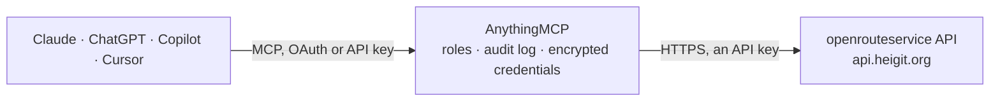

<!-- Generated by scripts/export-github-catalog.mjs in the anythingmcp-website repository. Do not edit by hand. -->

# openrouteservice MCP connector

openrouteservice (HeiGIT) routing on OpenStreetMap: geocoding and reverse geocoding, directions with turn-by-turn steps for car, truck, bike, foot and wheelchair, travel time matrices, isochrones … The AnythingMCP connector gives Claude, ChatGPT, Microsoft Copilot, Cursor and Gemini 8 MCP tools for openrouteservice, all read-only.

**Category:** [Maps](../maps.md) · **Tools:** 8 · **Setup guide:** [anythingmcp.com](https://anythingmcp.com/guides/openrouteservice-to-mcp) · [Deutsch](https://anythingmcp.com/de/guides/openrouteservice-to-mcp) · [Italiano](https://anythingmcp.com/it/guides/openrouteservice-to-mcp) · [Español](https://anythingmcp.com/es/guides/openrouteservice-to-mcp) · [日本語](https://anythingmcp.com/ja/guides/openrouteservice-to-mcp) · [Русский](https://anythingmcp.com/ru/guides/openrouteservice-to-mcp) · [中文](https://anythingmcp.com/zh/guides/openrouteservice-to-mcp)

## Start without code

No installation and no terminal: AnythingMCP Cloud runs the openrouteservice connector for you, operated by helpcode.ai in Frankfurt, Germany.

1. **Click the button above** and create an account or sign in. The openrouteservice connector opens, ready to install.
2. **Paste the API key or token from your openrouteservice account.** Every click is in the [step-by-step guide](https://anythingmcp.com/guides/openrouteservice-to-mcp).
3. **Click Install.** AnythingMCP shows the address of your MCP server.
4. **Add that address to your assistant:** [Claude](https://anythingmcp.com/guides/connect-openrouteservice-to-claude) · [ChatGPT](https://anythingmcp.com/guides/connect-openrouteservice-to-chatgpt) · [Microsoft Copilot](https://anythingmcp.com/guides/connect-openrouteservice-to-copilot) · [Cursor](https://anythingmcp.com/guides/connect-openrouteservice-to-cursor) · [Gemini CLI](https://anythingmcp.com/guides/connect-openrouteservice-to-gemini) · [Meta Muse](https://anythingmcp.com/guides/connect-openrouteservice-to-muse).
5. **Ask your first question**, for example: *Geocode customer address: Kranich GmbH, Hauptstraße 24, 69115 Heidelberg, DE — need coordinates for invoice processing.*

Prefer help with the setup? [Talk to us](https://anythingmcp.com/contact).

## How it works

- **The AI client** speaks MCP (Streamable HTTP) to AnythingMCP and only sees tool names, descriptions and results. It never gets the openrouteservice credentials.
- **AnythingMCP** checks the client's role, builds the call from the tool definition, adds the credentials (an API key), calls openrouteservice, logs the call and returns the result.
- **openrouteservice** sees an ordinary API client with the rights of the account the credentials belong to.

## Tools

| Tool | What it does | Access |
|---|---|---|
| [`openrouteservice_geocode`](#openrouteservice_geocode) | Turn an address or place name into coordinates (forward geocoding, OpenStreetMap and open address data): label, [longitude, latitude], street, house number,… | read |
| [`openrouteservice_autocomplete`](#openrouteservice_autocomplete) | Suggest places for a partly typed address or name (as-you-type geocoding), with the same fields as openrouteservice_geocode. | read |
| [`openrouteservice_reverse_geocode`](#openrouteservice_reverse_geocode) | Find the address or place at a point (reverse geocoding): nearest addresses, venues or streets with their distance in km. | read |
| [`openrouteservice_directions`](#openrouteservice_directions) | Plan a route through two or more points for a car, truck, bicycle, on foot or by wheelchair: total distance and duration, and per leg the turn-by-turn steps… | read |
| [`openrouteservice_matrix`](#openrouteservice_matrix) | Compute travel durations (seconds) and optionally distances between many points at once: a matrix from every source to every destination, e.g. which of 10… | read |
| [`openrouteservice_isochrones`](#openrouteservice_isochrones) | Compute the area reachable from one or more points within given travel times (seconds) or distances (metres): GeoJSON polygons with their area, e.g.… | read |
| [`openrouteservice_optimize_routes`](#openrouteservice_optimize_routes) | Solve a vehicle routing problem (VROOM): assign jobs (stops) to vehicles and order them to minimise total travel, respecting time windows, capacities and… | read |
| [`openrouteservice_find_pois`](#openrouteservice_find_pois) | Find points of interest from OpenStreetMap (shops, restaurants, fuel, pharmacies, charging stations...) within a radius of a point or in a box: name,… | read |

## Tool reference

Every parameter as the AI client sees it in `tools/list`. Source: [`packages/backend/src/adapters/intl/openrouteservice.json`](../../../packages/backend/src/adapters/intl/openrouteservice.json).

### `openrouteservice_geocode`

Turn an address or place name into coordinates (forward geocoding, OpenStreetMap and open address data): label, [longitude, latitude], street, house number, postcode, locality, region, country and a confidence score. Use it before routing.

**Access:** read · **Call:** `GET /pelias/v1/search`

| Parameter | Type | Required | Description |
|---|---|---|---|
| `text` | string | yes | Address or place, e.g. "Bertoldstraße 1, Freiburg" or "Freiburg Hauptbahnhof". |
| `size` | integer | no | Number of results, 1 to 40. |
| `country` | string | no | Only results in these countries, ISO 3166 alpha-2 or alpha-3, comma-separated, e.g. DE or DE,AT,CH. |
| `focus_lat` | number | no | Prefer results near this latitude (with focus_lon). |
| `focus_lon` | number | no | Prefer results near this longitude (with focus_lat). |
| `layers` | string | no | Only these kinds, comma-separated: address, venue, street, locality, county, region, country, postalcode, neighbourhood. |

### `openrouteservice_autocomplete`

Suggest places for a partly typed address or name (as-you-type geocoding), with the same fields as openrouteservice_geocode.

**Access:** read · **Call:** `GET /pelias/v1/autocomplete`

| Parameter | Type | Required | Description |
|---|---|---|---|
| `text` | string | yes | The text typed so far, e.g. "Freiburg Haupt". |
| `country` | string | no | Only results in these countries, ISO 3166 alpha-2 or alpha-3, comma-separated, e.g. DE or DE,AT,CH. |
| `focus_lat` | number | no | Prefer results near this latitude (with focus_lon). |
| `focus_lon` | number | no | Prefer results near this longitude (with focus_lat). |
| `layers` | string | no | Only these kinds, comma-separated: address, venue, street, locality, county, region, country, postalcode, neighbourhood. |

### `openrouteservice_reverse_geocode`

Find the address or place at a point (reverse geocoding): nearest addresses, venues or streets with their distance in km.

**Access:** read · **Call:** `GET /pelias/v1/reverse`

| Parameter | Type | Required | Description |
|---|---|---|---|
| `lat` | number | yes | Latitude, e.g. 47.9977. |
| `lon` | number | yes | Longitude, e.g. 7.8418. |
| `size` | integer | no | Number of results, 1 to 40. |
| `layers` | string | no | Only these kinds, comma-separated: address, venue, street, locality. |

### `openrouteservice_directions`

Plan a route through two or more points for a car, truck, bicycle, on foot or by wheelchair: total distance and duration, and per leg the turn-by-turn steps (instruction, distance, duration, street name). Read-only, although it is a POST. Coordinates are [longitude, latitude] (longitude first), e.g. [7.8421, 47.9990] for Freiburg.

**Access:** read · **Call:** `POST /openrouteservice/v2/directions/{profile}`

| Parameter | Type | Required | Description |
|---|---|---|---|
| `profile` | `driving-car` \| `driving-hgv` \| `cycling-regular` \| `cycling-road` \| `cycling-mountain` \| `cycling-electric` \| `foot-walking` \| `foot-hiking` \| `wheelchair` | yes | Means of transport: driving-car, driving-hgv (truck), cycling-regular, cycling-road, cycling-mountain, cycling-electric, foot-walking, foot-hiking, wheelchair. |
| `coordinates` | number[][] | yes | Start, optional via points and destination as [[lon, lat], ...], at most 50, e.g. [[7.8421,47.9990],[7.8494,47.9959]]. |
| `preference` | `fastest` \| `shortest` \| `recommended` | no | fastest (default), shortest or recommended. |
| `units` | `m` \| `km` \| `mi` | no | Distance unit. |
| `language` | string | no | Language of the instructions, e.g. en, de, fr, es, it, pt. |
| `instructions` | boolean | no | Include turn-by-turn steps. |
| `geometry` | boolean | no | Include the encoded route line (large; only to draw the route). |
| `options` | object | no | Optional routing options, e.g. {"avoid_features":["highways","tollways","ferries"]} or {"avoid_countries":[...]}. |

### `openrouteservice_matrix`

Compute travel durations (seconds) and optionally distances between many points at once: a matrix from every source to every destination, e.g. which of 10 technicians is closest to each of 20 customers. Read-only, although it is a POST. Coordinates are [longitude, latitude] (longitude first), e.g. [7.8421, 47.9990] for Freiburg.

**Access:** read · **Call:** `POST /openrouteservice/v2/matrix/{profile}`

| Parameter | Type | Required | Description |
|---|---|---|---|
| `profile` | `driving-car` \| `driving-hgv` \| `cycling-regular` \| `cycling-road` \| `cycling-mountain` \| `cycling-electric` \| `foot-walking` \| `foot-hiking` \| `wheelchair` | yes | Means of transport: driving-car, driving-hgv (truck), cycling-regular, cycling-road, cycling-mountain, cycling-electric, foot-walking, foot-hiking, wheelchair. |
| `locations` | number[][] | yes | All points as [[lon, lat], ...]. |
| `sources` | integer[] | no | Indexes into locations used as origins; default all. |
| `destinations` | integer[] | no | Indexes into locations used as destinations; default all. |
| `metrics` | `duration` \| `distance`[] | no | duration and/or distance; default ["duration"]. |
| `units` | `m` \| `km` \| `mi` | no | Distance unit when distance is asked for. |

### `openrouteservice_isochrones`

Compute the area reachable from one or more points within given travel times (seconds) or distances (metres): GeoJSON polygons with their area, e.g. everything within 15 minutes by car of a shop. Read-only, although it is a POST. Coordinates are [longitude, latitude] (longitude first), e.g. [7.8421, 47.9990] for Freiburg.

**Access:** read · **Call:** `POST /openrouteservice/v2/isochrones/{profile}`

| Parameter | Type | Required | Description |
|---|---|---|---|
| `profile` | `driving-car` \| `driving-hgv` \| `cycling-regular` \| `cycling-road` \| `cycling-mountain` \| `cycling-electric` \| `foot-walking` \| `foot-hiking` \| `wheelchair` | yes | Means of transport: driving-car, driving-hgv (truck), cycling-regular, cycling-road, cycling-mountain, cycling-electric, foot-walking, foot-hiking, wheelchair. |
| `locations` | number[][] | yes | Centre points as [[lon, lat], ...], at most 5. |
| `range` | number[] | yes | Travel times in seconds (range_type time) or distances in metres, e.g. [600, 1200]. |
| `range_type` | `time` \| `distance` | no | time (default) or distance. |
| `attributes` | string[] | no | Extra values per polygon, e.g. ["area","reachfactor","total_pop"]. |
| `area_units` | `m` \| `km` \| `mi` | no | Unit of area. |

### `openrouteservice_optimize_routes`

Solve a vehicle routing problem (VROOM): assign jobs (stops) to vehicles and order them to minimise total travel, respecting time windows, capacities and skills. Returns per vehicle the ordered steps with arrival times and the unassigned jobs. Read-only, although it is a POST. Coordinates are [longitude, latitude] (longitude first), e.g. [7.8421, 47.9990] for Freiburg.

**Access:** read · **Call:** `POST /vroom/v0`

| Parameter | Type | Required | Description |
|---|---|---|---|
| `jobs` | object[] | yes | Stops, e.g. [{"id":1,"location":[7.8494,47.9959],"service":300,"time_windows":[[28800,43200]]}]. service and time windows in seconds. |
| `vehicles` | object[] | yes | Vehicles, e.g. [{"id":1,"profile":"driving-car","start":[7.8421,47.9990],"end":[7.8421,47.9990],"capacity":[10],"time_window":[28800,61200]}]. |
| `shipments` | object[] | no | Optional pickup-and-delivery pairs, as in VROOM. |
| `options` | object | no | Optional, e.g. {"g":true} to return route geometry. |

### `openrouteservice_find_pois`

Find points of interest from OpenStreetMap (shops, restaurants, fuel, pharmacies, charging stations...) within a radius of a point or in a box: name, category, OSM tags and distance. Read-only, although it is a POST. Coordinates are [longitude, latitude] (longitude first), e.g. [7.8421, 47.9990] for Freiburg.

**Access:** read · **Call:** `POST /openpoiservice/v0/pois`

| Parameter | Type | Required | Description |
|---|---|---|---|
| `geometry` | object | yes | Search area, e.g. {"geojson":{"type":"Point","coordinates":[7.8421,47.9990]},"buffer":500} for 500 m around a point, or {"bbox":[[minLon,minLat],[maxLon,maxLat]]}. |
| `filters` | object | no | Optional filters, e.g. {"category_group_ids":[560]} or {"category_ids":[564]} or {"name":["Aldi"]}. |
| `limit` | integer | no | Maximum results, up to 2000. |

## Run it yourself

AnythingMCP is open source (AGPL-3.0). [Run it with Docker](../../../README.md#run-it-yourself), open **Connectors → Store**, pick **openrouteservice** and enter `OPENROUTESERVICE_API_KEY`, then add your MCP server URL to the AI client.

[← Maps connectors](../maps.md) · [All categories](../README.md)
