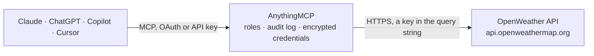

<!-- Generated by scripts/export-github-catalog.mjs in the anythingmcp-website repository. Do not edit by hand. -->

# OpenWeather MCP connector

Query OpenWeather (current weather, forecasts, air quality, geocoding) from any AI agent. 6 tools, API-key auth. The AnythingMCP connector gives Claude, ChatGPT, Microsoft Copilot, Cursor and Gemini 6 MCP tools for OpenWeather, all read-only.

**Category:** [Public Data](../data.md) · **Tools:** 6 · **Setup guide:** [anythingmcp.com](https://anythingmcp.com/guides/openweather-to-mcp) · [Deutsch](https://anythingmcp.com/de/guides/openweather-to-mcp) · [Italiano](https://anythingmcp.com/it/guides/openweather-to-mcp) · [Español](https://anythingmcp.com/es/guides/openweather-to-mcp) · [日本語](https://anythingmcp.com/ja/guides/openweather-to-mcp) · [Русский](https://anythingmcp.com/ru/guides/openweather-to-mcp) · [中文](https://anythingmcp.com/zh/guides/openweather-to-mcp)

## Start without code

No installation and no terminal: AnythingMCP Cloud runs the OpenWeather connector for you, operated by helpcode.ai in Frankfurt, Germany.

1. **Click the button above** and create an account or sign in. The OpenWeather connector opens, ready to install.
2. **Paste the API key or token from your OpenWeather account.** Every click is in the [step-by-step guide](https://anythingmcp.com/guides/openweather-to-mcp).
3. **Click Install.** AnythingMCP shows the address of your MCP server.
4. **Add that address to your assistant:** [Claude](https://anythingmcp.com/guides/connect-openweather-to-claude) · [ChatGPT](https://anythingmcp.com/guides/connect-openweather-to-chatgpt) · [Microsoft Copilot](https://anythingmcp.com/guides/connect-openweather-to-copilot) · [Cursor](https://anythingmcp.com/guides/connect-openweather-to-cursor) · [Gemini CLI](https://anythingmcp.com/guides/connect-openweather-to-gemini) · [Meta Muse](https://anythingmcp.com/guides/connect-openweather-to-muse).
5. **Ask your first question**, for example: *Current conditions at Alexanderplatz, Berlin right now — temp, wind speed and description*

Prefer help with the setup? [Talk to us](https://anythingmcp.com/contact).

## How it works

- **The AI client** speaks MCP (Streamable HTTP) to AnythingMCP and only sees tool names, descriptions and results. It never gets the OpenWeather credentials.
- **AnythingMCP** checks the client's role, builds the call from the tool definition, adds the credentials (a key in the query string), calls OpenWeather, logs the call and returns the result.
- **OpenWeather** sees an ordinary API client with the rights of the account the credentials belong to.

## Tools

| Tool | What it does | Access |
|---|---|---|
| [`openweather_geocode_city`](#openweather_geocode_city) | Translate a city name (optionally with state and country code) into latitude/longitude. | read |
| [`openweather_reverse_geocode`](#openweather_reverse_geocode) | Translate latitude/longitude back into a list of nearby place names. | read |
| [`openweather_current_weather`](#openweather_current_weather) | Current weather at given coordinates: temperature, humidity, wind, conditions, sunrise/sunset. | read |
| [`openweather_forecast_5day`](#openweather_forecast_5day) | 5-day weather forecast at 3-hour intervals. | read |
| [`openweather_air_pollution`](#openweather_air_pollution) | Current air-quality index (AQI 1-5) + concentrations of CO, NO, NO2, O3, SO2, PM2.5, PM10, NH3 at given coordinates. | read |
| [`openweather_air_pollution_forecast`](#openweather_air_pollution_forecast) | Hourly air-pollution forecast for the next ~4 days at given coordinates. | read |

## Tool reference

Every parameter as the AI client sees it in `tools/list`. Source: [`packages/backend/src/adapters/intl/openweather.json`](../../../packages/backend/src/adapters/intl/openweather.json).

### `openweather_geocode_city`

Translate a city name (optionally with state and country code) into latitude/longitude. Always run this first when the user asks about a city — every other tool wants lat/lon, not city names. Returns up to `limit` candidates; the first is usually the most populous.

**Access:** read · **Call:** `GET /geo/1.0/direct`

| Parameter | Type | Required | Description |
|---|---|---|---|
| `q` | string | yes | Location query, e.g. 'Rome,IT' or 'Springfield,IL,US' (city,state,country). |
| `limit` | integer | no | Max results (1-5). Default 1. |

### `openweather_reverse_geocode`

Translate latitude/longitude back into a list of nearby place names. Useful when you have GPS coordinates from another tool and need a human-readable label.

**Access:** read · **Call:** `GET /geo/1.0/reverse`

| Parameter | Type | Required | Description |
|---|---|---|---|
| `lat` | number | yes | Latitude. |
| `lon` | number | yes | Longitude. |
| `limit` | integer | no | Max results (1-5). Default 1. |

### `openweather_current_weather`

Current weather at given coordinates: temperature, humidity, wind, conditions, sunrise/sunset. Snapshot only — for forecasts use openweather_forecast_5day.

**Access:** read · **Call:** `GET /data/2.5/weather`

| Parameter | Type | Required | Description |
|---|---|---|---|
| `lat` | number | yes | Latitude. |
| `lon` | number | yes | Longitude. |
| `units` | string | no | 'metric' (°C, m/s), 'imperial' (°F, mph), or 'standard' (K, m/s). |
| `lang` | string | no | ISO 639-1 code for localized descriptions (it, de, en, es, ...). |

### `openweather_forecast_5day`

5-day weather forecast at 3-hour intervals. Returns a `list` of 40 entries; each has dt, temperature, weather[], wind, pop (precipitation probability). Use this for 'will it rain tomorrow' style questions on the free tier.

**Access:** read · **Call:** `GET /data/2.5/forecast`

| Parameter | Type | Required | Description |
|---|---|---|---|
| `lat` | number | yes | Latitude. |
| `lon` | number | yes | Longitude. |
| `units` | string | no | 'metric' / 'imperial' / 'standard'. |
| `lang` | string | no | Locale for descriptions. |
| `cnt` | integer | no | Limit number of 3-hour timestamps returned (1-40). |

### `openweather_air_pollution`

Current air-quality index (AQI 1-5) + concentrations of CO, NO, NO2, O3, SO2, PM2.5, PM10, NH3 at given coordinates.

**Access:** read · **Call:** `GET /data/2.5/air_pollution`

| Parameter | Type | Required | Description |
|---|---|---|---|
| `lat` | number | yes | Latitude. |
| `lon` | number | yes | Longitude. |

### `openweather_air_pollution_forecast`

Hourly air-pollution forecast for the next ~4 days at given coordinates.

**Access:** read · **Call:** `GET /data/2.5/air_pollution/forecast`

| Parameter | Type | Required | Description |
|---|---|---|---|
| `lat` | number | yes | Latitude. |
| `lon` | number | yes | Longitude. |

## Run it yourself

AnythingMCP is open source (AGPL-3.0). [Run it with Docker](../../../README.md#run-it-yourself), open **Connectors → Store**, pick **OpenWeather** and enter `OPENWEATHER_API_KEY`, then add your MCP server URL to the AI client.

[← Public Data connectors](../data.md) · [All categories](../README.md)
