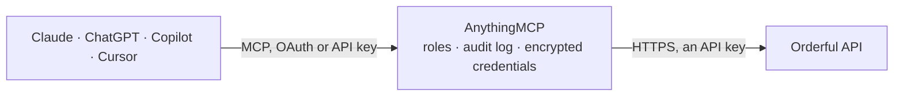

<!-- Generated by scripts/export-github-catalog.mjs in the anythingmcp-website repository. Do not edit by hand. -->

# Orderful MCP connector

Orderful EDI platform: list and read EDI transactions (purchase orders, acknowledgments, ship notices, invoices, inventory advice) in both directions, read their message content, work an inbox of … The AnythingMCP connector gives Claude, ChatGPT, Microsoft Copilot, Cursor and Gemini 12 MCP tools for Orderful: 8 read and 4 can change data.

**Category:** [Logistics](../logistics.md) · **Tools:** 12 · **Setup guide:** [anythingmcp.com](https://anythingmcp.com/guides/orderful-to-mcp) · [Deutsch](https://anythingmcp.com/de/guides/orderful-to-mcp) · [Italiano](https://anythingmcp.com/it/guides/orderful-to-mcp) · [Español](https://anythingmcp.com/es/guides/orderful-to-mcp) · [日本語](https://anythingmcp.com/ja/guides/orderful-to-mcp) · [Русский](https://anythingmcp.com/ru/guides/orderful-to-mcp) · [中文](https://anythingmcp.com/zh/guides/orderful-to-mcp)

## Start without code

No installation and no terminal: AnythingMCP Cloud runs the Orderful connector for you, operated by helpcode.ai in Frankfurt, Germany.

1. **Click the button above** and create an account or sign in. The Orderful connector opens, ready to install.
2. **Paste the API key or token from your Orderful account.** Every click is in the [step-by-step guide](https://anythingmcp.com/guides/orderful-to-mcp).
3. **Click Install.** AnythingMCP shows the address of your MCP server.
4. **Add that address to your assistant:** [Claude](https://anythingmcp.com/guides/connect-orderful-to-claude) · [ChatGPT](https://anythingmcp.com/guides/connect-orderful-to-chatgpt) · [Microsoft Copilot](https://anythingmcp.com/guides/connect-orderful-to-copilot) · [Cursor](https://anythingmcp.com/guides/connect-orderful-to-cursor) · [Gemini CLI](https://anythingmcp.com/guides/connect-orderful-to-gemini) · [Meta Muse](https://anythingmcp.com/guides/connect-orderful-to-muse).
5. **Ask your first question**, for example: *Show me Orderful record for invoice INV-2026-118 from partner RetailHaus KG*

Prefer help with the setup? [Talk to us](https://anythingmcp.com/contact).

## How it works

- **The AI client** speaks MCP (Streamable HTTP) to AnythingMCP and only sees tool names, descriptions and results. It never gets the Orderful credentials.
- **AnythingMCP** checks the client's role, builds the call from the tool definition, adds the credentials (an API key), calls Orderful, logs the call and returns the result.
- **Orderful** sees an ordinary API client with the rights of the account the credentials belong to.

## Tools

| Tool | What it does | Access |
|---|---|---|
| [`orderful_get_organization`](#orderful_get_organization) | Get your own Orderful organization: id, name and its EDI accounts with live and test ISA ids and qualifiers. | read |
| [`orderful_list_transactions`](#orderful_list_transactions) | List EDI transactions sent and received across all trading partners, newest first, up to 100 per page. | read |
| [`orderful_get_transaction`](#orderful_get_transaction) | Get one transaction by its UUID: direction, sender and receiver ISA ids, EDI and business type, business number, stream, statuses, creation time and links… | read |
| [`orderful_get_transaction_message`](#orderful_get_transaction_message) | Get the document content of one transaction: the purchase order, invoice or ship notice itself, as JSON or as the raw EDI file. | read |
| [`orderful_get_acknowledgment`](#orderful_get_acknowledgment) | Get the business acknowledgment of a transaction: ACCEPTED or REJECTED, with the errors given by the receiver. | read |
| [`orderful_list_inbox_transactions`](#orderful_list_inbox_transactions) | Read the transactions waiting in an Inbound Poller inbox, each with its document content and a delivery object (deliveryId, transactionId, accept and fail… | read |
| [`orderful_get_delivery`](#orderful_get_delivery) | Get one delivery of a transaction: status (CREATED, SENT, FAILED, DELIVERED), note, send and confirmation times, and the accept and fail links. | read |
| [`orderful_accept_delivery`](#orderful_accept_delivery) | Confirm that an inbound delivery was received and processed. | write |
| [`orderful_fail_delivery`](#orderful_fail_delivery) | Mark an inbound delivery as failed because your system could not process it, with a note saying why. | write |
| [`orderful_acknowledge_transaction`](#orderful_acknowledge_transaction) | Send the business acknowledgment for an inbound transaction on a JSON relationship: ACCEPTED, or REJECTED with error messages. | write |
| [`orderful_create_transaction`](#orderful_create_transaction) | Send one EDI document to a trading partner in Orderful's Mosaic JSON (850, 855, 856, 810, 846 or 860). | write |
| [`orderful_list_relationships`](#orderful_list_relationships) | List your trading partner relationships: for each, the document type, status, auto-send setting and the sender and receiver organization, EDI account and… | read |

## Tool reference

Every parameter as the AI client sees it in `tools/list`. Source: [`packages/backend/src/adapters/intl/orderful.json`](../../../packages/backend/src/adapters/intl/orderful.json).

### `orderful_get_organization`

Get your own Orderful organization: id, name and its EDI accounts with live and test ISA ids and qualifiers. Call it first to check the token and to learn the ISA ids used as senderId and receiverId.

**Access:** read · **Call:** `GET /v3/organizations/me`

No parameters.

### `orderful_list_transactions`

List EDI transactions sent and received across all trading partners, newest first, up to 100 per page. Each has a UUID id, direction, sender and receiver ISA ids, type, business number, stream and validation, delivery and acknowledgment status.

**Access:** read · **Call:** `GET /transactions`

| Parameter | Type | Required | Description |
|---|---|---|---|
| `direction` | `in` \| `out`[] | no | in for received, out for sent. |
| `simplified_transaction_type` | `PURCHASE_ORDER` \| `PURCHASE_ORDER_ACKNOWLEDGMENT` \| `PURCHASE_ORDER_CHANGE` \| `SHIP_NOTICE` \| `INVOICE` \| `INVENTORY_ADVICE` \| `PRICE_SALES_CATALOG` \| `WAREHOUSE_SHIPPING_ORDER` \| `WAREHOUSE_SHIPPING_ADVICE` \| `WAREHOUSE_STOCK_TRANSFER_SHIPMENT` \| `WAREHOUSE_STOCK_TRANSFER_RECEIPT`[] | no | Business document types, e.g. ["INVOICE"] matches every invoice type. |
| `edi_transaction_type` | string[] | no | Exact EDI types, up to 5, e.g. ["850_PURCHASE_ORDER", "810_INVOICE"]. |
| `stream` | `test` \| `live`[] | no | test and/or live stream (lowercase). |
| `business_number` | string[] | no | Up to 5 business numbers, such as a purchase order or invoice number. |
| `validation_status` | `PROCESSING` \| `VALID` \| `INVALID`[] | no | Validation statuses to include. |
| `delivery_status` | `PENDING` \| `SENT` \| `DELIVERED` \| `FAILED`[] | no | Delivery statuses to include. |
| `acknowledgment_status` | `NOT_ACKNOWLEDGED` \| `ACCEPTED` \| `REJECTED` \| `OVERDUE` \| `ACCEPTED_WITH_ERRORS`[] | no | Acknowledgment statuses to include, e.g. ["OVERDUE"]. |
| `sender_id` | string[] | no | Up to 5 sender ISA ids. |
| `receiver_id` | string[] | no | Up to 5 receiver ISA ids. |
| `created_at_start` | string | no | Created at or after, ISO 8601, e.g. 2026-10-01T00:00:00.000Z. |
| `created_at_end` | string | no | Created at or before, ISO 8601. |
| `limit` | integer | no | Transactions per page, 1 to 100 (default 100). |
| `next_cursor` | string | no | nextCursor value from metadata.pagination.links.next of the previous page. |
| `prev_cursor` | string | no | prevCursor value from metadata.pagination.links.prev, to go back a page. |

### `orderful_get_transaction`

Get one transaction by its UUID: direction, sender and receiver ISA ids, EDI and business type, business number, stream, statuses, creation time and links to its message and acknowledgment.

**Access:** read · **Call:** `GET /transactions/{transaction_id}`

| Parameter | Type | Required | Description |
|---|---|---|---|
| `transaction_id` | string | yes | Transaction UUID, the id from orderful_list_transactions or from an inbox item. |

### `orderful_get_transaction_message`

Get the document content of one transaction: the purchase order, invoice or ship notice itself, as JSON or as the raw EDI file. Use it to read line items, quantities, prices and parties.

**Access:** read · **Call:** `GET /transactions/{transaction_id}/message`

| Parameter | Type | Required | Description |
|---|---|---|---|
| `transaction_id` | string | yes | Transaction UUID. |

### `orderful_get_acknowledgment`

Get the business acknowledgment of a transaction: ACCEPTED or REJECTED, with the errors given by the receiver. Works for both sender and receiver; use it to see whether a partner accepted your document.

**Access:** read · **Call:** `GET /transactions/{transaction_id}/acknowledgment`

| Parameter | Type | Required | Description |
|---|---|---|---|
| `transaction_id` | string | yes | Transaction UUID. |

### `orderful_list_inbox_transactions`

Read the transactions waiting in an Inbound Poller inbox, each with its document content and a delivery object (deliveryId, transactionId, accept and fail links). Use it to pick up inbound documents, then accept or fail each delivery.

**Access:** read · **Call:** `GET /inboxes/{inbox_id}/transactions`

| Parameter | Type | Required | Description |
|---|---|---|---|
| `inbox_id` | integer | yes | Inbox id, shown in the Orderful UI under Communication Channels. |
| `limit` | integer | no | Transactions to return, 1 to 100 (default 30). |

### `orderful_get_delivery`

Get one delivery of a transaction: status (CREATED, SENT, FAILED, DELIVERED), note, send and confirmation times, and the accept and fail links. Use it to check whether an inbound document was confirmed.

**Access:** read · **Call:** `GET /transactions/{transaction_id}/deliveries/{delivery_id}`

| Parameter | Type | Required | Description |
|---|---|---|---|
| `transaction_id` | integer | yes | Numeric transactionId from the delivery object of an inbox item. |
| `delivery_id` | string | yes | deliveryId from the delivery object. |

### `orderful_accept_delivery`

Confirm that an inbound delivery was received and processed. Sets the transaction's delivery status to DELIVERED and removes it from the inbox. Call it after your system has stored the document.

**Access:** write · **Call:** `POST /transactions/{transaction_id}/deliveries/{delivery_id}/accept`

| Parameter | Type | Required | Description |
|---|---|---|---|
| `transaction_id` | integer | yes | Numeric transactionId from the delivery object. |
| `delivery_id` | string | yes | deliveryId from the delivery object. |
| `note` | string | yes | Short note stored with the acceptance, e.g. Imported as order 4711. |

### `orderful_fail_delivery`

Mark an inbound delivery as failed because your system could not process it, with a note saying why. The delivery status becomes FAILED so the problem shows in Orderful.

**Access:** write · **Call:** `POST /transactions/{transaction_id}/deliveries/{delivery_id}/fail`

| Parameter | Type | Required | Description |
|---|---|---|---|
| `transaction_id` | integer | yes | Numeric transactionId from the delivery object. |
| `delivery_id` | string | yes | deliveryId from the delivery object. |
| `note` | string | yes | Why the delivery failed, e.g. Unknown ship-to location 0042. |

### `orderful_acknowledge_transaction`

Send the business acknowledgment for an inbound transaction on a JSON relationship: ACCEPTED, or REJECTED with error messages. Can be sent only once per transaction; the sender sees the result.

**Access:** write · **Call:** `POST /transactions/{transaction_id}/acknowledgment`

| Parameter | Type | Required | Description |
|---|---|---|---|
| `transaction_id` | string | yes | Transaction UUID (the id of the inbox item). |
| `status` | `ACCEPTED` \| `REJECTED` | yes | Accept or reject the document. |
| `errors` | object[] | no | For REJECTED: [{"path": "/message", "code": "00", "message": "reason"}]. Only free-text code 00 at /message is supported. |

### `orderful_create_transaction`

Send one EDI document to a trading partner in Orderful's Mosaic JSON (850, 855, 856, 810, 846 or 860). Returns the new transaction with its validation status. On the live stream the partner receives it.

**Access:** write · **Call:** `POST /transactions`

| Parameter | Type | Required | Description |
|---|---|---|---|
| `type` | `850_PURCHASE_ORDER` \| `855_PURCHASE_ORDER_ACKNOWLEDGMENT` \| `856_SHIP_NOTICE_MANIFEST` \| `810_INVOICE` \| `846_INVENTORY_ADVICE` \| `860_PURCHASE_ORDER_CHANGE` | yes | Document type. |
| `stream` | `test` \| `live` | yes | test while testing a relationship, live for production. |
| `sender_id` | string | yes | Your ISA id (from orderful_get_organization). |
| `receiver_id` | string | yes | The trading partner's ISA id (from orderful_list_relationships). |
| `message` | object | yes | The document in Mosaic JSON for the chosen type, e.g. for 810: invoiceNumber, invoiceDate, purchaseOrderNumber, parties, lineItems. |

### `orderful_list_relationships`

List your trading partner relationships: for each, the document type, status, auto-send setting and the sender and receiver organization, EDI account and ISA ids. Use it to see who you trade which documents with.

**Access:** read · **Call:** `GET /v3/relationships`

| Parameter | Type | Required | Description |
|---|---|---|---|
| `auto_send` | `ENABLED` \| `DISABLED` | no | Only relationships with auto-send on or off. |
| `limit` | integer | no | Relationships per page. |
| `next_cursor` | string | no | nextCursor value from metadata.pagination.links.next. |
| `prev_cursor` | string | no | prevCursor value from metadata.pagination.links.prev. |

## Run it yourself

AnythingMCP is open source (AGPL-3.0). [Run it with Docker](../../../README.md#run-it-yourself), open **Connectors → Store**, pick **Orderful** and enter `ORDERFUL_API_URL`, `ORDERFUL_API_KEY`, then add your MCP server URL to the AI client.

[← Logistics connectors](../logistics.md) · [All categories](../README.md)
