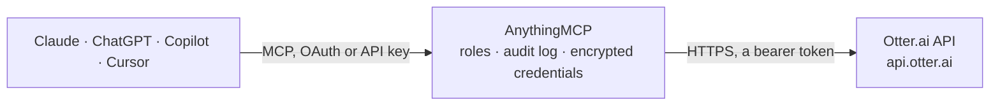

<!-- Generated by scripts/export-github-catalog.mjs in the anythingmcp-website repository. Do not edit by hand. -->

# Otter.ai MCP connector

Let your AI read your Otter.ai meeting notes: list recorded conversations, read Otter's summaries, action items, insights and transcripts, browse channels, and with your confirmation import a recording from a link. The AnythingMCP connector gives Claude, ChatGPT, Microsoft Copilot, Cursor and Gemini 9 MCP tools for Otter.ai: 8 read and 1 can change data.

**Category:** [Productivity](../productivity.md) · **Tools:** 9 · **Setup guide:** [anythingmcp.com](https://anythingmcp.com/guides/otter-to-mcp) · [Deutsch](https://anythingmcp.com/de/guides/otter-to-mcp) · [Italiano](https://anythingmcp.com/it/guides/otter-to-mcp) · [Español](https://anythingmcp.com/es/guides/otter-to-mcp) · [日本語](https://anythingmcp.com/ja/guides/otter-to-mcp) · [Русский](https://anythingmcp.com/ru/guides/otter-to-mcp) · [中文](https://anythingmcp.com/zh/guides/otter-to-mcp)

## Start without code

No installation and no terminal: AnythingMCP Cloud runs the Otter.ai connector for you, operated by helpcode.ai in Frankfurt, Germany.

1. **Click the button above** and create an account or sign in. The Otter.ai connector opens, ready to install.
2. **Paste the API key or token from your Otter.ai account.** Every click is in the [step-by-step guide](https://anythingmcp.com/guides/otter-to-mcp).
3. **Click Install.** AnythingMCP shows the address of your MCP server.
4. **Add that address to your assistant:** [Claude](https://anythingmcp.com/guides/connect-otter-to-claude) · [ChatGPT](https://anythingmcp.com/guides/connect-otter-to-chatgpt) · [Microsoft Copilot](https://anythingmcp.com/guides/connect-otter-to-copilot) · [Cursor](https://anythingmcp.com/guides/connect-otter-to-cursor) · [Gemini CLI](https://anythingmcp.com/guides/connect-otter-to-gemini) · [Meta Muse](https://anythingmcp.com/guides/connect-otter-to-muse).
5. **Ask your first question**, for example: *Show the Otter conversation for the invoice review meeting with Miller GmbH on 2026-09-14*

Prefer help with the setup? [Talk to us](https://anythingmcp.com/contact).

## How it works

- **The AI client** speaks MCP (Streamable HTTP) to AnythingMCP and only sees tool names, descriptions and results. It never gets the Otter.ai credentials.
- **AnythingMCP** checks the client's role, builds the call from the tool definition, adds the credentials (a bearer token), calls Otter.ai, logs the call and returns the result.
- **Otter.ai** sees an ordinary API client with the rights of the account the credentials belong to.

## Tools

| Tool | What it does | Access |
|---|---|---|
| [`otter_get_workspace`](#otter_get_workspace) | Read the Otter workspace of the API key's user: id, name, owner, number of members, handle and type. | read |
| [`otter_list_channels`](#otter_list_channels) | List the Otter channels of the user, alphabetically: id, name, number of members, owner and visibility (private or workspace). | read |
| [`otter_list_channel_members`](#otter_list_channel_members) | List the members of one Otter channel, alphabetically: user id, name and email. | read |
| [`otter_list_conversations`](#otter_list_conversations) | List Otter conversations (recorded meetings), newest first: id, title, date, link, owner, calendar guests, join link and Otter's summary. | read |
| [`otter_get_conversation`](#otter_get_conversation) | Read one Otter conversation without its full text: title, date, owner, guests, who it is shared with, Otter's summary, the action items with assignee and… | read |
| [`otter_get_transcript`](#otter_get_transcript) | Read what was said in an Otter conversation, speaker blocks 1 to 300: each block is the speaker name, the time into the recording and what they said. | read |
| [`otter_get_transcript_more`](#otter_get_transcript_more) | Read speaker blocks 301 to 600 of a long Otter conversation, after otter_get_transcript showed totalBlocks over 300. | read |
| [`otter_get_audio_link`](#otter_get_audio_link) | Get a download link for the MP3 recording of an Otter conversation. | read |
| [`otter_import_recording`](#otter_import_recording) | Create a new Otter conversation from a recording at a public link (for example a call from a dialer), so Otter transcribes and summarises it. | write |

## Tool reference

Every parameter as the AI client sees it in `tools/list`. Source: [`packages/backend/src/adapters/intl/otter.json`](../../../packages/backend/src/adapters/intl/otter.json).

### `otter_get_workspace`

Read the Otter workspace of the API key's user: id, name, owner, number of members, handle and type. Read-only.

**Access:** read · **Call:** `GET /workspace`

No parameters.

### `otter_list_channels`

List the Otter channels of the user, alphabetically: id, name, number of members, owner and visibility (private or workspace). A channel id filters otter_list_conversations. Read-only.

**Access:** read · **Call:** `GET /channels`

No parameters.

### `otter_list_channel_members`

List the members of one Otter channel, alphabetically: user id, name and email. Read-only.

**Access:** read · **Call:** `GET /channels/{channel_id}/members`

| Parameter | Type | Required | Description |
|---|---|---|---|
| `channel_id` | string | yes | Channel id from otter_list_channels. |

### `otter_list_conversations`

List Otter conversations (recorded meetings), newest first: id, title, date, link, owner, calendar guests, join link and Otter's summary. Optionally include conversations shared with the user, or only one channel. Pages with cursor: while hasMore is true, call again with cursor = nextCursor. Read-only.

**Access:** read · **Call:** `GET /conversations`

| Parameter | Type | Required | Description |
|---|---|---|---|
| `include_shared` | boolean | no | true: also conversations other people shared with the user. Default false; always on with channel_id. |
| `channel_id` | string | no | Only conversations in this channel (id from otter_list_channels). |
| `limit` | integer | no | Conversations per page, 1 to 100 (default 20). |
| `cursor` | string | no | nextCursor from the previous page. |

### `otter_get_conversation`

Read one Otter conversation without its full text: title, date, owner, guests, who it is shared with, Otter's summary, the action items with assignee and status, the insights by topic and the outline by section. Use otter_get_transcript for what was said. Read-only.

**Access:** read · **Call:** `GET /conversations/{conversation_id}`

| Parameter | Type | Required | Description |
|---|---|---|---|
| `conversation_id` | string | yes | Conversation id from otter_list_conversations. |

### `otter_get_transcript`

Read what was said in an Otter conversation, speaker blocks 1 to 300: each block is the speaker name, the time into the recording and what they said. totalBlocks tells how long it is; when it is over 300, read the rest with otter_get_transcript_more. Read-only.

**Access:** read · **Call:** `GET /conversations/{conversation_id}`

| Parameter | Type | Required | Description |
|---|---|---|---|
| `conversation_id` | string | yes | Conversation id from otter_list_conversations. |

### `otter_get_transcript_more`

Read speaker blocks 301 to 600 of a long Otter conversation, after otter_get_transcript showed totalBlocks over 300. Otter sends the text in one piece and there are no further pages: for longer meetings use the summary, action items and outline of otter_get_conversation. Read-only.

**Access:** read · **Call:** `GET /conversations/{conversation_id}`

| Parameter | Type | Required | Description |
|---|---|---|---|
| `conversation_id` | string | yes | Conversation id from otter_list_conversations. |

### `otter_get_audio_link`

Get a download link for the MP3 recording of an Otter conversation. The link gives access to the recording itself: only share it with the user who asked. Read-only.

**Access:** read · **Call:** `GET /conversations/{conversation_id}/audio`

| Parameter | Type | Required | Description |
|---|---|---|---|
| `conversation_id` | string | yes | Conversation id from otter_list_conversations. |

### `otter_import_recording`

Create a new Otter conversation from a recording at a public link (for example a call from a dialer), so Otter transcribes and summarises it. Adds a conversation to the user's account: confirm the link and the name with the user before calling it and wait for their yes. Returns the status of the import.

**Access:** write · **Call:** `POST /conversations`

| Parameter | Type | Required | Description |
|---|---|---|---|
| `file_url` | string | yes | Public link that downloads the audio or video file. |
| `name` | string | no | Name of the new conversation. |

## Run it yourself

AnythingMCP is open source (AGPL-3.0). [Run it with Docker](../../../README.md#run-it-yourself), open **Connectors → Store**, pick **Otter.ai** and enter `OTTER_API_KEY`, then add your MCP server URL to the AI client.

[← Productivity connectors](../productivity.md) · [All categories](../README.md)
