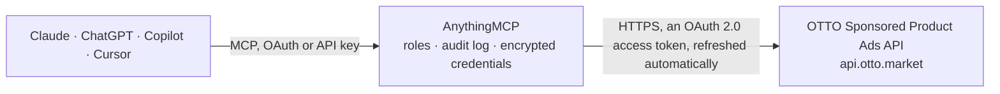

<!-- Generated by scripts/export-github-catalog.mjs in the anythingmcp-website repository. Do not edit by hand. -->

# OTTO Sponsored Product Ads MCP connector

OTTO Market Sponsored Product Ads: campaigns, advertised SKUs (targets), keywords and bids, plus SPA reporting (campaign and product KPIs, CSV reports) for advertisers on otto.de. The AnythingMCP connector gives Claude, ChatGPT, Microsoft Copilot, Cursor and Gemini 20 MCP tools for OTTO Sponsored Product Ads: 13 read and 7 can change data.

**Category:** [Advertising](../advertising.md) · **Tools:** 20 · **Setup guide:** [anythingmcp.com](https://anythingmcp.com/guides/otto-ads-to-mcp) · [Deutsch](https://anythingmcp.com/de/guides/otto-ads-to-mcp) · [Italiano](https://anythingmcp.com/it/guides/otto-ads-to-mcp) · [Español](https://anythingmcp.com/es/guides/otto-ads-to-mcp) · [日本語](https://anythingmcp.com/ja/guides/otto-ads-to-mcp) · [Русский](https://anythingmcp.com/ru/guides/otto-ads-to-mcp) · [中文](https://anythingmcp.com/zh/guides/otto-ads-to-mcp)

## Start without code

No installation and no terminal: AnythingMCP Cloud runs the OTTO Sponsored Product Ads connector for you, operated by helpcode.ai in Frankfurt, Germany.

1. **Click the button above** and create an account or sign in. The OTTO Sponsored Product Ads connector opens, ready to install.
2. **Sign in with your OTTO Sponsored Product Ads account** when AnythingMCP asks. The first time, an admin creates a small app in the OTTO Sponsored Product Ads developer console. Every click is in the [step-by-step guide](https://anythingmcp.com/guides/otto-ads-to-mcp).
3. **Click Install.** AnythingMCP shows the address of your MCP server.
4. **Add that address to your assistant:** [Claude](https://anythingmcp.com/guides/connect-otto-ads-to-claude) · [ChatGPT](https://anythingmcp.com/guides/connect-otto-ads-to-chatgpt) · [Microsoft Copilot](https://anythingmcp.com/guides/connect-otto-ads-to-copilot) · [Cursor](https://anythingmcp.com/guides/connect-otto-ads-to-cursor) · [Gemini CLI](https://anythingmcp.com/guides/connect-otto-ads-to-gemini) · [Meta Muse](https://anythingmcp.com/guides/connect-otto-ads-to-muse).
5. **Ask your first question**, for example: *What's campaign 8421's KPIs for 2026-09-01 to 2026-09-30? I need costs and attributed sales.*

Prefer help with the setup? [Talk to us](https://anythingmcp.com/contact).

## How it works

- **The AI client** speaks MCP (Streamable HTTP) to AnythingMCP and only sees tool names, descriptions and results. It never gets the OTTO Sponsored Product Ads credentials.
- **AnythingMCP** checks the client's role, builds the call from the tool definition, adds the credentials (an OAuth 2.0 access token, refreshed automatically), calls OTTO Sponsored Product Ads, logs the call and returns the result.
- **OTTO Sponsored Product Ads** sees an ordinary API client with the rights of the account the credentials belong to.

## Tools

| Tool | What it does | Access |
|---|---|---|
| [`otto_ads_list_campaigns`](#otto_ads_list_campaigns) | List Sponsored Product Ads campaigns: campaignId, name, status (PENDING, WAITING, ACTIVE, PAUSED, ENDED, CANCELED), campaignType (AUTOMATIC or MANUAL),… | read |
| [`otto_ads_get_campaign`](#otto_ads_get_campaign) | Read one campaign: status, type, budget (euro cents), budgetType, pacing and dates. | read |
| [`otto_ads_list_targets`](#otto_ads_list_targets) | List the targets (advertised SKUs) of a campaign with targetId, sku and bid. | read |
| [`otto_ads_get_target`](#otto_ads_get_target) | Read one target (advertised SKU) of a campaign with its bid. | read |
| [`otto_ads_list_keywords`](#otto_ads_list_keywords) | List the keywords of one target: keywordId, keyword, matchType (EXACT, PHRASE, BROAD), keywordType (POSITIVE or NEGATIVE) and bid (euro cents, positive… | read |
| [`otto_ads_get_change_request`](#otto_ads_get_change_request) | Status of an asynchronous write: PENDING, ACCEPTED or REJECTED. | read |
| [`otto_ads_get_campaign_kpis`](#otto_ads_get_campaign_kpis) | KPIs of one campaign for a date range: views, clicks, costs, attributed sales, ordered SKUs, click-through rate, cost per click and return on ad spend. | read |
| [`otto_ads_get_product_kpis`](#otto_ads_get_product_kpis) | KPIs of one SKU inside one campaign for a date range, the same metrics as the campaign KPIs plus totalSalesSeller (attributed sales of other articles of the… | read |
| [`otto_ads_request_campaign_report`](#otto_ads_request_campaign_report) | Start a CSV campaign report across campaigns and days. | read |
| [`otto_ads_request_keyword_report`](#otto_ads_request_keyword_report) | Start a CSV keyword report: performance per keyword and per actual search term, the basis for new negative keywords and bid changes. | read |
| [`otto_ads_request_product_report`](#otto_ads_request_product_report) | Start a CSV product report: performance per advertised SKU. | read |
| [`otto_ads_get_report_status`](#otto_ads_get_report_status) | Status of a requested report: IN_PROGRESS, READY or FAILED (request a new one after FAILED). | read |
| [`otto_ads_download_report`](#otto_ads_download_report) | Download a READY report as CSV text. | read |
| [`otto_ads_create_campaign`](#otto_ads_create_campaign) | Create a campaign. | write |
| [`otto_ads_update_campaign`](#otto_ads_update_campaign) | Change a campaign: status (ACTIVE, PAUSED, WAITING), budget (euro cents), pacing, name, start or end date. | write |
| [`otto_ads_add_targets`](#otto_ads_add_targets) | Add SKUs to a campaign. | write |
| [`otto_ads_update_target_bids`](#otto_ads_update_target_bids) | Change target bids in an AUTOMATIC campaign. | write |
| [`otto_ads_add_keywords`](#otto_ads_add_keywords) | Add keywords to one target. | write |
| [`otto_ads_update_keywords`](#otto_ads_update_keywords) | Change the bid (euro cents) or matchType of existing keywords of one target. | write |
| [`otto_ads_delete_keywords`](#otto_ads_delete_keywords) | Delete 1 to 50 keywords of one target by keywordId. | write |

## Tool reference

Every parameter as the AI client sees it in `tools/list`. Source: [`packages/backend/src/adapters/de/otto-ads.json`](../../../packages/backend/src/adapters/de/otto-ads.json).

### `otto_ads_list_campaigns`

List Sponsored Product Ads campaigns: campaignId, name, status (PENDING, WAITING, ACTIVE, PAUSED, ENDED, CANCELED), campaignType (AUTOMATIC or MANUAL), budget (euro cents), budgetType, pacing, start and end date. Page with cursor = nextCursor until it is null.

**Access:** read · **Call:** `GET /v1/sponsored-product-ads/campaigns`

| Parameter | Type | Required | Description |
|---|---|---|---|
| `limit` | integer | no | Campaigns per page, 1 to 1000. Default 100. |
| `cursor` | string | no | nextCursor from the previous page. Omit for the first page. |

### `otto_ads_get_campaign`

Read one campaign: status, type, budget (euro cents), budgetType, pacing and dates. Read it before changing its status: setting the status it already has is rejected.

**Access:** read · **Call:** `GET /v1/sponsored-product-ads/campaigns/{campaign_id}`

| Parameter | Type | Required | Description |
|---|---|---|---|
| `campaign_id` | string | yes | campaignId (UUID) from otto_ads_list_campaigns. |

### `otto_ads_list_targets`

List the targets (advertised SKUs) of a campaign with targetId, sku and bid. Only AUTOMATIC campaigns have a bid per target; in MANUAL campaigns bid is null and the bids sit on the keywords. Page with cursor = nextCursor.

**Access:** read · **Call:** `GET /v1/sponsored-product-ads/campaigns/{campaign_id}/targets`

| Parameter | Type | Required | Description |
|---|---|---|---|
| `campaign_id` | string | yes | campaignId (UUID). |
| `limit` | integer | no | Targets per page, 1 to 1000. Default 100. |
| `cursor` | string | no | nextCursor from the previous page. |

### `otto_ads_get_target`

Read one target (advertised SKU) of a campaign with its bid.

**Access:** read · **Call:** `GET /v1/sponsored-product-ads/campaigns/{campaign_id}/targets/{target_id}`

| Parameter | Type | Required | Description |
|---|---|---|---|
| `campaign_id` | string | yes | campaignId (UUID). |
| `target_id` | string | yes | targetId (UUID) from otto_ads_list_targets. |

### `otto_ads_list_keywords`

List the keywords of one target: keywordId, keyword, matchType (EXACT, PHRASE, BROAD), keywordType (POSITIVE or NEGATIVE) and bid (euro cents, positive keywords only). Targets of AUTOMATIC campaigns can carry negative keywords too. Page with cursor = nextCursor.

**Access:** read · **Call:** `GET /v1/sponsored-product-ads/campaigns/{campaign_id}/targets/{target_id}/keywords`

| Parameter | Type | Required | Description |
|---|---|---|---|
| `campaign_id` | string | yes | campaignId (UUID). |
| `target_id` | string | yes | targetId (UUID). |
| `limit` | integer | no | Keywords per page, 1 to 1000. Default 100. |
| `cursor` | string | no | nextCursor from the previous page. |

### `otto_ads_get_change_request`

Status of an asynchronous write: PENDING, ACCEPTED or REJECTED. ACCEPTED lists the affected entityIds; REJECTED carries rejectionReason. Poll with a growing wait (1 s, 2 s, 4 s...) to avoid 429.

**Access:** read · **Call:** `GET /v1/sponsored-product-ads/change-requests/{request_id}`

| Parameter | Type | Required | Description |
|---|---|---|---|
| `request_id` | string | yes | changeRequest.requestId (UUID) returned by a write. |

### `otto_ads_get_campaign_kpis`

KPIs of one campaign for a date range: views, clicks, costs, attributed sales, ordered SKUs, click-through rate, cost per click and return on ad spend. Costs and sales are euro cents. At most the last 90 days, never today; without dates OTTO uses the last 7 days. A campaign without data in the range answers 404 "Data not found".

**Access:** read · **Call:** `GET /v1/spa-reporting/campaign-performance`

| Parameter | Type | Required | Description |
|---|---|---|---|
| `campaign_id` | string | yes | campaignId (UUID). |
| `from_date` | string | no | YYYY-MM-DD, within the last 90 days. |
| `to_date` | string | no | YYYY-MM-DD, yesterday at the latest. |

### `otto_ads_get_product_kpis`

KPIs of one SKU inside one campaign for a date range, the same metrics as the campaign KPIs plus totalSalesSeller (attributed sales of other articles of the same brand). Euro cents; at most the last 90 days, never today; default the last 7 days.

**Access:** read · **Call:** `GET /v1/spa-reporting/product-performance`

| Parameter | Type | Required | Description |
|---|---|---|---|
| `campaign_id` | string | yes | campaignId (UUID). |
| `sku` | string | yes | The advertised SKU, as in otto_ads_list_targets. |
| `from_date` | string | no | YYYY-MM-DD, within the last 90 days. |
| `to_date` | string | no | YYYY-MM-DD, yesterday at the latest. |

### `otto_ads_request_campaign_report`

Start a CSV campaign report across campaigns and days. Returns a reportId; poll otto_ads_get_report_status with report_type "campaign" until READY, then otto_ads_download_report. Does not change any campaign, but counts against OTTO's quota of 200 reports per 24 hours.

**Access:** read · **Call:** `POST /v1/spa-reporting/campaign-performance`

| Parameter | Type | Required | Description |
|---|---|---|---|
| `name` | string | yes | A name for the report. |
| `from_date` | string | yes | YYYY-MM-DD, within the last 90 days. |
| `to_date` | string | yes | YYYY-MM-DD, yesterday at the latest. |
| `columns` | `TOTAL_VIEWS` \| `TOTAL_CLICKS` \| `TOTAL_COSTS` \| `TOTAL_SALES` \| `TOTAL_ORDERED_SKUS` \| `CAMPAIGN_ID` \| `EVENT_DATE_CET`[] | yes | Columns of the CSV. TOTAL_COSTS and TOTAL_SALES are euro cents. |
| `group_by` | `EVENT_DATE_CET` \| `CAMPAIGN_ID`[] | no | Group rows by day and/or campaign. |
| `filters` | object[] | no | Optional filters, combined with AND, e.g. [{"column": "CAMPAIGN_ID", "operator": "=", "value": "<uuid>"}]. |

### `otto_ads_request_keyword_report`

Start a CSV keyword report: performance per keyword and per actual search term, the basis for new negative keywords and bid changes. Returns a reportId; poll otto_ads_get_report_status with report_type "keyword" until READY, then otto_ads_download_report. Counts against the quota of 200 reports per 24 hours.

**Access:** read · **Call:** `POST /v1/spa-reporting/keyword-performance`

| Parameter | Type | Required | Description |
|---|---|---|---|
| `name` | string | yes | A name for the report. |
| `from_date` | string | yes | YYYY-MM-DD, within the last 90 days. |
| `to_date` | string | yes | YYYY-MM-DD, yesterday at the latest. |
| `columns` | `TOTAL_VIEWS` \| `TOTAL_CLICKS` \| `TOTAL_COSTS` \| `TOTAL_SALES` \| `TOTAL_ORDERED_SKUS` \| `CAMPAIGN_ID` \| `EVENT_DATE_CET` \| `KEYWORD` \| `SEARCHTERM` \| `MATCH_TYPE`[] | yes | Columns of the CSV. SEARCHTERM is what the shopper typed; KEYWORD is the keyword that matched it. |
| `group_by` | `KEYWORD` \| `SEARCHTERM` \| `EVENT_DATE_CET` \| `MATCH_TYPE`[] | no | Group rows by keyword, search term, day and/or match type. |
| `filters` | object[] | no | Optional filters, combined with AND. |

### `otto_ads_request_product_report`

Start a CSV product report: performance per advertised SKU. Returns a reportId; poll otto_ads_get_report_status with report_type "product" until READY, then otto_ads_download_report. Counts against the quota of 200 reports per 24 hours.

**Access:** read · **Call:** `POST /v1/spa-reporting/product-performance`

| Parameter | Type | Required | Description |
|---|---|---|---|
| `name` | string | yes | A name for the report. |
| `from_date` | string | yes | YYYY-MM-DD, within the last 90 days. |
| `to_date` | string | yes | YYYY-MM-DD, yesterday at the latest. |
| `columns` | `TOTAL_VIEWS` \| `TOTAL_CLICKS` \| `TOTAL_COSTS` \| `TOTAL_SALES` \| `TOTAL_ORDERED_SKUS` \| `TOTAL_SALES_SELLER` \| `CAMPAIGN_ID` \| `SKU` \| `EVENT_DATE_CET`[] | yes | Columns of the CSV. TOTAL_SALES_SELLER = attributed sales of other articles of the same brand. |
| `group_by` | `EVENT_DATE_CET` \| `CAMPAIGN_ID` \| `SKU`[] | no | Group rows by day, campaign and/or SKU. |
| `filters` | object[] | no | Optional filters, combined with AND. |

### `otto_ads_get_report_status`

Status of a requested report: IN_PROGRESS, READY or FAILED (request a new one after FAILED). report_type must match the tool that requested it.

**Access:** read · **Call:** `GET /v1/spa-reporting/{report_type}-performance/status`

| Parameter | Type | Required | Description |
|---|---|---|---|
| `report_type` | `campaign` \| `keyword` \| `product` | yes | Which kind of report it is. |
| `report_id` | string | yes | reportId returned when the report was requested. |

### `otto_ads_download_report`

Download a READY report as CSV text. 404 means it is not ready yet, 410 that it expired (files are kept 24 hours).

**Access:** read · **Call:** `GET /v1/spa-reporting/reports/download`

| Parameter | Type | Required | Description |
|---|---|---|---|
| `report_id` | string | yes | reportId of a READY report. |

### `otto_ads_create_campaign`

Create a campaign. AUTOMATIC campaigns bid per target (SKU); MANUAL campaigns bid per keyword. Add SKUs afterwards with otto_ads_add_targets and, for MANUAL, keywords with otto_ads_add_keywords. Asynchronous: poll otto_ads_get_change_request with the returned requestId. Starts real advertising spend from startDate; confirm budget and dates with the user first.

**Access:** write · **Call:** `POST /v1/sponsored-product-ads/campaigns`

| Parameter | Type | Required | Description |
|---|---|---|---|
| `name` | string | yes | 1 to 250 characters; no $ § " # * or parentheses, except a trailing (2). |
| `campaign_type` | `AUTOMATIC` \| `MANUAL` | yes | AUTOMATIC bids per target (SKU), MANUAL bids per keyword. Cannot be changed later. |
| `budget` | object | yes | Euro cents: {"amount": 1000, "currency": "EUR"} = 10.00 EUR. Minimum amount 20. |
| `budget_type` | `DAILY` \| `WEEKLY` \| `MONTHLY` \| `LIFETIME` | yes | Period the budget applies to. Cannot be changed later; LIFETIME needs an end_date. |
| `pacing` | `ASAP` \| `EVEN` | yes | ASAP spends as fast as possible, EVEN spreads the budget over the period. |
| `start_date` | string | yes | YYYY-MM-DD, today or later. |
| `end_date` | string | no | YYYY-MM-DD. Omit for an ongoing campaign; required for a LIFETIME budget. |

### `otto_ads_update_campaign`

Change a campaign: status (ACTIVE, PAUSED, WAITING), budget (euro cents), pacing, name, start or end date. Send only what changes; budgetType and campaignType cannot be changed. Read the campaign first: setting the status it already has is rejected. Asynchronous: poll otto_ads_get_change_request.

**Access:** write · **Call:** `PATCH /v1/sponsored-product-ads/campaigns/{campaign_id}`

| Parameter | Type | Required | Description |
|---|---|---|---|
| `campaign_id` | string | yes | campaignId (UUID). |
| `status` | `ACTIVE` \| `PAUSED` \| `WAITING` | no | ACTIVE to run, PAUSED to stop, WAITING to hold until the start date. Must differ from the current status. |
| `budget` | object | no | Euro cents: {"amount": 1000, "currency": "EUR"}. Minimum amount 20. |
| `pacing` | `ASAP` \| `EVEN` | no | ASAP spends as fast as possible, EVEN spreads the budget over the period. |
| `name` | string | no | New name, same rules as on create. |
| `start_date` | string | no | YYYY-MM-DD, today or later. |
| `end_date` | string | no | YYYY-MM-DD, tomorrow or later. |

### `otto_ads_add_targets`

Add SKUs to a campaign. Each item is {"sku": "...", "bid": {"amount": 50, "currency": "EUR"}}; the bid (euro cents) is required in AUTOMATIC campaigns and ignored in MANUAL ones. Asynchronous: poll otto_ads_get_change_request.

**Access:** write · **Call:** `POST /v1/sponsored-product-ads/campaigns/{campaign_id}/targets`

| Parameter | Type | Required | Description |
|---|---|---|---|
| `campaign_id` | string | yes | campaignId (UUID). |
| `targets` | object[] | yes | SKUs to advertise, each with a bid in euro cents for AUTOMATIC campaigns. |

### `otto_ads_update_target_bids`

Change target bids in an AUTOMATIC campaign. Each item is {"targetId": "...", "bid": {"amount": 160, "currency": "EUR"}} (160 = 1.60 EUR). Asynchronous: poll otto_ads_get_change_request.

**Access:** write · **Call:** `PATCH /v1/sponsored-product-ads/campaigns/{campaign_id}/targets`

| Parameter | Type | Required | Description |
|---|---|---|---|
| `campaign_id` | string | yes | campaignId (UUID). |
| `targets` | object[] | yes | Targets with their new bid in euro cents. |

### `otto_ads_add_keywords`

Add keywords to one target. NEGATIVE keywords (no bid) exclude search terms in AUTOMATIC and MANUAL campaigns; POSITIVE keywords need a bid in euro cents and belong to MANUAL campaigns. keywordType cannot be changed later. Each item: {"keyword": "...", "matchType": "EXACT|PHRASE|BROAD", "keywordType": "POSITIVE|NEGATIVE", "bid": {...}}. Asynchronous: poll otto_ads_get_change_request.

**Access:** write · **Call:** `POST /v1/sponsored-product-ads/campaigns/{campaign_id}/targets/{target_id}/keywords`

| Parameter | Type | Required | Description |
|---|---|---|---|
| `campaign_id` | string | yes | campaignId (UUID). |
| `target_id` | string | yes | targetId (UUID). |
| `keywords` | object[] | yes | Keywords to add to the target. |

### `otto_ads_update_keywords`

Change the bid (euro cents) or matchType of existing keywords of one target. Each item: {"keywordId": "...", "bid": {"amount": 80, "currency": "EUR"}, "matchType": "PHRASE"}, with only the fields that change. Asynchronous: poll otto_ads_get_change_request.

**Access:** write · **Call:** `PATCH /v1/sponsored-product-ads/campaigns/{campaign_id}/targets/{target_id}/keywords`

| Parameter | Type | Required | Description |
|---|---|---|---|
| `campaign_id` | string | yes | campaignId (UUID). |
| `target_id` | string | yes | targetId (UUID). |
| `keywords` | object[] | yes | Keywords to change, by keywordId, with only the fields that change. |

### `otto_ads_delete_keywords`

Delete 1 to 50 keywords of one target by keywordId. Cannot be undone; lowering a bid is often the better choice. Installed switched off. Asynchronous: poll otto_ads_get_change_request.

**Access:** write · **Call:** `DELETE /v1/sponsored-product-ads/campaigns/{campaign_id}/targets/{target_id}/keywords`

| Parameter | Type | Required | Description |
|---|---|---|---|
| `campaign_id` | string | yes | campaignId (UUID). |
| `target_id` | string | yes | targetId (UUID). |
| `keyword_ids` | string[] | yes | keywordIds from otto_ads_list_keywords. |

## Run it yourself

AnythingMCP is open source (AGPL-3.0). [Run it with Docker](../../../README.md#run-it-yourself), open **Connectors → Store**, pick **OTTO Sponsored Product Ads** and enter `OTTO_ADS_CLIENT_ID`, `OTTO_ADS_CLIENT_SECRET`, then add your MCP server URL to the AI client.

[← Advertising connectors](../advertising.md) · [All categories](../README.md)
