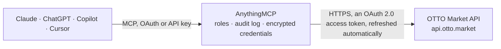

<!-- Generated by scripts/export-github-catalog.mjs in the anythingmcp-website repository. Do not edit by hand. -->

# OTTO Market MCP connector

OTTO Market partner API: orders and their positions, product variations, stock and price updates, and returns for sellers on otto.de. The AnythingMCP connector gives Claude, ChatGPT, Microsoft Copilot, Cursor and Gemini 8 MCP tools for OTTO Market: 6 read and 2 can change data.

**Category:** [E-commerce](../e-commerce.md) · **Tools:** 8 · **Setup guide:** [anythingmcp.com](https://anythingmcp.com/guides/otto-market-to-mcp) · [Deutsch](https://anythingmcp.com/de/guides/otto-market-to-mcp) · [Italiano](https://anythingmcp.com/it/guides/otto-market-to-mcp) · [Español](https://anythingmcp.com/es/guides/otto-market-to-mcp) · [日本語](https://anythingmcp.com/ja/guides/otto-market-to-mcp) · [Русский](https://anythingmcp.com/ru/guides/otto-market-to-mcp) · [中文](https://anythingmcp.com/zh/guides/otto-market-to-mcp)

## Start without code

No installation and no terminal: AnythingMCP Cloud runs the OTTO Market connector for you, operated by helpcode.ai in Frankfurt, Germany.

1. **Click the button above** and create an account or sign in. The OTTO Market connector opens, ready to install.
2. **Sign in with your OTTO Market account** when AnythingMCP asks. The first time, an admin creates a small app in the OTTO Market developer console. Every click is in the [step-by-step guide](https://anythingmcp.com/guides/otto-market-to-mcp).
3. **Click Install.** AnythingMCP shows the address of your MCP server.
4. **Add that address to your assistant:** [Claude](https://anythingmcp.com/guides/connect-otto-market-to-claude) · [ChatGPT](https://anythingmcp.com/guides/connect-otto-market-to-chatgpt) · [Microsoft Copilot](https://anythingmcp.com/guides/connect-otto-market-to-copilot) · [Cursor](https://anythingmcp.com/guides/connect-otto-market-to-cursor) · [Gemini CLI](https://anythingmcp.com/guides/connect-otto-market-to-gemini) · [Meta Muse](https://anythingmcp.com/guides/connect-otto-market-to-muse).
5. **Ask your first question**, for example: *Show order DE-2026-0412-77 and confirm buyer name and total amount.*

Prefer help with the setup? [Talk to us](https://anythingmcp.com/contact).

## How it works

- **The AI client** speaks MCP (Streamable HTTP) to AnythingMCP and only sees tool names, descriptions and results. It never gets the OTTO Market credentials.
- **AnythingMCP** checks the client's role, builds the call from the tool definition, adds the credentials (an OAuth 2.0 access token, refreshed automatically), calls OTTO Market, logs the call and returns the result.
- **OTTO Market** sees an ordinary API client with the rights of the account the credentials belong to.

## Tools

| Tool | What it does | Access |
|---|---|---|
| [`otto_market_list_orders`](#otto_market_list_orders) | List orders with their positions, buyer, delivery address and fulfilment status, optionally from/to an order date. | read |
| [`otto_market_get_order`](#otto_market_get_order) | Read one order in full: every position with SKU, price and status, the delivery and invoice addresses, and the payment method. | read |
| [`otto_market_list_products`](#otto_market_list_products) | List the seller's product variations with their SKU, EAN, product reference and category, optionally filtered. | read |
| [`otto_market_get_product`](#otto_market_get_product) | Read one product variation by SKU: its attributes, category and media. | read |
| [`otto_market_list_quantities`](#otto_market_list_quantities) | Read the current stock quantities OTTO holds for the seller's SKUs (up to 200 per page), so a discrepancy with the ERP can be spotted. | read |
| [`otto_market_list_returns`](#otto_market_list_returns) | List returned position items by return status, with their SKU, reason and the order they belong to — the input to any returns-rate question. | read |
| [`otto_market_update_quantity`](#otto_market_update_quantity) | Set the available stock for one SKU, as OTTO's availability interface holds it. | write |
| [`otto_market_update_price`](#otto_market_update_price) | Set the standard price for one SKU. | write |

## Tool reference

Every parameter as the AI client sees it in `tools/list`. Source: [`packages/backend/src/adapters/de/otto-market.json`](../../../packages/backend/src/adapters/de/otto-market.json).

### `otto_market_list_orders`

List orders with their positions, buyer, delivery address and fulfilment status, optionally from/to an order date. Page by passing back the `nextcursor` value from the response's `links` (rel=next) as nextCursor.

**Access:** read · **Call:** `GET /v4/orders`

| Parameter | Type | Required | Description |
|---|---|---|---|
| `fromOrderDate` | string | no | Only orders newer than this date, ISO 8601 with a zone, e.g. 2026-09-01T00:00:00Z. |
| `toOrderDate` | string | no | Only orders older than this date, ISO 8601 with a zone. |
| `fulfillmentStatus` | `ANNOUNCED` \| `PROCESSABLE` \| `SENT` \| `RETURNED` \| `CANCELLED_BY_PARTNER` \| `CANCELLED_BY_MARKETPLACE` | no | Restrict to orders whose position items are in this state. |
| `limit` | number | no | Orders per page, max 256. |
| `nextCursor` | string | no | The `nextcursor` value from the previous response's next link (only the cursor string). With a cursor, OTTO ignores every other filter except limit. |

### `otto_market_get_order`

Read one order in full: every position with SKU, price and status, the delivery and invoice addresses, and the payment method.

**Access:** read · **Call:** `GET /v4/orders/{orderNumber}`

| Parameter | Type | Required | Description |
|---|---|---|---|
| `orderNumber` | string | yes | OTTO order number. |

### `otto_market_list_products`

List the seller's product variations with their SKU, EAN, product reference and category, optionally filtered. Pages with page and limit.

**Access:** read · **Call:** `GET /v5/products`

| Parameter | Type | Required | Description |
|---|---|---|---|
| `sku` | string | no | Exact SKU. Use this instead of otto_market_get_product when the SKU contains / or . |
| `productReference` | string | no | Product reference shared by the variations of one product. |
| `category` | string | no | OTTO category name. |
| `brandId` | string | no | OTTO brand id. |
| `page` | number | no | Page number. |
| `limit` | number | no | Products per page, max 100. |

### `otto_market_get_product`

Read one product variation by SKU: its attributes, category and media. For a SKU containing / or . use otto_market_list_products with sku instead.

**Access:** read · **Call:** `GET /v5/products/{sku}`

| Parameter | Type | Required | Description |
|---|---|---|---|
| `sku` | string | yes | Seller-defined SKU. |

### `otto_market_list_quantities`

Read the current stock quantities OTTO holds for the seller's SKUs (up to 200 per page), so a discrepancy with the ERP can be spotted.

**Access:** read · **Call:** `GET /v1/availability/quantities`

| Parameter | Type | Required | Description |
|---|---|---|---|
| `limit` | number | no | Rows per page (default and max 200). |
| `page` | number | no | Page number, starting at 0. |
| `cursor` | string | no | Cursor for the next page: the last SKU of the previous response. With a cursor, only limit is considered. |

### `otto_market_list_returns`

List returned position items by return status, with their SKU, reason and the order they belong to — the input to any returns-rate question.

**Access:** read · **Call:** `GET /v3/returns`

| Parameter | Type | Required | Description |
|---|---|---|---|
| `status` | `ANNOUNCED` \| `ACCEPTED` \| `REJECTED` \| `MISDIRECTED` | no | Return status to list. |
| `page` | number | no | Page number, starting at 1. |
| `limit` | number | no | Rows per page, max 50 (default 10). |

### `otto_market_update_quantity`

Set the available stock for one SKU, as OTTO's availability interface holds it.

**Access:** write · **Call:** `POST /v1/availability/quantities`

| Parameter | Type | Required | Description |
|---|---|---|---|
| `sku` | string | yes | Seller-defined SKU. |
| `quantity` | integer | yes | New available quantity. |

### `otto_market_update_price`

Set the standard price for one SKU. OTTO answers 202 with a process id and applies the change asynchronously; shoppers on otto.de see it once it has been processed.

**Access:** write · **Call:** `POST /v5/products/prices`

| Parameter | Type | Required | Description |
|---|---|---|---|
| `sku` | string | yes | Seller-defined SKU. |
| `amount` | number | yes | New gross price, e.g. 29.99. |
| `currency` | string | yes | ISO 4217 currency code, normally EUR. |

## Run it yourself

AnythingMCP is open source (AGPL-3.0). [Run it with Docker](../../../README.md#run-it-yourself), open **Connectors → Store**, pick **OTTO Market** and enter `OTTO_USERNAME`, `OTTO_PASSWORD`, then add your MCP server URL to the AI client.

[← E-commerce connectors](../e-commerce.md) · [All categories](../README.md)
