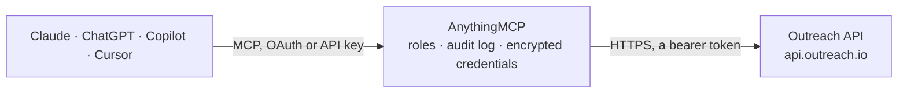

<!-- Generated by scripts/export-github-catalog.mjs in the anythingmcp-website repository. Do not edit by hand. -->

# Outreach MCP connector

Drive Outreach (sales engagement platform) from any AI agent: prospects, accounts, sequences, sequence enrollment, tasks, users. 11 tools, OAuth2 Bearer auth, JSON:API spec. The AnythingMCP connector gives Claude, ChatGPT, Microsoft Copilot, Cursor and Gemini 11 MCP tools for Outreach: 8 read and 3 can change data.

**Category:** [CRM](../crm.md) · **Tools:** 11 · **Setup guide:** [anythingmcp.com](https://anythingmcp.com/guides/outreach-to-mcp) · [Deutsch](https://anythingmcp.com/de/guides/outreach-to-mcp) · [Italiano](https://anythingmcp.com/it/guides/outreach-to-mcp) · [Español](https://anythingmcp.com/es/guides/outreach-to-mcp) · [日本語](https://anythingmcp.com/ja/guides/outreach-to-mcp) · [Русский](https://anythingmcp.com/ru/guides/outreach-to-mcp) · [中文](https://anythingmcp.com/zh/guides/outreach-to-mcp)

## Start without code

No installation and no terminal: AnythingMCP Cloud runs the Outreach connector for you, operated by helpcode.ai in Frankfurt, Germany.

1. **Click the button above** and create an account or sign in. The Outreach connector opens, ready to install.
2. **Paste the API key or token from your Outreach account.** Every click is in the [step-by-step guide](https://anythingmcp.com/guides/outreach-to-mcp).
3. **Click Install.** AnythingMCP shows the address of your MCP server.
4. **Add that address to your assistant:** [Claude](https://anythingmcp.com/guides/connect-outreach-to-claude) · [ChatGPT](https://anythingmcp.com/guides/connect-outreach-to-chatgpt) · [Microsoft Copilot](https://anythingmcp.com/guides/connect-outreach-to-copilot) · [Cursor](https://anythingmcp.com/guides/connect-outreach-to-cursor) · [Gemini CLI](https://anythingmcp.com/guides/connect-outreach-to-gemini) · [Meta Muse](https://anythingmcp.com/guides/connect-outreach-to-muse).
5. **Ask your first question**, for example: *Show prospect record for eva.lindström@solarnordic.fi*

Prefer help with the setup? [Talk to us](https://anythingmcp.com/contact).

## How it works

- **The AI client** speaks MCP (Streamable HTTP) to AnythingMCP and only sees tool names, descriptions and results. It never gets the Outreach credentials.
- **AnythingMCP** checks the client's role, builds the call from the tool definition, adds the credentials (a bearer token), calls Outreach, logs the call and returns the result.
- **Outreach** sees an ordinary API client with the rights of the account the credentials belong to.

## Tools

| Tool | What it does | Access |
|---|---|---|
| [`outreach_list_prospects`](#outreach_list_prospects) | List prospects with filters. | read |
| [`outreach_get_prospect`](#outreach_get_prospect) | Fetch a prospect by ID with full attributes and relationships. | read |
| [`outreach_create_prospect`](#outreach_create_prospect) | Create a prospect. | write |
| [`outreach_update_prospect`](#outreach_update_prospect) | Update a prospect. | write |
| [`outreach_list_accounts`](#outreach_list_accounts) | List accounts with filters. | read |
| [`outreach_list_sequences`](#outreach_list_sequences) | List sequences (cadences). | read |
| [`outreach_enroll_in_sequence`](#outreach_enroll_in_sequence) | Enroll a prospect in a sequence (create sequenceState). | write |
| [`outreach_list_mailboxes`](#outreach_list_mailboxes) | List mailboxes (email accounts connected to Outreach for sending). | read |
| [`outreach_list_users`](#outreach_list_users) | List Outreach users. | read |
| [`outreach_list_tasks`](#outreach_list_tasks) | List tasks (manual steps in sequences that need agent action — calls, custom emails, LinkedIn DMs). | read |
| [`outreach_list_stages`](#outreach_list_stages) | List prospect stages defined on the org (the funnel positions like Lead/MQL/SQL/Opportunity). | read |

## Tool reference

Every parameter as the AI client sees it in `tools/list`. Source: [`packages/backend/src/adapters/intl/outreach.json`](../../../packages/backend/src/adapters/intl/outreach.json).

### `outreach_list_prospects`

List prospects with filters. Supports filter[emails], filter[accountId], filter[ownerId], filter[stage.id], filter[engagedAt][gte], etc.

**Access:** read · **Call:** `GET /prospects`

| Parameter | Type | Required | Description |
|---|---|---|---|
| `filter_emails` | string | no | Comma-separated email exact-match. |
| `filter_account_id` | string | no | Account ID filter. |
| `filter_owner_id` | string | no | Owner user ID. |
| `filter_stage_id` | string | no | Stage ID. |
| `sort` | string | no | Sort attribute, prefix - for desc: -updatedAt. |
| `page_size` | integer | no | Per page (default 50, max 1000). |
| `page_after` | string | no | Cursor for next page. |
| `include` | string | no | Side-load: account, owner, currentlyActiveSequenceStates, etc. |
| `fields_prospect` | string | no | Sparse fieldset for prospect attributes. |

### `outreach_get_prospect`

Fetch a prospect by ID with full attributes and relationships.

**Access:** read · **Call:** `GET /prospects/{prospectId}`

| Parameter | Type | Required | Description |
|---|---|---|---|
| `prospectId` | string | yes | Prospect ID. |
| `include` | string | no | Side-load related resources. |

### `outreach_create_prospect`

Create a prospect. JSON:API envelope: {data: {type:'prospect', attributes:{emails:['a@b.com'], firstName, lastName, ...}, relationships:{account:{data:{type:'account',id:'N'}}, owner:{data:{type:'user',id:'M'}}}}}.

**Access:** write · **Call:** `POST /prospects`

| Parameter | Type | Required | Description |
|---|---|---|---|
| `data` | object | yes | JSON:API data envelope. {type:'prospect', attributes:{emails:['email1','email2'], firstName?, lastName?, title?, addressCity?, ...}, relationships?:{account, owner}}. Wrap inside {data:{...}}. |

### `outreach_update_prospect`

Update a prospect. JSON:API PATCH envelope: {data: {type:'prospect', id:PROSPECT_ID, attributes:{...}}}.

**Access:** write · **Call:** `PATCH /prospects/{prospectId}`

| Parameter | Type | Required | Description |
|---|---|---|---|
| `prospectId` | string | yes | Prospect ID. |
| `data` | object | yes | {type:'prospect', id:PROSPECT_ID, attributes:{...changed fields...}}. Wrap inside {data:{...}}. |

### `outreach_list_accounts`

List accounts with filters. Each account has name, domain, industry, numberOfEmployees, websiteUrl, addressCity, custom*.

**Access:** read · **Call:** `GET /accounts`

| Parameter | Type | Required | Description |
|---|---|---|---|
| `filter_name` | string | no | Name filter. |
| `filter_domain` | string | no | Domain filter. |
| `filter_owner_id` | string | no | Owner user ID. |
| `page_size` | integer | no | Per page. |
| `page_after` | string | no | Cursor. |

### `outreach_list_sequences`

List sequences (cadences). Each has name, shareType (private/shared), enabled, numActiveProspects, numSteps.

**Access:** read · **Call:** `GET /sequences`

| Parameter | Type | Required | Description |
|---|---|---|---|
| `filter_enabled` | boolean | no | Only enabled sequences. |
| `filter_share_type` | string | no | private, shared. |
| `page_size` | integer | no | Per page. |

### `outreach_enroll_in_sequence`

Enroll a prospect in a sequence (create sequenceState). The mailbox must belong to a user with permission to send through it. JSON:API envelope.

**Access:** write · **Call:** `POST /sequenceStates`

| Parameter | Type | Required | Description |
|---|---|---|---|
| `data` | object | yes | {type:'sequenceState', relationships:{prospect:{data:{type:'prospect',id:'N'}}, sequence:{data:{type:'sequence',id:'M'}}, mailbox:{data:{type:'mailbox',id:'K'}}}}. Wrap inside {data:{...}}. |

### `outreach_list_mailboxes`

List mailboxes (email accounts connected to Outreach for sending). Returns id, email, sendType (sequenceSend / replyFromSequence), userId.

**Access:** read · **Call:** `GET /mailboxes`

| Parameter | Type | Required | Description |
|---|---|---|---|
| `filter_user_id` | string | no | Filter by owner user ID. |
| `page_size` | integer | no | Per page. |

### `outreach_list_users`

List Outreach users. Returns id, name, email, role, locked, createdAt.

**Access:** read · **Call:** `GET /users`

| Parameter | Type | Required | Description |
|---|---|---|---|
| `filter_email` | string | no | Exact email filter. |
| `page_size` | integer | no | Per page. |

### `outreach_list_tasks`

List tasks (manual steps in sequences that need agent action — calls, custom emails, LinkedIn DMs). Filter by state (pending/skipped/completed) and assignee.

**Access:** read · **Call:** `GET /tasks`

| Parameter | Type | Required | Description |
|---|---|---|---|
| `filter_state` | string | no | pending, skipped, completed, scheduled, expired. |
| `filter_owner_id` | string | no | Assignee user ID. |
| `filter_prospect_id` | string | no | Prospect ID. |
| `page_size` | integer | no | Per page. |

### `outreach_list_stages`

List prospect stages defined on the org (the funnel positions like Lead/MQL/SQL/Opportunity). Required to compose filter[stage.id] queries.

**Access:** read · **Call:** `GET /stages`

No parameters.

## Run it yourself

AnythingMCP is open source (AGPL-3.0). [Run it with Docker](../../../README.md#run-it-yourself), open **Connectors → Store**, pick **Outreach** and enter `OUTREACH_ACCESS_TOKEN`, then add your MCP server URL to the AI client.

[← CRM connectors](../crm.md) · [All categories](../README.md)
