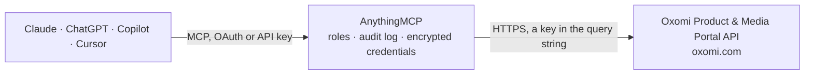

<!-- Generated by scripts/export-github-catalog.mjs in the anythingmcp-website repository. Do not edit by hand. -->

# Oxomi Product & Media Portal MCP connector

Look up product data, datasheets, documents, brands, media and availability via the official Oxomi Public API. The AnythingMCP connector gives Claude, ChatGPT, Microsoft Copilot, Cursor and Gemini 10 MCP tools for Oxomi Product & Media Portal: 8 read and 2 can change data.

**Category:** [Wholesale](../wholesale.md) · **Tools:** 10 · **Setup guide:** [anythingmcp.com](https://anythingmcp.com/guides/oxomi-to-mcp) · [Deutsch](https://anythingmcp.com/de/guides/oxomi-to-mcp) · [Italiano](https://anythingmcp.com/it/guides/oxomi-to-mcp) · [Español](https://anythingmcp.com/es/guides/oxomi-to-mcp) · [日本語](https://anythingmcp.com/ja/guides/oxomi-to-mcp) · [Русский](https://anythingmcp.com/ru/guides/oxomi-to-mcp) · [中文](https://anythingmcp.com/zh/guides/oxomi-to-mcp)

## Start without code

No installation and no terminal: AnythingMCP Cloud runs the Oxomi Product & Media Portal connector for you, operated by helpcode.ai in Frankfurt, Germany.

1. **Click the button above** and create an account or sign in. The Oxomi Product & Media Portal connector opens, ready to install.
2. **Paste the API key or token from your Oxomi Product & Media Portal account.** Every click is in the [step-by-step guide](https://anythingmcp.com/guides/oxomi-to-mcp).
3. **Click Install.** AnythingMCP shows the address of your MCP server.
4. **Add that address to your assistant:** [Claude](https://anythingmcp.com/guides/connect-oxomi-to-claude) · [ChatGPT](https://anythingmcp.com/guides/connect-oxomi-to-chatgpt) · [Microsoft Copilot](https://anythingmcp.com/guides/connect-oxomi-to-copilot) · [Cursor](https://anythingmcp.com/guides/connect-oxomi-to-cursor) · [Gemini CLI](https://anythingmcp.com/guides/connect-oxomi-to-gemini) · [Meta Muse](https://anythingmcp.com/guides/connect-oxomi-to-muse).
5. **Ask your first question**, for example: *Retrieve the German technical datasheet HTML for item 110-540 from supplier 4721*

Prefer help with the setup? [Talk to us](https://anythingmcp.com/contact).

## How it works

- **The AI client** speaks MCP (Streamable HTTP) to AnythingMCP and only sees tool names, descriptions and results. It never gets the Oxomi Product & Media Portal credentials.
- **AnythingMCP** checks the client's role, builds the call from the tool definition, adds the credentials (a key in the query string), calls Oxomi Product & Media Portal, logs the call and returns the result.
- **Oxomi Product & Media Portal** sees an ordinary API client with the rights of the account the credentials belong to.

## Tools

| Tool | What it does | Access |
|---|---|---|
| [`oxomi_search_products`](#oxomi_search_products) | Search products in the portal by free text, item code or GTIN (Navigator Pro logic). | read |
| [`oxomi_get_product_data`](#oxomi_get_product_data) | Fetch rich product information for a product (by itemNumber + supplierNumber): images, attachments/documents, prices, catalog pages, cover, availability and… | read |
| [`oxomi_resolve_gtin`](#oxomi_resolve_gtin) | Resolve a GTIN-13 or GTIN-14 barcode to its product, returning the supplierNumber and supplierItemNumber. | read |
| [`oxomi_product_availability`](#oxomi_product_availability) | Obtain manufacturer stock/availability for a product (stock status, indicator, availability dates, manufacturing time). | write |
| [`oxomi_get_brand_info`](#oxomi_get_brand_info) | Get information about a brand by id, name or supplier number: official name, supplier number(s), logo image URL, manufacturer and distributor contact details. | read |
| [`oxomi_list_documents`](#oxomi_list_documents) | List documents (catalogs, price lists, brochures, promotions, etc.) in the portal with filtering and pagination. | read |
| [`oxomi_render_datasheet`](#oxomi_render_datasheet) | Render the technical datasheet of a product and return the generated HTML in a JSON response. | write |
| [`oxomi_sync_products_changed`](#oxomi_sync_products_changed) | Incrementally sync products changed since a given date from the product information graph (for ETL/bulk export). | read |
| [`oxomi_get_product_spx`](#oxomi_get_product_spx) | Fetch a single product in full SPX format by itemNumber or GTIN, with selectable data blocks. | read |
| [`oxomi_update_sync_date`](#oxomi_update_sync_date) | Update the stored sync date for the portal API token (call after a successful incremental sync so the next run starts from the right point). | read |

## Tool reference

Every parameter as the AI client sees it in `tools/list`. Source: [`packages/backend/src/adapters/de/oxomi.json`](../../../packages/backend/src/adapters/de/oxomi.json).

### `oxomi_search_products`

Search products in the portal by free text, item code or GTIN (Navigator Pro logic). Returns matched products with itemNumber, supplierNumber, GTIN, model, brand, series and images. Requires the 'product-search' permission on the access token.

**Access:** read · **Call:** `POST /portals/api/v2/products/search`

| Parameter | Type | Required | Description |
|---|---|---|---|
| `query` | string | yes | Search string: description, brand, item number or GTIN. |
| `limit` | number | no | Maximum number of results to return (default applied by Oxomi). |

### `oxomi_get_product_data`

Fetch rich product information for a product (by itemNumber + supplierNumber): images, attachments/documents, prices, catalog pages, cover, availability and more. Choose which data blocks via the 'queries' array. Up to 30 products per call (this tool sends one).

**Access:** read · **Call:** `POST /portals/api/v2/product/data`

| Parameter | Type | Required | Description |
|---|---|---|---|
| `itemNumber` | string | yes | The product item/article number. |
| `supplierNumber` | string | yes | The supplier number for the item (use '-' if unknown). |
| `queries` | `base-info` \| `product-images` \| `images` \| `cover` \| `icons` \| `galleries` \| `attachments` \| `pages` \| `prices` \| `availability` \| `videos` \| `spare-parts` \| `relationships` \| `variants` \| `features` \| `properties` \| `measurements` \| `energy-label` \| `html-description` \| `tender-text` \| `texts` \| `commercial` \| `card`[] | yes | Which data blocks to return, e.g. ["base-info","attachments","product-images","prices"]. Each block may require its own permission on the token. |

### `oxomi_resolve_gtin`

Resolve a GTIN-13 or GTIN-14 barcode to its product, returning the supplierNumber and supplierItemNumber. Use before oxomi_get_product_data when you only have a barcode.

**Access:** read · **Call:** `GET /portals/api/v1/products/resolve-gtin`

| Parameter | Type | Required | Description |
|---|---|---|---|
| `gtin` | string | yes | The GTIN-13 or GTIN-14 / EAN barcode to resolve. |
| `filterCountry` | string | no | Optional ISO country filter for resolution (e.g. DE). |
| `filterLanguage` | string | no | Optional ISO language filter for resolution (e.g. de). |

### `oxomi_product_availability`

Obtain manufacturer stock/availability for a product (stock status, indicator, availability dates, manufacturing time). The 'mode' value is portal-specific — consult your Oxomi documentation/admin for the valid value. Auth and endpoint are otherwise standard.

**Access:** write · **Call:** `POST /portals/api/v1/products/availability`

| Parameter | Type | Required | Description |
|---|---|---|---|
| `itemNumber1` | string | yes | The item/article number to check. |
| `supplierNumber1` | string | no | The supplier number for the item. |
| `mode` | string | yes | Availability mode (portal-specific enum, required by Oxomi). |
| `quantity1` | number | no | Optional requested quantity. |
| `unit1` | string | no | Optional unit for the quantity. |

### `oxomi_get_brand_info`

Get information about a brand by id, name or supplier number: official name, supplier number(s), logo image URL, manufacturer and distributor contact details.

**Access:** read · **Call:** `GET /portals/api/v1/brand/info`

| Parameter | Type | Required | Description |
|---|---|---|---|
| `brand` | string | yes | Brand identifier: brand id, brand name, or supplier number. |
| `language` | string | no | Optional ISO language code for human-readable content (e.g. de, en). |

### `oxomi_list_documents`

List documents (catalogs, price lists, brochures, promotions, etc.) in the portal with filtering and pagination. Returns id, code, type, name, previewUrl, page count, supplier, brand, tags, categories and languages.

**Access:** read · **Call:** `GET /portals/api/v1/documents`

| Parameter | Type | Required | Description |
|---|---|---|---|
| `limit` | number | no | Maximum items to return (default 50, max 1000). |
| `start` | number | no | Number of items to skip, for pagination. |
| `sortBy` | string | no | Sort order: 'priority' (default), 'name', 'date' or 'random'. |
| `includeOutdated` | boolean | no | Include outdated documents. |
| `language` | string | no | Optional ISO language code filter. |

### `oxomi_render_datasheet`

Render the technical datasheet of a product and return the generated HTML in a JSON response. Identify the product by itemNumber + supplierNumber.

**Access:** write · **Call:** `POST /portals/api/v1/product/datasheet/render`

| Parameter | Type | Required | Description |
|---|---|---|---|
| `itemNumber` | string | yes | The product item/article number. |
| `supplierNumber` | string | yes | The supplier number for the item. |
| `language` | string | no | Optional ISO language code for the rendered datasheet. |

### `oxomi_sync_products_changed`

Incrementally sync products changed since a given date from the product information graph (for ETL/bulk export). Returns a products array plus a continuationToken for pagination ('-' when finished). Requires OXOMI_API_TOKEN.

**Access:** read · **Call:** `GET /portals/api/v3/products/changed`

| Parameter | Type | Required | Description |
|---|---|---|---|
| `syncStart` | string | yes | Sync start date/time (ISO 8601). Return products changed since this moment. |
| `blocks` | string | no | Comma-separated data blocks: DETAILS, CLASSIFICATIONS, FEATURES, PROPERTIES, TEXTS, IMAGES, ATTACHMENTS, PRICES, RELATIONSHIPS, MEASUREMENTS, PACKAGES. |
| `continuationToken` | string | no | Pagination token returned by a previous call; omit on the first page. |
| `supplierNumber` | string | no | Optional supplier filter. |

### `oxomi_get_product_spx`

Fetch a single product in full SPX format by itemNumber or GTIN, with selectable data blocks. Returns the complete product detail structure. Requires OXOMI_API_TOKEN.

**Access:** read · **Call:** `GET /portals/api/v3/products/spx`

| Parameter | Type | Required | Description |
|---|---|---|---|
| `itemNumber` | string | no | The product item/article number (provide this or gtin). |
| `gtin` | string | no | The product GTIN (provide this or itemNumber). |
| `supplierNumber` | string | no | Optional supplier number for disambiguation. |
| `blocks` | string | no | Comma-separated data blocks (e.g. DETAILS, IMAGES, ATTACHMENTS, PRICES). |

### `oxomi_update_sync_date`

Update the stored sync date for the portal API token (call after a successful incremental sync so the next run starts from the right point). Requires OXOMI_API_TOKEN.

**Access:** read · **Call:** `GET /portals/api/v1/core/update-sync-date`

| Parameter | Type | Required | Description |
|---|---|---|---|
| `date` | string | yes | The new sync date/time to store (ISO 8601). |

## Run it yourself

AnythingMCP is open source (AGPL-3.0). [Run it with Docker](../../../README.md#run-it-yourself), open **Connectors → Store**, pick **Oxomi Product & Media Portal** and enter `OXOMI_PORTAL_ID`, `OXOMI_USER`, `OXOMI_ACCESS_TOKEN`, `OXOMI_API_TOKEN`, then add your MCP server URL to the AI client.

[← Wholesale connectors](../wholesale.md) · [All categories](../README.md)
