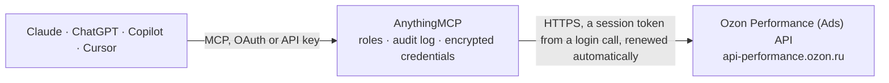

<!-- Generated by scripts/export-github-catalog.mjs in the anythingmcp-website repository. Do not edit by hand. -->

# Ozon Performance (Ads) MCP connector

Ozon Performance API for the seller ad account: pay-per-click, pay-per-order and banner campaigns, their products and bids, competitive bids and bid limits, daily and spend statistics and the detailed campaign reports. The AnythingMCP connector gives Claude, ChatGPT, Microsoft Copilot, Cursor and Gemini 19 MCP tools for Ozon Performance (Ads): 14 read and 5 can change data.

**Category:** [Advertising](../advertising.md) · **Tools:** 19 · **Setup guide:** [anythingmcp.com](https://anythingmcp.com/guides/ozon-performance-to-mcp) · [Deutsch](https://anythingmcp.com/de/guides/ozon-performance-to-mcp) · [Italiano](https://anythingmcp.com/it/guides/ozon-performance-to-mcp) · [Español](https://anythingmcp.com/es/guides/ozon-performance-to-mcp) · [日本語](https://anythingmcp.com/ja/guides/ozon-performance-to-mcp) · [Русский](https://anythingmcp.com/ru/guides/ozon-performance-to-mcp) · [中文](https://anythingmcp.com/zh/guides/ozon-performance-to-mcp)

## Start without code

No installation and no terminal: AnythingMCP Cloud runs the Ozon Performance (Ads) connector for you, operated by helpcode.ai in Frankfurt, Germany.

1. **Click the button above** and create an account or sign in. The Ozon Performance (Ads) connector opens, ready to install.
2. **Paste the API key or token from your Ozon Performance (Ads) account.** Every click is in the [step-by-step guide](https://anythingmcp.com/guides/ozon-performance-to-mcp).
3. **Click Install.** AnythingMCP shows the address of your MCP server.
4. **Add that address to your assistant:** [Claude](https://anythingmcp.com/guides/connect-ozon-performance-to-claude) · [ChatGPT](https://anythingmcp.com/guides/connect-ozon-performance-to-chatgpt) · [Microsoft Copilot](https://anythingmcp.com/guides/connect-ozon-performance-to-copilot) · [Cursor](https://anythingmcp.com/guides/connect-ozon-performance-to-cursor) · [Gemini CLI](https://anythingmcp.com/guides/connect-ozon-performance-to-gemini) · [Meta Muse](https://anythingmcp.com/guides/connect-ozon-performance-to-muse).
5. **Ask your first question.**

Prefer help with the setup? [Talk to us](https://anythingmcp.com/contact).

## How it works

- **The AI client** speaks MCP (Streamable HTTP) to AnythingMCP and only sees tool names, descriptions and results. It never gets the Ozon Performance (Ads) credentials.
- **AnythingMCP** checks the client's role, builds the call from the tool definition, adds the credentials (a session token from a login call, renewed automatically), calls Ozon Performance (Ads), logs the call and returns the result.
- **Ozon Performance (Ads)** sees an ordinary API client with the rights of the account the credentials belong to.

## Tools

| Tool | What it does | Access |
|---|---|---|
| [`ozon_performance_list_campaigns`](#ozon_performance_list_campaigns) | List the advertising campaigns of the Ozon seller account: id, title, state (CAMPAIGN_STATE_RUNNING, _STOPPED, _PLANNED, _INACTIVE, _ARCHIVED and others),… | read |
| [`ozon_performance_list_campaign_objects`](#ozon_performance_list_campaign_objects) | List the promoted objects of a pay-per-click, banner or video banner campaign: the SKUs (or banner ids) it advertises. | read |
| [`ozon_performance_list_campaign_products`](#ozon_performance_list_campaign_products) | List the products of a pay-per-click campaign with their bids: SKU, title, bid per click (average click cost strategy), target ad cost share in percent… | read |
| [`ozon_performance_get_competitive_bids`](#ozon_performance_get_competitive_bids) | Get the competitive bids for up to 200 products of a pay-per-click campaign: the bid other sellers place, per SKU. | read |
| [`ozon_performance_get_bid_limits`](#ozon_performance_get_bid_limits) | Get the minimum and maximum bids in rubles for each promotion tool (pay per click, pay per order) and placement, and the minimum bid of the product… | read |
| [`ozon_performance_list_cpo_products`](#ozon_performance_list_cpo_products) | List the products in pay-per-order promotion (Оплата за заказ, selected products): SKU, seller article, title, price, bid as a percent of the price and in… | read |
| [`ozon_performance_get_daily_statistics`](#ozon_performance_get_daily_statistics) | Get daily statistics per campaign as JSON rows: campaign id and title, date, views, clicks, spend in rubles, orders and order value. | read |
| [`ozon_performance_get_expense_statistics`](#ozon_performance_get_expense_statistics) | Get campaign spend per day as JSON rows: campaign id, date, title, total spend, spend from the prepaid account and spend paid with bonuses. | read |
| [`ozon_performance_get_cpc_campaign_statistics`](#ozon_performance_get_cpc_campaign_statistics) | Get the totals of pay-per-click campaigns for a period as JSON: per campaign its title, object type, status, budget, views, clicks, spend, orders and order… | read |
| [`ozon_performance_request_campaign_report`](#ozon_performance_request_campaign_report) | Order a detailed statistics report for up to 10 campaigns over at most 62 days, per product and grouped by day, week or month. | read |
| [`ozon_performance_request_search_phrases_report`](#ozon_performance_request_search_phrases_report) | Order a report of the search phrases that showed the products of pay-per-click campaigns placed in top promotion (Ozon marks this method as being tested). | read |
| [`ozon_performance_get_report_status`](#ozon_performance_get_report_status) | Get the status of an ordered report by its UUID: state NOT_STARTED, IN_PROGRESS, ERROR (with error) or OK (with link), the report kind and the request it… | read |
| [`ozon_performance_download_report`](#ozon_performance_download_report) | Download a finished report by its UUID once ozon_performance_get_report_status shows state OK. | read |
| [`ozon_performance_list_api_reports`](#ozon_performance_list_api_reports) | List the reports ordered through the API by this service account: UUID, state, kind, campaigns, request period and link. | read |
| [`ozon_performance_add_campaign_products`](#ozon_performance_add_campaign_products) | Add products to a pay-per-click campaign (at most 500 products per campaign), each with an optional bid. | write |
| [`ozon_performance_update_campaign_bids`](#ozon_performance_update_campaign_bids) | Change the bids of products already in a pay-per-click campaign. | write |
| [`ozon_performance_remove_campaign_products`](#ozon_performance_remove_campaign_products) | Remove products from a pay-per-click campaign; their bids are lost. | write |
| [`ozon_performance_deactivate_campaign`](#ozon_performance_deactivate_campaign) | Stop a running campaign (Выключить кампанию): it stops showing and spending until activated again. | write |
| [`ozon_performance_activate_campaign`](#ozon_performance_activate_campaign) | Start a campaign (Активировать кампанию): it starts showing ads and spending the budget. | write |

## Tool reference

Every parameter as the AI client sees it in `tools/list`. Source: [`packages/backend/src/adapters/intl/ozon-performance.json`](../../../packages/backend/src/adapters/intl/ozon-performance.json).

### `ozon_performance_list_campaigns`

List the advertising campaigns of the Ozon seller account: id, title, state (CAMPAIGN_STATE_RUNNING, _STOPPED, _PLANNED, _INACTIVE, _ARCHIVED and others), type (SKU = pay per click, SEARCH_PROMO = pay per order, BANNER, VIDEO_BANNER), payment type, placement, strategy, dates and budgets. Budgets are in millionths of a ruble ("1000000" = 1 ruble). Start here to get campaign ids.

**Access:** read · **Call:** `GET /api/client/campaign`

| Parameter | Type | Required | Description |
|---|---|---|---|
| `campaign_ids` | string[] | no | Only these campaigns, for example ["12345678"]. |
| `adv_object_type` | `SKU` \| `BANNER` \| `SEARCH_PROMO` \| `VIDEO_BANNER` | no | Campaign type: SKU = pay per click (Оплата за клик), SEARCH_PROMO = pay per order (Оплата за заказ), BANNER, VIDEO_BANNER. |
| `state` | `CAMPAIGN_STATE_RUNNING` \| `CAMPAIGN_STATE_PLANNED` \| `CAMPAIGN_STATE_STOPPED` \| `CAMPAIGN_STATE_INACTIVE` \| `CAMPAIGN_STATE_ARCHIVED` \| `CAMPAIGN_STATE_MODERATION_DRAFT` \| `CAMPAIGN_STATE_MODERATION_IN_PROGRESS` \| `CAMPAIGN_STATE_MODERATION_FAILED` \| `CAMPAIGN_STATE_FINISHED` | no | Only campaigns in this state. |
| `page` | integer | no | Page number, starting at 1. |
| `page_size` | integer | no | Rows per page. Default 20. |

### `ozon_performance_list_campaign_objects`

List the promoted objects of a pay-per-click, banner or video banner campaign: the SKUs (or banner ids) it advertises. For pay-per-order products use ozon_performance_list_cpo_products.

**Access:** read · **Call:** `GET /api/client/campaign/{campaign_id}/objects`

| Parameter | Type | Required | Description |
|---|---|---|---|
| `campaign_id` | string | yes | Campaign id from ozon_performance_list_campaigns, for example "12345678". |

### `ozon_performance_list_campaign_products`

List the products of a pay-per-click campaign with their bids: SKU, title, bid per click (average click cost strategy), target ad cost share in percent (target cost strategy) or search position range (top promotion strategy). Pages with page and page_size.

**Access:** read · **Call:** `GET /api/client/campaign/{campaign_id}/v2/products`

| Parameter | Type | Required | Description |
|---|---|---|---|
| `campaign_id` | string | yes | Campaign id from ozon_performance_list_campaigns, for example "12345678". |
| `page` | integer | no | Page number, starting at 1. |
| `page_size` | integer | no | Rows per page. Default 20. |

### `ozon_performance_get_competitive_bids`

Get the competitive bids for up to 200 products of a pay-per-click campaign: the bid other sellers place, per SKU. A product not in the campaign shows bid 0. Use it before choosing a bid with ozon_performance_update_campaign_bids.

**Access:** read · **Call:** `GET /api/client/campaign/{campaign_id}/products/bids/competitive`

| Parameter | Type | Required | Description |
|---|---|---|---|
| `campaign_id` | string | yes | Campaign id from ozon_performance_list_campaigns, for example "12345678". |
| `skus` | string[] | yes | Product SKUs, for example ["987654321"]. |

### `ozon_performance_get_bid_limits`

Get the minimum and maximum bids in rubles for each promotion tool (pay per click, pay per order) and placement, and the minimum bid of the product categories that have their own. No arguments.

**Access:** read · **Call:** `GET /api/client/limits/list`

No parameters.

### `ozon_performance_list_cpo_products`

List the products in pay-per-order promotion (Оплата за заказ, selected products): SKU, seller article, title, price, bid as a percent of the price and in rubles, the previous bid, whether promotion is on, visibility index and views this week and last week. Pages with page and page_size.

**Access:** read · **Call:** `POST /api/client/campaign/search_promo/v2/products`

| Parameter | Type | Required | Description |
|---|---|---|---|
| `page` | integer | no | Page number, starting at 1. |
| `page_size` | integer | no | Rows per page. Default 20. |

### `ozon_performance_get_daily_statistics`

Get daily statistics per campaign as JSON rows: campaign id and title, date, views, clicks, spend in rubles, orders and order value. Without dates Ozon returns the last 7 days. Answers at once, no report to wait for.

**Access:** read · **Call:** `GET /api/client/statistics/daily/json`

| Parameter | Type | Required | Description |
|---|---|---|---|
| `campaign_ids` | string[] | no | Campaign ids, for example ["12345678"]. Leave out for every campaign. |
| `date_from` | string | no | First day of the period, YYYY-MM-DD (Moscow time). Without both dates Ozon returns the last 7 days. |
| `date_to` | string | no | Last day of the period, YYYY-MM-DD (Moscow time). Without both dates Ozon returns the last 7 days. |

### `ozon_performance_get_expense_statistics`

Get campaign spend per day as JSON rows: campaign id, date, title, total spend, spend from the prepaid account and spend paid with bonuses. Without dates Ozon returns the last 7 days. Answers at once.

**Access:** read · **Call:** `GET /api/client/statistics/expense/json`

| Parameter | Type | Required | Description |
|---|---|---|---|
| `campaign_ids` | string[] | no | Campaign ids, for example ["12345678"]. Leave out for every campaign. |
| `date_from` | string | no | First day of the period, YYYY-MM-DD (Moscow time). Without both dates Ozon returns the last 7 days. |
| `date_to` | string | no | Last day of the period, YYYY-MM-DD (Moscow time). Without both dates Ozon returns the last 7 days. |

### `ozon_performance_get_cpc_campaign_statistics`

Get the totals of pay-per-click campaigns for a period as JSON: per campaign its title, object type, status, budget, views, clicks, spend, orders and order value. Does not count against the Performance API report limits. Without dates Ozon returns the last 7 days.

**Access:** read · **Call:** `GET /api/client/statistics/campaign/product/json`

| Parameter | Type | Required | Description |
|---|---|---|---|
| `campaign_ids` | string[] | no | Campaign ids, for example ["12345678"]. Leave out for every campaign. |
| `date_from` | string | no | First day of the period, YYYY-MM-DD (Moscow time). Without both dates Ozon returns the last 7 days. |
| `date_to` | string | no | Last day of the period, YYYY-MM-DD (Moscow time). Without both dates Ozon returns the last 7 days. |

### `ozon_performance_request_campaign_report`

Order a detailed statistics report for up to 10 campaigns over at most 62 days, per product and grouped by day, week or month. The report is built in the background: this returns a UUID; poll ozon_performance_get_report_status until state is OK, then fetch it with ozon_performance_download_report. Only one report runs at a time per account. Does not change any campaign.

**Access:** read · **Call:** `POST /api/client/statistics`

| Parameter | Type | Required | Description |
|---|---|---|---|
| `campaigns` | string[] | yes | Up to 10 campaign ids. One campaign gives a CSV file, several give a ZIP archive with one CSV per campaign. |
| `dateFrom` | string | yes | First day of the report, YYYY-MM-DD. The period may span at most 62 days. |
| `dateTo` | string | yes | Last day of the report, YYYY-MM-DD. |
| `groupBy` | `NO_GROUP_BY` \| `DATE` \| `START_OF_WEEK` \| `START_OF_MONTH` | no | Group rows by day, week or month; NO_GROUP_BY gives totals for the period. |

### `ozon_performance_request_search_phrases_report`

Order a report of the search phrases that showed the products of pay-per-click campaigns placed in top promotion (Ozon marks this method as being tested). Returns a UUID: poll ozon_performance_get_report_status, then fetch it with ozon_performance_download_report. Does not change any campaign.

**Access:** read · **Call:** `POST /api/client/statistics/phrases`

| Parameter | Type | Required | Description |
|---|---|---|---|
| `campaigns` | string[] | yes | Up to 10 campaign ids. One campaign gives a CSV file, several give a ZIP archive with one CSV per campaign. |
| `dateFrom` | string | yes | First day of the report, YYYY-MM-DD. The period may span at most 62 days. |
| `dateTo` | string | yes | Last day of the report, YYYY-MM-DD. |
| `groupBy` | `NO_GROUP_BY` \| `DATE` \| `START_OF_WEEK` \| `START_OF_MONTH` | no | Group rows by day, week or month; NO_GROUP_BY gives totals for the period. |

### `ozon_performance_get_report_status`

Get the status of an ordered report by its UUID: state NOT_STARTED, IN_PROGRESS, ERROR (with error) or OK (with link), the report kind and the request it was built from. Wait a few seconds between checks.

**Access:** read · **Call:** `GET /api/client/statistics/{uuid}`

| Parameter | Type | Required | Description |
|---|---|---|---|
| `uuid` | string | yes | UUID returned when the report was ordered. |

### `ozon_performance_download_report`

Download a finished report by its UUID once ozon_performance_get_report_status shows state OK. A report for one campaign comes back as CSV text (semicolon separated, Russian column names); one for several campaigns is a ZIP archive with one CSV per campaign, attached as a file.

**Access:** read · **Call:** `GET /api/client/statistics/report`

| Parameter | Type | Required | Description |
|---|---|---|---|
| `uuid` | string | yes | UUID of the finished report. |

### `ozon_performance_list_api_reports`

List the reports ordered through the API by this service account: UUID, state, kind, campaigns, request period and link. Use it to find a report ordered earlier.

**Access:** read · **Call:** `GET /api/client/statistics/externallist`

| Parameter | Type | Required | Description |
|---|---|---|---|
| `page` | integer | no | Page number, starting at 1. |
| `page_size` | integer | no | Rows per page. Default 20. |

### `ozon_performance_add_campaign_products`

Add products to a pay-per-click campaign (at most 500 products per campaign), each with an optional bid. In a campaign with an automatic strategy only products of its autopilot category can be added. Show the user the products and bids and ask for confirmation before calling.

**Access:** write · **Call:** `POST /api/client/campaign/{campaign_id}/products`

| Parameter | Type | Required | Description |
|---|---|---|---|
| `campaign_id` | string | yes | Campaign id from ozon_performance_list_campaigns, for example "12345678". |
| `bids` | object[] | yes | For example [{"sku": "987654321"}]. |

### `ozon_performance_update_campaign_bids`

Change the bids of products already in a pay-per-click campaign. Ozon replaces the stop words and phrase bids of the campaign with what is sent. Read the current bids with ozon_performance_list_campaign_products and the market with ozon_performance_get_competitive_bids, show the user old and new bids and ask for confirmation before calling.

**Access:** write · **Call:** `PUT /api/client/campaign/{campaign_id}/products`

| Parameter | Type | Required | Description |
|---|---|---|---|
| `campaign_id` | string | yes | Campaign id from ozon_performance_list_campaigns, for example "12345678". |
| `bids` | object[] | yes | For example [{"sku": "987654321", "bid": "15000000"}]. |

### `ozon_performance_remove_campaign_products`

Remove products from a pay-per-click campaign; their bids are lost. Installed switched off. Show the user the products and ask for confirmation before calling.

**Access:** write · **Call:** `POST /api/client/campaign/{campaign_id}/products/delete`

| Parameter | Type | Required | Description |
|---|---|---|---|
| `campaign_id` | string | yes | Campaign id from ozon_performance_list_campaigns, for example "12345678". |
| `skus` | string[] | yes | SKUs to remove. |

### `ozon_performance_deactivate_campaign`

Stop a running campaign (Выключить кампанию): it stops showing and spending until activated again. Show the user the campaign and ask for confirmation before calling. Returns the campaign with its new state.

**Access:** write · **Call:** `POST /api/client/campaign/{campaign_id}/deactivate`

| Parameter | Type | Required | Description |
|---|---|---|---|
| `campaign_id` | string | yes | Campaign id from ozon_performance_list_campaigns, for example "12345678". |

### `ozon_performance_activate_campaign`

Start a campaign (Активировать кампанию): it starts showing ads and spending the budget. Installed switched off. Show the user the campaign and its budget and ask for confirmation before calling. Returns the campaign with its new state.

**Access:** write · **Call:** `POST /api/client/campaign/{campaign_id}/activate`

| Parameter | Type | Required | Description |
|---|---|---|---|
| `campaign_id` | string | yes | Campaign id from ozon_performance_list_campaigns, for example "12345678". |

## Run it yourself

AnythingMCP is open source (AGPL-3.0). [Run it with Docker](../../../README.md#run-it-yourself), open **Connectors → Store**, pick **Ozon Performance (Ads)** and enter `OZON_PERFORMANCE_CLIENT_ID`, `OZON_PERFORMANCE_CLIENT_SECRET`, then add your MCP server URL to the AI client.

[← Advertising connectors](../advertising.md) · [All categories](../README.md)
