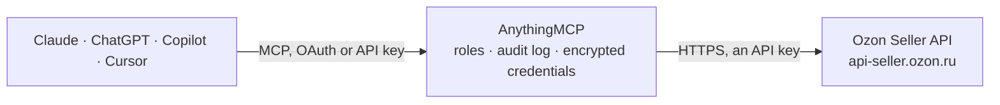

<!-- Generated by scripts/export-github-catalog.mjs in the anythingmcp-website repository. Do not edit by hand. -->

# Ozon Seller MCP connector

Run an Ozon seller account from an AI agent: products and their characteristics, content rating and images, stock and prices, FBS and FBO postings, returns, finance accruals and the balance report, … The AnythingMCP connector gives Claude, ChatGPT, Microsoft Copilot, Cursor and Gemini 39 MCP tools for Ozon Seller: 29 read and 10 can change data.

**Category:** [E-commerce](../e-commerce.md) · **Tools:** 39 · **Setup guide:** [anythingmcp.com](https://anythingmcp.com/guides/ozon-to-mcp) · [Deutsch](https://anythingmcp.com/de/guides/ozon-to-mcp) · [Italiano](https://anythingmcp.com/it/guides/ozon-to-mcp) · [Español](https://anythingmcp.com/es/guides/ozon-to-mcp) · [日本語](https://anythingmcp.com/ja/guides/ozon-to-mcp) · [Русский](https://anythingmcp.com/ru/guides/ozon-to-mcp) · [中文](https://anythingmcp.com/zh/guides/ozon-to-mcp)

## Start without code

No installation and no terminal: AnythingMCP Cloud runs the Ozon Seller connector for you, operated by helpcode.ai in Frankfurt, Germany.

1. **Click the button above** and create an account or sign in. The Ozon Seller connector opens, ready to install.
2. **Paste the API key or token from your Ozon Seller account.** Every click is in the [step-by-step guide](https://anythingmcp.com/guides/ozon-to-mcp).
3. **Click Install.** AnythingMCP shows the address of your MCP server.
4. **Add that address to your assistant:** [Claude](https://anythingmcp.com/guides/connect-ozon-to-claude) · [ChatGPT](https://anythingmcp.com/guides/connect-ozon-to-chatgpt) · [Microsoft Copilot](https://anythingmcp.com/guides/connect-ozon-to-copilot) · [Cursor](https://anythingmcp.com/guides/connect-ozon-to-cursor) · [Gemini CLI](https://anythingmcp.com/guides/connect-ozon-to-gemini) · [Meta Muse](https://anythingmcp.com/guides/connect-ozon-to-muse).
5. **Ask your first question**, for example: *Get details for FBS posting 89491381-0072-1 — status, accepted date, products and tracking number*

Prefer help with the setup? [Talk to us](https://anythingmcp.com/contact).

## How it works

- **The AI client** speaks MCP (Streamable HTTP) to AnythingMCP and only sees tool names, descriptions and results. It never gets the Ozon Seller credentials.
- **AnythingMCP** checks the client's role, builds the call from the tool definition, adds the credentials (an API key), calls Ozon Seller, logs the call and returns the result.
- **Ozon Seller** sees an ordinary API client with the rights of the account the credentials belong to.

## Tools

| Tool | What it does | Access |
|---|---|---|
| [`ozon_get_api_key_info`](#ozon_get_api_key_info) | Check the API key: the names of its roles (роли) and when it expires (keys last 3 months). | read |
| [`ozon_get_seller_info`](#ozon_get_seller_info) | Get the seller account (кабинет продавца) behind the key: company name, legal name, INN, OGRN, settlement currency, tax system, Premium subscription type… | read |
| [`ozon_list_promotions`](#ozon_list_promotions) | List the Ozon promotions (акции Ozon) the seller can join: id, title, dates, discount value, whether the seller takes part and how many products participate… | read |
| [`ozon_list_products`](#ozon_list_products) | List the seller's products (товары): product_id, offer_id (seller article) and flags for archived, FBO stock, FBS stock and discounted. | read |
| [`ozon_get_products`](#ozon_get_products) | Get product details for up to 1000 products by offer_id, product_id or sku (pass one kind of id): name, SKU, barcodes, price, old price, minimum price, VAT,… | read |
| [`ozon_get_stocks`](#ozon_get_stocks) | Stock per product (остатки) across schemes: for each product the present and reserved quantity per warehouse type (fbo = Ozon warehouse, fbs and rfbs =… | read |
| [`ozon_get_fbs_warehouse_stocks`](#ozon_get_fbs_warehouse_stocks) | Stock on the seller's own FBS and rFBS warehouses for the given products, per warehouse: present, reserved and free_stock. | read |
| [`ozon_get_prices`](#ozon_get_prices) | Prices per product (цены): price, old (strikethrough) price, minimum price, the price after the seller's promotions, currency, the price index colour and… | read |
| [`ozon_list_fbs_postings`](#ozon_list_fbs_postings) | List FBS and rFBS postings (отправления, orders shipped from the seller's own warehouse) in a period of at most one year: posting number, order number,… | read |
| [`ozon_get_fbs_posting`](#ozon_get_fbs_posting) | Get one FBS or rFBS posting by its posting number: status, substatus, previous substatus, dates, delivery method, tracking number, cancellation, products,… | read |
| [`ozon_list_fbo_postings`](#ozon_list_fbo_postings) | List FBO postings (orders shipped from Ozon warehouses) in a period of at most one year: posting number, order number, status, dates, Ozon warehouse and the… | read |
| [`ozon_list_returns`](#ozon_list_returns) | List FBO and FBS returns (возвраты): return id, scheme, posting number, product (article, name, quantity, price), reason, current status and return date. | read |
| [`ozon_get_finance_balance`](#ozon_get_finance_balance) | Balance report for a period of up to 30 days, as in the seller portal under Finance > Balance (Финансы > Баланс): opening and closing balance, accrued and… | read |
| [`ozon_list_accruals_by_day`](#ozon_list_accruals_by_day) | Every accrual (начисление) of one day: per posting, per product, per container or without a product, with amounts and accrual type ids (names come from… | read |
| [`ozon_get_posting_accruals`](#ozon_get_posting_accruals) | Accruals of up to 200 postings: for each posting the dated amounts per SKU, the seller price and the accrual type id. | read |
| [`ozon_list_accrual_types`](#ozon_list_accrual_types) | The reference list of accrual types (справочник начислений): id and name. | read |
| [`ozon_get_analytics`](#ozon_get_analytics) | Sales analytics (Аналитика > Графики): metrics such as revenue and ordered_units grouped by day, week, month, sku or spu for a period. | read |
| [`ozon_list_warehouses`](#ozon_list_warehouses) | List the seller's own FBS and rFBS warehouses (склады): warehouse_id, name, status and whether it is an rFBS warehouse. | read |
| [`ozon_list_reviews`](#ozon_list_reviews) | List product reviews (отзывы): id, SKU, rating, text, publication date, review status (NEW, VIEWED, PROCESSED), order status and counts of comments, photos… | read |
| [`ozon_list_questions`](#ozon_list_questions) | List buyer questions about products (вопросы): id, SKU, text, status, publication date, number of answers and links. | read |
| [`ozon_get_cancel_reasons`](#ozon_get_cancel_reasons) | List the cancellation reasons allowed for FBS postings: reason id, title and who cancels (seller or buyer). | read |
| [`ozon_get_product_characteristics`](#ozon_get_product_characteristics) | Get the characteristics (атрибуты, характеристики) of products: category and type ids, barcodes, dimensions and weight, image file names, model, and every… | read |
| [`ozon_get_product_description_text`](#ozon_get_product_description_text) | Get the description text (описание) of one product shown on its page, with its name and ids. | read |
| [`ozon_get_product_images`](#ozon_get_product_images) | Get the image links of up to 1000 products by product_id: main image, other photos, color sample, and image errors from processing. | read |
| [`ozon_get_product_content_rating`](#ozon_get_product_content_rating) | Get the content rating (контент-рейтинг, 0 to 100) of up to 1000 products by SKU, with each characteristic group, its weight and score, the conditions that… | read |
| [`ozon_get_product_import_task`](#ozon_get_product_import_task) | Get the result of a product create, update, characteristics or image task by its task_id (from ozon_create_or_update_product_cards,… | read |
| [`ozon_list_category_characteristics`](#ozon_list_category_characteristics) | List the characteristics a category and product type can have: id, name, type, whether it is required or a collection, its dictionary_id (0 = free text,… | read |
| [`ozon_list_characteristic_values`](#ozon_list_characteristic_values) | List the dictionary values (справочник) of one characteristic in a category and product type: value id, text and extra info. | read |
| [`ozon_search_characteristic_values`](#ozon_search_characteristic_values) | Search the dictionary values of one characteristic by text (at least 2 characters), for example a brand or a color name, and get their ids for… | read |
| [`ozon_reply_to_review`](#ozon_reply_to_review) | Publish the seller's comment under a product review. | write |
| [`ozon_answer_question`](#ozon_answer_question) | Publish the seller's answer to a buyer question (2 to 3000 characters). | write |
| [`ozon_update_prices`](#ozon_update_prices) | Change the prices of up to 1000 products on the live shop. | write |
| [`ozon_update_stocks`](#ozon_update_stocks) | Set the available stock of up to 100 product and warehouse pairs on the seller's own FBS or rFBS warehouses. | write |
| [`ozon_update_product_characteristics`](#ozon_update_product_characteristics) | Add or change characteristics of up to 100 existing products by offer_id. | write |
| [`ozon_create_or_update_product_cards`](#ozon_create_or_update_product_cards) | Create new product cards or update existing ones, up to 100 per call. | write |
| [`ozon_replace_product_images`](#ozon_replace_product_images) | Replace the images of up to 100 products by offer_id. | write |
| [`ozon_move_products_to_archive`](#ozon_move_products_to_archive) | Move up to 100 products to the archive (архив): they leave the storefront and the product lists. | write |
| [`ozon_ship_fbs_posting`](#ozon_ship_fbs_posting) | Assemble an FBS posting (собрать заказ): split it into packages and move it to awaiting_deliver. | write |
| [`ozon_cancel_fbs_posting`](#ozon_cancel_fbs_posting) | Cancel an FBS posting; the buyer's order is cancelled and the cancellation may count against the seller rating. | write |

## Tool reference

Every parameter as the AI client sees it in `tools/list`. Source: [`packages/backend/src/adapters/intl/ozon.json`](../../../packages/backend/src/adapters/intl/ozon.json).

### `ozon_get_api_key_info`

Check the API key: the names of its roles (роли) and when it expires (keys last 3 months). Works with any valid key and costs nothing; use it first, and when another tool answers 403 'Api-Key is missing a required role'.

**Access:** read · **Call:** `POST /v1/roles`

No parameters.

### `ozon_get_seller_info`

Get the seller account (кабинет продавца) behind the key: company name, legal name, INN, OGRN, settlement currency, tax system, Premium subscription type and the seller ratings with their current values and status.

**Access:** read · **Call:** `POST /v1/seller/info`

No parameters.

### `ozon_list_promotions`

List the Ozon promotions (акции Ozon) the seller can join: id, title, dates, discount value, whether the seller takes part and how many products participate or could. Read-only; joining a promotion is not available in this connector.

**Access:** read · **Call:** `GET /v1/actions`

No parameters.

### `ozon_list_products`

List the seller's products (товары): product_id, offer_id (seller article) and flags for archived, FBO stock, FBS stock and discounted. Call without arguments for the first 20 products; continue with last_id. Use ozon_get_products for names, prices and status.

**Access:** read · **Call:** `POST /v3/product/list`

| Parameter | Type | Required | Description |
|---|---|---|---|
| `visibility` | `ALL` \| `VISIBLE` \| `INVISIBLE` \| `EMPTY_STOCK` \| `NOT_MODERATED` \| `MODERATED` \| `DISABLED` \| `STATE_FAILED` \| `READY_TO_SUPPLY` \| `VALIDATION_STATE_PENDING` \| `VALIDATION_STATE_FAIL` \| `VALIDATION_STATE_SUCCESS` \| `TO_SUPPLY` \| `IN_SALE` \| `REMOVED_FROM_SALE` \| `OVERPRICED` \| `CRITICALLY_OVERPRICED` \| `EMPTY_BARCODE` \| `BARCODE_EXISTS` \| `QUARANTINE` \| `ARCHIVED` \| `OVERPRICED_WITH_STOCK` \| `PARTIAL_APPROVED` | no | Visibility filter (видимость). ALL (default) = every product except archived ones; VISIBLE = shown to buyers; INVISIBLE = hidden; EMPTY_STOCK = no stock; ARCHIVED = archived products; IN_SALE, REMOVED_FROM_SALE, NOT_MODERATED, STATE_FAILED and the others follow the seller portal filters. |
| `offer_ids` | string[] | no | Optional seller articles (offer_id, артикул), for example ["SKU-123"]. With ids, visibility is ignored and every matching product is returned. |
| `product_ids` | integer[] | no | Optional Ozon product ids (product_id) from ozon_list_products, for example [123456789]. |
| `last_id` | string | no | Pagination. Leave empty for the first page, then pass last_id from the previous answer. |
| `limit` | integer | no | Rows per page, 1 to 1000. Default 20; raise it only when the user needs more. |

### `ozon_get_products`

Get product details for up to 1000 products by offer_id, product_id or sku (pass one kind of id): name, SKU, barcodes, price, old price, minimum price, VAT, status and moderation status, stock presence, visibility, creation and update dates, and moderation errors.

**Access:** read · **Call:** `POST /v3/product/info/list`

| Parameter | Type | Required | Description |
|---|---|---|---|
| `offer_ids` | string[] | no | Seller articles (offer_id), for example ["SKU-123"]. |
| `product_ids` | integer[] | no | Ozon product ids, for example [123456789]. |
| `skus` | integer[] | no | Ozon SKUs, for example [987654321]. |

### `ozon_get_stocks`

Stock per product (остатки) across schemes: for each product the present and reserved quantity per warehouse type (fbo = Ozon warehouse, fbs and rfbs = seller warehouse, fbp = partner warehouse). Call without arguments for 20 products; continue with cursor. For stock per individual seller warehouse use ozon_get_fbs_warehouse_stocks.

**Access:** read · **Call:** `POST /v4/product/info/stocks`

| Parameter | Type | Required | Description |
|---|---|---|---|
| `visibility` | `ALL` \| `VISIBLE` \| `INVISIBLE` \| `EMPTY_STOCK` \| `NOT_MODERATED` \| `MODERATED` \| `DISABLED` \| `STATE_FAILED` \| `READY_TO_SUPPLY` \| `VALIDATION_STATE_PENDING` \| `VALIDATION_STATE_FAIL` \| `VALIDATION_STATE_SUCCESS` \| `TO_SUPPLY` \| `IN_SALE` \| `REMOVED_FROM_SALE` \| `OVERPRICED` \| `CRITICALLY_OVERPRICED` \| `EMPTY_BARCODE` \| `BARCODE_EXISTS` \| `QUARANTINE` \| `ARCHIVED` \| `OVERPRICED_WITH_STOCK` \| `PARTIAL_APPROVED` | no | Visibility filter (видимость). ALL (default) = every product except archived ones; VISIBLE = shown to buyers; INVISIBLE = hidden; EMPTY_STOCK = no stock; ARCHIVED = archived products; IN_SALE, REMOVED_FROM_SALE, NOT_MODERATED, STATE_FAILED and the others follow the seller portal filters. |
| `offer_ids` | string[] | no | Optional seller articles (offer_id, артикул), for example ["SKU-123"]. With ids, visibility is ignored and every matching product is returned. |
| `product_ids` | integer[] | no | Optional Ozon product ids (product_id) from ozon_list_products, for example [123456789]. |
| `cursor` | string | no | Pagination cursor. Leave empty for the first page, then pass the cursor value of the previous answer. |
| `limit` | integer | no | Rows per page, 1 to 1000. Default 20; raise it only when the user needs more. |

### `ozon_get_fbs_warehouse_stocks`

Stock on the seller's own FBS and rFBS warehouses for the given products, per warehouse: present, reserved and free_stock. Pass at least one of offer_ids or skus: Ozon refuses a call without them. Read this before ozon_update_stocks, because the stock you set excludes reserved units.

**Access:** read · **Call:** `POST /v2/product/info/stocks-by-warehouse/fbs`

| Parameter | Type | Required | Description |
|---|---|---|---|
| `offer_ids` | string[] | no | Seller articles (offer_id). Give this or skus (at least one of the two is needed). |
| `skus` | integer[] | no | Ozon SKUs. Give this or offer_ids (at least one of the two is needed). |
| `cursor` | string | no | Pagination cursor. Leave empty for the first page, then pass the cursor value of the previous answer. |
| `limit` | integer | no | Rows per page, 1 to 1000. Default 20; raise it only when the user needs more. |

### `ozon_get_prices`

Prices per product (цены): price, old (strikethrough) price, minimum price, the price after the seller's promotions, currency, the price index colour and the sales commission percentage for FBO and FBS. Call without arguments for 20 products; continue with cursor.

**Access:** read · **Call:** `POST /v5/product/info/prices`

| Parameter | Type | Required | Description |
|---|---|---|---|
| `visibility` | `ALL` \| `VISIBLE` \| `INVISIBLE` \| `EMPTY_STOCK` \| `NOT_MODERATED` \| `MODERATED` \| `DISABLED` \| `STATE_FAILED` \| `READY_TO_SUPPLY` \| `VALIDATION_STATE_PENDING` \| `VALIDATION_STATE_FAIL` \| `VALIDATION_STATE_SUCCESS` \| `TO_SUPPLY` \| `IN_SALE` \| `REMOVED_FROM_SALE` \| `OVERPRICED` \| `CRITICALLY_OVERPRICED` \| `EMPTY_BARCODE` \| `BARCODE_EXISTS` \| `QUARANTINE` \| `ARCHIVED` \| `OVERPRICED_WITH_STOCK` \| `PARTIAL_APPROVED` | no | Visibility filter (видимость). ALL (default) = every product except archived ones; VISIBLE = shown to buyers; INVISIBLE = hidden; EMPTY_STOCK = no stock; ARCHIVED = archived products; IN_SALE, REMOVED_FROM_SALE, NOT_MODERATED, STATE_FAILED and the others follow the seller portal filters. |
| `offer_ids` | string[] | no | Optional seller articles (offer_id, артикул), for example ["SKU-123"]. With ids, visibility is ignored and every matching product is returned. |
| `product_ids` | integer[] | no | Optional Ozon product ids (product_id) from ozon_list_products, for example [123456789]. |
| `cursor` | string | no | Pagination cursor. Leave empty for the first page, then pass the cursor value of the previous answer. |
| `limit` | integer | no | Rows per page, 1 to 1000. Default 20; raise it only when the user needs more. |

### `ozon_list_fbs_postings`

List FBS and rFBS postings (отправления, orders shipped from the seller's own warehouse) in a period of at most one year: posting number, order number, status, substatus, accepted and shipping dates, warehouse id and the products with quantity and price. Filter by status, for example awaiting_packaging for orders to pack now. For delivery, tracking, cancellation and finance details call ozon_get_fbs_posting. Buyer contact data is not returned.

**Access:** read · **Call:** `POST /v4/posting/fbs/list`

| Parameter | Type | Required | Description |
|---|---|---|---|
| `since` | string | yes | Start of the period (in_process_at). ISO 8601 date-time in UTC, for example 2026-10-01T00:00:00Z. |
| `to` | string | yes | End of the period. ISO 8601 date-time in UTC, for example 2026-10-01T00:00:00Z. |
| `statuses` | `awaiting_registration` \| `acceptance_in_progress` \| `awaiting_approve` \| `awaiting_packaging` \| `awaiting_deliver` \| `arbitration` \| `client_arbitration` \| `delivering` \| `driver_pickup` \| `delivered` \| `cancelled` \| `not_accepted` \| `sent_by_seller`[] | no | Optional statuses: awaiting_packaging (ожидает упаковки), awaiting_deliver (ожидает отгрузки), delivering, delivered, cancelled and others. |
| `warehouse_ids` | integer[] | no | Optional seller warehouse ids from ozon_list_warehouses. |
| `sort_dir` | `ASC` \| `DESC` | no | DESC (default) newest first, ASC oldest first. |
| `cursor` | string | no | Pagination cursor. Leave empty for the first page, then pass the cursor value of the previous answer. |
| `limit` | integer | no | Postings per page, 1 to 100. Default 20; raise it only when the user needs more. |

### `ozon_get_fbs_posting`

Get one FBS or rFBS posting by its posting number: status, substatus, previous substatus, dates, delivery method, tracking number, cancellation, products, and optionally financial data (commissions, payout per product) and analytics data. Buyer contact data is not returned.

**Access:** read · **Call:** `POST /v3/posting/fbs/get`

| Parameter | Type | Required | Description |
|---|---|---|---|
| `posting_number` | string | yes | Posting number (номер отправления), for example 89491381-0072-1. |
| `with_financial_data` | boolean | no | Add commissions and payout per product. |
| `with_analytics_data` | boolean | no | Add region, city, delivery type and warehouse. |

### `ozon_list_fbo_postings`

List FBO postings (orders shipped from Ozon warehouses) in a period of at most one year: posting number, order number, status, dates, Ozon warehouse and the products with quantity and price. since and to are both required by Ozon.

**Access:** read · **Call:** `POST /v3/posting/fbo/list`

| Parameter | Type | Required | Description |
|---|---|---|---|
| `since` | string | yes | Start of the period. ISO 8601 date-time in UTC, for example 2026-10-01T00:00:00Z. |
| `to` | string | yes | End of the period. ISO 8601 date-time in UTC, for example 2026-10-01T00:00:00Z. |
| `statuses` | `awaiting_packaging` \| `awaiting_deliver` \| `delivering` \| `delivered` \| `cancelled`[] | no | Optional statuses. |
| `posting_numbers` | string[] | no | Optional posting numbers. |
| `sort_dir` | `ASC` \| `DESC` | no | DESC (default) newest first. |
| `cursor` | string | no | Pagination cursor. Leave empty for the first page, then pass the cursor value of the previous answer. |
| `limit` | integer | no | Postings per page, 1 to 100. Default 20; raise it only when the user needs more. |

### `ozon_list_returns`

List FBO and FBS returns (возвраты): return id, scheme, posting number, product (article, name, quantity, price), reason, current status and return date. Call without arguments for the latest 20; continue with last_id while has_next is true.

**Access:** read · **Call:** `POST /v1/returns/list`

| Parameter | Type | Required | Description |
|---|---|---|---|
| `return_schema` | `FBS` \| `FBO` | no | Optional scheme filter. |
| `posting_numbers` | string[] | no | Optional posting numbers, at most 50. |
| `offer_id` | string | no | Optional seller article. |
| `visual_status_name` | string | no | Optional return status, for example DisputeOpened, OnSellerApproval, ArrivedAtReturnPlace, ReturnedToSeller. |
| `logistic_return_date` | object | no | Optional period of the return date, {"time_from": "2026-10-01T00:00:00Z", "time_to": "2026-10-15T00:00:00Z"}. |
| `last_id` | integer | no | Pagination: the id of the last return of the previous page. |
| `limit` | integer | no | Returns per page, 1 to 500. Default 20; raise it only when the user needs more. |

### `ozon_get_finance_balance`

Balance report for a period of up to 30 days, as in the seller portal under Finance > Balance (Финансы > Баланс): opening and closing balance, accrued and paid totals, sales and returns with commissions, and the services charged.

**Access:** read · **Call:** `POST /v1/finance/balance`

| Parameter | Type | Required | Description |
|---|---|---|---|
| `date_from` | string | yes | First day, YYYY-MM-DD. |
| `date_to` | string | yes | Last day, YYYY-MM-DD, at most 30 days after date_from. |

### `ozon_list_accruals_by_day`

Every accrual (начисление) of one day: per posting, per product, per container or without a product, with amounts and accrual type ids (names come from ozon_list_accrual_types). Replaces the old transaction list. Continue with last_id, passing the same date.

**Access:** read · **Call:** `POST /v1/finance/accrual/by-day`

| Parameter | Type | Required | Description |
|---|---|---|---|
| `date` | string | yes | Day, YYYY-MM-DD, not before 2022-01-01. |
| `last_id` | string | no | Pagination: last_id of the previous answer (valid 15 minutes). Keep the same date. |

### `ozon_get_posting_accruals`

Accruals of up to 200 postings: for each posting the dated amounts per SKU, the seller price and the accrual type id. Use it to explain what Ozon charged or paid for an order.

**Access:** read · **Call:** `POST /v1/finance/accrual/postings`

| Parameter | Type | Required | Description |
|---|---|---|---|
| `posting_numbers` | string[] | yes | Posting numbers, for example ["89491381-0072-1"]. |

### `ozon_list_accrual_types`

The reference list of accrual types (справочник начислений): id and name. The type_id values in the accrual tools refer to it.

**Access:** read · **Call:** `POST /v1/finance/accrual/types`

No parameters.

### `ozon_get_analytics`

Sales analytics (Аналитика > Графики): metrics such as revenue and ordered_units grouped by day, week, month, sku or spu for a period. Without Premium Plus only revenue and ordered_units, the last 3 months and 50 calls a day are available. At most 1 call a minute.

**Access:** read · **Call:** `POST /v1/analytics/data`

| Parameter | Type | Required | Description |
|---|---|---|---|
| `date_from` | string | yes | First day, YYYY-MM-DD (within the last 3 months without Premium). |
| `date_to` | string | yes | Last day, YYYY-MM-DD. |
| `metrics` | `revenue` \| `ordered_units` \| `hits_view_search` \| `hits_view_pdp` \| `hits_view` \| `hits_tocart_search` \| `hits_tocart_pdp` \| `hits_tocart` \| `session_view_search` \| `session_view_pdp` \| `session_view` \| `conv_tocart_search` \| `conv_tocart_pdp` \| `conv_tocart` \| `returns` \| `cancellations` \| `delivered_units` \| `position_category`[] | no | Up to 14 metrics. Default revenue and ordered_units (available to every seller); the others need Premium Plus. |
| `dimension` | `sku` \| `spu` \| `day` \| `week` \| `month` \| `year` \| `category1` \| `category2` \| `brand` \| `modelID`[] | no | Grouping. Default day. sku, spu, day, week and month are available to every seller; year, category1, category2, brand and modelID need Premium Plus. |
| `sort` | object[] | no | Optional sort, for example [{"key": "revenue", "order": "DESC"}]. |
| `offset` | integer | no | Rows to skip. |
| `limit` | integer | no | Rows per page, 1 to 1000. Default 20; raise it only when the user needs more. |

### `ozon_list_warehouses`

List the seller's own FBS and rFBS warehouses (склады): warehouse_id, name, status and whether it is an rFBS warehouse. The warehouse_id is what ozon_update_stocks and ozon_get_fbs_warehouse_stocks report and need.

**Access:** read · **Call:** `POST /v2/warehouse/list`

| Parameter | Type | Required | Description |
|---|---|---|---|
| `cursor` | string | no | Pagination cursor. Leave empty for the first page, then pass the cursor value of the previous answer. |
| `limit` | integer | no | Warehouses per page, 1 to 200. Default 20; raise it only when the user needs more. |

### `ozon_list_reviews`

List product reviews (отзывы): id, SKU, rating, text, publication date, review status (NEW, VIEWED, PROCESSED), order status and counts of comments, photos and videos. Needs the Review management (Управление отзывами) or Premium Pro subscription; otherwise Ozon refuses the call.

**Access:** read · **Call:** `POST /v2/review/list`

| Parameter | Type | Required | Description |
|---|---|---|---|
| `status` | `ALL` \| `NEW` \| `VIEWED` \| `PROCESSED` | no | Review status. Default ALL; NEW for reviews nobody has looked at. |
| `skus` | integer[] | no | Optional SKUs. |
| `published_from` | string | no | Optional start of the publication period. ISO 8601 date-time in UTC, for example 2026-10-01T00:00:00Z. |
| `published_to` | string | no | Optional end of the publication period. ISO 8601 date-time in UTC, for example 2026-10-01T00:00:00Z. |
| `sort_dir` | `ASC` \| `DESC` | no | DESC (default) newest first. |
| `last_id` | string | no | Pagination. Leave empty for the first page, then pass last_id from the previous answer. |
| `limit` | integer | no | Reviews per page, 20 to 100. Default 20; raise it only when the user needs more. |

### `ozon_list_questions`

List buyer questions about products (вопросы): id, SKU, text, status, publication date, number of answers and links. Needs the Premium Plus subscription; otherwise Ozon refuses the call.

**Access:** read · **Call:** `POST /v1/question/list`

| Parameter | Type | Required | Description |
|---|---|---|---|
| `status` | `ALL` \| `NEW` \| `VIEWED` \| `PROCESSED` \| `UNPROCESSED` | no | Question status. Default ALL; UNPROCESSED for questions still waiting for an answer. |
| `date_from` | string | no | Optional start of the period. ISO 8601 date-time in UTC, for example 2026-10-01T00:00:00Z. |
| `date_to` | string | no | Optional end of the period. ISO 8601 date-time in UTC, for example 2026-10-01T00:00:00Z. |
| `sort_dir` | `ASC` \| `DESC` | no | DESC (default) newest first. |
| `last_id` | string | no | Pagination. Leave empty for the first page, then pass last_id from the previous answer. |
| `limit` | integer | no | Questions per page, 1 to 100. Default 20; raise it only when the user needs more. |

### `ozon_get_cancel_reasons`

List the cancellation reasons allowed for FBS postings: reason id, title and who cancels (seller or buyer). Read-only; use it before ozon_cancel_fbs_posting.

**Access:** read · **Call:** `POST /v1/posting/fbs/cancel-reason`

| Parameter | Type | Required | Description |
|---|---|---|---|
| `posting_numbers` | string[] | yes | Posting numbers, for example ["89491381-0072-1"]. |

### `ozon_get_product_characteristics`

Get the characteristics (атрибуты, характеристики) of products: category and type ids, barcodes, dimensions and weight, image file names, model, and every filled characteristic with its id, complex_id and values (dictionary_value_id plus text). Filter by offer_ids, product_ids or skus (one kind), or page through all products by visibility with last_id. Use it before ozon_update_product_characteristics or ozon_create_or_update_product_cards to see the current values.

**Access:** read · **Call:** `POST /v4/product/info/attributes`

| Parameter | Type | Required | Description |
|---|---|---|---|
| `offer_ids` | string[] | no | Seller articles (offer_id), for example ["SKU-123"]. |
| `product_ids` | integer[] | no | Ozon product ids, for example [123456789]. |
| `skus` | integer[] | no | Ozon SKUs, for example [987654321]. |
| `visibility` | `ALL` \| `VISIBLE` \| `INVISIBLE` \| `EMPTY_STOCK` \| `NOT_MODERATED` \| `MODERATED` \| `DISABLED` \| `STATE_FAILED` \| `READY_TO_SUPPLY` \| `VALIDATION_STATE_PENDING` \| `VALIDATION_STATE_FAIL` \| `VALIDATION_STATE_SUCCESS` \| `TO_SUPPLY` \| `IN_SALE` \| `REMOVED_FROM_SALE` \| `OVERPRICED` \| `CRITICALLY_OVERPRICED` \| `EMPTY_BARCODE` \| `BARCODE_EXISTS` \| `QUARANTINE` \| `ARCHIVED` \| `OVERPRICED_WITH_STOCK` \| `PARTIAL_APPROVED` | no | Visibility filter when no ids are given. ALL (default) = every product except archived ones. |
| `sort_by` | `sku` \| `offer_id` \| `id` \| `title` | no | Optional sort field. |
| `sort_dir` | `asc` \| `desc` | no | Sort direction. |
| `last_id` | string | no | Pagination. Leave empty for the first page, then pass last_id from the previous answer. |
| `limit` | integer | no | Products per page, 1 to 1000. Default 20; each product can carry dozens of characteristics. |

### `ozon_get_product_description_text`

Get the description text (описание) of one product shown on its page, with its name and ids. Pass offer_id or product_id. The description is a characteristic of the card: change it with ozon_update_product_characteristics.

**Access:** read · **Call:** `POST /v1/product/info/description`

| Parameter | Type | Required | Description |
|---|---|---|---|
| `offer_id` | string | no | Seller article (offer_id). |
| `product_id` | integer | no | Ozon product id. |

### `ozon_get_product_images`

Get the image links of up to 1000 products by product_id: main image, other photos, color sample, and image errors from processing. Read them before ozon_replace_product_images, which replaces the whole set.

**Access:** read · **Call:** `POST /v2/product/pictures/info`

| Parameter | Type | Required | Description |
|---|---|---|---|
| `product_ids` | integer[] | yes | Ozon product ids, for example [123456789]. |

### `ozon_get_product_content_rating`

Get the content rating (контент-рейтинг, 0 to 100) of up to 1000 products by SKU, with each characteristic group, its weight and score, the conditions that raise it and the characteristics still worth filling. Use it to decide which characteristics to add.

**Access:** read · **Call:** `POST /v1/product/rating-by-sku`

| Parameter | Type | Required | Description |
|---|---|---|---|
| `skus` | integer[] | yes | Ozon SKUs, for example [987654321]. |

### `ozon_get_product_import_task`

Get the result of a product create, update, characteristics or image task by its task_id (from ozon_create_or_update_product_cards, ozon_update_product_characteristics or ozon_replace_product_images): per product offer_id, product_id, status (pending, imported, failed, skipped) and the errors with the characteristic they concern. Tasks are processed in a queue: call again after a few seconds while the status is pending.

**Access:** read · **Call:** `POST /v1/product/import/info`

| Parameter | Type | Required | Description |
|---|---|---|---|
| `task_id` | integer | yes | Task id returned by the write tool. |

### `ozon_list_category_characteristics`

List the characteristics a category and product type can have: id, name, type, whether it is required or a collection, its dictionary_id (0 = free text, otherwise pick values with ozon_list_characteristic_values), group and complex attribute id. Take description_category_id and type_id from a product of that category.

**Access:** read · **Call:** `POST /v1/description-category/attribute`

| Parameter | Type | Required | Description |
|---|---|---|---|
| `description_category_id` | integer | yes | Category id (description_category_id), as returned by ozon_get_products or ozon_get_product_characteristics for a product of that category. |
| `type_id` | integer | yes | Product type id (type_id) of the same product. |
| `language` | `DEFAULT` \| `RU` \| `EN` \| `TR` \| `ZH_HANS` | no | Language of the names; Russian by default. |

### `ozon_list_characteristic_values`

List the dictionary values (справочник) of one characteristic in a category and product type: value id, text and extra info. Page with last_value_id (the id of the last value received) while has_next is true. For a large dictionary such as brands, search with ozon_search_characteristic_values instead.

**Access:** read · **Call:** `POST /v1/description-category/attribute/values`

| Parameter | Type | Required | Description |
|---|---|---|---|
| `attribute_id` | integer | yes | Characteristic id from ozon_list_category_characteristics. |
| `description_category_id` | integer | yes | Category id (description_category_id), as returned by ozon_get_products or ozon_get_product_characteristics for a product of that category. |
| `type_id` | integer | yes | Product type id (type_id) of the same product. |
| `language` | `DEFAULT` \| `RU` \| `EN` \| `TR` \| `ZH_HANS` | no | Language of the values; Russian by default. |
| `last_value_id` | integer | no | Pagination: id of the last value of the previous page. |
| `limit` | integer | no | Values per page, 1 to 2000. Default 20. |

### `ozon_search_characteristic_values`

Search the dictionary values of one characteristic by text (at least 2 characters), for example a brand or a color name, and get their ids for ozon_update_product_characteristics. Returns value id, text and extra info.

**Access:** read · **Call:** `POST /v1/description-category/attribute/values/search`

| Parameter | Type | Required | Description |
|---|---|---|---|
| `attribute_id` | integer | yes | Characteristic id from ozon_list_category_characteristics. |
| `description_category_id` | integer | yes | Category id (description_category_id), as returned by ozon_get_products or ozon_get_product_characteristics for a product of that category. |
| `type_id` | integer | yes | Product type id (type_id) of the same product. |
| `value` | string | yes | Text to search for, at least 2 characters. |
| `limit` | integer | no | Values to return, 1 to 100. Default 20. |

### `ozon_reply_to_review`

Publish the seller's comment under a product review. The comment is public on the product page. Show the user the exact text and ask for confirmation before calling. Needs the Review management or Premium Pro subscription.

**Access:** write · **Call:** `POST /v1/review/comment/create`

| Parameter | Type | Required | Description |
|---|---|---|---|
| `review_id` | string | yes | Review id from ozon_list_reviews. |
| `text` | string | yes | Comment text, as approved by the user. |
| `mark_review_as_processed` | boolean | no | true to set the review status to PROCESSED as well. |
| `parent_comment_id` | string | no | Optional id of the comment this one answers. |

### `ozon_answer_question`

Publish the seller's answer to a buyer question (2 to 3000 characters). The answer is public on the product page. Show the user the exact text and ask for confirmation before calling. Needs Premium Plus.

**Access:** write · **Call:** `POST /v1/question/answer/create`

| Parameter | Type | Required | Description |
|---|---|---|---|
| `question_id` | string | yes | Question id from ozon_list_questions. |
| `sku` | integer | yes | SKU of the product the question is about (sku from ozon_list_questions). |
| `text` | string | yes | Answer text, as approved by the user. |

### `ozon_update_prices`

Change the prices of up to 1000 products on the live shop. Each product's price can change at most 10 times an hour. Show the user every product with its old and new price and ask for confirmation before calling, then check result[].updated and errors, and read the prices back with ozon_get_prices.

**Access:** write · **Call:** `POST /v1/product/import/prices`

| Parameter | Type | Required | Description |
|---|---|---|---|
| `prices` | object[] | yes | One entry per product, identified by offer_id or product_id (not both). Prices are strings in the account currency, for example [{"offer_id": "SKU-123", "price": "1490", "old_price": "1990"}]. old_price must be higher than price, or "0" to remove it. |

### `ozon_update_stocks`

Set the available stock of up to 100 product and warehouse pairs on the seller's own FBS or rFBS warehouses. The value replaces the current stock and must exclude reserved units (read them with ozon_get_fbs_warehouse_stocks first). One pair can change once every 30 seconds. Show the user the changes and ask for confirmation before calling, then check result[].updated and errors.

**Access:** write · **Call:** `POST /v2/products/stocks`

| Parameter | Type | Required | Description |
|---|---|---|---|
| `stocks` | object[] | yes | For example [{"product_id": 123456789, "offer_id": "SKU-123", "warehouse_id": 22142605386000, "stock": 15}]. |

### `ozon_update_product_characteristics`

Add or change characteristics of up to 100 existing products by offer_id. Only the characteristics in the request change; filled ones cannot be removed this way. Answers with a task_id: check the result with ozon_get_product_import_task. Show the user each product with the old and new values and ask for confirmation before calling. Ozon limits product changes per minute and per day (429 with Item-Retry-After).

**Access:** write · **Call:** `POST /v1/product/attributes/update`

| Parameter | Type | Required | Description |
|---|---|---|---|
| `items` | object[] | yes | For example [{"offer_id": "SKU-123", "attributes": [{"id": 85, "complex_id": 0, "values": [{"dictionary_value_id": 971082156, "value": "Brand"}]}]}]. |

### `ozon_create_or_update_product_cards`

Create new product cards or update existing ones, up to 100 per call. An update replaces the whole card, so pass every detail: read the current card with ozon_get_product_characteristics first. Each item needs offer_id, name, description_category_id, type_id, price, vat, dimensions, weight, images and the required characteristics (ozon_list_category_characteristics). Answers with a task_id: check the result with ozon_get_product_import_task. Show the user the full card and ask for confirmation before calling. Ozon limits creations and updates per day.

**Access:** write · **Call:** `POST /v3/product/import`

| Parameter | Type | Required | Description |
|---|---|---|---|
| `items` | object[] | yes | Product cards. For example [{"offer_id": "SKU-123", "name": "...", "description_category_id": 17028922, "type_id": 91565, "price": "1490", "old_price": "1990", "currency_code": "RUB", "vat": "0.2", "barcode": "4600000000000", "depth": 100, "width": 80, "height": 50, "dimension_unit": "mm", "weight": 300, "weight_unit": "g", "images": ["https://example.com/1.jpg"], "attributes": [{"id": 85, "values": [{"value": "Brand"}]}]}]. |

### `ozon_replace_product_images`

Replace the images of up to 100 products by offer_id. Each call sets the complete image list: images left out are deleted, so read the current links with ozon_get_product_images and pass the full new list. Links must be public JPG or PNG files, up to 30 per product, first one shown as main unless primary_image is set. Answers with a task_id for ozon_get_product_import_task. Show the user the new image list and ask for confirmation before calling.

**Access:** write · **Call:** `POST /v2/product/pictures/import`

| Parameter | Type | Required | Description |
|---|---|---|---|
| `items` | object[] | yes | For example [{"offer_id": "SKU-123", "images": ["https://example.com/1.jpg", "https://example.com/2.jpg"]}]. |

### `ozon_move_products_to_archive`

Move up to 100 products to the archive (архив): they leave the storefront and the product lists. Installed switched off. Show the user the products and ask for confirmation before calling; check the result with ozon_get_products (is_archived). Ozon only lets sellers from some countries take products out of the archive through the API.

**Access:** write · **Call:** `POST /v1/product/archive`

| Parameter | Type | Required | Description |
|---|---|---|---|
| `product_ids` | integer[] | yes | Ozon product ids, up to 100. |

### `ozon_ship_fbs_posting`

Assemble an FBS posting (собрать заказ): split it into packages and move it to awaiting_deliver. Installed switched off. Show the user the packages and ask for confirmation before calling; a 200 answer does not guarantee success, so check the posting afterwards with ozon_get_fbs_posting (substatus ship_failed means retry).

**Access:** write · **Call:** `POST /v4/posting/fbs/ship`

| Parameter | Type | Required | Description |
|---|---|---|---|
| `posting_number` | string | yes | Posting number in status awaiting_packaging. |
| `packages` | object[] | yes | One entry per package, for example [{"products": [{"product_id": 185479045, "quantity": 2}]}]. Several entries split the order. |

### `ozon_cancel_fbs_posting`

Cancel an FBS posting; the buyer's order is cancelled and the cancellation may count against the seller rating. Cannot be undone. Installed switched off. Ask the user for explicit confirmation before calling.

**Access:** write · **Call:** `POST /v2/posting/fbs/cancel`

| Parameter | Type | Required | Description |
|---|---|---|---|
| `posting_number` | string | yes | Posting number. |
| `cancel_reason_id` | integer | yes | Cancellation reason id allowed for this posting, from ozon_get_cancel_reasons (for example 352 out of stock at the seller warehouse, 400 only defective goods left, 402 other, seller's fault). |
| `cancel_reason_message` | string | no | Explanation; required when cancel_reason_id is 402. |

## Run it yourself

AnythingMCP is open source (AGPL-3.0). [Run it with Docker](../../../README.md#run-it-yourself), open **Connectors → Store**, pick **Ozon Seller** and enter `OZON_CLIENT_ID`, `OZON_API_KEY`, then add your MCP server URL to the AI client.

[← E-commerce connectors](../e-commerce.md) · [All categories](../README.md)
