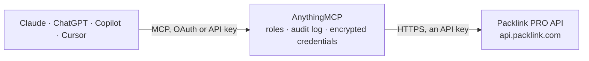

<!-- Generated by scripts/export-github-catalog.mjs in the anythingmcp-website repository. Do not edit by hand. -->

# Packlink PRO MCP connector

Packlink PRO multi-carrier shipping: quote parcels across carriers, look up services and drop-off points, read sender addresses and parcel presets, create shipment drafts, and read shipments, labels … The AnythingMCP connector gives Claude, ChatGPT, Microsoft Copilot, Cursor and Gemini 11 MCP tools for Packlink PRO: 10 read and 1 can change data.

**Category:** [Logistics](../logistics.md) · **Tools:** 11 · **Setup guide:** [anythingmcp.com](https://anythingmcp.com/guides/packlink-to-mcp) · [Deutsch](https://anythingmcp.com/de/guides/packlink-to-mcp) · [Italiano](https://anythingmcp.com/it/guides/packlink-to-mcp) · [Español](https://anythingmcp.com/es/guides/packlink-to-mcp) · [日本語](https://anythingmcp.com/ja/guides/packlink-to-mcp) · [Русский](https://anythingmcp.com/ru/guides/packlink-to-mcp) · [中文](https://anythingmcp.com/zh/guides/packlink-to-mcp)

## Start without code

No installation and no terminal: AnythingMCP Cloud runs the Packlink PRO connector for you, operated by helpcode.ai in Frankfurt, Germany.

1. **Click the button above** and create an account or sign in. The Packlink PRO connector opens, ready to install.
2. **Paste the API key or token from your Packlink PRO account.** Every click is in the [step-by-step guide](https://anythingmcp.com/guides/packlink-to-mcp).
3. **Click Install.** AnythingMCP shows the address of your MCP server.
4. **Add that address to your assistant:** [Claude](https://anythingmcp.com/guides/connect-packlink-to-claude) · [ChatGPT](https://anythingmcp.com/guides/connect-packlink-to-chatgpt) · [Microsoft Copilot](https://anythingmcp.com/guides/connect-packlink-to-copilot) · [Cursor](https://anythingmcp.com/guides/connect-packlink-to-cursor) · [Gemini CLI](https://anythingmcp.com/guides/connect-packlink-to-gemini) · [Meta Muse](https://anythingmcp.com/guides/connect-packlink-to-muse).
5. **Ask your first question**, for example: *What's the Packlink status and tracking for shipment reference PS-2026-0789 to Lisbon?*

Prefer help with the setup? [Talk to us](https://anythingmcp.com/contact).

## How it works

- **The AI client** speaks MCP (Streamable HTTP) to AnythingMCP and only sees tool names, descriptions and results. It never gets the Packlink PRO credentials.
- **AnythingMCP** checks the client's role, builds the call from the tool definition, adds the credentials (an API key), calls Packlink PRO, logs the call and returns the result.
- **Packlink PRO** sees an ordinary API client with the rights of the account the credentials belong to.

## Tools

| Tool | What it does | Access |
|---|---|---|
| [`packlink_get_account`](#packlink_get_account) | The Packlink PRO account the API key belongs to: name, company, email, phone, platform_country, customer_type and whether it is active. | read |
| [`packlink_list_warehouses`](#packlink_list_warehouses) | The sender (pickup) addresses saved in Packlink PRO: id, alias, contact name, company, address, postal_code, city, country, phone, email, and… | read |
| [`packlink_list_parcel_presets`](#packlink_list_parcel_presets) | The parcel presets saved in Packlink PRO: id, name, weight (kg), length, width and height (cm), and default for the default parcel. | read |
| [`packlink_search_services`](#packlink_search_services) | Shipping quotes: every carrier service Packlink PRO offers for one parcel from a sender postal code to a recipient postal code, with id, carrier_name, name,… | read |
| [`packlink_get_service`](#packlink_get_service) | Details of one shipping service by id: carrier_name, service_name, service_type, departure_type and destination_type (home or drop-off), and the carrier's… | read |
| [`packlink_list_dropoffs`](#packlink_list_dropoffs) | The ten closest drop-off points (parcel shops, lockers) of a service around a postal code: id, commerce_name, address, zip, city, lat, long, phone and… | read |
| [`packlink_get_postal_codes`](#packlink_get_postal_codes) | Checks a postal code against Packlink's location data: the matching places with zipcode, city, province, state, country, postal zone, time zone and coordinates. | read |
| [`packlink_create_draft_shipment`](#packlink_create_draft_shipment) | Creates a shipment draft in Packlink PRO and returns its reference. | write |
| [`packlink_get_shipment`](#packlink_get_shipment) | One shipment by its Packlink reference: state (e.g. AWAITING_COMPLETION, READY_TO_PURCHASE, READY_TO_PRINT, READY_FOR_COLLECTION, IN_TRANSIT,… | read |
| [`packlink_get_shipment_labels`](#packlink_get_shipment_labels) | Download links (PDF) of the shipping labels of a paid shipment. | read |
| [`packlink_get_shipment_tracking`](#packlink_get_shipment_tracking) | Tracking history of a shipment: history entries with timestamp, description (the carrier's event, e.g. DELIVERED) and city. | read |

## Tool reference

Every parameter as the AI client sees it in `tools/list`. Source: [`packages/backend/src/adapters/intl/packlink.json`](../../../packages/backend/src/adapters/intl/packlink.json).

### `packlink_get_account`

The Packlink PRO account the API key belongs to: name, company, email, phone, platform_country, customer_type and whether it is active. Use it to check the connection.

**Access:** read · **Call:** `GET /clients`

No parameters.

### `packlink_list_warehouses`

The sender (pickup) addresses saved in Packlink PRO: id, alias, contact name, company, address, postal_code, city, country, phone, email, and default_selection for the default one. Use them as the sender of quotes and drafts.

**Access:** read · **Call:** `GET /clients/warehouses`

No parameters.

### `packlink_list_parcel_presets`

The parcel presets saved in Packlink PRO: id, name, weight (kg), length, width and height (cm), and default for the default parcel.

**Access:** read · **Call:** `GET /users/parcels`

No parameters.

### `packlink_search_services`

Shipping quotes: every carrier service Packlink PRO offers for one parcel from a sender postal code to a recipient postal code, with id, carrier_name, name, category, price (base_price, tax_price, total_price) and currency, transit_time and transit_hours, first_estimated_delivery_date, dropoff (the parcel is handed in at a drop-off point) and delivery_to_parcelshop, labels_required, customs_required, insurance and cash on delivery conditions.

**Access:** read · **Call:** `GET /services`

| Parameter | Type | Required | Description |
|---|---|---|---|
| `from_country` | string | yes | Two-letter ISO country code of the sender, e.g. ES, FR, DE, IT, GB. |
| `from_zip` | string | yes | Postal code of the sender. |
| `to_country` | string | yes | Two-letter ISO country code of the recipient, e.g. ES, FR, DE, IT, GB. |
| `to_zip` | string | yes | Postal code of the recipient. |
| `weight` | number | yes | Parcel weight in kilograms, e.g. 1.5. |
| `length` | integer | yes | Parcel length in centimetres (whole number). |
| `width` | integer | yes | Parcel width in centimetres (whole number). |
| `height` | integer | yes | Parcel height in centimetres (whole number). |

### `packlink_get_service`

Details of one shipping service by id: carrier_name, service_name, service_type, departure_type and destination_type (home or drop-off), and the carrier's notes in service_details and packlink_info.

**Access:** read · **Call:** `GET /services/available/{service_id}/details`

| Parameter | Type | Required | Description |
|---|---|---|---|
| `service_id` | integer | yes | Service id from packlink_search_services. |

### `packlink_list_dropoffs`

The ten closest drop-off points (parcel shops, lockers) of a service around a postal code: id, commerce_name, address, zip, city, lat, long, phone and opening_times per weekday. Pass the id as dropoff_point_id when the service has destination drop-off.

**Access:** read · **Call:** `GET /dropoffs/{service_id}/{country}/{zip}`

| Parameter | Type | Required | Description |
|---|---|---|---|
| `service_id` | integer | yes | Service id from packlink_search_services (one with dropoff or delivery_to_parcelshop). |
| `country` | string | yes | Two-letter ISO country code of the search area, e.g. ES, FR, DE, IT, GB. |
| `zip` | string | yes | Postal code of the search area. |

### `packlink_get_postal_codes`

Checks a postal code against Packlink's location data: the matching places with zipcode, city, province, state, country, postal zone, time zone and coordinates. An empty list means Packlink does not know the code.

**Access:** read · **Call:** `GET /locations/postalcodes/{country}/{zip}`

| Parameter | Type | Required | Description |
|---|---|---|---|
| `country` | string | yes | Two-letter ISO country code of the postal code, e.g. ES, FR, DE, IT, GB. |
| `zip` | string | yes | Postal code to look up. |

### `packlink_create_draft_shipment`

Creates a shipment draft in Packlink PRO and returns its reference. Nothing is paid or booked: the draft appears in Packlink PRO, where the user reviews it and pays to get the label. Confirm the addresses, parcels and service with the user first.

**Access:** write · **Call:** `POST /shipments`

| Parameter | Type | Required | Description |
|---|---|---|---|
| `from` | object | yes | Sender address. Take the sender from packlink_list_warehouses (address goes into street1, postal_code into zip_code). |
| `to` | object | yes | Recipient address. |
| `packages` | object[] | yes | The parcels, one entry per box. |
| `service_id` | integer | no | Chosen service id from packlink_search_services. Without it the user picks the service in Packlink PRO. |
| `dropoff_point_id` | string | no | Drop-off point id from packlink_list_dropoffs, for services delivered to a parcel shop. |
| `content` | string | yes | Short description of the contents, e.g. "2 T-shirts". Avoid special characters such as ; : % & / # ( ) = ?. |
| `content_value` | number | no | Declared value of the contents, used for insurance and customs. |
| `currency` | string | no | Currency of content_value, e.g. EUR or GBP. |
| `second_hand` | boolean | no | True when the contents are second-hand goods. |
| `custom_reference` | string | no | Your own reference, e.g. the shop order number; shown in Packlink PRO as shipment_custom_reference. |

### `packlink_get_shipment`

One shipment by its Packlink reference: state (e.g. AWAITING_COMPLETION, READY_TO_PURCHASE, READY_TO_PRINT, READY_FOR_COLLECTION, IN_TRANSIT, OUT_FOR_DELIVERY, DELIVERED, INCIDENT, CANCELED), carrier, service, collection and delivery addresses, collection date and hours, parcels, content and value, price, insurance, trackings (carrier tracking numbers) and tracking_url.

**Access:** read · **Call:** `GET /shipments/{reference}`

| Parameter | Type | Required | Description |
|---|---|---|---|
| `reference` | string | yes | Packlink shipment reference, e.g. ES2026PRO0001234567 (returned by packlink_create_draft_shipment and shown in Packlink PRO). |

### `packlink_get_shipment_labels`

Download links (PDF) of the shipping labels of a paid shipment. Empty or an error while the shipment is still a draft or not yet READY_TO_PRINT.

**Access:** read · **Call:** `GET /shipments/{reference}/labels`

| Parameter | Type | Required | Description |
|---|---|---|---|
| `reference` | string | yes | Packlink shipment reference, e.g. ES2026PRO0001234567 (returned by packlink_create_draft_shipment and shown in Packlink PRO). |

### `packlink_get_shipment_tracking`

Tracking history of a shipment: history entries with timestamp, description (the carrier's event, e.g. DELIVERED) and city.

**Access:** read · **Call:** `GET /shipments/{reference}/track`

| Parameter | Type | Required | Description |
|---|---|---|---|
| `reference` | string | yes | Packlink shipment reference, e.g. ES2026PRO0001234567 (returned by packlink_create_draft_shipment and shown in Packlink PRO). |

## Run it yourself

AnythingMCP is open source (AGPL-3.0). [Run it with Docker](../../../README.md#run-it-yourself), open **Connectors → Store**, pick **Packlink PRO** and enter `PACKLINK_API_KEY`, then add your MCP server URL to the AI client.

[← Logistics connectors](../logistics.md) · [All categories](../README.md)
