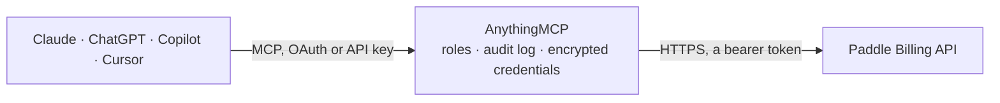

<!-- Generated by scripts/export-github-catalog.mjs in the anythingmcp-website repository. Do not edit by hand. -->

# Paddle Billing MCP connector

Paddle Billing, the merchant of record for software sales: products, prices and discounts, customers with addresses and businesses, subscriptions (update, pause, resume, cancel, previews), … The AnythingMCP connector gives Claude, ChatGPT, Microsoft Copilot, Cursor and Gemini 57 MCP tools for Paddle Billing: 33 read and 24 can change data.

**Category:** [Payments](../payments.md) · **Tools:** 57 · **Setup guide:** [anythingmcp.com](https://anythingmcp.com/guides/paddle-to-mcp) · [Deutsch](https://anythingmcp.com/de/guides/paddle-to-mcp) · [Italiano](https://anythingmcp.com/it/guides/paddle-to-mcp) · [Español](https://anythingmcp.com/es/guides/paddle-to-mcp) · [日本語](https://anythingmcp.com/ja/guides/paddle-to-mcp) · [Русский](https://anythingmcp.com/ru/guides/paddle-to-mcp) · [中文](https://anythingmcp.com/zh/guides/paddle-to-mcp)

## Start without code

No installation and no terminal: AnythingMCP Cloud runs the Paddle Billing connector for you, operated by helpcode.ai in Frankfurt, Germany.

1. **Click the button above** and create an account or sign in. The Paddle Billing connector opens, ready to install.
2. **Paste the API key or token from your Paddle Billing account.** Every click is in the [step-by-step guide](https://anythingmcp.com/guides/paddle-to-mcp).
3. **Click Install.** AnythingMCP shows the address of your MCP server.
4. **Add that address to your assistant:** [Claude](https://anythingmcp.com/guides/connect-paddle-to-claude) · [ChatGPT](https://anythingmcp.com/guides/connect-paddle-to-chatgpt) · [Microsoft Copilot](https://anythingmcp.com/guides/connect-paddle-to-copilot) · [Cursor](https://anythingmcp.com/guides/connect-paddle-to-cursor) · [Gemini CLI](https://anythingmcp.com/guides/connect-paddle-to-gemini) · [Meta Muse](https://anythingmcp.com/guides/connect-paddle-to-muse).
5. **Ask your first question**, for example: *Show invoice INV-2026-0412: is it billed, billed date and total amount in EUR, and get the PDF link*

Prefer help with the setup? [Talk to us](https://anythingmcp.com/contact).

## How it works

- **The AI client** speaks MCP (Streamable HTTP) to AnythingMCP and only sees tool names, descriptions and results. It never gets the Paddle Billing credentials.
- **AnythingMCP** checks the client's role, builds the call from the tool definition, adds the credentials (a bearer token), calls Paddle Billing, logs the call and returns the result.
- **Paddle Billing** sees an ordinary API client with the rights of the account the credentials belong to.

## Tools

| Tool | What it does | Access |
|---|---|---|
| [`paddle_list_products`](#paddle_list_products) | List products in the catalog with name, tax category, type, status and custom data. | read |
| [`paddle_get_product`](#paddle_get_product) | Get one product by id (pro_...) with its name, description, tax category, image URL, status and custom data; include prices to list its prices too. | read |
| [`paddle_create_product`](#paddle_create_product) | Create a catalog product (what you sell). | write |
| [`paddle_update_product`](#paddle_update_product) | Update a product: name, description, tax category, image, custom data, or archive it with status archived. | write |
| [`paddle_list_prices`](#paddle_list_prices) | List prices with their product id, unit price (amount in the lowest currency unit), billing cycle, trial period, quantity limits and status. | read |
| [`paddle_get_price`](#paddle_get_price) | Get one price by id (pri_...): product, description, unit price and overrides per country, billing cycle, trial period, tax mode and quantity limits. | read |
| [`paddle_create_price`](#paddle_create_price) | Create a price for a product: amount and currency, optional billing cycle (subscription) and trial, country overrides and quantity limits. | write |
| [`paddle_update_price`](#paddle_update_price) | Update a price: description, name, amount, billing cycle, trial, overrides, quantity limits, custom data, or archive it. | write |
| [`paddle_list_discounts`](#paddle_list_discounts) | List discounts with code, type (flat, flat_per_seat, percentage), amount, recurring settings, usage limit, times used, expiry and status. | read |
| [`paddle_get_discount`](#paddle_get_discount) | Get one discount by id (dsc_...): code, type, amount, currency, whether it recurs and for how many intervals, usage limit, times used, restrictions and expiry. | read |
| [`paddle_create_discount`](#paddle_create_discount) | Create a discount: percentage or flat amount, optional checkout code, recurring behaviour, usage limit, product or price restrictions and expiry. | write |
| [`paddle_update_discount`](#paddle_update_discount) | Update a discount: amount, code, recurring settings, limits, restrictions, expiry, custom data, or archive it with status archived. | write |
| [`paddle_list_customers`](#paddle_list_customers) | List customers with name, email, locale, marketing consent and status. | read |
| [`paddle_get_customer`](#paddle_get_customer) | Get one customer by id (ctm_...): name, email, locale, marketing consent, status, custom data and timestamps. | read |
| [`paddle_create_customer`](#paddle_create_customer) | Create a customer by email (unique per account) with optional name, locale and custom data. | write |
| [`paddle_update_customer`](#paddle_update_customer) | Update a customer: email, name, locale, custom data, or archive it with status archived. | write |
| [`paddle_list_customer_addresses`](#paddle_list_customer_addresses) | List the addresses saved for a customer (add_... | read |
| [`paddle_create_customer_address`](#paddle_create_customer_address) | Add an address to a customer. | write |
| [`paddle_update_customer_address`](#paddle_update_customer_address) | Update a customer address: lines, city, postal code, region, country, custom data, or archive it. | write |
| [`paddle_list_customer_businesses`](#paddle_list_customer_businesses) | List the businesses saved for a customer (biz_... | read |
| [`paddle_create_customer_business`](#paddle_create_customer_business) | Add a business to a customer for B2B billing: name, company number, VAT or tax id and invoice contacts. | write |
| [`paddle_update_customer_business`](#paddle_update_customer_business) | Update a customer business: name, company number, tax identifier, contacts, custom data, or archive it. | write |
| [`paddle_list_customer_credit_balances`](#paddle_list_customer_credit_balances) | Credit balances of a customer per currency: available, reserved and used credit created by adjustments (credits) on their subscriptions. | read |
| [`paddle_create_customer_portal_session`](#paddle_create_customer_portal_session) | Create authenticated links to the Paddle customer portal for a customer, where they can update payment methods, see invoices and cancel. | write |
| [`paddle_list_subscriptions`](#paddle_list_subscriptions) | List subscriptions with status, customer, address, items (price and quantity), currency, billing period, next billing date and any scheduled change (pause,… | read |
| [`paddle_get_subscription`](#paddle_get_subscription) | Get one subscription by id (sub_...): status, customer, items, discount, billing cycle and current period, next billing date, scheduled change and… | read |
| [`paddle_preview_subscription_update`](#paddle_preview_subscription_update) | Preview what an update to a subscription would charge or credit, without changing it: immediate transaction, next transaction and the resulting subscription. | read |
| [`paddle_update_subscription`](#paddle_update_subscription) | Update a subscription: change items or quantities (upgrade, downgrade, add-ons) with a proration mode, apply a discount, change billing date, address,… | write |
| [`paddle_pause_subscription`](#paddle_pause_subscription) | Pause a subscription at the end of the billing period (default) or immediately, optionally with a date to resume automatically. | write |
| [`paddle_resume_subscription`](#paddle_resume_subscription) | Resume a paused subscription now (effective_from immediately) or at a given date-time, or change the date of a scheduled resume. | write |
| [`paddle_cancel_subscription`](#paddle_cancel_subscription) | Cancel a subscription at the end of the billing period (default, can be undone by removing the scheduled change) or immediately (final). | write |
| [`paddle_activate_subscription`](#paddle_activate_subscription) | End the trial of a trialing subscription now and start billing it: the first payment is collected immediately. | write |
| [`paddle_create_subscription_charge`](#paddle_create_subscription_charge) | Bill a one-time charge on a subscription (e.g. extra seats or a setup fee), now or with the next renewal. | write |
| [`paddle_list_transactions`](#paddle_list_transactions) | List transactions (checkouts, renewals, invoices) with status, customer, subscription, items, totals in the lowest currency unit, invoice number and billed… | read |
| [`paddle_get_transaction`](#paddle_get_transaction) | Get one transaction by id (txn_...): status, items, totals and tax breakdown (details.totals, amounts in the lowest currency unit), payments with method and… | read |
| [`paddle_create_transaction`](#paddle_create_transaction) | Create a transaction: a draft or ready checkout for a customer to pay (returns checkout.url), or an invoice for manual collection (status billed). | write |
| [`paddle_update_transaction`](#paddle_update_transaction) | Update a draft or ready transaction: items, customer, address, business, currency, discount, billing details, or set status billed or canceled. | write |
| [`paddle_preview_transaction`](#paddle_preview_transaction) | Preview a transaction without creating it: line items, tax, discounts and totals for given prices, customer or location. | read |
| [`paddle_get_transaction_invoice`](#paddle_get_transaction_invoice) | Get a temporary link to the PDF invoice of a billed or completed transaction. | read |
| [`paddle_preview_prices`](#paddle_preview_prices) | Localized price preview for a list of prices: subtotal, tax, discount and total per item in the customer's currency and country, as on a pricing page. | read |
| [`paddle_list_adjustments`](#paddle_list_adjustments) | List adjustments (refunds, credits, chargebacks) with action, status (pending_approval, approved, rejected, reversed), transaction, subscription, customer,… | read |
| [`paddle_create_adjustment`](#paddle_create_adjustment) | Refund or credit a billed or completed transaction, fully or for some items. | write |
| [`paddle_get_adjustment_credit_note`](#paddle_get_adjustment_credit_note) | Get a temporary link to the PDF credit note of an approved adjustment. | read |
| [`paddle_list_reports`](#paddle_list_reports) | List reports you requested with type, status (pending, ready, failed, expired), filters, row count and expiry. | read |
| [`paddle_create_report`](#paddle_create_report) | Request a CSV report: transactions, transaction_line_items, adjustments, adjustment_line_items, discounts, products_prices, balance, payout_reconciliation,… | write |
| [`paddle_get_report`](#paddle_get_report) | Get one report by id (rep_...): type, status, filters, number of rows and when it expires. | read |
| [`paddle_get_report_csv`](#paddle_get_report_csv) | Get a temporary download link for a ready report as CSV. | read |
| [`paddle_get_revenue_metrics`](#paddle_get_revenue_metrics) | Net revenue per day for a date range in the account balance currency, as shown in the Paddle dashboard (amounts in the lowest currency unit). | read |
| [`paddle_get_mrr_metrics`](#paddle_get_mrr_metrics) | Monthly recurring revenue per day for a date range, as shown in the Paddle dashboard (amounts in the lowest currency unit). | read |
| [`paddle_get_active_subscribers_metrics`](#paddle_get_active_subscribers_metrics) | Number of active subscribers per day for a date range, as shown in the Paddle dashboard metrics. | read |
| [`paddle_list_event_types`](#paddle_list_event_types) | List the event types Paddle can send (transaction.completed, subscription.canceled, ...) with a description and the API version of each. | read |
| [`paddle_list_events`](#paddle_list_events) | List events (what happened in the account): event_type, occurred_at and the full entity in data. | read |
| [`paddle_list_notification_settings`](#paddle_list_notification_settings) | List notification destinations (webhook URLs and emails) with their subscribed event types, active flag and API version. | read |
| [`paddle_list_notifications`](#paddle_list_notifications) | List webhook and email notifications sent for events, with status (delivered, failed, needs_retry, not_attempted), times attempted and the destination. | read |
| [`paddle_get_notification`](#paddle_get_notification) | Get one notification by id (ntf_...): status, event payload, destination, attempts and last error. | read |
| [`paddle_list_notification_logs`](#paddle_list_notification_logs) | List the delivery attempts of a notification with the HTTP status and response body your endpoint returned, to debug failing webhooks. | read |
| [`paddle_replay_notification`](#paddle_replay_notification) | Send a notification again to its destination, e.g. after fixing a failing webhook endpoint. | write |

## Tool reference

Every parameter as the AI client sees it in `tools/list`. Source: [`packages/backend/src/adapters/intl/paddle.json`](../../../packages/backend/src/adapters/intl/paddle.json).

### `paddle_list_products`

List products in the catalog with name, tax category, type, status and custom data. Include prices to get each product's prices in the same call. Paged with after and per_page.

**Access:** read · **Call:** `GET /products`

| Parameter | Type | Required | Description |
|---|---|---|---|
| `id` | string | no | Only these product ids (pro_...), comma-separated. |
| `status` | string | no | Comma-separated statuses: active, archived (default active). |
| `type` | `standard` \| `custom` | no | standard (catalog) or custom (one-off, created for a single transaction). |
| `tax_category` | string | no | Only these tax categories, e.g. standard,saas, comma-separated. |
| `include` | `prices` | no | prices: also return the product's prices. |
| `order_by` | string | no | Sort, e.g. id[ASC] or id[DESC] (default id[ASC]). Sortable: created_at, custom_data, id, description, image_url, name, status, tax_category, updated_at. |
| `after` | string | no | Cursor for the next page: the id after which to continue, taken from meta.pagination.next (the after= value). |
| `per_page` | integer | no | Items per page, 1 to 200 (default 50). |

### `paddle_get_product`

Get one product by id (pro_...) with its name, description, tax category, image URL, status and custom data; include prices to list its prices too.

**Access:** read · **Call:** `GET /products/{product_id}`

| Parameter | Type | Required | Description |
|---|---|---|---|
| `product_id` | string | yes | Product id, starting with pro_. |
| `include` | `prices` | no | prices: also return the product's prices. |

### `paddle_create_product`

Create a catalog product (what you sell). Add one or more prices to it with paddle_create_price before it can be bought. Returns the new product with its pro_ id.

**Access:** write · **Call:** `POST /products`

| Parameter | Type | Required | Description |
|---|---|---|---|
| `name` | string | yes | Product name shown to customers. |
| `tax_category` | `digital-goods` \| `ebooks` \| `implementation-services` \| `professional-services` \| `saas` \| `software-programming-services` \| `standard` \| `training-services` \| `website-hosting` | yes | Tax category: standard for most items, saas for software as a service, digital-goods, ebooks, implementation-services, professional-services, software-programming-services, training-services, website-hosting. Categories other than standard and saas need Paddle approval. |
| `description` | string | no | Short description shown at checkout and on invoices. |
| `type` | `standard` \| `custom` | no | standard (default, part of the catalog) or custom. |
| `image_url` | string | no | HTTPS URL of a square product image. |
| `custom_data` | object | no | Your own key-value data stored on the entity, e.g. {"crm_id": "123"}. |

### `paddle_update_product`

Update a product: name, description, tax category, image, custom data, or archive it with status archived. Only the fields passed change.

**Access:** write · **Call:** `PATCH /products/{product_id}`

| Parameter | Type | Required | Description |
|---|---|---|---|
| `product_id` | string | yes | Product id, starting with pro_. |
| `name` | string | no | New name. |
| `description` | string | no | New description. |
| `tax_category` | `digital-goods` \| `ebooks` \| `implementation-services` \| `professional-services` \| `saas` \| `software-programming-services` \| `standard` \| `training-services` \| `website-hosting` | no | Tax category: standard for most items, saas for software as a service, digital-goods, ebooks, implementation-services, professional-services, software-programming-services, training-services, website-hosting. Categories other than standard and saas need Paddle approval. |
| `image_url` | string | no | HTTPS URL of a square product image. |
| `custom_data` | object | no | Your own key-value data stored on the entity, e.g. {"crm_id": "123"}. |
| `status` | `active` \| `archived` | no | Filter by status: active or archived. |

### `paddle_list_prices`

List prices with their product id, unit price (amount in the lowest currency unit), billing cycle, trial period, quantity limits and status. Filter by product or by recurring/one-time.

**Access:** read · **Call:** `GET /prices`

| Parameter | Type | Required | Description |
|---|---|---|---|
| `id` | string | no | Only these price ids (pri_...), comma-separated. |
| `product_id` | string | no | Only these product ids (pro_...), comma-separated. |
| `status` | string | no | Comma-separated statuses: active, archived (default active). |
| `recurring` | boolean | no | true: only prices with a billing cycle (subscriptions); false: only one-time prices. |
| `type` | `standard` \| `custom` | no | standard or custom. |
| `include` | `product` | no | product: also return the related product. |
| `order_by` | string | no | Sort, e.g. id[ASC] or id[DESC] (default id[ASC]). Sortable: billing_cycle.frequency, billing_cycle.interval, id, product_id, quantity.maximum, quantity.minimum, status, tax_mode, unit_price.amount, unit_price.currency_code. |
| `after` | string | no | Cursor for the next page: the id after which to continue, taken from meta.pagination.next (the after= value). |
| `per_page` | integer | no | Items per page, 1 to 200 (default 50). |

### `paddle_get_price`

Get one price by id (pri_...): product, description, unit price and overrides per country, billing cycle, trial period, tax mode and quantity limits.

**Access:** read · **Call:** `GET /prices/{price_id}`

| Parameter | Type | Required | Description |
|---|---|---|---|
| `price_id` | string | yes | Price id, starting with pri_. |
| `include` | `product` | no | product: also return the related product. |

### `paddle_create_price`

Create a price for a product: amount and currency, optional billing cycle (subscription) and trial, country overrides and quantity limits. Returns the new pri_ id used in checkouts and transactions.

**Access:** write · **Call:** `POST /prices`

| Parameter | Type | Required | Description |
|---|---|---|---|
| `product_id` | string | yes | Product id (pro_...) the price belongs to. |
| `description` | string | yes | Internal description, e.g. Monthly (per seat). Not shown to customers. |
| `unit_price` | object | yes | Unit price: {"amount": "1000", "currency_code": "USD"}. amount is a string in the lowest currency unit (1000 = 10.00 USD). |
| `name` | string | no | Name shown to customers at checkout and on invoices. |
| `billing_cycle` | object | no | Billing cycle for recurring prices: {"interval": "month", "frequency": 1}; interval is day, week, month or year. Leave out for a one-time price. |
| `trial_period` | object | no | Trial period: {"interval": "day", "frequency": 14}. Requires a billing cycle. |
| `tax_mode` | `account_setting` \| `external` \| `internal` | no | account_setting (default), external (prices exclude tax) or internal (prices include tax). |
| `unit_price_overrides` | object[] | no | Prices for specific countries: [{"country_codes": ["DE", "AT"], "unit_price": {"amount": "900", "currency_code": "EUR"}}]. |
| `quantity` | object | no | Allowed quantity per checkout: {"minimum": 1, "maximum": 100}. |
| `custom_data` | object | no | Your own key-value data stored on the entity, e.g. {"crm_id": "123"}. |

### `paddle_update_price`

Update a price: description, name, amount, billing cycle, trial, overrides, quantity limits, custom data, or archive it. Existing subscriptions keep their price until they are updated.

**Access:** write · **Call:** `PATCH /prices/{price_id}`

| Parameter | Type | Required | Description |
|---|---|---|---|
| `price_id` | string | yes | Price id, starting with pri_. |
| `description` | string | no | New internal description. |
| `name` | string | no | New customer-facing name. |
| `unit_price` | object | no | Unit price: {"amount": "1000", "currency_code": "USD"}. amount is a string in the lowest currency unit (1000 = 10.00 USD). |
| `billing_cycle` | object | no | Billing cycle for recurring prices: {"interval": "month", "frequency": 1}; interval is day, week, month or year. Leave out for a one-time price. |
| `trial_period` | object | no | Trial period: {"interval": "day", "frequency": 14}. Requires a billing cycle. |
| `tax_mode` | `account_setting` \| `external` \| `internal` | no | account_setting (default), external (prices exclude tax) or internal (prices include tax). |
| `unit_price_overrides` | object[] | no | Prices for specific countries: [{"country_codes": ["DE", "AT"], "unit_price": {"amount": "900", "currency_code": "EUR"}}]. |
| `quantity` | object | no | Allowed quantity per checkout: {"minimum": 1, "maximum": 100}. |
| `status` | `active` \| `archived` | no | Filter by status: active or archived. |
| `custom_data` | object | no | Your own key-value data stored on the entity, e.g. {"crm_id": "123"}. |

### `paddle_list_discounts`

List discounts with code, type (flat, flat_per_seat, percentage), amount, recurring settings, usage limit, times used, expiry and status. Filter by code or status.

**Access:** read · **Call:** `GET /discounts`

| Parameter | Type | Required | Description |
|---|---|---|---|
| `id` | string | no | Only these discount ids (dsc_...), comma-separated. |
| `code` | string | no | Only these discount codes, comma-separated. |
| `status` | string | no | Comma-separated statuses: active, archived, expired, used. |
| `mode` | `standard` \| `custom` | no | standard (catalog) or custom. |
| `discount_group_id` | string | no | Only these discount group ids (dsg_...), comma-separated. |
| `order_by` | string | no | Sort, e.g. id[ASC] or id[DESC] (default id[ASC]). Sortable: created_at, id. |
| `after` | string | no | Cursor for the next page: the id after which to continue, taken from meta.pagination.next (the after= value). |
| `per_page` | integer | no | Items per page, 1 to 200 (default 50). |

### `paddle_get_discount`

Get one discount by id (dsc_...): code, type, amount, currency, whether it recurs and for how many intervals, usage limit, times used, restrictions and expiry.

**Access:** read · **Call:** `GET /discounts/{discount_id}`

| Parameter | Type | Required | Description |
|---|---|---|---|
| `discount_id` | string | yes | Discount id, starting with dsc_. |

### `paddle_create_discount`

Create a discount: percentage or flat amount, optional checkout code, recurring behaviour, usage limit, product or price restrictions and expiry. Returns the new dsc_ id.

**Access:** write · **Call:** `POST /discounts`

| Parameter | Type | Required | Description |
|---|---|---|---|
| `description` | string | yes | Internal description, not shown to customers. |
| `type` | `flat` \| `flat_per_seat` \| `percentage` | yes | flat (fixed amount off the total), flat_per_seat (fixed amount per unit) or percentage. |
| `amount` | string | yes | Amount as a string: a percentage such as "10" or "12.5" for percentage, otherwise the lowest currency unit (500 = 5.00). |
| `currency_code` | string | no | Currency for flat and flat_per_seat discounts, e.g. USD or EUR. |
| `code` | string | no | Code customers enter at checkout (letters and numbers, up to 32). Leave out for a discount you only apply through the API. |
| `enabled_for_checkout` | boolean | no | Whether customers can enter the code at checkout. |
| `recur` | boolean | no | Whether the discount applies to recurring renewals as well as the first payment. |
| `maximum_recurring_intervals` | integer | no | With recur: on how many renewals it applies; leave out for forever. |
| `usage_limit` | integer | no | How many times the discount can be redeemed in total. |
| `restrict_to` | string[] | no | Only these product or price ids (pro_..., pri_...). |
| `expires_at` | string | no | Expiry as RFC 3339 date-time, e.g. 2026-12-31T23:59:59Z. |
| `custom_data` | object | no | Your own key-value data stored on the entity, e.g. {"crm_id": "123"}. |

### `paddle_update_discount`

Update a discount: amount, code, recurring settings, limits, restrictions, expiry, custom data, or archive it with status archived. Only the fields passed change.

**Access:** write · **Call:** `PATCH /discounts/{discount_id}`

| Parameter | Type | Required | Description |
|---|---|---|---|
| `discount_id` | string | yes | Discount id, starting with dsc_. |
| `description` | string | no | Internal description, not shown to customers. |
| `type` | `flat` \| `flat_per_seat` \| `percentage` | no | flat (fixed amount off the total), flat_per_seat (fixed amount per unit) or percentage. |
| `amount` | string | no | Amount as a string: a percentage such as "10" or "12.5" for percentage, otherwise the lowest currency unit (500 = 5.00). |
| `currency_code` | string | no | Currency for flat and flat_per_seat discounts, e.g. USD or EUR. |
| `code` | string | no | Code customers enter at checkout (letters and numbers, up to 32). Leave out for a discount you only apply through the API. |
| `enabled_for_checkout` | boolean | no | Whether customers can enter the code at checkout. |
| `recur` | boolean | no | Whether the discount applies to recurring renewals as well as the first payment. |
| `maximum_recurring_intervals` | integer | no | With recur: on how many renewals it applies; leave out for forever. |
| `usage_limit` | integer | no | How many times the discount can be redeemed in total. |
| `restrict_to` | string[] | no | Only these product or price ids (pro_..., pri_...). |
| `expires_at` | string | no | Expiry as RFC 3339 date-time, e.g. 2026-12-31T23:59:59Z. |
| `custom_data` | object | no | Your own key-value data stored on the entity, e.g. {"crm_id": "123"}. |
| `status` | `active` \| `archived` | no | Filter by status: active or archived. |

### `paddle_list_customers`

List customers with name, email, locale, marketing consent and status. Search by email or text; ids start with ctm_. Paged with after and per_page.

**Access:** read · **Call:** `GET /customers`

| Parameter | Type | Required | Description |
|---|---|---|---|
| `id` | string | no | Only these customer ids (ctm_...), comma-separated. |
| `email` | string | no | Only these email addresses (exact match), comma-separated. |
| `search` | string | no | Free-text search over id, name and email. |
| `status` | string | no | Comma-separated statuses: active, archived (default active). |
| `order_by` | string | no | Sort, e.g. id[ASC] or id[DESC] (default id[ASC]). Sortable: id. |
| `after` | string | no | Cursor for the next page: the id after which to continue, taken from meta.pagination.next (the after= value). |
| `per_page` | integer | no | Items per page, 1 to 200 (default 50). |

### `paddle_get_customer`

Get one customer by id (ctm_...): name, email, locale, marketing consent, status, custom data and timestamps.

**Access:** read · **Call:** `GET /customers/{customer_id}`

| Parameter | Type | Required | Description |
|---|---|---|---|
| `customer_id` | string | yes | Customer id, starting with ctm_. |

### `paddle_create_customer`

Create a customer by email (unique per account) with optional name, locale and custom data. Add addresses and businesses afterwards. Returns the new ctm_ id.

**Access:** write · **Call:** `POST /customers`

| Parameter | Type | Required | Description |
|---|---|---|---|
| `email` | string | yes | Email address, unique among your customers. |
| `name` | string | no | Full name. |
| `locale` | string | no | Locale for emails and invoices, e.g. en or de (default en). |
| `custom_data` | object | no | Your own key-value data stored on the entity, e.g. {"crm_id": "123"}. |

### `paddle_update_customer`

Update a customer: email, name, locale, custom data, or archive it with status archived. Only the fields passed change.

**Access:** write · **Call:** `PATCH /customers/{customer_id}`

| Parameter | Type | Required | Description |
|---|---|---|---|
| `customer_id` | string | yes | Customer id, starting with ctm_. |
| `email` | string | no | New email address. |
| `name` | string | no | New name. |
| `locale` | string | no | Locale, e.g. en or de. |
| `status` | `active` \| `archived` | no | Filter by status: active or archived. |
| `custom_data` | object | no | Your own key-value data stored on the entity, e.g. {"crm_id": "123"}. |

### `paddle_list_customer_addresses`

List the addresses saved for a customer (add_... ids): country, postal code, region, city and lines. Transactions and subscriptions point to an address for tax.

**Access:** read · **Call:** `GET /customers/{customer_id}/addresses`

| Parameter | Type | Required | Description |
|---|---|---|---|
| `customer_id` | string | yes | Customer id, starting with ctm_. |
| `status` | string | no | Comma-separated statuses: active, archived (default active). |
| `search` | string | no | Free-text search. |
| `after` | string | no | Cursor for the next page: the id after which to continue, taken from meta.pagination.next (the after= value). |
| `per_page` | integer | no | Items per page, 1 to 200 (default 50). |

### `paddle_create_customer_address`

Add an address to a customer. Only the country is required, but US and CA need a postal code for tax. Returns the new add_ id.

**Access:** write · **Call:** `POST /customers/{customer_id}/addresses`

| Parameter | Type | Required | Description |
|---|---|---|---|
| `customer_id` | string | yes | Customer id, starting with ctm_. |
| `country_code` | string | yes | Two-letter ISO 3166 country code, e.g. US or DE. |
| `description` | string | no | Label for the address, e.g. Head office. |
| `first_line` | string | no | First address line. |
| `second_line` | string | no | Second address line. |
| `city` | string | no | City. |
| `postal_code` | string | no | ZIP or postal code; required for some countries such as US and CA. |
| `region` | string | no | State, county or region. |
| `custom_data` | object | no | Your own key-value data stored on the entity, e.g. {"crm_id": "123"}. |

### `paddle_update_customer_address`

Update a customer address: lines, city, postal code, region, country, custom data, or archive it. Only the fields passed change.

**Access:** write · **Call:** `PATCH /customers/{customer_id}/addresses/{address_id}`

| Parameter | Type | Required | Description |
|---|---|---|---|
| `customer_id` | string | yes | Customer id, starting with ctm_. |
| `address_id` | string | yes | Address id, starting with add_. |
| `country_code` | string | no | Two-letter ISO 3166 country code, e.g. US or DE. |
| `description` | string | no | Label for the address, e.g. Head office. |
| `first_line` | string | no | First address line. |
| `second_line` | string | no | Second address line. |
| `city` | string | no | City. |
| `postal_code` | string | no | ZIP or postal code; required for some countries such as US and CA. |
| `region` | string | no | State, county or region. |
| `custom_data` | object | no | Your own key-value data stored on the entity, e.g. {"crm_id": "123"}. |
| `status` | `active` \| `archived` | no | Filter by status: active or archived. |

### `paddle_list_customer_businesses`

List the businesses saved for a customer (biz_... ids): company name, company number, tax identifier (VAT number) and contacts, used for B2B invoices.

**Access:** read · **Call:** `GET /customers/{customer_id}/businesses`

| Parameter | Type | Required | Description |
|---|---|---|---|
| `customer_id` | string | yes | Customer id, starting with ctm_. |
| `status` | string | no | Comma-separated statuses: active, archived (default active). |
| `search` | string | no | Free-text search. |
| `after` | string | no | Cursor for the next page: the id after which to continue, taken from meta.pagination.next (the after= value). |
| `per_page` | integer | no | Items per page, 1 to 200 (default 50). |

### `paddle_create_customer_business`

Add a business to a customer for B2B billing: name, company number, VAT or tax id and invoice contacts. Returns the new biz_ id.

**Access:** write · **Call:** `POST /customers/{customer_id}/businesses`

| Parameter | Type | Required | Description |
|---|---|---|---|
| `customer_id` | string | yes | Customer id, starting with ctm_. |
| `name` | string | yes | Company name. |
| `company_number` | string | no | Company registration number. |
| `tax_identifier` | string | no | Tax or VAT number, e.g. DE123456789; Paddle validates it and applies reverse charge where it can. |
| `contacts` | object[] | no | Invoice contacts: [{"name": "Ana", "email": "ana@example.com"}]. |
| `custom_data` | object | no | Your own key-value data stored on the entity, e.g. {"crm_id": "123"}. |

### `paddle_update_customer_business`

Update a customer business: name, company number, tax identifier, contacts, custom data, or archive it. Only the fields passed change.

**Access:** write · **Call:** `PATCH /customers/{customer_id}/businesses/{business_id}`

| Parameter | Type | Required | Description |
|---|---|---|---|
| `customer_id` | string | yes | Customer id, starting with ctm_. |
| `business_id` | string | yes | Business id, starting with biz_. |
| `name` | string | no | Company name. |
| `company_number` | string | no | Company registration number. |
| `tax_identifier` | string | no | Tax or VAT number, e.g. DE123456789; Paddle validates it and applies reverse charge where it can. |
| `contacts` | object[] | no | Invoice contacts: [{"name": "Ana", "email": "ana@example.com"}]. |
| `custom_data` | object | no | Your own key-value data stored on the entity, e.g. {"crm_id": "123"}. |
| `status` | `active` \| `archived` | no | Filter by status: active or archived. |

### `paddle_list_customer_credit_balances`

Credit balances of a customer per currency: available, reserved and used credit created by adjustments (credits) on their subscriptions.

**Access:** read · **Call:** `GET /customers/{customer_id}/credit-balances`

| Parameter | Type | Required | Description |
|---|---|---|---|
| `customer_id` | string | yes | Customer id, starting with ctm_. |
| `currency_code` | string | no | Only this currency, e.g. USD. |

### `paddle_create_customer_portal_session`

Create authenticated links to the Paddle customer portal for a customer, where they can update payment methods, see invoices and cancel. Optionally deep links for given subscriptions.

**Access:** write · **Call:** `POST /customers/{customer_id}/portal-sessions`

| Parameter | Type | Required | Description |
|---|---|---|---|
| `customer_id` | string | yes | Customer id, starting with ctm_. |
| `subscription_ids` | string[] | no | Subscription ids (sub_...) to return deep links for (update payment method, cancel). |

### `paddle_list_subscriptions`

List subscriptions with status, customer, address, items (price and quantity), currency, billing period, next billing date and any scheduled change (pause, cancel, resume).

**Access:** read · **Call:** `GET /subscriptions`

| Parameter | Type | Required | Description |
|---|---|---|---|
| `id` | string | no | Only these subscription ids (sub_...), comma-separated. |
| `customer_id` | string | no | Only these customer ids (ctm_...), comma-separated. |
| `address_id` | string | no | Only these address ids (add_...), comma-separated. |
| `price_id` | string | no | Only these price ids (pri_...), comma-separated. |
| `status` | string | no | Comma-separated statuses: active, canceled, past_due, paused, trialing. |
| `collection_mode` | `automatic` \| `manual` | no | automatic (card or wallet) or manual (invoiced). |
| `scheduled_change_action` | string | no | Comma-separated scheduled change actions: cancel, pause, resume. |
| `order_by` | string | no | Sort, e.g. id[ASC] or id[DESC] (default id[ASC]). Sortable: id. |
| `after` | string | no | Cursor for the next page: the id after which to continue, taken from meta.pagination.next (the after= value). |
| `per_page` | integer | no | Items per page, 1 to 200 (default 50). |

### `paddle_get_subscription`

Get one subscription by id (sub_...): status, customer, items, discount, billing cycle and current period, next billing date, scheduled change and management URLs. include next_transaction previews the next charge.

**Access:** read · **Call:** `GET /subscriptions/{subscription_id}`

| Parameter | Type | Required | Description |
|---|---|---|---|
| `subscription_id` | string | yes | Subscription id, starting with sub_. |
| `include` | string | no | Comma-separated: next_transaction (preview of the next renewal) and/or recurring_transaction_details. |

### `paddle_preview_subscription_update`

Preview what an update to a subscription would charge or credit, without changing it: immediate transaction, next transaction and the resulting subscription. Same fields as paddle_update_subscription.

**Access:** read · **Call:** `PATCH /subscriptions/{subscription_id}/preview`

| Parameter | Type | Required | Description |
|---|---|---|---|
| `subscription_id` | string | yes | Subscription id, starting with sub_. |
| `items` | object[] | no | The complete new list of items: [{"price_id": "pri_...", "quantity": 1}]. Items left out are removed. |
| `proration_billing_mode` | `prorated_immediately` \| `prorated_next_billing_period` \| `full_immediately` \| `full_next_billing_period` \| `do_not_bill` | no | How to bill the change: prorated_immediately, prorated_next_billing_period, full_immediately, full_next_billing_period or do_not_bill. Required when items change. |
| `customer_id` | string | no | Move the subscription to this customer (ctm_...). |
| `address_id` | string | no | New address id (add_...). |
| `business_id` | string | no | New business id (biz_...); null removes it. |
| `currency_code` | string | no | New currency, e.g. EUR (manual collection allows USD, EUR, GBP). |
| `next_billed_at` | string | no | New next billing date-time (RFC 3339). |
| `discount` | object | no | Apply a discount: {"id": "dsc_...", "effective_from": "next_billing_period"}; null removes the discount. |
| `collection_mode` | `automatic` \| `manual` | no | automatic or manual. |
| `billing_details` | object | no | Invoice settings for manual collection: {"payment_terms": {"interval": "day", "frequency": 14}, "purchase_order_number": "PO-1"}. |
| `scheduled_change` | object | no | Pass null to remove a scheduled pause, resume or cancellation; no other value is accepted. |
| `on_payment_failure` | `prevent_change` \| `apply_change` | no | prevent_change (default) or apply_change when the immediate charge fails. |
| `custom_data` | object | no | Your own key-value data stored on the entity, e.g. {"crm_id": "123"}. |

### `paddle_update_subscription`

Update a subscription: change items or quantities (upgrade, downgrade, add-ons) with a proration mode, apply a discount, change billing date, address, collection mode or remove a scheduled change. May charge the customer at once.

**Access:** write · **Call:** `PATCH /subscriptions/{subscription_id}`

| Parameter | Type | Required | Description |
|---|---|---|---|
| `subscription_id` | string | yes | Subscription id, starting with sub_. |
| `items` | object[] | no | The complete new list of items: [{"price_id": "pri_...", "quantity": 1}]. Items left out are removed. |
| `proration_billing_mode` | `prorated_immediately` \| `prorated_next_billing_period` \| `full_immediately` \| `full_next_billing_period` \| `do_not_bill` | no | How to bill the change: prorated_immediately, prorated_next_billing_period, full_immediately, full_next_billing_period or do_not_bill. Required when items change. |
| `customer_id` | string | no | Move the subscription to this customer (ctm_...). |
| `address_id` | string | no | New address id (add_...). |
| `business_id` | string | no | New business id (biz_...); null removes it. |
| `currency_code` | string | no | New currency, e.g. EUR (manual collection allows USD, EUR, GBP). |
| `next_billed_at` | string | no | New next billing date-time (RFC 3339). |
| `discount` | object | no | Apply a discount: {"id": "dsc_...", "effective_from": "next_billing_period"}; null removes the discount. |
| `collection_mode` | `automatic` \| `manual` | no | automatic or manual. |
| `billing_details` | object | no | Invoice settings for manual collection: {"payment_terms": {"interval": "day", "frequency": 14}, "purchase_order_number": "PO-1"}. |
| `scheduled_change` | object | no | Pass null to remove a scheduled pause, resume or cancellation; no other value is accepted. |
| `on_payment_failure` | `prevent_change` \| `apply_change` | no | prevent_change (default) or apply_change when the immediate charge fails. |
| `custom_data` | object | no | Your own key-value data stored on the entity, e.g. {"crm_id": "123"}. |

### `paddle_pause_subscription`

Pause a subscription at the end of the billing period (default) or immediately, optionally with a date to resume automatically. While paused nothing is billed.

**Access:** write · **Call:** `POST /subscriptions/{subscription_id}/pause`

| Parameter | Type | Required | Description |
|---|---|---|---|
| `subscription_id` | string | yes | Subscription id, starting with sub_. |
| `effective_from` | `next_billing_period` \| `immediately` | no | next_billing_period (default, at the end of the paid period) or immediately. |
| `resume_at` | string | no | Resume automatically at this RFC 3339 date-time; leave out to pause until resumed. |
| `on_resume` | `continue_existing_billing_period` \| `start_new_billing_period` | no | continue_existing_billing_period (default) or start_new_billing_period when it resumes. |

### `paddle_resume_subscription`

Resume a paused subscription now (effective_from immediately) or at a given date-time, or change the date of a scheduled resume. Resuming may start billing at once.

**Access:** write · **Call:** `POST /subscriptions/{subscription_id}/resume`

| Parameter | Type | Required | Description |
|---|---|---|---|
| `subscription_id` | string | yes | Subscription id, starting with sub_. |
| `effective_from` | string | yes | immediately, or an RFC 3339 date-time in the future. |
| `on_resume` | `continue_existing_billing_period` \| `start_new_billing_period` | no | continue_existing_billing_period (default) or start_new_billing_period. |

### `paddle_cancel_subscription`

Cancel a subscription at the end of the billing period (default, can be undone by removing the scheduled change) or immediately (final). Show the user the subscription first and wait for a yes.

**Access:** write · **Call:** `POST /subscriptions/{subscription_id}/cancel`

| Parameter | Type | Required | Description |
|---|---|---|---|
| `subscription_id` | string | yes | Subscription id, starting with sub_. |
| `effective_from` | `next_billing_period` \| `immediately` | no | next_billing_period (default, at the end of the paid period) or immediately. |

### `paddle_activate_subscription`

End the trial of a trialing subscription now and start billing it: the first payment is collected immediately. Only for trialing subscriptions with automatic collection.

**Access:** write · **Call:** `POST /subscriptions/{subscription_id}/activate`

| Parameter | Type | Required | Description |
|---|---|---|---|
| `subscription_id` | string | yes | Subscription id, starting with sub_. |

### `paddle_create_subscription_charge`

Bill a one-time charge on a subscription (e.g. extra seats or a setup fee), now or with the next renewal. Charges the saved payment method; installed switched off.

**Access:** write · **Call:** `POST /subscriptions/{subscription_id}/charge`

| Parameter | Type | Required | Description |
|---|---|---|---|
| `subscription_id` | string | yes | Subscription id, starting with sub_. |
| `effective_from` | `next_billing_period` \| `immediately` | yes | next_billing_period (default, at the end of the paid period) or immediately. |
| `items` | object[] | yes | Items to charge: [{"price_id": "pri_...", "quantity": 1}] (one-time prices or inline price objects). |
| `on_payment_failure` | `prevent_change` \| `apply_change` | no | prevent_change (default) or apply_change. |

### `paddle_list_transactions`

List transactions (checkouts, renewals, invoices) with status, customer, subscription, items, totals in the lowest currency unit, invoice number and billed date. Filter by customer, subscription, status, invoice number or date range.

**Access:** read · **Call:** `GET /transactions`

| Parameter | Type | Required | Description |
|---|---|---|---|
| `id` | string | no | Only these transaction ids (txn_...), comma-separated. |
| `customer_id` | string | no | Only these customer ids (ctm_...), comma-separated. |
| `subscription_id` | string | no | Only these subscription ids (sub_...), comma-separated. |
| `invoice_number` | string | no | Only these invoice numbers, comma-separated. |
| `status` | string | no | Comma-separated statuses: draft, ready, billed, paid, completed, canceled, past_due. |
| `collection_mode` | `automatic` \| `manual` | no | automatic or manual. |
| `origin` | string | no | Comma-separated origins: api, subscription_charge, subscription_payment_method_change, subscription_recurring, subscription_update, web. |
| `billed_from` | string | no | Billed at or after this RFC 3339 date-time. |
| `billed_to` | string | no | Billed before this RFC 3339 date-time. |
| `created_from` | string | no | Created at or after this RFC 3339 date-time. |
| `created_to` | string | no | Created before this RFC 3339 date-time. |
| `updated_from` | string | no | Updated at or after this RFC 3339 date-time. |
| `updated_to` | string | no | Updated before this RFC 3339 date-time. |
| `include` | string | no | Comma-separated related entities to include: address, adjustments, adjustments_totals, available_payment_methods, business, customer, discount. |
| `order_by` | string | no | Sort, e.g. id[ASC] or id[DESC] (default id[ASC]). Sortable: billed_at, created_at, id, updated_at. |
| `after` | string | no | Cursor for the next page: the id after which to continue, taken from meta.pagination.next (the after= value). |
| `per_page` | integer | no | Items per page, 1 to 200 (default 50). |

### `paddle_get_transaction`

Get one transaction by id (txn_...): status, items, totals and tax breakdown (details.totals, amounts in the lowest currency unit), payments with method and error codes, invoice number and checkout URL.

**Access:** read · **Call:** `GET /transactions/{transaction_id}`

| Parameter | Type | Required | Description |
|---|---|---|---|
| `transaction_id` | string | yes | Transaction id, starting with txn_. |
| `include` | string | no | Comma-separated related entities to include: address, adjustments, adjustments_totals, available_payment_methods, business, customer, discount. |

### `paddle_create_transaction`

Create a transaction: a draft or ready checkout for a customer to pay (returns checkout.url), or an invoice for manual collection (status billed). Amounts follow the prices used.

**Access:** write · **Call:** `POST /transactions`

| Parameter | Type | Required | Description |
|---|---|---|---|
| `items` | object[] | yes | Items: [{"price_id": "pri_...", "quantity": 1}], or a non-catalog price object instead of price_id. |
| `customer_id` | string | no | Customer id (ctm_...). |
| `address_id` | string | no | Address id (add_...) of that customer. |
| `business_id` | string | no | Business id (biz_...) of that customer. |
| `currency_code` | string | no | Currency, e.g. USD or EUR. |
| `collection_mode` | `automatic` \| `manual` | no | automatic (the customer pays in a checkout) or manual (Paddle sends an invoice). |
| `status` | `billed` \| `canceled` | no | Leave out for draft or ready; billed issues an invoice for manual collection and cannot be undone. |
| `discount_id` | string | no | Discount id (dsc_...) to apply. |
| `billing_details` | object | no | For manual collection: {"enable_checkout": true, "payment_terms": {"interval": "day", "frequency": 14}, "purchase_order_number": "PO-1"}. |
| `billing_period` | object | no | Service period shown on the invoice: {"starts_at": "2026-11-01T00:00:00Z", "ends_at": "2026-12-01T00:00:00Z"}. |
| `checkout` | object | no | {"url": "https://example.com/pay"}: your approved checkout page for the payment link. |
| `custom_data` | object | no | Your own key-value data stored on the entity, e.g. {"crm_id": "123"}. |
| `include` | string | no | Comma-separated related entities to include: address, adjustments, adjustments_totals, available_payment_methods, business, customer, discount. |

### `paddle_update_transaction`

Update a draft or ready transaction: items, customer, address, business, currency, discount, billing details, or set status billed or canceled. Billed and completed transactions can no longer change.

**Access:** write · **Call:** `PATCH /transactions/{transaction_id}`

| Parameter | Type | Required | Description |
|---|---|---|---|
| `transaction_id` | string | yes | Transaction id, starting with txn_. |
| `items` | object[] | no | Items: [{"price_id": "pri_...", "quantity": 1}], or a non-catalog price object instead of price_id. |
| `customer_id` | string | no | Customer id (ctm_...). |
| `address_id` | string | no | Address id (add_...) of that customer. |
| `business_id` | string | no | Business id (biz_...) of that customer. |
| `currency_code` | string | no | Currency, e.g. USD or EUR. |
| `collection_mode` | `automatic` \| `manual` | no | automatic (the customer pays in a checkout) or manual (Paddle sends an invoice). |
| `status` | `billed` \| `canceled` | no | Leave out for draft or ready; billed issues an invoice for manual collection and cannot be undone. |
| `discount_id` | string | no | Discount id (dsc_...) to apply. |
| `billing_details` | object | no | For manual collection: {"enable_checkout": true, "payment_terms": {"interval": "day", "frequency": 14}, "purchase_order_number": "PO-1"}. |
| `billing_period` | object | no | Service period shown on the invoice: {"starts_at": "2026-11-01T00:00:00Z", "ends_at": "2026-12-01T00:00:00Z"}. |
| `checkout` | object | no | {"url": "https://example.com/pay"}: your approved checkout page for the payment link. |
| `custom_data` | object | no | Your own key-value data stored on the entity, e.g. {"crm_id": "123"}. |
| `include` | string | no | Comma-separated related entities to include: address, adjustments, adjustments_totals, available_payment_methods, business, customer, discount. |

### `paddle_preview_transaction`

Preview a transaction without creating it: line items, tax, discounts and totals for given prices, customer or location. Nothing is saved; use it to quote a price.

**Access:** read · **Call:** `POST /transactions/preview`

| Parameter | Type | Required | Description |
|---|---|---|---|
| `items` | object[] | yes | Items: [{"price_id": "pri_...", "quantity": 1}]. |
| `customer_id` | string | no | Customer id (ctm_...). |
| `address_id` | string | no | Address id (add_...) for the tax location. |
| `business_id` | string | no | Business id (biz_...). |
| `currency_code` | string | no | Currency, e.g. EUR. |
| `discount_id` | string | no | Discount id (dsc_...). |
| `address` | object | no | Tax location without a saved address: {"country_code": "DE", "postal_code": "10115"}. |
| `customer_ip_address` | string | no | Customer IP address, used to estimate the tax location. |
| `ignore_trials` | boolean | no | true: calculate as if trial periods did not apply. |

### `paddle_get_transaction_invoice`

Get a temporary link to the PDF invoice of a billed or completed transaction. The returned data.url expires after about an hour; share it right away.

**Access:** read · **Call:** `GET /transactions/{transaction_id}/invoice`

| Parameter | Type | Required | Description |
|---|---|---|---|
| `transaction_id` | string | yes | Transaction id, starting with txn_. |
| `disposition` | `attachment` \| `inline` | no | attachment (download, default) or inline (open in the browser). |

### `paddle_preview_prices`

Localized price preview for a list of prices: subtotal, tax, discount and total per item in the customer's currency and country, as on a pricing page. Nothing is saved.

**Access:** read · **Call:** `POST /pricing-preview`

| Parameter | Type | Required | Description |
|---|---|---|---|
| `items` | object[] | yes | Items: [{"price_id": "pri_...", "quantity": 1}]. |
| `customer_id` | string | no | Customer id (ctm_...). |
| `address_id` | string | no | Address id (add_...) for the tax location. |
| `business_id` | string | no | Business id (biz_...). |
| `currency_code` | string | no | Currency, e.g. EUR. |
| `discount_id` | string | no | Discount id (dsc_...). |
| `address` | object | no | Tax location without a saved address: {"country_code": "DE", "postal_code": "10115"}. |
| `customer_ip_address` | string | no | Customer IP address, used to estimate the tax location. |

### `paddle_list_adjustments`

List adjustments (refunds, credits, chargebacks) with action, status (pending_approval, approved, rejected, reversed), transaction, subscription, customer, reason and totals.

**Access:** read · **Call:** `GET /adjustments`

| Parameter | Type | Required | Description |
|---|---|---|---|
| `id` | string | no | Only these adjustment ids (adj_...), comma-separated. |
| `action` | string | no | Comma-separated actions: credit, refund, chargeback, chargeback_reverse, chargeback_warning, chargeback_warning_reverse, credit_reverse. |
| `customer_id` | string | no | Only these customer ids (ctm_...), comma-separated. |
| `subscription_id` | string | no | Only these subscription ids (sub_...), comma-separated. |
| `transaction_id` | string | no | Only these transaction ids (txn_...), comma-separated. |
| `status` | string | no | Comma-separated statuses: pending_approval, approved, rejected, reversed. |
| `order_by` | string | no | Sort, e.g. id[ASC] or id[DESC] (default id[ASC]). Sortable: id. |
| `after` | string | no | Cursor for the next page: the id after which to continue, taken from meta.pagination.next (the after= value). |
| `per_page` | integer | no | Items per page, 1 to 200 (default 50). |

### `paddle_create_adjustment`

Refund or credit a billed or completed transaction, fully or for some items. Refunds go to Paddle for approval (status pending_approval) and return money to the customer; confirm with the user first.

**Access:** write · **Call:** `POST /adjustments`

| Parameter | Type | Required | Description |
|---|---|---|---|
| `action` | `refund` \| `credit` | yes | refund (money back to the customer) or credit (credit balance for manually collected transactions). |
| `transaction_id` | string | yes | Transaction id (txn_...) to adjust. |
| `reason` | string | yes | Why, e.g. Customer requested refund. Shown in Paddle. |
| `type` | `full` \| `partial` | no | full (the whole transaction, default when items are left out) or partial. |
| `items` | object[] | no | For partial: [{"item_id": "txnitm_...", "type": "partial", "amount": "500"}] or type full per item. item_id from the transaction details.line_items[].id. |
| `tax_mode` | `internal` \| `external` | no | internal (default, amounts include tax) or external. |

### `paddle_get_adjustment_credit_note`

Get a temporary link to the PDF credit note of an approved adjustment. The returned data.url expires after about an hour.

**Access:** read · **Call:** `GET /adjustments/{adjustment_id}/credit-note`

| Parameter | Type | Required | Description |
|---|---|---|---|
| `adjustment_id` | string | yes | Adjustment id, starting with adj_. |
| `disposition` | `attachment` \| `inline` | no | attachment (default) or inline. |

### `paddle_list_reports`

List reports you requested with type, status (pending, ready, failed, expired), filters, row count and expiry. Ready reports can be downloaded with paddle_get_report_csv.

**Access:** read · **Call:** `GET /reports`

| Parameter | Type | Required | Description |
|---|---|---|---|
| `status` | string | no | Comma-separated statuses: pending, ready, failed, expired. |
| `order_by` | string | no | Sort, e.g. id[ASC] or id[DESC] (default id[ASC]). Sortable: id. |
| `after` | string | no | Cursor for the next page: the id after which to continue, taken from meta.pagination.next (the after= value). |
| `per_page` | integer | no | Items per page, 1 to 200 (default 50). |

### `paddle_create_report`

Request a CSV report: transactions, transaction_line_items, adjustments, adjustment_line_items, discounts, products_prices, balance, payout_reconciliation, checkouts or subscriptions, with filters such as a date range.

**Access:** write · **Call:** `POST /reports`

| Parameter | Type | Required | Description |
|---|---|---|---|
| `type` | `transactions` \| `transaction_line_items` \| `adjustments` \| `adjustment_line_items` \| `discounts` \| `products_prices` \| `balance` \| `payout_reconciliation` \| `checkouts` \| `subscriptions` | yes | Report type. |
| `filters` | object[] | no | Filters: [{"name": "updated_at", "operator": "gte", "value": "2026-10-01"}, {"name": "updated_at", "operator": "lt", "value": "2026-11-01"}, {"name": "status", "operator": null, "value": ["completed"]}]. Names depend on the type (status, collection_mode, currency_code, origin, action, type, updated_at, ...). |

### `paddle_get_report`

Get one report by id (rep_...): type, status, filters, number of rows and when it expires. Poll it until status is ready, then call paddle_get_report_csv.

**Access:** read · **Call:** `GET /reports/{report_id}`

| Parameter | Type | Required | Description |
|---|---|---|---|
| `report_id` | string | yes | Report id, starting with rep_. |

### `paddle_get_report_csv`

Get a temporary download link for a ready report as CSV. The returned data.url expires after a few minutes.

**Access:** read · **Call:** `GET /reports/{report_id}/download-url`

| Parameter | Type | Required | Description |
|---|---|---|---|
| `report_id` | string | yes | Report id, starting with rep_. |

### `paddle_get_revenue_metrics`

Net revenue per day for a date range in the account balance currency, as shown in the Paddle dashboard (amounts in the lowest currency unit).

**Access:** read · **Call:** `GET /metrics/revenue`

| Parameter | Type | Required | Description |
|---|---|---|---|
| `from` | string | yes | First day, YYYY-MM-DD (00:00 UTC). |
| `to` | string | yes | Day after the last day, YYYY-MM-DD; must be on or after from. |

### `paddle_get_mrr_metrics`

Monthly recurring revenue per day for a date range, as shown in the Paddle dashboard (amounts in the lowest currency unit).

**Access:** read · **Call:** `GET /metrics/monthly-recurring-revenue`

| Parameter | Type | Required | Description |
|---|---|---|---|
| `from` | string | yes | First day, YYYY-MM-DD (00:00 UTC). |
| `to` | string | yes | Day after the last day, YYYY-MM-DD; must be on or after from. |

### `paddle_get_active_subscribers_metrics`

Number of active subscribers per day for a date range, as shown in the Paddle dashboard metrics.

**Access:** read · **Call:** `GET /metrics/active-subscribers`

| Parameter | Type | Required | Description |
|---|---|---|---|
| `from` | string | yes | First day, YYYY-MM-DD (00:00 UTC). |
| `to` | string | yes | Day after the last day, YYYY-MM-DD; must be on or after from. |

### `paddle_list_event_types`

List the event types Paddle can send (transaction.completed, subscription.canceled, ...) with a description and the API version of each. Needs no ids; useful to check the key.

**Access:** read · **Call:** `GET /event-types`

No parameters.

### `paddle_list_events`

List events (what happened in the account): event_type, occurred_at and the full entity in data. Kept for 90 days. Filter by type or time range.

**Access:** read · **Call:** `GET /events`

| Parameter | Type | Required | Description |
|---|---|---|---|
| `event_type` | string | no | Comma-separated event types, e.g. subscription.canceled,transaction.completed. |
| `from` | string | no | Occurred at or after this RFC 3339 date-time. |
| `to` | string | no | Occurred before this RFC 3339 date-time. |
| `order_by` | string | no | Sort, e.g. id[ASC] or id[DESC] (default id[ASC]). Sortable: id. |
| `after` | string | no | Cursor for the next page: the id after which to continue, taken from meta.pagination.next (the after= value). |
| `per_page` | integer | no | Items per page, 1 to 200 (default 50). |

### `paddle_list_notification_settings`

List notification destinations (webhook URLs and emails) with their subscribed event types, active flag and API version. Ids start with ntfset_.

**Access:** read · **Call:** `GET /notification-settings`

No parameters.

### `paddle_list_notifications`

List webhook and email notifications sent for events, with status (delivered, failed, needs_retry, not_attempted), times attempted and the destination. Filter by status, destination or time.

**Access:** read · **Call:** `GET /notifications`

| Parameter | Type | Required | Description |
|---|---|---|---|
| `status` | string | no | Comma-separated statuses: delivered, failed, needs_retry, not_attempted. |
| `notification_setting_id` | string | no | Only these notification setting ids (ntfset_...), comma-separated. |
| `search` | string | no | Search by event, notification or entity id. |
| `filter` | string | no | Only notifications for this entity id or event type. |
| `from` | string | no | Created at or after this RFC 3339 date-time. |
| `to` | string | no | Created before this RFC 3339 date-time. |
| `order_by` | string | no | Sort, e.g. id[ASC] or id[DESC] (default id[ASC]). Sortable: id. |
| `after` | string | no | Cursor for the next page: the id after which to continue, taken from meta.pagination.next (the after= value). |
| `per_page` | integer | no | Items per page, 1 to 200 (default 50). |

### `paddle_get_notification`

Get one notification by id (ntf_...): status, event payload, destination, attempts and last error. Use paddle_list_notification_logs for each delivery attempt.

**Access:** read · **Call:** `GET /notifications/{notification_id}`

| Parameter | Type | Required | Description |
|---|---|---|---|
| `notification_id` | string | yes | Notification id, starting with ntf_. |

### `paddle_list_notification_logs`

List the delivery attempts of a notification with the HTTP status and response body your endpoint returned, to debug failing webhooks.

**Access:** read · **Call:** `GET /notifications/{notification_id}/logs`

| Parameter | Type | Required | Description |
|---|---|---|---|
| `notification_id` | string | yes | Notification id, starting with ntf_. |
| `after` | string | no | Cursor for the next page: the id after which to continue, taken from meta.pagination.next (the after= value). |
| `per_page` | integer | no | Items per page, 1 to 200 (default 50). |

### `paddle_replay_notification`

Send a notification again to its destination, e.g. after fixing a failing webhook endpoint. Creates a new notification with origin replay.

**Access:** write · **Call:** `POST /notifications/{notification_id}/replay`

| Parameter | Type | Required | Description |
|---|---|---|---|
| `notification_id` | string | yes | Notification id, starting with ntf_. |

## Run it yourself

AnythingMCP is open source (AGPL-3.0). [Run it with Docker](../../../README.md#run-it-yourself), open **Connectors → Store**, pick **Paddle Billing** and enter `PADDLE_API_KEY`, `PADDLE_API_URL`, then add your MCP server URL to the AI client.

[← Payments connectors](../payments.md) · [All categories](../README.md)
