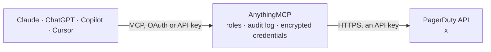

<!-- Generated by scripts/export-github-catalog.mjs in the anythingmcp-website repository. Do not edit by hand. -->

# PagerDuty MCP connector

Let your AI work with PagerDuty: see open incidents with their timeline, alerts and notes, find out who is on call, read services, escalation policies, schedules and teams, acknowledge, resolve, … The AnythingMCP connector gives Claude, ChatGPT, Microsoft Copilot, Cursor and Gemini 26 MCP tools for PagerDuty: 19 read and 7 can change data.

**Category:** [Monitoring](../monitoring.md) · **Tools:** 26 · **Setup guide:** [anythingmcp.com](https://anythingmcp.com/guides/pagerduty-to-mcp) · [Deutsch](https://anythingmcp.com/de/guides/pagerduty-to-mcp) · [Italiano](https://anythingmcp.com/it/guides/pagerduty-to-mcp) · [Español](https://anythingmcp.com/es/guides/pagerduty-to-mcp) · [日本語](https://anythingmcp.com/ja/guides/pagerduty-to-mcp) · [Русский](https://anythingmcp.com/ru/guides/pagerduty-to-mcp) · [中文](https://anythingmcp.com/zh/guides/pagerduty-to-mcp)

## Start without code

No installation and no terminal: AnythingMCP Cloud runs the PagerDuty connector for you, operated by helpcode.ai in Frankfurt, Germany.

1. **Click the button above** and create an account or sign in. The PagerDuty connector opens, ready to install.
2. **Paste the API key or token from your PagerDuty account.** Every click is in the [step-by-step guide](https://anythingmcp.com/guides/pagerduty-to-mcp).
3. **Click Install.** AnythingMCP shows the address of your MCP server.
4. **Add that address to your assistant:** [Claude](https://anythingmcp.com/guides/connect-pagerduty-to-claude) · [ChatGPT](https://anythingmcp.com/guides/connect-pagerduty-to-chatgpt) · [Microsoft Copilot](https://anythingmcp.com/guides/connect-pagerduty-to-copilot) · [Cursor](https://anythingmcp.com/guides/connect-pagerduty-to-cursor) · [Gemini CLI](https://anythingmcp.com/guides/connect-pagerduty-to-gemini) · [Meta Muse](https://anythingmcp.com/guides/connect-pagerduty-to-muse).
5. **Ask your first question**, for example: *Show the incident about invoice processing failures for PaymentsService with number 4821, I need full details.*

Prefer help with the setup? [Talk to us](https://anythingmcp.com/contact).

## How it works

- **The AI client** speaks MCP (Streamable HTTP) to AnythingMCP and only sees tool names, descriptions and results. It never gets the PagerDuty credentials.
- **AnythingMCP** checks the client's role, builds the call from the tool definition, adds the credentials (an API key), calls PagerDuty, logs the call and returns the result.
- **PagerDuty** sees an ordinary API client with the rights of the account the credentials belong to.

## Tools

| Tool | What it does | Access |
|---|---|---|
| [`pagerduty_get_current_user`](#pagerduty_get_current_user) | Read the PagerDuty user behind the API key: id, name, email, role, time zone and teams. | read |
| [`pagerduty_list_incidents`](#pagerduty_list_incidents) | List incidents, newest first by default: id, number, title, status, urgency, priority, service, escalation policy, who it is assigned to, teams, alert… | read |
| [`pagerduty_get_incident`](#pagerduty_get_incident) | Read one incident: number, title, status, urgency, priority, service, escalation policy, assignees, acknowledgements, teams, alert counts, resolve reason… | read |
| [`pagerduty_list_incident_notes`](#pagerduty_list_incident_notes) | List the notes on an incident, oldest first: id, text, who wrote it and when. | read |
| [`pagerduty_list_incident_log_entries`](#pagerduty_list_incident_log_entries) | Read the timeline of an incident: triggers, notifications, acknowledgements, escalations, reassignments, notes and resolution, each with type, summary, time… | read |
| [`pagerduty_list_incident_alerts`](#pagerduty_list_incident_alerts) | List the alerts grouped into an incident: id, summary, status, severity, alert key, service, created time and the event details the monitoring tool sent… | read |
| [`pagerduty_acknowledge_incident`](#pagerduty_acknowledge_incident) | Acknowledge an incident: it stops escalating and the responders are no longer paged for it, but it stays open. | write |
| [`pagerduty_resolve_incident`](#pagerduty_resolve_incident) | Resolve an incident: it is closed, its alerts are resolved and nobody is paged for it any more. | write |
| [`pagerduty_reassign_incident`](#pagerduty_reassign_incident) | Reassign an incident to one user: PagerDuty pages that user and removes the current assignees. | write |
| [`pagerduty_escalate_incident`](#pagerduty_escalate_incident) | Escalate an incident to a level of its escalation policy: PagerDuty pages the on-call responders of that level. | write |
| [`pagerduty_update_incident`](#pagerduty_update_incident) | Change an incident's title, urgency or priority. | write |
| [`pagerduty_add_incident_note`](#pagerduty_add_incident_note) | Add a note to an incident's timeline. | write |
| [`pagerduty_create_incident`](#pagerduty_create_incident) | Open a new incident on a service: PagerDuty pages the on-call responders of the service's escalation policy right away. | write |
| [`pagerduty_list_services`](#pagerduty_list_services) | List services (the things PagerDuty raises incidents for): id, name, description, status (active, warning, critical, maintenance, disabled), escalation… | read |
| [`pagerduty_get_service`](#pagerduty_get_service) | Read one service: name, description, status, escalation policy, teams, urgency rule, acknowledgement and auto-resolve timeouts, alert grouping and the… | read |
| [`pagerduty_list_escalation_policies`](#pagerduty_list_escalation_policies) | List escalation policies: id, name, description, how many times they repeat, the levels with their delay and targets (users or schedules), services and teams. | read |
| [`pagerduty_get_escalation_policy`](#pagerduty_get_escalation_policy) | Read one escalation policy: levels in order with their delay in minutes and targets (users and schedules), repeat count, services and teams. | read |
| [`pagerduty_list_oncalls`](#pagerduty_list_oncalls) | Who is on call: one entry per user, escalation policy and level, with the schedule behind it and the shift start and end. | read |
| [`pagerduty_list_schedules`](#pagerduty_list_schedules) | List on-call schedules: id, name, description, time zone, the users in them and the escalation policies that use them. | read |
| [`pagerduty_get_schedule`](#pagerduty_get_schedule) | Read one schedule with its final rotation for a time window: who is on call from when to when, after overrides. | read |
| [`pagerduty_list_users`](#pagerduty_list_users) | List users: id, name, email, role, job title, time zone and teams. | read |
| [`pagerduty_get_user`](#pagerduty_get_user) | Read one user: name, email, role, job title, time zone, teams and the type of each contact method (email, phone, push) without the addresses. | read |
| [`pagerduty_list_teams`](#pagerduty_list_teams) | List teams: id, name and description. | read |
| [`pagerduty_list_priorities`](#pagerduty_list_priorities) | List the incident priorities of the account in order (for example P1 to P5): id, name and description. | read |
| [`pagerduty_get_incident_analytics`](#pagerduty_get_incident_analytics) | Analytics per incident: seconds to first acknowledgement, to engage, to mobilise and to resolve, escalations, reassignments, interruptions (business, off… | read |
| [`pagerduty_get_incident_metrics`](#pagerduty_get_incident_metrics) | Aggregated incident metrics for a period: incident count, mean and percentile times to acknowledge and resolve, escalations, interruptions and uptime, for… | read |

## Tool reference

Every parameter as the AI client sees it in `tools/list`. Source: [`packages/backend/src/adapters/intl/pagerduty.json`](../../../packages/backend/src/adapters/intl/pagerduty.json).

### `pagerduty_get_current_user`

Read the PagerDuty user behind the API key: id, name, email, role, time zone and teams. Works only with a user token (Profile, User Settings, Create API User Token); a general access key from Integrations, API Access Keys has no user and PagerDuty answers 400. Read-only.

**Access:** read · **Call:** `GET /users/me`

No parameters.

### `pagerduty_list_incidents`

List incidents, newest first by default: id, number, title, status, urgency, priority, service, escalation policy, who it is assigned to, teams, alert counts and link. Without since and until PagerDuty returns the last 30 days; date_range all ignores the window. Filter by status (triggered, acknowledged, resolved), urgency, services, teams or assigned users. Read-only.

**Access:** read · **Call:** `GET /incidents`

| Parameter | Type | Required | Description |
|---|---|---|---|
| `statuses` | `triggered` \| `acknowledged` \| `resolved`[] | no | Only incidents with these statuses, e.g. ["triggered", "acknowledged"] for open incidents. |
| `urgencies` | `high` \| `low`[] | no | Only incidents with these urgencies. |
| `service_ids` | string[] | no | Only incidents of these service ids (from pagerduty_list_services). |
| `team_ids` | string[] | no | Only incidents of these team ids (from pagerduty_list_teams). Needs the teams ability on the account. |
| `user_ids` | string[] | no | Only incidents assigned to these user ids. |
| `since` | string | no | Start of the window, ISO 8601 such as 2026-10-01T00:00:00Z. |
| `until` | string | no | End of the window, ISO 8601. At most 6 months after since. |
| `date_range` | `all` | no | Set to all to ignore since and until and search every incident. |
| `incident_key` | string | no | Only the incident with this de-duplication key. |
| `sort_by` | string | no | Sort field and direction: created_at, resolved_at, incident_number or urgency, with :asc or :desc (default created_at:desc). |
| `time_zone` | string | no | Time zone for the dates in the answer, e.g. Europe/Berlin. Default UTC. |
| `total` | boolean | no | Also return the total count (slower). Default false. |
| `limit` | integer | no | Results per page (default 25, up to 100). |
| `offset` | integer | no | How many results to skip. While the answer says more: true, call again with offset + limit. |

### `pagerduty_get_incident`

Read one incident: number, title, status, urgency, priority, service, escalation policy, assignees, acknowledgements, teams, alert counts, resolve reason and link. Read-only.

**Access:** read · **Call:** `GET /incidents/{id}`

| Parameter | Type | Required | Description |
|---|---|---|---|
| `id` | string | yes | Incident id such as PT4KHLK (from pagerduty_list_incidents), not the incident number. |

### `pagerduty_list_incident_notes`

List the notes on an incident, oldest first: id, text, who wrote it and when. Read-only.

**Access:** read · **Call:** `GET /incidents/{id}/notes`

| Parameter | Type | Required | Description |
|---|---|---|---|
| `id` | string | yes | Incident id such as PT4KHLK (from pagerduty_list_incidents), not the incident number. |

### `pagerduty_list_incident_log_entries`

Read the timeline of an incident: triggers, notifications, acknowledgements, escalations, reassignments, notes and resolution, each with type, summary, time and who or what caused it. is_overview true (default) keeps only the important entries. Read-only.

**Access:** read · **Call:** `GET /incidents/{id}/log_entries`

| Parameter | Type | Required | Description |
|---|---|---|---|
| `id` | string | yes | Incident id such as PT4KHLK (from pagerduty_list_incidents), not the incident number. |
| `is_overview` | boolean | no | Only the most important entries (default true). false lists every notification too. |
| `since` | string | no | Only entries after this time, ISO 8601. |
| `until` | string | no | Only entries before this time, ISO 8601. |
| `time_zone` | string | no | Time zone for the dates, e.g. Europe/Berlin. |
| `limit` | integer | no | Results per page (default 25, up to 100). |
| `offset` | integer | no | How many results to skip. While the answer says more: true, call again with offset + limit. |

### `pagerduty_list_incident_alerts`

List the alerts grouped into an incident: id, summary, status, severity, alert key, service, created time and the event details the monitoring tool sent (shortened). Read-only.

**Access:** read · **Call:** `GET /incidents/{id}/alerts`

| Parameter | Type | Required | Description |
|---|---|---|---|
| `id` | string | yes | Incident id such as PT4KHLK (from pagerduty_list_incidents), not the incident number. |
| `statuses` | `triggered` \| `resolved`[] | no | Only alerts with these statuses. |
| `alert_key` | string | no | Only alerts with this de-duplication key. |
| `sort_by` | `created_at` \| `resolved_at` \| `created_at:asc` \| `created_at:desc` \| `resolved_at:asc` \| `resolved_at:desc` | no | Sort order, e.g. created_at:desc. |
| `limit` | integer | no | Results per page (default 10, up to 100). |
| `offset` | integer | no | How many results to skip. While the answer says more: true, call again with offset + limit. |

### `pagerduty_acknowledge_incident`

Acknowledge an incident: it stops escalating and the responders are no longer paged for it, but it stays open. Before calling, tell the user which incident (number and title) will be acknowledged and wait for their yes. PagerDuty records the change under the user behind the key, or under the email in PAGERDUTY_FROM_EMAIL when the key is a general access (account) key. Returns the updated incident.

**Access:** write · **Call:** `PUT /incidents/{id}`

| Parameter | Type | Required | Description |
|---|---|---|---|
| `id` | string | yes | Incident id such as PT4KHLK (from pagerduty_list_incidents), not the incident number. |

### `pagerduty_resolve_incident`

Resolve an incident: it is closed, its alerts are resolved and nobody is paged for it any more. Before calling, tell the user which incident (number and title) will be resolved and wait for their yes. PagerDuty records the change under the user behind the key, or under the email in PAGERDUTY_FROM_EMAIL when the key is a general access (account) key. Returns the updated incident.

**Access:** write · **Call:** `PUT /incidents/{id}`

| Parameter | Type | Required | Description |
|---|---|---|---|
| `id` | string | yes | Incident id such as PT4KHLK (from pagerduty_list_incidents), not the incident number. |
| `resolution` | string | no | Optional resolution note, added to the Resolve entry of the timeline. |

### `pagerduty_reassign_incident`

Reassign an incident to one user: PagerDuty pages that user and removes the current assignees. Before calling, tell the user the incident and the person it will go to and wait for their yes. PagerDuty records the change under the user behind the key, or under the email in PAGERDUTY_FROM_EMAIL when the key is a general access (account) key. Returns the updated incident.

**Access:** write · **Call:** `PUT /incidents/{id}`

| Parameter | Type | Required | Description |
|---|---|---|---|
| `id` | string | yes | Incident id such as PT4KHLK (from pagerduty_list_incidents), not the incident number. |
| `user_id` | string | yes | User id of the new assignee, from pagerduty_list_users or pagerduty_list_oncalls. |

### `pagerduty_escalate_incident`

Escalate an incident to a level of its escalation policy: PagerDuty pages the on-call responders of that level. Before calling, tell the user the incident and the level and wait for their yes. PagerDuty records the change under the user behind the key, or under the email in PAGERDUTY_FROM_EMAIL when the key is a general access (account) key. Returns the updated incident.

**Access:** write · **Call:** `PUT /incidents/{id}`

| Parameter | Type | Required | Description |
|---|---|---|---|
| `id` | string | yes | Incident id such as PT4KHLK (from pagerduty_list_incidents), not the incident number. |
| `escalation_level` | integer | yes | Escalation level to move to, from 1 (see pagerduty_get_escalation_policy for the levels). |

### `pagerduty_update_incident`

Change an incident's title, urgency or priority. Changing urgency can change who is paged and how. Before calling, show the user the new values and wait for their yes. PagerDuty records the change under the user behind the key, or under the email in PAGERDUTY_FROM_EMAIL when the key is a general access (account) key. Returns the updated incident.

**Access:** write · **Call:** `PUT /incidents/{id}`

| Parameter | Type | Required | Description |
|---|---|---|---|
| `id` | string | yes | Incident id such as PT4KHLK (from pagerduty_list_incidents), not the incident number. |
| `title` | string | no | New title. |
| `urgency` | `high` \| `low` | no | New urgency. |
| `priority` | string | no | Name of a priority as listed by pagerduty_list_priorities, e.g. P1. PagerDuty uses the highest priority with that name. |

### `pagerduty_add_incident_note`

Add a note to an incident's timeline. Everyone with access to the incident sees it, and notes cannot be edited later. Before calling, show the user the text and wait for their yes. PagerDuty records the change under the user behind the key, or under the email in PAGERDUTY_FROM_EMAIL when the key is a general access (account) key. Returns the note.

**Access:** write · **Call:** `POST /incidents/{id}/notes`

| Parameter | Type | Required | Description |
|---|---|---|---|
| `id` | string | yes | Incident id such as PT4KHLK (from pagerduty_list_incidents), not the incident number. |
| `content` | string | yes | Text of the note. |

### `pagerduty_create_incident`

Open a new incident on a service: PagerDuty pages the on-call responders of the service's escalation policy right away. Before calling, show the user the service, title, urgency and details and wait for their yes. PagerDuty records the change under the user behind the key, or under the email in PAGERDUTY_FROM_EMAIL when the key is a general access (account) key. Returns the new incident with its id and number.

**Access:** write · **Call:** `POST /incidents`

| Parameter | Type | Required | Description |
|---|---|---|---|
| `service_id` | string | yes | Service id from pagerduty_list_services. |
| `title` | string | yes | Short description of what is wrong. |
| `urgency` | `high` \| `low` | no | high pages immediately, low follows the service's low-urgency rules. Default: the service setting. |
| `details` | string | no | Longer description shown in the incident body. |
| `incident_key` | string | no | Optional de-duplication key: a second create with the same key on the same service is refused while the first incident is open. |

### `pagerduty_list_services`

List services (the things PagerDuty raises incidents for): id, name, description, status (active, warning, critical, maintenance, disabled), escalation policy, teams and the time of the last incident. Read-only.

**Access:** read · **Call:** `GET /services`

| Parameter | Type | Required | Description |
|---|---|---|---|
| `query` | string | no | Only services whose name contains this text. |
| `team_ids` | string[] | no | Only services of these team ids. |
| `sort_by` | `name` \| `name:asc` \| `name:desc` | no | Sort by name (default ascending). |
| `limit` | integer | no | Results per page (default 25, up to 100). |
| `offset` | integer | no | How many results to skip. While the answer says more: true, call again with offset + limit. |

### `pagerduty_get_service`

Read one service: name, description, status, escalation policy, teams, urgency rule, acknowledgement and auto-resolve timeouts, alert grouping and the integrations sending events to it (names only). Read-only.

**Access:** read · **Call:** `GET /services/{id}`

| Parameter | Type | Required | Description |
|---|---|---|---|
| `id` | string | yes | Service id from pagerduty_list_services. |

### `pagerduty_list_escalation_policies`

List escalation policies: id, name, description, how many times they repeat, the levels with their delay and targets (users or schedules), services and teams. Read-only.

**Access:** read · **Call:** `GET /escalation_policies`

| Parameter | Type | Required | Description |
|---|---|---|---|
| `query` | string | no | Only policies whose name contains this text. |
| `user_ids` | string[] | no | Only policies that contain these users. |
| `team_ids` | string[] | no | Only policies of these teams. |
| `limit` | integer | no | Results per page (default 25, up to 100). |
| `offset` | integer | no | How many results to skip. While the answer says more: true, call again with offset + limit. |

### `pagerduty_get_escalation_policy`

Read one escalation policy: levels in order with their delay in minutes and targets (users and schedules), repeat count, services and teams. Level numbers start at 1 and are what pagerduty_escalate_incident takes. Read-only.

**Access:** read · **Call:** `GET /escalation_policies/{id}`

| Parameter | Type | Required | Description |
|---|---|---|---|
| `id` | string | yes | Escalation policy id. |

### `pagerduty_list_oncalls`

Who is on call: one entry per user, escalation policy and level, with the schedule behind it and the shift start and end. Without since and until it answers who is on call right now. earliest true keeps only the next shift per user, policy and level. Read-only.

**Access:** read · **Call:** `GET /oncalls`

| Parameter | Type | Required | Description |
|---|---|---|---|
| `escalation_policy_ids` | string[] | no | Only these escalation policies. |
| `schedule_ids` | string[] | no | Only these schedules. |
| `user_ids` | string[] | no | Only these users. |
| `since` | string | no | Start of the window, ISO 8601. Omit for now. |
| `until` | string | no | End of the window, ISO 8601, at most 90 days after since. |
| `earliest` | boolean | no | Only the earliest on-call per user, policy and level, to find the next shift. |
| `time_zone` | string | no | Time zone for the dates, e.g. Europe/Berlin. |
| `limit` | integer | no | Results per page (default 25, up to 100). |
| `offset` | integer | no | How many results to skip. While the answer says more: true, call again with offset + limit. |

### `pagerduty_list_schedules`

List on-call schedules: id, name, description, time zone, the users in them and the escalation policies that use them. Read-only.

**Access:** read · **Call:** `GET /schedules`

| Parameter | Type | Required | Description |
|---|---|---|---|
| `query` | string | no | Only schedules whose name contains this text. |
| `limit` | integer | no | Results per page (default 25, up to 100). |
| `offset` | integer | no | How many results to skip. While the answer says more: true, call again with offset + limit. |

### `pagerduty_get_schedule`

Read one schedule with its final rotation for a time window: who is on call from when to when, after overrides. Pass since (until defaults to two weeks later) or until (since defaults to two weeks earlier); without either PagerDuty may return no shifts. Read-only.

**Access:** read · **Call:** `GET /schedules/{id}`

| Parameter | Type | Required | Description |
|---|---|---|---|
| `id` | string | yes | Schedule id from pagerduty_list_schedules. |
| `since` | string | no | Start of the window, ISO 8601 such as 2026-10-15T00:00:00Z. |
| `until` | string | no | End of the window, ISO 8601. |
| `time_zone` | string | no | Time zone for the shift times, e.g. Europe/Berlin. Default: the schedule's own. |

### `pagerduty_list_users`

List users: id, name, email, role, job title, time zone and teams. Use it to find the user id for pagerduty_reassign_incident. Read-only.

**Access:** read · **Call:** `GET /users`

| Parameter | Type | Required | Description |
|---|---|---|---|
| `query` | string | no | Only users whose name or email contains this text. |
| `team_ids` | string[] | no | Only members of these teams. |
| `limit` | integer | no | Results per page (default 25, up to 100). |
| `offset` | integer | no | How many results to skip. While the answer says more: true, call again with offset + limit. |

### `pagerduty_get_user`

Read one user: name, email, role, job title, time zone, teams and the type of each contact method (email, phone, push) without the addresses. Read-only.

**Access:** read · **Call:** `GET /users/{id}`

| Parameter | Type | Required | Description |
|---|---|---|---|
| `id` | string | yes | User id. |

### `pagerduty_list_teams`

List teams: id, name and description. Team ids filter incidents, services, escalation policies and users. Needs the teams feature on the account. Read-only.

**Access:** read · **Call:** `GET /teams`

| Parameter | Type | Required | Description |
|---|---|---|---|
| `query` | string | no | Only teams whose name contains this text. |
| `limit` | integer | no | Results per page (default 25, up to 100). |
| `offset` | integer | no | How many results to skip. While the answer says more: true, call again with offset + limit. |

### `pagerduty_list_priorities`

List the incident priorities of the account in order (for example P1 to P5): id, name and description. The name is what pagerduty_update_incident takes. Empty when priorities are switched off. Read-only.

**Access:** read · **Call:** `GET /priorities`

No parameters.

### `pagerduty_get_incident_analytics`

Analytics per incident: seconds to first acknowledgement, to engage, to mobilise and to resolve, escalations, reassignments, interruptions (business, off and sleep hours), responders, service, team and priority. Needs a plan with Analytics. Data lags real time by a few hours. Read-only (the API takes the filters in a POST body).

**Access:** read · **Call:** `POST /analytics/raw/incidents`

| Parameter | Type | Required | Description |
|---|---|---|---|
| `created_at_start` | string | no | Only incidents created at or after this time, ISO 8601 such as 2026-09-01T00:00:00Z. |
| `created_at_end` | string | no | Only incidents created before this time, ISO 8601. |
| `urgency` | `high` \| `low` | no | Only incidents with this urgency. |
| `major` | boolean | no | true for major incidents only (the two highest priorities), false to leave them out. |
| `service_ids` | string[] | no | Only these services. A user token needs service_ids or team_ids. |
| `team_ids` | string[] | no | Only these teams. A user token needs service_ids or team_ids. |
| `time_zone` | string | no | Time zone for the dates, e.g. Europe/Berlin. |
| `order` | `asc` \| `desc` | no | Sort direction (default desc). |
| `order_by` | `created_at` \| `seconds_to_resolve` | no | Sort field (default created_at). |
| `limit` | integer | no | Incidents per page (default 25, up to 1000). |
| `starting_after` | string | no | Cursor for the next page: the last value from the previous answer while more is true. |

### `pagerduty_get_incident_metrics`

Aggregated incident metrics for a period: incident count, mean and percentile times to acknowledge and resolve, escalations, interruptions and uptime, for the whole period or per day, week or month. Needs a plan with Analytics. Read-only (the API takes the filters in a POST body).

**Access:** read · **Call:** `POST /analytics/metrics/incidents/all`

| Parameter | Type | Required | Description |
|---|---|---|---|
| `created_at_start` | string | no | Only incidents created at or after this time, ISO 8601 such as 2026-09-01T00:00:00Z. |
| `created_at_end` | string | no | Only incidents created before this time, ISO 8601. |
| `urgency` | `high` \| `low` | no | Only incidents with this urgency. |
| `major` | boolean | no | true for major incidents only (the two highest priorities), false to leave them out. |
| `service_ids` | string[] | no | Only these services. A user token needs service_ids or team_ids. |
| `team_ids` | string[] | no | Only these teams. A user token needs service_ids or team_ids. |
| `time_zone` | string | no | Time zone for the dates, e.g. Europe/Berlin. |
| `aggregate_unit` | `day` \| `week` \| `month` | no | Split the period by day, week or month. Omit for one total. |

## Run it yourself

AnythingMCP is open source (AGPL-3.0). [Run it with Docker](../../../README.md#run-it-yourself), open **Connectors → Store**, pick **PagerDuty** and enter `PAGERDUTY_API_KEY`, `PAGERDUTY_API_HOST`, then add your MCP server URL to the AI client.

[← Monitoring connectors](../monitoring.md) · [All categories](../README.md)
