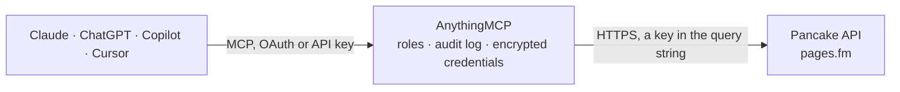

<!-- Generated by scripts/export-github-catalog.mjs in the anythingmcp-website repository. Do not edit by hand. -->

# Pancake MCP connector

Work your Pancake social-commerce inbox from your AI: list and read Facebook, Instagram, Zalo, WhatsApp and TikTok conversations of a page, tag and assign them, mark them read, look up customers, add … The AnythingMCP connector gives Claude, ChatGPT, Microsoft Copilot, Cursor and Gemini 18 MCP tools for Pancake: 10 read and 8 can change data.

**Category:** [Messaging](../messaging.md) · **Tools:** 18 · **Setup guide:** [anythingmcp.com](https://anythingmcp.com/guides/pancake-to-mcp) · [Deutsch](https://anythingmcp.com/de/guides/pancake-to-mcp) · [Italiano](https://anythingmcp.com/it/guides/pancake-to-mcp) · [Español](https://anythingmcp.com/es/guides/pancake-to-mcp) · [日本語](https://anythingmcp.com/ja/guides/pancake-to-mcp) · [Русский](https://anythingmcp.com/ru/guides/pancake-to-mcp) · [中文](https://anythingmcp.com/zh/guides/pancake-to-mcp)

## Start without code

No installation and no terminal: AnythingMCP Cloud runs the Pancake connector for you, operated by helpcode.ai in Frankfurt, Germany.

1. **Click the button above** and create an account or sign in. The Pancake connector opens, ready to install.
2. **Paste the API key or token from your Pancake account.** Every click is in the [step-by-step guide](https://anythingmcp.com/guides/pancake-to-mcp).
3. **Click Install.** AnythingMCP shows the address of your MCP server.
4. **Add that address to your assistant:** [Claude](https://anythingmcp.com/guides/connect-pancake-to-claude) · [ChatGPT](https://anythingmcp.com/guides/connect-pancake-to-chatgpt) · [Microsoft Copilot](https://anythingmcp.com/guides/connect-pancake-to-copilot) · [Cursor](https://anythingmcp.com/guides/connect-pancake-to-cursor) · [Gemini CLI](https://anythingmcp.com/guides/connect-pancake-to-gemini) · [Meta Muse](https://anythingmcp.com/guides/connect-pancake-to-muse).
5. **Ask your first question**, for example: *Show the Pancake conversation thread for customer Mai Tran about order ORD-2026-074, latest messages*

Prefer help with the setup? [Talk to us](https://anythingmcp.com/contact).

## How it works

- **The AI client** speaks MCP (Streamable HTTP) to AnythingMCP and only sees tool names, descriptions and results. It never gets the Pancake credentials.
- **AnythingMCP** checks the client's role, builds the call from the tool definition, adds the credentials (a key in the query string), calls Pancake, logs the call and returns the result.
- **Pancake** sees an ordinary API client with the rights of the account the credentials belong to.

## Tools

| Tool | What it does | Access |
|---|---|---|
| [`pancake_list_conversations`](#pancake_list_conversations) | List the page's conversations, 60 at a time, most recently updated first: id, channel type (INBOX, COMMENT, LIVESTREAM), snippet, seen, message count,… | read |
| [`pancake_get_messages`](#pancake_get_messages) | Read the messages of one conversation, 30 at a time, newest first: id, type, text, sender (customer or staff name), time, attachments and whether it was… | read |
| [`pancake_tag_conversation`](#pancake_tag_conversation) | Add a tag to a conversation or remove it, the way staff label threads in the Pancake inbox. | write |
| [`pancake_assign_conversation`](#pancake_assign_conversation) | Assign a conversation to one or more staff members, replacing the current assignment, so it shows in their Pancake inbox. | write |
| [`pancake_mark_conversation_read`](#pancake_mark_conversation_read) | Mark a conversation as read in the Pancake inbox, for example after the AI has handled it. | read |
| [`pancake_mark_conversation_unread`](#pancake_mark_conversation_unread) | Mark a conversation as unread in the Pancake inbox so staff pick it up again. | write |
| [`pancake_send_message`](#pancake_send_message) | Send a text message to the customer in an inbox conversation (Messenger, Instagram, Zalo, WhatsApp, TikTok and other channels of the page). | write |
| [`pancake_reply_comment`](#pancake_reply_comment) | Reply publicly under a customer's comment on one of the page's posts. | write |
| [`pancake_send_private_reply`](#pancake_send_private_reply) | Send a private message to the author of a comment (Facebook private reply), allowed up to 7 days after the comment. | write |
| [`pancake_list_tags`](#pancake_list_tags) | List the tags set up on the page: numeric id, text and colour. | read |
| [`pancake_list_staff`](#pancake_list_staff) | List the page's staff: id (UUID), name, availability status, whether they are online and their status on the page, plus the round-robin lists for inbox and… | read |
| [`pancake_list_customers`](#pancake_list_customers) | List the page's customers created or updated in a time window, newest first, page by page: id, name, page-scoped id (psid), gender, birthday, phone numbers,… | read |
| [`pancake_update_customer`](#pancake_update_customer) | Change a page customer's name, gender, birthday or phone numbers in Pancake. | write |
| [`pancake_add_customer_note`](#pancake_add_customer_note) | Add a text note to a page customer, visible to the page's staff in Pancake and not to the customer. | write |
| [`pancake_list_posts`](#pancake_list_posts) | List the page's posts published in a time window: id, type, text, time, comment count, phone numbers collected and likes. | read |
| [`pancake_page_statistics`](#pancake_page_statistics) | Page activity per hour in a time window: new customers, new inbox threads, customer and page inbox messages and comments, phone numbers collected and… | read |
| [`pancake_staff_statistics`](#pancake_staff_statistics) | Staff performance on the page in a date range: the page totals and the figures per staff member that Pancake's staff report shows (statistics and users). | read |
| [`pancake_tag_statistics`](#pancake_tag_statistics) | How often each tag was used on the page in a time window, as a series per tag, plus today's counts and the tag list (id and text) to read the series by. | read |

## Tool reference

Every parameter as the AI client sees it in `tools/list`. Source: [`packages/backend/src/adapters/intl/pancake.json`](../../../packages/backend/src/adapters/intl/pancake.json).

### `pancake_list_conversations`

List the page's conversations, 60 at a time, most recently updated first: id, channel type (INBOX, COMMENT, LIVESTREAM), snippet, seen, message count, customer (from), tag ids, assigned staff, last sender, phone numbers and times. The tag and assignment history and the messages themselves are left out: read a thread in full with pancake_get_messages. Filter by tags, type, time or unread first; page on with last_conversation_id. Read-only.

**Access:** read · **Call:** `GET /public_api/v2/pages/{{PANCAKE_PAGE_ID}}/conversations`

| Parameter | Type | Required | Description |
|---|---|---|---|
| `last_conversation_id` | string | no | For the next page: the id of the last conversation of the previous call. Leave empty for the newest 60. |
| `tags` | string | no | Only conversations with these tag ids, comma-separated (from pancake_list_tags), e.g. '3,7'. |
| `type` | `INBOX` \| `COMMENT` \| `COMMENT_LIVESTREAM` | no | Only one kind of conversation: INBOX (private messages), COMMENT (comments under posts) or COMMENT_LIVESTREAM. |
| `since` | integer | no | Only conversations active from this Unix time in seconds (UTC). |
| `until` | integer | no | Only conversations active up to this Unix time in seconds (UTC). |
| `unread_first` | boolean | no | true lists unread conversations first. |
| `order_by` | `updated_at` \| `inserted_at` | no | Sort by last activity (updated_at) or by creation (inserted_at). |

### `pancake_get_messages`

Read the messages of one conversation, 30 at a time, newest first: id, type, text, sender (customer or staff name), time, attachments and whether it was removed, plus the customer's name and recent phone numbers. Read-only.

**Access:** read · **Call:** `GET /public_api/v1/pages/{{PANCAKE_PAGE_ID}}/conversations/{conversation_id}/messages`

| Parameter | Type | Required | Description |
|---|---|---|---|
| `conversation_id` | string | yes | Conversation id from pancake_list_conversations. |
| `current_count` | integer | no | For older messages: how many you already have; the call returns the 30 messages before that position. |

### `pancake_tag_conversation`

Add a tag to a conversation or remove it, the way staff label threads in the Pancake inbox. Tags are internal: the customer does not see them. Take the tag id from pancake_list_tags.

**Access:** write · **Call:** `POST /public_api/v1/pages/{{PANCAKE_PAGE_ID}}/conversations/{conversation_id}/tags`

| Parameter | Type | Required | Description |
|---|---|---|---|
| `conversation_id` | string | yes | Conversation id from pancake_list_conversations. |
| `action` | `add` \| `remove` | yes | add puts the tag on the conversation, remove takes it off. |
| `tag_id` | string | yes | Tag id from pancake_list_tags, e.g. '3'. |

### `pancake_assign_conversation`

Assign a conversation to one or more staff members, replacing the current assignment, so it shows in their Pancake inbox. Take the staff ids from pancake_list_staff. Internal: the customer does not see it.

**Access:** write · **Call:** `POST /public_api/v1/pages/{{PANCAKE_PAGE_ID}}/conversations/{conversation_id}/assign`

| Parameter | Type | Required | Description |
|---|---|---|---|
| `conversation_id` | string | yes | Conversation id from pancake_list_conversations. |
| `assignee_ids` | string[] | yes | Staff user ids (UUIDs) from pancake_list_staff. |

### `pancake_mark_conversation_read`

Mark a conversation as read in the Pancake inbox, for example after the AI has handled it. Changes only the inbox state, not what the customer sees.

**Access:** read · **Call:** `POST /public_api/v1/pages/{{PANCAKE_PAGE_ID}}/conversations/{conversation_id}/read`

| Parameter | Type | Required | Description |
|---|---|---|---|
| `conversation_id` | string | yes | Conversation id from pancake_list_conversations. |

### `pancake_mark_conversation_unread`

Mark a conversation as unread in the Pancake inbox so staff pick it up again. Changes only the inbox state, not what the customer sees.

**Access:** write · **Call:** `POST /public_api/v1/pages/{{PANCAKE_PAGE_ID}}/conversations/{conversation_id}/unread`

| Parameter | Type | Required | Description |
|---|---|---|---|
| `conversation_id` | string | yes | Conversation id from pancake_list_conversations. |

### `pancake_send_message`

Send a text message to the customer in an inbox conversation (Messenger, Instagram, Zalo, WhatsApp, TikTok and other channels of the page). The customer receives it immediately: show the text and confirm with the user first. Channel rules apply, e.g. Facebook allows free replies only within 24 hours of the customer's last message. Installed switched off.

**Access:** write · **Call:** `POST /public_api/v1/pages/{{PANCAKE_PAGE_ID}}/conversations/{conversation_id}/messages`

| Parameter | Type | Required | Description |
|---|---|---|---|
| `conversation_id` | string | yes | Inbox conversation id from pancake_list_conversations (type INBOX). |
| `message` | string | yes | Text to send. |
| `reply_message_id` | string | no | Optional: id of a message (from pancake_get_messages) to quote as the one being answered. |
| `sender_id` | string | no | Optional: staff user id (from pancake_list_staff) to send as. Needs a Pancake plan and role that allow it. |

### `pancake_reply_comment`

Reply publicly under a customer's comment on one of the page's posts. Everyone who sees the post can read it: show the text and confirm with the user first. Installed switched off.

**Access:** write · **Call:** `POST /public_api/v1/pages/{{PANCAKE_PAGE_ID}}/conversations/{conversation_id}/messages`

| Parameter | Type | Required | Description |
|---|---|---|---|
| `conversation_id` | string | yes | Comment conversation id from pancake_list_conversations (type COMMENT). |
| `message_id` | string | yes | Id of the comment to reply to, from pancake_get_messages. |
| `message` | string | yes | Text of the public reply. |

### `pancake_send_private_reply`

Send a private message to the author of a comment (Facebook private reply), allowed up to 7 days after the comment. The customer receives it in Messenger: show the text and confirm with the user first. Installed switched off.

**Access:** write · **Call:** `POST /public_api/v1/pages/{{PANCAKE_PAGE_ID}}/conversations/{conversation_id}/messages`

| Parameter | Type | Required | Description |
|---|---|---|---|
| `conversation_id` | string | yes | Comment conversation id from pancake_list_conversations (type COMMENT). |
| `post_id` | string | yes | Id of the post the comment is on (postId in pancake_list_conversations). |
| `message_id` | string | yes | Id of the comment, from pancake_get_messages. |
| `from_id` | string | yes | Id of the comment's author (fromId of the comment in pancake_get_messages). |
| `message` | string | yes | Text of the private message. |

### `pancake_list_tags`

List the tags set up on the page: numeric id, text and colour. Use the id with pancake_tag_conversation or as a filter in pancake_list_conversations. Read-only.

**Access:** read · **Call:** `GET /public_api/v1/pages/{{PANCAKE_PAGE_ID}}/tags`

No parameters.

### `pancake_list_staff`

List the page's staff: id (UUID), name, availability status, whether they are online and their status on the page, plus the round-robin lists for inbox and comments. Use the ids with pancake_assign_conversation. Read-only.

**Access:** read · **Call:** `GET /public_api/v1/pages/{{PANCAKE_PAGE_ID}}/users`

No parameters.

### `pancake_list_customers`

List the page's customers created or updated in a time window, newest first, page by page: id, name, page-scoped id (psid), gender, birthday, phone numbers, emails, notes and times. since, until and page_number are required. Read-only.

**Access:** read · **Call:** `GET /public_api/v1/pages/{{PANCAKE_PAGE_ID}}/page_customers`

| Parameter | Type | Required | Description |
|---|---|---|---|
| `since` | integer | yes | Start of the window, Unix time in seconds (UTC). |
| `until` | integer | yes | End of the window, Unix time in seconds (UTC). |
| `page_number` | integer | no | Page of results, starting at 1. |
| `page_size` | integer | no | Customers per page, at most 100. |
| `order_by` | `inserted_at` \| `updated_at` | no | Sort by creation (inserted_at, the default) or last change (updated_at), newest first. |

### `pancake_update_customer`

Change a page customer's name, gender, birthday or phone numbers in Pancake. Only the fields you pass change; phone_numbers replaces the list. Tell the user what will change and confirm with the user first.

**Access:** write · **Call:** `PUT /public_api/v1/pages/{{PANCAKE_PAGE_ID}}/page_customers/{page_customer_id}`

| Parameter | Type | Required | Description |
|---|---|---|---|
| `page_customer_id` | string | yes | Customer id (id) from pancake_list_customers. |
| `name` | string | no | New name. |
| `gender` | `male` \| `female` \| `unknown` | no | New gender. |
| `birthday` | string | no | Birthday as YYYY-MM-DD. |
| `phone_numbers` | string[] | no | The complete new list of phone numbers. |

### `pancake_add_customer_note`

Add a text note to a page customer, visible to the page's staff in Pancake and not to the customer. Use it to record what was agreed or asked.

**Access:** write · **Call:** `POST /public_api/v1/pages/{{PANCAKE_PAGE_ID}}/page_customers/{page_customer_id}/notes`

| Parameter | Type | Required | Description |
|---|---|---|---|
| `page_customer_id` | string | yes | Customer id (id) from pancake_list_customers. |
| `message` | string | yes | Text of the note. |

### `pancake_list_posts`

List the page's posts published in a time window: id, type, text, time, comment count, phone numbers collected and likes. Use a post id to find its comment conversations. since and until are required. Read-only.

**Access:** read · **Call:** `GET /public_api/v1/pages/{{PANCAKE_PAGE_ID}}/posts`

| Parameter | Type | Required | Description |
|---|---|---|---|
| `since` | integer | yes | Start of the window, Unix time in seconds (UTC). |
| `until` | integer | yes | End of the window, Unix time in seconds (UTC). |
| `page_number` | integer | no | Page of results, starting at 1. |
| `page_size` | integer | no | Posts per page, at most 30. |
| `type` | `video` \| `photo` \| `text` \| `livestream` | no | Only posts of this type. |

### `pancake_page_statistics`

Page activity per hour in a time window: new customers, new inbox threads, customer and page inbox messages and comments, phone numbers collected and website referrals. Read-only.

**Access:** read · **Call:** `GET /public_api/v1/pages/{{PANCAKE_PAGE_ID}}/statistics/pages`

| Parameter | Type | Required | Description |
|---|---|---|---|
| `since` | integer | yes | Start, Unix time in seconds (UTC). |
| `until` | integer | yes | End, Unix time in seconds (UTC). |

### `pancake_staff_statistics`

Staff performance on the page in a date range: the page totals and the figures per staff member that Pancake's staff report shows (statistics and users). date_range is in the page's own time zone. Read-only.

**Access:** read · **Call:** `GET /public_api/v1/pages/{{PANCAKE_PAGE_ID}}/statistics/users`

| Parameter | Type | Required | Description |
|---|---|---|---|
| `date_range` | string | yes | 'DD/MM/YYYY HH:MM:SS - DD/MM/YYYY HH:MM:SS' in the page's time zone, e.g. '01/10/2026 00:00:00 - 07/10/2026 23:59:59'. |

### `pancake_tag_statistics`

How often each tag was used on the page in a time window, as a series per tag, plus today's counts and the tag list (id and text) to read the series by. Read-only.

**Access:** read · **Call:** `GET /public_api/v1/pages/{{PANCAKE_PAGE_ID}}/statistics/tags`

| Parameter | Type | Required | Description |
|---|---|---|---|
| `since` | integer | yes | Start, Unix time in seconds (UTC). |
| `until` | integer | yes | End, Unix time in seconds (UTC). |

## Run it yourself

AnythingMCP is open source (AGPL-3.0). [Run it with Docker](../../../README.md#run-it-yourself), open **Connectors → Store**, pick **Pancake** and enter `PANCAKE_PAGE_ID`, `PANCAKE_PAGE_ACCESS_TOKEN`, then add your MCP server URL to the AI client.

[← Messaging connectors](../messaging.md) · [All categories](../README.md)
