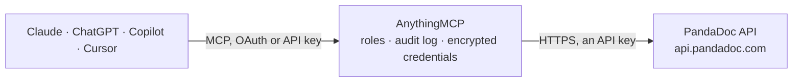

<!-- Generated by scripts/export-github-catalog.mjs in the anythingmcp-website repository. Do not edit by hand. -->

# PandaDoc MCP connector

Drive PandaDoc (proposals + e-signature) from any AI agent: documents, templates, contacts, recipients, sending for signature, status tracking. 10 tools, API-key auth. The AnythingMCP connector gives Claude, ChatGPT, Microsoft Copilot, Cursor and Gemini 10 MCP tools for PandaDoc: 7 read and 3 can change data.

**Category:** [E-Signature](../e-signature.md) · **Tools:** 10 · **Setup guide:** [anythingmcp.com](https://anythingmcp.com/guides/pandadoc-to-mcp) · [Deutsch](https://anythingmcp.com/de/guides/pandadoc-to-mcp) · [Italiano](https://anythingmcp.com/it/guides/pandadoc-to-mcp) · [Español](https://anythingmcp.com/es/guides/pandadoc-to-mcp) · [日本語](https://anythingmcp.com/ja/guides/pandadoc-to-mcp) · [Русский](https://anythingmcp.com/ru/guides/pandadoc-to-mcp) · [中文](https://anythingmcp.com/zh/guides/pandadoc-to-mcp)

## Start without code

No installation and no terminal: AnythingMCP Cloud runs the PandaDoc connector for you, operated by helpcode.ai in Frankfurt, Germany.

1. **Click the button above** and create an account or sign in. The PandaDoc connector opens, ready to install.
2. **Paste the API key or token from your PandaDoc account.** Every click is in the [step-by-step guide](https://anythingmcp.com/guides/pandadoc-to-mcp).
3. **Click Install.** AnythingMCP shows the address of your MCP server.
4. **Add that address to your assistant:** [Claude](https://anythingmcp.com/guides/connect-pandadoc-to-claude) · [ChatGPT](https://anythingmcp.com/guides/connect-pandadoc-to-chatgpt) · [Microsoft Copilot](https://anythingmcp.com/guides/connect-pandadoc-to-copilot) · [Cursor](https://anythingmcp.com/guides/connect-pandadoc-to-cursor) · [Gemini CLI](https://anythingmcp.com/guides/connect-pandadoc-to-gemini) · [Meta Muse](https://anythingmcp.com/guides/connect-pandadoc-to-muse).
5. **Ask your first question**, for example: *Show me the invoice INV-2026-114 we sent to Solstice Marine GmbH and whether it's signed*

Prefer help with the setup? [Talk to us](https://anythingmcp.com/contact).

## How it works

- **The AI client** speaks MCP (Streamable HTTP) to AnythingMCP and only sees tool names, descriptions and results. It never gets the PandaDoc credentials.
- **AnythingMCP** checks the client's role, builds the call from the tool definition, adds the credentials (an API key), calls PandaDoc, logs the call and returns the result.
- **PandaDoc** sees an ordinary API client with the rights of the account the credentials belong to.

## Tools

| Tool | What it does | Access |
|---|---|---|
| [`pandadoc_list_documents`](#pandadoc_list_documents) | List documents in the workspace, with filters. | read |
| [`pandadoc_create_document`](#pandadoc_create_document) | Create a document from a template. | write |
| [`pandadoc_get_document_status`](#pandadoc_get_document_status) | Quick status check for a document. | read |
| [`pandadoc_get_document_details`](#pandadoc_get_document_details) | Fetch document full details — recipients with signing status, tokens, fields, pricing data, attachments. | read |
| [`pandadoc_send_document`](#pandadoc_send_document) | Send the document for signing/review. | write |
| [`pandadoc_download_document`](#pandadoc_download_document) | Download the finalized PDF of a document. | read |
| [`pandadoc_delete_document`](#pandadoc_delete_document) | Delete (move to trash) a document. | write |
| [`pandadoc_list_templates`](#pandadoc_list_templates) | List templates available in the workspace. | read |
| [`pandadoc_get_template_details`](#pandadoc_get_template_details) | Fetch a template's full structure: roles[], tokens[], fields[], pricing_tables, content. | read |
| [`pandadoc_list_contacts`](#pandadoc_list_contacts) | List contacts in the workspace (saved recipients). | read |

## Tool reference

Every parameter as the AI client sees it in `tools/list`. Source: [`packages/backend/src/adapters/intl/pandadoc.json`](../../../packages/backend/src/adapters/intl/pandadoc.json).

### `pandadoc_list_documents`

List documents in the workspace, with filters.

**Access:** read · **Call:** `GET /documents`

| Parameter | Type | Required | Description |
|---|---|---|---|
| `page` | integer | no | Page (1-based). |
| `count` | integer | no | Per page (max 100). |
| `q` | string | no | Substring search on document name. |
| `status` | integer | no | Filter by numeric status: 0=draft, 1=sent, 2=completed, 3=viewed, 4=waiting_approval, 5=approved, 6=rejected, 7=expired, 8=declined, 9=voided, 11=waiting_pay, 12=paid, 13=external_review. |
| `tag` | string | no | Filter by tag. |
| `folder_uuid` | string | no | Filter by folder. |
| `template_id` | string | no | Only docs created from this template. |
| `completed_from` | string | no | ISO 8601 date. |
| `completed_to` | string | no | ISO 8601. |
| `created_from` | string | no | ISO 8601. |
| `created_to` | string | no | ISO 8601. |
| `modified_from` | string | no | ISO 8601. |
| `modified_to` | string | no | ISO 8601. |
| `order_by` | string | no | name, date_created, date_modified. Prefix with - for desc. |

### `pandadoc_create_document`

Create a document from a template. Required: name + template_uuid + recipients (with email + first_name + last_name + role). Tokens fill template placeholders. Pricing tables for line-item docs.

**Access:** write · **Call:** `POST /documents`

| Parameter | Type | Required | Description |
|---|---|---|---|
| `name` | string | yes | Document name. |
| `template_uuid` | string | yes | Template UUID to instantiate. |
| `recipients` | any[] | yes | [{email, first_name, last_name, role:'Client'\|'Vendor'\|..., signing_order?:N}]. role matches a template role. |
| `tokens` | any[] | no | [{name:'Client.Company', value:'ACME'}] — replaces {{Client.Company}} in template content. |
| `fields` | object | no | {field_name:{value, role?}} — fills form fields in template. |
| `pricing_tables` | any[] | no | Pricing tables data (template-defined). |
| `metadata` | object | no | Free-form metadata (string K/V). |
| `tags` | any[] | no | Tag strings. |
| `folder_uuid` | string | no | Put in folder. |

### `pandadoc_get_document_status`

Quick status check for a document. Returns id, status, expiration_date.

**Access:** read · **Call:** `GET /documents/{documentId}`

| Parameter | Type | Required | Description |
|---|---|---|---|
| `documentId` | string | yes | Document UUID. |

### `pandadoc_get_document_details`

Fetch document full details — recipients with signing status, tokens, fields, pricing data, attachments.

**Access:** read · **Call:** `GET /documents/{documentId}/details`

| Parameter | Type | Required | Description |
|---|---|---|---|
| `documentId` | string | yes | Document UUID. |

### `pandadoc_send_document`

Send the document for signing/review. Required: documentId. Optional: subject + message (the email content recipients receive).

**Access:** write · **Call:** `POST /documents/{documentId}/send`

| Parameter | Type | Required | Description |
|---|---|---|---|
| `documentId` | string | yes | Document UUID. |
| `subject` | string | no | Email subject. |
| `message` | string | no | Email body. |
| `silent` | boolean | no | If true, skip recipient notification emails (you handle communication yourself). |

### `pandadoc_download_document`

Download the finalized PDF of a document. Returns binary PDF (the engine returns it as the response body — handle it as a file).

**Access:** read · **Call:** `GET /documents/{documentId}/download`

| Parameter | Type | Required | Description |
|---|---|---|---|
| `documentId` | string | yes | Document UUID. |
| `watermark_text` | string | no | Optional watermark. |
| `watermark_color` | string | no | Hex color for watermark. |
| `watermark_font_size` | integer | no | Watermark font size. |
| `watermark_opacity` | number | no | 0.0-1.0. |

### `pandadoc_delete_document`

Delete (move to trash) a document.

**Access:** write · **Call:** `DELETE /documents/{documentId}`

| Parameter | Type | Required | Description |
|---|---|---|---|
| `documentId` | string | yes | Document UUID. |

### `pandadoc_list_templates`

List templates available in the workspace. Required to know which template_uuid to pass to create_document.

**Access:** read · **Call:** `GET /templates`

| Parameter | Type | Required | Description |
|---|---|---|---|
| `page` | integer | no | Page. |
| `count` | integer | no | Per page. |
| `q` | string | no | Name substring. |
| `tag` | string | no | Tag filter. |
| `folder_uuid` | string | no | Folder filter. |

### `pandadoc_get_template_details`

Fetch a template's full structure: roles[], tokens[], fields[], pricing_tables, content. Required to know what tokens/fields to fill when creating a document.

**Access:** read · **Call:** `GET /templates/{templateId}/details`

| Parameter | Type | Required | Description |
|---|---|---|---|
| `templateId` | string | yes | Template UUID. |

### `pandadoc_list_contacts`

List contacts in the workspace (saved recipients).

**Access:** read · **Call:** `GET /contacts`

| Parameter | Type | Required | Description |
|---|---|---|---|
| `email` | string | no | Filter by exact email. |

## Run it yourself

AnythingMCP is open source (AGPL-3.0). [Run it with Docker](../../../README.md#run-it-yourself), open **Connectors → Store**, pick **PandaDoc** and enter `PANDADOC_API_KEY`, then add your MCP server URL to the AI client.

[← E-Signature connectors](../e-signature.md) · [All categories](../README.md)
