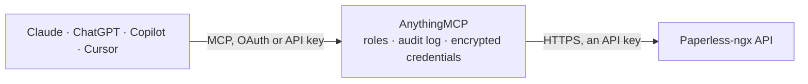

<!-- Generated by scripts/export-github-catalog.mjs in the anythingmcp-website repository. Do not edit by hand. -->

# Paperless-ngx MCP connector

Paperless-ngx document management: full-text search over scanned documents, correspondents, document types, tags, storage paths and the OCR'd content of any document. The AnythingMCP connector gives Claude, ChatGPT, Microsoft Copilot, Cursor and Gemini 9 MCP tools for Paperless-ngx, all read-only.

**Category:** [Document Management](../dms.md) · **Tools:** 9 · **Setup guide:** [anythingmcp.com](https://anythingmcp.com/guides/paperless-ngx-to-mcp) · [Deutsch](https://anythingmcp.com/de/guides/paperless-ngx-to-mcp) · [Italiano](https://anythingmcp.com/it/guides/paperless-ngx-to-mcp) · [Español](https://anythingmcp.com/es/guides/paperless-ngx-to-mcp) · [日本語](https://anythingmcp.com/ja/guides/paperless-ngx-to-mcp) · [Русский](https://anythingmcp.com/ru/guides/paperless-ngx-to-mcp) · [中文](https://anythingmcp.com/zh/guides/paperless-ngx-to-mcp)

## Start without code

No installation and no terminal: AnythingMCP Cloud runs the Paperless-ngx connector for you, operated by helpcode.ai in Frankfurt, Germany.

1. **Click the button above** and create an account or sign in. The Paperless-ngx connector opens, ready to install.
2. **Paste the API key or token from your Paperless-ngx account.** Every click is in the [step-by-step guide](https://anythingmcp.com/guides/paperless-ngx-to-mcp).
3. **Click Install.** AnythingMCP shows the address of your MCP server.
4. **Add that address to your assistant:** [Claude](https://anythingmcp.com/guides/connect-paperless-ngx-to-claude) · [ChatGPT](https://anythingmcp.com/guides/connect-paperless-ngx-to-chatgpt) · [Microsoft Copilot](https://anythingmcp.com/guides/connect-paperless-ngx-to-copilot) · [Cursor](https://anythingmcp.com/guides/connect-paperless-ngx-to-cursor) · [Gemini CLI](https://anythingmcp.com/guides/connect-paperless-ngx-to-gemini) · [Meta Muse](https://anythingmcp.com/guides/connect-paperless-ngx-to-muse).
5. **Ask your first question**, for example: *Find the invoice from MöbelWerk GmbH with invoice number INV-2026-089 dated 2026-07-12*

Prefer help with the setup? [Talk to us](https://anythingmcp.com/contact).

## How it works

- **The AI client** speaks MCP (Streamable HTTP) to AnythingMCP and only sees tool names, descriptions and results. It never gets the Paperless-ngx credentials.
- **AnythingMCP** checks the client's role, builds the call from the tool definition, adds the credentials (an API key), calls Paperless-ngx, logs the call and returns the result.
- **Paperless-ngx** sees an ordinary API client with the rights of the account the credentials belong to.

## Tools

| Tool | What it does | Access |
|---|---|---|
| [`paperless_ngx_search_documents`](#paperless_ngx_search_documents) | Full-text search across the OCR'd content of every document. | read |
| [`paperless_ngx_list_documents`](#paperless_ngx_list_documents) | List documents filtered by correspondent, document type, tag or creation date — the structured alternative to full-text search when you already have the ids. | read |
| [`paperless_ngx_get_document`](#paperless_ngx_get_document) | Read one document's metadata: title, correspondent, type, tags, created and added dates, archive serial number and the full OCR'd content. | read |
| [`paperless_ngx_get_document_metadata`](#paperless_ngx_get_document_metadata) | Read the technical metadata of one document: original filename, media type, checksum, page count and any embedded PDF metadata. | read |
| [`paperless_ngx_list_correspondents`](#paperless_ngx_list_correspondents) | List correspondents — the senders documents are filed under — with their document count and matching rules. | read |
| [`paperless_ngx_list_document_types`](#paperless_ngx_list_document_types) | List the document types configured in the instance (invoice, contract, payslip …) with their document counts. | read |
| [`paperless_ngx_list_tags`](#paperless_ngx_list_tags) | List tags with their colour, inbox flag and document count. | read |
| [`paperless_ngx_list_storage_paths`](#paperless_ngx_list_storage_paths) | List the storage paths documents are filed into, with their path template and document count. | read |
| [`paperless_ngx_get_statistics`](#paperless_ngx_get_statistics) | Read instance-wide statistics: total documents, documents in the inbox, character count and the breakdown by file type. | read |

## Tool reference

Every parameter as the AI client sees it in `tools/list`. Source: [`packages/backend/src/adapters/de/paperless-ngx.json`](../../../packages/backend/src/adapters/de/paperless-ngx.json).

### `paperless_ngx_search_documents`

Full-text search across the OCR'd content of every document. Supports field terms (correspondent:acme, type:invoice), quoted phrases, wildcards and date ranges.

**Access:** read · **Call:** `GET /documents/`

| Parameter | Type | Required | Description |
|---|---|---|---|
| `query` | string | yes | Full-text query, e.g. `Mahnung correspondent:Telekom` or `"Rechnung 2026"`. |
| `page` | number | no | Page number, starting at 1. |
| `page_size` | number | no | Rows per page (default 25). |

### `paperless_ngx_list_documents`

List documents filtered by correspondent, document type, tag or creation date — the structured alternative to full-text search when you already have the ids.

**Access:** read · **Call:** `GET /documents/`

| Parameter | Type | Required | Description |
|---|---|---|---|
| `correspondent__id` | number | no | Restrict to one correspondent id. |
| `document_type__id` | number | no | Restrict to one document type id. |
| `tags__id__all` | string | no | Comma-separated tag ids that must ALL be present. |
| `created__date__gte` | string | no | Earliest creation date, YYYY-MM-DD. |
| `created__date__lte` | string | no | Latest creation date, YYYY-MM-DD. |
| `ordering` | string | no | Sort field, e.g. `-created` for newest first. |
| `page` | number | no | Page number, starting at 1. |
| `page_size` | number | no | Rows per page (default 25). |

### `paperless_ngx_get_document`

Read one document's metadata: title, correspondent, type, tags, created and added dates, archive serial number and the full OCR'd content.

**Access:** read · **Call:** `GET /documents/{id}/`

| Parameter | Type | Required | Description |
|---|---|---|---|
| `id` | number | yes | Numeric document id. |

### `paperless_ngx_get_document_metadata`

Read the technical metadata of one document: original filename, media type, checksum, page count and any embedded PDF metadata.

**Access:** read · **Call:** `GET /documents/{id}/metadata/`

| Parameter | Type | Required | Description |
|---|---|---|---|
| `id` | number | yes | Numeric document id. |

### `paperless_ngx_list_correspondents`

List correspondents — the senders documents are filed under — with their document count and matching rules.

**Access:** read · **Call:** `GET /correspondents/`

| Parameter | Type | Required | Description |
|---|---|---|---|
| `name__icontains` | string | no | Case-insensitive name fragment to filter by. |
| `page` | number | no | Page number, starting at 1. |
| `page_size` | number | no | Rows per page. |

### `paperless_ngx_list_document_types`

List the document types configured in the instance (invoice, contract, payslip …) with their document counts.

**Access:** read · **Call:** `GET /document_types/`

| Parameter | Type | Required | Description |
|---|---|---|---|
| `name__icontains` | string | no | Case-insensitive name fragment to filter by. |
| `page` | number | no | Page number, starting at 1. |

### `paperless_ngx_list_tags`

List tags with their colour, inbox flag and document count. No parameters needed — the quickest check that URL and token are right.

**Access:** read · **Call:** `GET /tags/`

| Parameter | Type | Required | Description |
|---|---|---|---|
| `page` | number | no | Page number, starting at 1. |

### `paperless_ngx_list_storage_paths`

List the storage paths documents are filed into, with their path template and document count.

**Access:** read · **Call:** `GET /storage_paths/`

| Parameter | Type | Required | Description |
|---|---|---|---|
| `page` | number | no | Page number, starting at 1. |

### `paperless_ngx_get_statistics`

Read instance-wide statistics: total documents, documents in the inbox, character count and the breakdown by file type.

**Access:** read · **Call:** `GET /statistics/`

No parameters.

## Run it yourself

AnythingMCP is open source (AGPL-3.0). [Run it with Docker](../../../README.md#run-it-yourself), open **Connectors → Store**, pick **Paperless-ngx** and enter `PAPERLESS_URL`, `PAPERLESS_API_TOKEN`, then add your MCP server URL to the AI client.

[← Document Management connectors](../dms.md) · [All categories](../README.md)
