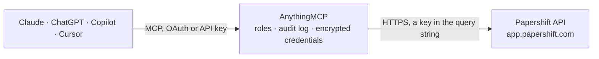

<!-- Generated by scripts/export-github-catalog.mjs in the anythingmcp-website repository. Do not edit by hand. -->

# Papershift MCP connector

Papershift workforce management: shift plans, working sessions, absences, employees and locations. The AnythingMCP connector gives Claude, ChatGPT, Microsoft Copilot, Cursor and Gemini 7 MCP tools for Papershift, all read-only.

**Category:** [HR](../hr.md) · **Tools:** 7 · **Setup guide:** [anythingmcp.com](https://anythingmcp.com/guides/papershift-to-mcp) · [Deutsch](https://anythingmcp.com/de/guides/papershift-to-mcp) · [Italiano](https://anythingmcp.com/it/guides/papershift-to-mcp) · [Español](https://anythingmcp.com/es/guides/papershift-to-mcp) · [日本語](https://anythingmcp.com/ja/guides/papershift-to-mcp) · [Русский](https://anythingmcp.com/ru/guides/papershift-to-mcp) · [中文](https://anythingmcp.com/zh/guides/papershift-to-mcp)

## Start without code

No installation and no terminal: AnythingMCP Cloud runs the Papershift connector for you, operated by helpcode.ai in Frankfurt, Germany.

1. **Click the button above** and create an account or sign in. The Papershift connector opens, ready to install.
2. **Paste the API key or token from your Papershift account.** Every click is in the [step-by-step guide](https://anythingmcp.com/guides/papershift-to-mcp).
3. **Click Install.** AnythingMCP shows the address of your MCP server.
4. **Add that address to your assistant:** [Claude](https://anythingmcp.com/guides/connect-papershift-to-claude) · [ChatGPT](https://anythingmcp.com/guides/connect-papershift-to-chatgpt) · [Microsoft Copilot](https://anythingmcp.com/guides/connect-papershift-to-copilot) · [Cursor](https://anythingmcp.com/guides/connect-papershift-to-cursor) · [Gemini CLI](https://anythingmcp.com/guides/connect-papershift-to-gemini) · [Meta Muse](https://anythingmcp.com/guides/connect-papershift-to-muse).
5. **Ask your first question**, for example: *Show contact and employment details for employee with staff number 2047, Lina Hoffmann*

Prefer help with the setup? [Talk to us](https://anythingmcp.com/contact).

## How it works

- **The AI client** speaks MCP (Streamable HTTP) to AnythingMCP and only sees tool names, descriptions and results. It never gets the Papershift credentials.
- **AnythingMCP** checks the client's role, builds the call from the tool definition, adds the credentials (a key in the query string), calls Papershift, logs the call and returns the result.
- **Papershift** sees an ordinary API client with the rights of the account the credentials belong to.

## Tools

| Tool | What it does | Access |
|---|---|---|
| [`papershift_list_users`](#papershift_list_users) | List employees (25 per page) with their name, e-mail, staff number and the locations and working areas they belong to. | read |
| [`papershift_get_user`](#papershift_get_user) | Read one employee by id: contact details, employment data, assigned locations and tags. | read |
| [`papershift_list_locations`](#papershift_list_locations) | List all locations (Standorte) of the account with their id, name, external id and status. | read |
| [`papershift_list_shifts`](#papershift_list_shifts) | Read the *planned* roster of one location in a date range: which shifts exist in which working area, when, and for how many employees. | read |
| [`papershift_list_working_sessions`](#papershift_list_working_sessions) | Read *actually worked* time in a date range — clock-in and clock-out, breaks and the resulting duration. | read |
| [`papershift_list_absences`](#papershift_list_absences) | Read absences (holiday, sickness, special leave) in a date range with their type and approval state, to explain gaps in the roster. | read |
| [`papershift_list_working_areas`](#papershift_list_working_areas) | List all working areas (Arbeitsbereiche) with their location — the roles a shift can be planned for, such as bar, kitchen or till. | read |

## Tool reference

Every parameter as the AI client sees it in `tools/list`. Source: [`packages/backend/src/adapters/de/papershift.json`](../../../packages/backend/src/adapters/de/papershift.json).

### `papershift_list_users`

List employees (25 per page) with their name, e-mail, staff number and the locations and working areas they belong to. No parameters needed — the quickest check that the token is accepted.

**Access:** read · **Call:** `GET /users`

| Parameter | Type | Required | Description |
|---|---|---|---|
| `page` | number | no | Page number, starting at 1 (25 rows per page, fixed). |
| `location_ids` | string | no | Only users in these locations: comma-separated location ids. |
| `working_area_ids` | string | no | Only users in these working areas: comma-separated working area ids. |

### `papershift_get_user`

Read one employee by id: contact details, employment data, assigned locations and tags.

**Access:** read · **Call:** `GET /users`

| Parameter | Type | Required | Description |
|---|---|---|---|
| `id` | string | yes | Papershift user id. |

### `papershift_list_locations`

List all locations (Standorte) of the account with their id, name, external id and status. Unpaged. Shifts need one of these ids.

**Access:** read · **Call:** `GET /locations`

No parameters.

### `papershift_list_shifts`

Read the *planned* roster of one location in a date range: which shifts exist in which working area, when, and for how many employees. This is the plan, not what was actually worked. Needs a location_id from papershift_list_locations.

**Access:** read · **Call:** `GET /shifts`

| Parameter | Type | Required | Description |
|---|---|---|---|
| `range_start` | string | yes | First day of the range, YYYY-MM-DD. |
| `range_end` | string | yes | Last day of the range, YYYY-MM-DD. |
| `location_id` | string | yes | Location id (required by Papershift); get it from papershift_list_locations. |
| `working_area_id` | string | no | Restrict to one working area. |
| `page` | number | no | Page number, starting at 1 (25 rows per page, fixed). |

### `papershift_list_working_sessions`

Read *actually worked* time in a date range — clock-in and clock-out, breaks and the resulting duration. This is what payroll is based on.

**Access:** read · **Call:** `GET /working_sessions`

| Parameter | Type | Required | Description |
|---|---|---|---|
| `range_start` | string | yes | First day of the range, YYYY-MM-DD. |
| `range_end` | string | yes | Last day of the range, YYYY-MM-DD. |
| `user_id` | string | no | Restrict to one employee. |
| `page` | number | no | Page number, starting at 1 (25 rows per page, fixed). |

### `papershift_list_absences`

Read absences (holiday, sickness, special leave) in a date range with their type and approval state, to explain gaps in the roster.

**Access:** read · **Call:** `GET /absences`

| Parameter | Type | Required | Description |
|---|---|---|---|
| `range_start` | string | yes | First day of the range, YYYY-MM-DD. |
| `range_end` | string | yes | Last day of the range, YYYY-MM-DD. |
| `user_id` | string | no | Restrict to one employee. |
| `location_id` | string | no | Restrict to one location. |
| `page` | number | no | Page number, starting at 1 (25 rows per page, fixed). |

### `papershift_list_working_areas`

List all working areas (Arbeitsbereiche) with their location — the roles a shift can be planned for, such as bar, kitchen or till. Unpaged.

**Access:** read · **Call:** `GET /working_areas`

| Parameter | Type | Required | Description |
|---|---|---|---|
| `location_id` | string | no | Restrict to one location. |

## Run it yourself

AnythingMCP is open source (AGPL-3.0). [Run it with Docker](../../../README.md#run-it-yourself), open **Connectors → Store**, pick **Papershift** and enter `PAPERSHIFT_API_TOKEN`, then add your MCP server URL to the AI client.

[← HR connectors](../hr.md) · [All categories](../README.md)
