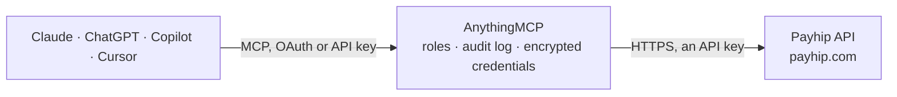

<!-- Generated by scripts/export-github-catalog.mjs in the anythingmcp-website repository. Do not edit by hand. -->

# Payhip MCP connector

Manage your Payhip store's coupon codes and check software license keys from an AI agent: list and read coupons, create new ones with your approval, verify a buyer's license key and, when you allow … The AnythingMCP connector gives Claude, ChatGPT, Microsoft Copilot, Cursor and Gemini 8 MCP tools for Payhip: 3 read and 5 can change data.

**Category:** [E-commerce](../e-commerce.md) · **Tools:** 8 · **Setup guide:** [anythingmcp.com](https://anythingmcp.com/guides/payhip-to-mcp) · [Deutsch](https://anythingmcp.com/de/guides/payhip-to-mcp) · [Italiano](https://anythingmcp.com/it/guides/payhip-to-mcp) · [Español](https://anythingmcp.com/es/guides/payhip-to-mcp) · [日本語](https://anythingmcp.com/ja/guides/payhip-to-mcp) · [Русский](https://anythingmcp.com/ru/guides/payhip-to-mcp) · [中文](https://anythingmcp.com/zh/guides/payhip-to-mcp)

## Start without code

No installation and no terminal: AnythingMCP Cloud runs the Payhip connector for you, operated by helpcode.ai in Frankfurt, Germany.

1. **Click the button above** and create an account or sign in. The Payhip connector opens, ready to install.
2. **Paste the API key or token from your Payhip account.** Every click is in the [step-by-step guide](https://anythingmcp.com/guides/payhip-to-mcp).
3. **Click Install.** AnythingMCP shows the address of your MCP server.
4. **Add that address to your assistant:** [Claude](https://anythingmcp.com/guides/connect-payhip-to-claude) · [ChatGPT](https://anythingmcp.com/guides/connect-payhip-to-chatgpt) · [Microsoft Copilot](https://anythingmcp.com/guides/connect-payhip-to-copilot) · [Cursor](https://anythingmcp.com/guides/connect-payhip-to-cursor) · [Gemini CLI](https://anythingmcp.com/guides/connect-payhip-to-gemini) · [Meta Muse](https://anythingmcp.com/guides/connect-payhip-to-muse).
5. **Ask your first question**, for example: *Show details for coupon id 2147 — I need code, percent/amount, dates, usage limit and notes.*

Prefer help with the setup? [Talk to us](https://anythingmcp.com/contact).

## How it works

- **The AI client** speaks MCP (Streamable HTTP) to AnythingMCP and only sees tool names, descriptions and results. It never gets the Payhip credentials.
- **AnythingMCP** checks the client's role, builds the call from the tool definition, adds the credentials (an API key), calls Payhip, logs the call and returns the result.
- **Payhip** sees an ordinary API client with the rights of the account the credentials belong to.

## Tools

| Tool | What it does | Access |
|---|---|---|
| [`payhip_list_coupons`](#payhip_list_coupons) | List the store's coupon codes with their type (single product, all products or one collection), percent or amount off (amounts in cents), start and end… | read |
| [`payhip_get_coupon`](#payhip_get_coupon) | Read one coupon by its numeric id: code, type, percent or amount off (cents), product key or collection, dates, minimum purchase, usage limit and notes. | read |
| [`payhip_create_coupon`](#payhip_create_coupon) | Create a coupon code buyers can enter at checkout: either percent_off (above 0, up to 100) or amount_off in cents, for one product (coupon_type single with… | write |
| [`payhip_verify_license`](#payhip_verify_license) | Check a software license key of the product whose secret key is configured: whether it is enabled (keys are disabled automatically on a refund), the buyer's… | read |
| [`payhip_disable_license`](#payhip_disable_license) | Disable a license key so it no longer verifies, e.g. after a terms violation or a chargeback. | write |
| [`payhip_enable_license`](#payhip_enable_license) | Enable a disabled license key again so it verifies. | write |
| [`payhip_increase_license_usage`](#payhip_increase_license_usage) | Add one to the usage counter of a license key, e.g. when the buyer activates another device. | write |
| [`payhip_decrease_license_usage`](#payhip_decrease_license_usage) | Subtract one from the usage counter of a license key, e.g. when the buyer deactivates a device. | write |

## Tool reference

Every parameter as the AI client sees it in `tools/list`. Source: [`packages/backend/src/adapters/intl/payhip.json`](../../../packages/backend/src/adapters/intl/payhip.json).

### `payhip_list_coupons`

List the store's coupon codes with their type (single product, all products or one collection), percent or amount off (amounts in cents), start and end dates, usage limit and notes. Pages with limit (1 to 100) and offset.

**Access:** read · **Call:** `GET /coupons`

| Parameter | Type | Required | Description |
|---|---|---|---|
| `limit` | integer | no | Coupons per page, 1 to 100. |
| `offset` | integer | no | Coupons to skip, for paging. |

### `payhip_get_coupon`

Read one coupon by its numeric id: code, type, percent or amount off (cents), product key or collection, dates, minimum purchase, usage limit and notes.

**Access:** read · **Call:** `GET /coupons/{id}`

| Parameter | Type | Required | Description |
|---|---|---|---|
| `id` | integer | yes | Coupon id from payhip_list_coupons. |

### `payhip_create_coupon`

Create a coupon code buyers can enter at checkout: either percent_off (above 0, up to 100) or amount_off in cents, for one product (coupon_type single with product_key), all products (multi) or one collection (collection with collection_id). Subscription products cannot get coupons through the API. It is usable as soon as it exists, so confirm the code, the discount and the scope with the user first. Installed switched off.

**Access:** write · **Call:** `POST /coupons`

| Parameter | Type | Required | Description |
|---|---|---|---|
| `code` | string | yes | The code buyers type, e.g. AUTUMN20. |
| `coupon_type` | `single` \| `multi` \| `collection` | yes | single (one product), multi (all products) or collection. |
| `percent_off` | number | no | Percent discount, above 0 and up to 100. Use this or amount_off. |
| `amount_off` | integer | no | Fixed discount in cents, e.g. 500 for 5.00. Use this or percent_off. |
| `product_key` | string | no | Product key (the code in the product's Payhip link) when coupon_type is single. |
| `collection_id` | string | no | Collection id when coupon_type is collection. |
| `usage_limit` | integer | no | How many times the coupon can be used in total. |
| `notes` | string | no | Internal note, not shown to buyers. |

### `payhip_verify_license`

Check a software license key of the product whose secret key is configured: whether it is enabled (keys are disabled automatically on a refund), the buyer's email, the product and variant, how often it has been used and when it was issued. An empty answer means the key does not exist for this product. Needs PAYHIP_PRODUCT_SECRET_KEY.

**Access:** read · **Call:** `GET /license/verify`

| Parameter | Type | Required | Description |
|---|---|---|---|
| `license_key` | string | yes | The license key as the buyer has it, e.g. 9Q2KX-ZP7RM-4HVN8-T6WJC. |

### `payhip_disable_license`

Disable a license key so it no longer verifies, e.g. after a terms violation or a chargeback. The buyer loses access until it is enabled again; confirm with the user first. Needs PAYHIP_PRODUCT_SECRET_KEY. Installed switched off.

**Access:** write · **Call:** `PUT /license/disable`

| Parameter | Type | Required | Description |
|---|---|---|---|
| `license_key` | string | yes | The license key as the buyer has it, e.g. 9Q2KX-ZP7RM-4HVN8-T6WJC. |

### `payhip_enable_license`

Enable a disabled license key again so it verifies. Needs PAYHIP_PRODUCT_SECRET_KEY. Installed switched off.

**Access:** write · **Call:** `PUT /license/enable`

| Parameter | Type | Required | Description |
|---|---|---|---|
| `license_key` | string | yes | The license key as the buyer has it, e.g. 9Q2KX-ZP7RM-4HVN8-T6WJC. |

### `payhip_increase_license_usage`

Add one to the usage counter of a license key, e.g. when the buyer activates another device. Needs PAYHIP_PRODUCT_SECRET_KEY. Installed switched off.

**Access:** write · **Call:** `PUT /license/usage`

| Parameter | Type | Required | Description |
|---|---|---|---|
| `license_key` | string | yes | The license key as the buyer has it, e.g. 9Q2KX-ZP7RM-4HVN8-T6WJC. |

### `payhip_decrease_license_usage`

Subtract one from the usage counter of a license key, e.g. when the buyer deactivates a device. Needs PAYHIP_PRODUCT_SECRET_KEY. Installed switched off.

**Access:** write · **Call:** `PUT /license/decrease`

| Parameter | Type | Required | Description |
|---|---|---|---|
| `license_key` | string | yes | The license key as the buyer has it, e.g. 9Q2KX-ZP7RM-4HVN8-T6WJC. |

## Run it yourself

AnythingMCP is open source (AGPL-3.0). [Run it with Docker](../../../README.md#run-it-yourself), open **Connectors → Store**, pick **Payhip** and enter `PAYHIP_API_KEY`, then add your MCP server URL to the AI client.

[← E-commerce connectors](../e-commerce.md) · [All categories](../README.md)
