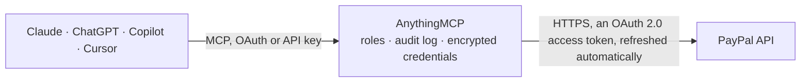

<!-- Generated by scripts/export-github-catalog.mjs in the anythingmcp-website repository. Do not edit by hand. -->

# PayPal MCP connector

Let your AI work with your PayPal business account: create and capture orders, refund payments, create, send and chase invoices, search the transaction history and balances, review disputes, and look … The AnythingMCP connector gives Claude, ChatGPT, Microsoft Copilot, Cursor and Gemini 28 MCP tools for PayPal: 19 read and 9 can change data.

**Category:** [Payments](../payments.md) · **Tools:** 28 · **Setup guide:** [anythingmcp.com](https://anythingmcp.com/guides/paypal-to-mcp) · [Deutsch](https://anythingmcp.com/de/guides/paypal-to-mcp) · [Italiano](https://anythingmcp.com/it/guides/paypal-to-mcp) · [Español](https://anythingmcp.com/es/guides/paypal-to-mcp) · [日本語](https://anythingmcp.com/ja/guides/paypal-to-mcp) · [Русский](https://anythingmcp.com/ru/guides/paypal-to-mcp) · [中文](https://anythingmcp.com/zh/guides/paypal-to-mcp)

## Start without code

No installation and no terminal: AnythingMCP Cloud runs the PayPal connector for you, operated by helpcode.ai in Frankfurt, Germany.

1. **Click the button above** and create an account or sign in. The PayPal connector opens, ready to install.
2. **Sign in with your PayPal account** when AnythingMCP asks. The first time, an admin creates a small app in the PayPal developer console. Every click is in the [step-by-step guide](https://anythingmcp.com/guides/paypal-to-mcp).
3. **Click Install.** AnythingMCP shows the address of your MCP server.
4. **Add that address to your assistant:** [Claude](https://anythingmcp.com/guides/connect-paypal-to-claude) · [ChatGPT](https://anythingmcp.com/guides/connect-paypal-to-chatgpt) · [Microsoft Copilot](https://anythingmcp.com/guides/connect-paypal-to-copilot) · [Cursor](https://anythingmcp.com/guides/connect-paypal-to-cursor) · [Gemini CLI](https://anythingmcp.com/guides/connect-paypal-to-gemini) · [Meta Muse](https://anythingmcp.com/guides/connect-paypal-to-muse).
5. **Ask your first question**, for example: *What's the status and due amount for invoice INV2-2026-045 to Solarkraft GmbH?*

Prefer help with the setup? [Talk to us](https://anythingmcp.com/contact).

## How it works

- **The AI client** speaks MCP (Streamable HTTP) to AnythingMCP and only sees tool names, descriptions and results. It never gets the PayPal credentials.
- **AnythingMCP** checks the client's role, builds the call from the tool definition, adds the credentials (an OAuth 2.0 access token, refreshed automatically), calls PayPal, logs the call and returns the result.
- **PayPal** sees an ordinary API client with the rights of the account the credentials belong to.

## Tools

| Tool | What it does | Access |
|---|---|---|
| [`paypal_create_order`](#paypal_create_order) | Create a checkout order (nothing is charged yet). | write |
| [`paypal_get_order`](#paypal_get_order) | Read one checkout order: status (CREATED, APPROVED, COMPLETED, VOIDED, ...), amounts, payer, and for completed orders the captures under… | read |
| [`paypal_capture_order`](#paypal_capture_order) | Collect the money of an order the buyer has approved (intent CAPTURE). | write |
| [`paypal_get_capture`](#paypal_get_capture) | Read one captured payment: amount, status (COMPLETED, PENDING, PARTIALLY_REFUNDED, REFUNDED, DECLINED), seller fees and net amount, and links to its order… | read |
| [`paypal_refund_capture`](#paypal_refund_capture) | Refund a captured payment, in full (no amount) or in part. | write |
| [`paypal_get_refund`](#paypal_get_refund) | Read one refund: amount, status (COMPLETED, PENDING, FAILED, CANCELLED), note to the payer and the capture it belongs to. | read |
| [`paypal_get_authorization`](#paypal_get_authorization) | Read one authorized payment (an order created with intent AUTHORIZE): amount, status (CREATED, CAPTURED, PARTIALLY_CAPTURED, VOIDED, DENIED, PENDING) and… | read |
| [`paypal_list_invoices`](#paypal_list_invoices) | List invoices, newest first, with id, number, status, recipient, amount and due date. | read |
| [`paypal_search_invoices`](#paypal_search_invoices) | Search invoices by recipient, number, status, currency, dates or amount (all filters combined with AND). | read |
| [`paypal_create_draft_invoice`](#paypal_create_draft_invoice) | Create a draft invoice. | write |
| [`paypal_get_invoice`](#paypal_get_invoice) | Read one invoice: status, recipient, items, amounts, due amount, payments and refunds recorded on it, and the payer link (links[] rel "payer-view"). | read |
| [`paypal_send_invoice`](#paypal_send_invoice) | Send a draft invoice. | write |
| [`paypal_remind_invoice`](#paypal_remind_invoice) | Email a payment reminder for a sent, unpaid invoice (PayPal allows 2 reminders a day). | write |
| [`paypal_cancel_invoice`](#paypal_cancel_invoice) | Cancel a sent invoice so it can no longer be paid; by default the recipient is told by email. | write |
| [`paypal_delete_draft_invoice`](#paypal_delete_draft_invoice) | Delete a draft or scheduled invoice for good (sent invoices are cancelled with paypal_cancel_invoice instead). | write |
| [`paypal_search_transactions`](#paypal_search_transactions) | Search the account history (Transaction Search): payments received and sent, refunds, fees, transfers and their payer and cart details. | read |
| [`paypal_get_balances`](#paypal_get_balances) | Read the account balances per currency (available, withheld and total), now or as of a past time: balances[] with as_of_time. | read |
| [`paypal_list_disputes`](#paypal_list_disputes) | List disputes, claims and chargebacks raised against the account (last 180 days), with dispute_id, reason, status, dispute_state, amount and dates. | read |
| [`paypal_get_dispute`](#paypal_get_dispute) | Read one dispute in full: reason, status, amounts, disputed transactions, messages, offers, evidence and the deadline to respond (seller_response_due_date). | read |
| [`paypal_list_products`](#paypal_list_products) | List catalog products (the products subscription plans belong to): id, name, description, type and dates. | read |
| [`paypal_get_product`](#paypal_get_product) | Read one catalog product: name, description, type (PHYSICAL, DIGITAL, SERVICE), category, image and home URLs. | read |
| [`paypal_list_plans`](#paypal_list_plans) | List subscription plans, optionally for one product: id, name, status (CREATED, ACTIVE, INACTIVE), product_id and dates. | read |
| [`paypal_get_plan`](#paypal_get_plan) | Read one subscription plan: billing cycles with prices and frequency, trial periods, setup fee, taxes and payment failure settings. | read |
| [`paypal_list_subscriptions`](#paypal_list_subscriptions) | List subscriptions, filtered by plan and status: id, status, plan_id, subscriber, start time and next billing time. | read |
| [`paypal_get_subscription`](#paypal_get_subscription) | Read one subscription: status, plan, subscriber (name, email, shipping address), billing info (outstanding balance, last payment, next billing time, failed… | read |
| [`paypal_list_subscription_transactions`](#paypal_list_subscription_transactions) | List the payments of one subscription between two times: id, status, amounts with fees and net, payer and time. | read |
| [`paypal_cancel_subscription`](#paypal_cancel_subscription) | Cancel a subscription for good: no further payments are collected and it cannot be reactivated. | write |
| [`paypal_get_payout_batch`](#paypal_get_payout_batch) | Read one payout batch: batch status and totals, and its items (receiver, amount, status, fees, errors). | read |

## Tool reference

Every parameter as the AI client sees it in `tools/list`. Source: [`packages/backend/src/adapters/intl/paypal.json`](../../../packages/backend/src/adapters/intl/paypal.json).

### `paypal_create_order`

Create a checkout order (nothing is charged yet). Returns the order id, status CREATED or PAYER_ACTION_REQUIRED, and links: the buyer must open the "approve" or "payer-action" link and approve before paypal_capture_order can collect the money.

**Access:** write · **Call:** `POST /v2/checkout/orders`

| Parameter | Type | Required | Description |
|---|---|---|---|
| `intent` | `CAPTURE` \| `AUTHORIZE` | no | CAPTURE to collect the money right after approval, AUTHORIZE to only hold it. |
| `purchase_units` | object[] | yes | 1 to 10 purchase units. Minimal: [{"amount": {"currency_code": "EUR", "value": "19.99"}, "description": "Order 1042"}]. Optional per unit: reference_id, invoice_id, custom_id, items (each name, quantity as string, unit_amount; then amount.breakdown.item_total is required), shipping. |
| `payment_source` | object | no | Optional payer experience, e.g. {"paypal": {"experience_context": {"return_url": "https://shop.example/ok", "cancel_url": "https://shop.example/cancel", "user_action": "PAY_NOW", "shipping_preference": "NO_SHIPPING"}}}. |
| `request_id` | string | no | Optional idempotency key (PayPal-Request-Id), for example a UUID. Retrying with the same key returns the first result instead of acting twice. |

### `paypal_get_order`

Read one checkout order: status (CREATED, APPROVED, COMPLETED, VOIDED, ...), amounts, payer, and for completed orders the captures under purchase_units[].payments.captures[].

**Access:** read · **Call:** `GET /v2/checkout/orders/{order_id}`

| Parameter | Type | Required | Description |
|---|---|---|---|
| `order_id` | string | yes | The order id, e.g. "5O190127TN364715T". |

### `paypal_capture_order`

Collect the money of an order the buyer has approved (intent CAPTURE). This charges the buyer: confirm the order id, amount and currency with the user first. Fails with 422 ORDER_NOT_APPROVED if the buyer has not approved yet. Returns the completed order with the capture id under purchase_units[].payments.captures[].id.

**Access:** write · **Call:** `POST /v2/checkout/orders/{order_id}/capture`

| Parameter | Type | Required | Description |
|---|---|---|---|
| `order_id` | string | yes | The approved order id. |
| `request_id` | string | no | Optional idempotency key (PayPal-Request-Id), for example a UUID. Retrying with the same key returns the first result instead of acting twice. |

### `paypal_get_capture`

Read one captured payment: amount, status (COMPLETED, PENDING, PARTIALLY_REFUNDED, REFUNDED, DECLINED), seller fees and net amount, and links to its order and refunds.

**Access:** read · **Call:** `GET /v2/payments/captures/{capture_id}`

| Parameter | Type | Required | Description |
|---|---|---|---|
| `capture_id` | string | yes | The capture id (a transaction id), e.g. "2GG279541U471931P". |

### `paypal_refund_capture`

Refund a captured payment, in full (no amount) or in part. This sends money back to the buyer and cannot be undone: confirm the capture id, amount and currency with the user first. Returns the refund id and status (COMPLETED or PENDING).

**Access:** write · **Call:** `POST /v2/payments/captures/{capture_id}/refund`

| Parameter | Type | Required | Description |
|---|---|---|---|
| `capture_id` | string | yes | The capture id to refund. |
| `amount` | object | no | For a partial refund, e.g. {"currency_code": "EUR", "value": "5.00"}. Leave out to refund what remains of the capture. |
| `note_to_payer` | string | no | Reason shown to the buyer, up to 255 characters. |
| `invoice_id` | string | no | Your own invoice or reference number for this refund, up to 127 characters. |
| `request_id` | string | no | Optional idempotency key (PayPal-Request-Id), for example a UUID. Retrying with the same key returns the first result instead of acting twice. |

### `paypal_get_refund`

Read one refund: amount, status (COMPLETED, PENDING, FAILED, CANCELLED), note to the payer and the capture it belongs to.

**Access:** read · **Call:** `GET /v2/payments/refunds/{refund_id}`

| Parameter | Type | Required | Description |
|---|---|---|---|
| `refund_id` | string | yes | The refund id. |

### `paypal_get_authorization`

Read one authorized payment (an order created with intent AUTHORIZE): amount, status (CREATED, CAPTURED, PARTIALLY_CAPTURED, VOIDED, DENIED, PENDING) and expiry.

**Access:** read · **Call:** `GET /v2/payments/authorizations/{authorization_id}`

| Parameter | Type | Required | Description |
|---|---|---|---|
| `authorization_id` | string | yes | The authorization id. |

### `paypal_list_invoices`

List invoices, newest first, with id, number, status, recipient, amount and due date. Returns items, plus total_items and total_pages when total_required is true. For filters (status, recipient, dates, amount) use paypal_search_invoices.

**Access:** read · **Call:** `GET /v2/invoicing/invoices`

| Parameter | Type | Required | Description |
|---|---|---|---|
| `page` | integer | no | Page number, starting at 1. |
| `page_size` | integer | no | Invoices per page, 1 to 100 (default 20). |
| `total_required` | boolean | no | true to also return total_items and total_pages. |
| `fields` | string | no | Comma-separated extra fields to include, e.g. "items,payments". |

### `paypal_search_invoices`

Search invoices by recipient, number, status, currency, dates or amount (all filters combined with AND). Read-only, although it is a POST. Returns items with total_items and total_pages.

**Access:** read · **Call:** `POST /v2/invoicing/search-invoices`

| Parameter | Type | Required | Description |
|---|---|---|---|
| `recipient_email` | string | no | Recipient email address. |
| `recipient_business_name` | string | no | Recipient business name. |
| `invoice_number` | string | no | Exact invoice number. |
| `status` | string[] | no | Up to 5 statuses, e.g. ["SENT", "UNPAID", "PARTIALLY_PAID"]. Others: DRAFT, SCHEDULED, PAID, MARKED_AS_PAID, CANCELLED, REFUNDED, PARTIALLY_REFUNDED, PAYMENT_PENDING. |
| `reference` | string | no | The invoice reference field. |
| `currency_code` | string | no | Three-letter currency code, e.g. "EUR". |
| `invoice_date_range` | object | no | Invoice date range, e.g. {"start": "2026-09-01", "end": "2026-09-30"}. |
| `due_date_range` | object | no | Due date range, e.g. {"start": "2026-10-01", "end": "2026-10-31"}. |
| `creation_date_range` | object | no | Creation time range in RFC 3339, both bounds required, e.g. {"start": "2026-09-01T00:00:00Z", "end": "2026-09-30T23:59:59Z"}. |
| `total_amount_range` | object | no | Amount range, both bounds required, e.g. {"lower_amount": {"currency_code": "EUR", "value": "100.00"}, "upper_amount": {"currency_code": "EUR", "value": "500.00"}}. |
| `archived` | boolean | no | true for archived invoices only, false for not archived. |
| `page` | integer | no | Page number, starting at 1. |
| `page_size` | integer | no | Invoices per page, 1 to 100 (default 20). |

### `paypal_create_draft_invoice`

Create a draft invoice. Nothing is emailed: send it with paypal_send_invoice. Returns the full invoice with its id (INV2-...), number and status DRAFT.

**Access:** write · **Call:** `POST /v2/invoicing/invoices`

| Parameter | Type | Required | Description |
|---|---|---|---|
| `detail` | object | yes | Invoice header. currency_code is required, e.g. {"currency_code": "EUR", "invoice_date": "2026-10-10", "payment_term": {"term_type": "NET_30"}, "note": "Thank you", "reference": "PO-77"}. Add "invoice_number" to set one yourself (unique, up to 25 characters); otherwise PayPal numbers it. |
| `primary_recipients` | object[] | no | The customer, e.g. [{"billing_info": {"name": {"given_name": "Ana", "surname": "Diaz"}, "email_address": "ana@example.com"}}]. Without an email address PayPal cannot email the invoice. |
| `items` | object[] | yes | Line items, each with name, quantity (string) and unit_amount, e.g. [{"name": "Consulting", "quantity": "2", "unit_amount": {"currency_code": "EUR", "value": "150.00"}, "tax": {"name": "VAT", "percent": "19"}}]. |
| `invoicer` | object | no | Optional seller details, e.g. {"email_address": "billing@yourshop.example", "business_name": "Your Shop"}. The email must belong to the PayPal account; the primary one is used if omitted. |
| `configuration` | object | no | Optional settings, e.g. {"allow_tip": false, "partial_payment": {"allow_partial_payment": true}}. |

### `paypal_get_invoice`

Read one invoice: status, recipient, items, amounts, due amount, payments and refunds recorded on it, and the payer link (links[] rel "payer-view").

**Access:** read · **Call:** `GET /v2/invoicing/invoices/{invoice_id}`

| Parameter | Type | Required | Description |
|---|---|---|---|
| `invoice_id` | string | yes | The invoice id, e.g. "INV2-Z56S-5LLA-Q52L-CPZ5". |

### `paypal_send_invoice`

Send a draft invoice. By default PayPal emails it to the recipient: confirm with the user first. With send_to_recipient false the invoice becomes payable through its link without an email. Returns a link to the payer view, or 202 when the send is scheduled for a future invoice date.

**Access:** write · **Call:** `POST /v2/invoicing/invoices/{invoice_id}/send`

| Parameter | Type | Required | Description |
|---|---|---|---|
| `invoice_id` | string | yes | The draft invoice id. |
| `send_to_recipient` | boolean | no | Email the invoice to the recipient (default true). |
| `send_to_invoicer` | boolean | no | Also email a copy to the seller (default false). |
| `additional_recipients` | string[] | no | Extra email addresses to copy, e.g. ["accounts@example.com"]. |

### `paypal_remind_invoice`

Email a payment reminder for a sent, unpaid invoice (PayPal allows 2 reminders a day). Confirm with the user first. Returns no content on success.

**Access:** write · **Call:** `POST /v2/invoicing/invoices/{invoice_id}/remind`

| Parameter | Type | Required | Description |
|---|---|---|---|
| `invoice_id` | string | yes | The sent invoice id. |
| `send_to_recipient` | boolean | no | Email the reminder to the recipient (default true). |
| `send_to_invoicer` | boolean | no | Also email a copy to the seller (default false). |
| `additional_recipients` | string[] | no | Extra email addresses to copy. |

### `paypal_cancel_invoice`

Cancel a sent invoice so it can no longer be paid; by default the recipient is told by email. Drafts cannot be cancelled (they are deleted instead). This cannot be undone: confirm with the user first. Returns no content on success.

**Access:** write · **Call:** `POST /v2/invoicing/invoices/{invoice_id}/cancel`

| Parameter | Type | Required | Description |
|---|---|---|---|
| `invoice_id` | string | yes | The sent invoice id. |
| `send_to_recipient` | boolean | no | Email the cancellation to the recipient (default true). |
| `send_to_invoicer` | boolean | no | Also email a copy to the seller (default false). |

### `paypal_delete_draft_invoice`

Delete a draft or scheduled invoice for good (sent invoices are cancelled with paypal_cancel_invoice instead). Confirm with the user first. Returns no content on success.

**Access:** write · **Call:** `DELETE /v2/invoicing/invoices/{invoice_id}`

| Parameter | Type | Required | Description |
|---|---|---|---|
| `invoice_id` | string | yes | The draft invoice id. |

### `paypal_search_transactions`

Search the account history (Transaction Search): payments received and sent, refunds, fees, transfers and their payer and cart details. At most 31 days per call; data can lag up to 3 hours. Returns transaction_details[] with total_items and total_pages; when nothing matches, PayPal leaves transaction_details out and total_items is 0. Needs Transaction Search enabled on the app.

**Access:** read · **Call:** `GET /v1/reporting/transactions`

| Parameter | Type | Required | Description |
|---|---|---|---|
| `start_date` | string | yes | Start, RFC 3339 with seconds, e.g. "2026-09-01T00:00:00Z" or "2026-09-01T00:00:00+02:00". |
| `end_date` | string | yes | End, same format, at most 31 days after start_date. |
| `transaction_id` | string | no | Only this transaction id (17 to 19 characters). |
| `transaction_type` | string | no | PayPal event code, e.g. "T0006" (checkout payment), "T1107" (refund), "T0400" (withdrawal). |
| `transaction_status` | `D` \| `P` \| `S` \| `V` | no | D denied, P pending, S success, V reversed. |
| `transaction_amount` | string | no | Amount range in minor units, e.g. "[500 TO 1005]" for 5.00 to 10.05. |
| `transaction_currency` | string | no | Three-letter currency code. |
| `balance_affecting_records_only` | `Y` \| `N` | no | Y (default) for rows that change the balance only, N for all rows. |
| `fields` | string | no | Which details to include: "all" (default here) or a comma list of transaction_info, payer_info, shipping_info, cart_info, incentive_info, store_info, auction_info. |
| `page_size` | integer | no | Rows per page, 1 to 500 (default 100). |
| `page` | integer | no | Page number, starting at 1. |

### `paypal_get_balances`

Read the account balances per currency (available, withheld and total), now or as of a past time: balances[] with as_of_time. An account that has never held money gets no balances key at all. Refreshed with up to 3 hours delay. Needs Transaction Search enabled on the app.

**Access:** read · **Call:** `GET /v1/reporting/balances`

| Parameter | Type | Required | Description |
|---|---|---|---|
| `as_of_time` | string | no | Optional point in time, RFC 3339, e.g. "2026-09-30T23:59:59Z". |
| `currency_code` | string | no | Only this currency, e.g. "EUR". |

### `paypal_list_disputes`

List disputes, claims and chargebacks raised against the account (last 180 days), with dispute_id, reason, status, dispute_state, amount and dates.

**Access:** read · **Call:** `GET /v1/customer/disputes`

| Parameter | Type | Required | Description |
|---|---|---|---|
| `dispute_state` | string | no | Comma-separated: OPEN_INQUIRIES, REQUIRED_ACTION, REQUIRED_OTHER_PARTY_ACTION, UNDER_PAYPAL_REVIEW, APPEALABLE, RESOLVED. |
| `disputed_transaction_id` | string | no | Only disputes about this transaction id. |
| `create_time_after` | string | no | Created after, RFC 3339. |
| `create_time_before` | string | no | Created before, RFC 3339. |
| `update_time_after` | string | no | Updated after, RFC 3339. |
| `update_time_before` | string | no | Updated before, RFC 3339. |
| `page_size` | integer | no | Disputes per page, 1 to 50 (default 10). |
| `page` | integer | no | Page number, 1 to 50. |

### `paypal_get_dispute`

Read one dispute in full: reason, status, amounts, disputed transactions, messages, offers, evidence and the deadline to respond (seller_response_due_date).

**Access:** read · **Call:** `GET /v1/customer/disputes/{dispute_id}`

| Parameter | Type | Required | Description |
|---|---|---|---|
| `dispute_id` | string | yes | The dispute id, e.g. "PP-D-27803". |

### `paypal_list_products`

List catalog products (the products subscription plans belong to): id, name, description, type and dates.

**Access:** read · **Call:** `GET /v1/catalogs/products`

| Parameter | Type | Required | Description |
|---|---|---|---|
| `page_size` | integer | no | Products per page, 1 to 20 (default 10). |
| `page` | integer | no | Page number, starting at 1. |
| `total_required` | boolean | no | true to also return total_items and total_pages. |

### `paypal_get_product`

Read one catalog product: name, description, type (PHYSICAL, DIGITAL, SERVICE), category, image and home URLs.

**Access:** read · **Call:** `GET /v1/catalogs/products/{product_id}`

| Parameter | Type | Required | Description |
|---|---|---|---|
| `product_id` | string | yes | The product id, e.g. "PROD-XYAB12ABSB7868434". |

### `paypal_list_plans`

List subscription plans, optionally for one product: id, name, status (CREATED, ACTIVE, INACTIVE), product_id and dates. Prices are in paypal_get_plan.

**Access:** read · **Call:** `GET /v1/billing/plans`

| Parameter | Type | Required | Description |
|---|---|---|---|
| `product_id` | string | no | Only plans of this product id. |
| `page_size` | integer | no | Plans per page, 1 to 20 (default 10). |
| `page` | integer | no | Page number, starting at 1. |
| `total_required` | boolean | no | true to also return total_items and total_pages. |

### `paypal_get_plan`

Read one subscription plan: billing cycles with prices and frequency, trial periods, setup fee, taxes and payment failure settings.

**Access:** read · **Call:** `GET /v1/billing/plans/{plan_id}`

| Parameter | Type | Required | Description |
|---|---|---|---|
| `plan_id` | string | yes | The plan id, e.g. "P-5ML4271244454362WXNWU5NQ". |

### `paypal_list_subscriptions`

List subscriptions, filtered by plan and status: id, status, plan_id, subscriber, start time and next billing time.

**Access:** read · **Call:** `GET /v1/billing/subscriptions`

| Parameter | Type | Required | Description |
|---|---|---|---|
| `plan_ids` | string | no | Comma-separated plan ids. |
| `statuses` | string | no | Comma-separated: APPROVAL_PENDING, APPROVED, ACTIVE, SUSPENDED, CANCELLED, EXPIRED. |
| `created_after` | string | no | Created after, RFC 3339. |
| `created_before` | string | no | Created before, RFC 3339. |
| `page_size` | integer | no | Subscriptions per page, 1 to 20 (default 10). |
| `page` | integer | no | Page number, starting at 1. |

### `paypal_get_subscription`

Read one subscription: status, plan, subscriber (name, email, shipping address), billing info (outstanding balance, last payment, next billing time, failed payments count).

**Access:** read · **Call:** `GET /v1/billing/subscriptions/{subscription_id}`

| Parameter | Type | Required | Description |
|---|---|---|---|
| `subscription_id` | string | yes | The subscription id, e.g. "I-BW452GLLEP1G". |
| `fields` | string | no | Extra details: "last_failed_payment", "plan" or both comma-separated. |

### `paypal_list_subscription_transactions`

List the payments of one subscription between two times: id, status, amounts with fees and net, payer and time.

**Access:** read · **Call:** `GET /v1/billing/subscriptions/{subscription_id}/transactions`

| Parameter | Type | Required | Description |
|---|---|---|---|
| `subscription_id` | string | yes | The subscription id. |
| `start_time` | string | yes | Start, RFC 3339, e.g. "2026-01-01T00:00:00Z". |
| `end_time` | string | yes | End, RFC 3339. |

### `paypal_cancel_subscription`

Cancel a subscription for good: no further payments are collected and it cannot be reactivated. Confirm the subscription and the reason with the user first. Returns no content on success.

**Access:** write · **Call:** `POST /v1/billing/subscriptions/{subscription_id}/cancel`

| Parameter | Type | Required | Description |
|---|---|---|---|
| `subscription_id` | string | yes | The subscription id. |
| `reason` | string | yes | Why it is cancelled, 1 to 128 characters (shown in the subscription history). |

### `paypal_get_payout_batch`

Read one payout batch: batch status and totals, and its items (receiver, amount, status, fees, errors). Sending payouts is not part of this connector.

**Access:** read · **Call:** `GET /v1/payments/payouts/{payout_batch_id}`

| Parameter | Type | Required | Description |
|---|---|---|---|
| `payout_batch_id` | string | yes | The payout batch id. |
| `page` | integer | no | Page number, starting at 1. |
| `page_size` | integer | no | Items per page, 1 to 1000. |
| `total_required` | boolean | no | true to also return total_items and total_pages. |

## Run it yourself

AnythingMCP is open source (AGPL-3.0). [Run it with Docker](../../../README.md#run-it-yourself), open **Connectors → Store**, pick **PayPal** and enter `PAYPAL_CLIENT_ID`, `PAYPAL_CLIENT_SECRET`, `PAYPAL_API_URL`, then add your MCP server URL to the AI client.

[← Payments connectors](../payments.md) · [All categories](../README.md)
