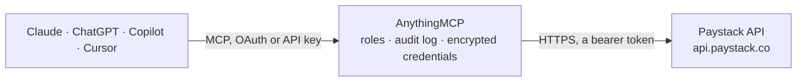

<!-- Generated by scripts/export-github-catalog.mjs in the anythingmcp-website repository. Do not edit by hand. -->

# Paystack MCP connector

Leading African payment processor (Nigeria-led, also supports Ghana, South Africa, Kenya, Côte d'Ivoire). The AnythingMCP connector gives Claude, ChatGPT, Microsoft Copilot, Cursor and Gemini 4 MCP tools for Paystack: 2 read and 2 can change data.

**Category:** [Payments](../payments.md) · **Tools:** 4 · **Setup guide:** [anythingmcp.com](https://anythingmcp.com/guides/paystack-to-mcp) · [Deutsch](https://anythingmcp.com/de/guides/paystack-to-mcp) · [Italiano](https://anythingmcp.com/it/guides/paystack-to-mcp) · [Español](https://anythingmcp.com/es/guides/paystack-to-mcp) · [日本語](https://anythingmcp.com/ja/guides/paystack-to-mcp) · [Русский](https://anythingmcp.com/ru/guides/paystack-to-mcp) · [中文](https://anythingmcp.com/zh/guides/paystack-to-mcp)

## Start without code

No installation and no terminal: AnythingMCP Cloud runs the Paystack connector for you, operated by helpcode.ai in Frankfurt, Germany.

1. **Click the button above** and create an account or sign in. The Paystack connector opens, ready to install.
2. **Paste the API key or token from your Paystack account.** Every click is in the [step-by-step guide](https://anythingmcp.com/guides/paystack-to-mcp).
3. **Click Install.** AnythingMCP shows the address of your MCP server.
4. **Add that address to your assistant:** [Claude](https://anythingmcp.com/guides/connect-paystack-to-claude) · [ChatGPT](https://anythingmcp.com/guides/connect-paystack-to-chatgpt) · [Microsoft Copilot](https://anythingmcp.com/guides/connect-paystack-to-copilot) · [Cursor](https://anythingmcp.com/guides/connect-paystack-to-cursor) · [Gemini CLI](https://anythingmcp.com/guides/connect-paystack-to-gemini) · [Meta Muse](https://anythingmcp.com/guides/connect-paystack-to-muse).
5. **Ask your first question**, for example: *Show me the Paystack customer record for email sales@oluwasolar.ng, I need their customer code and total transaction value.*

Prefer help with the setup? [Talk to us](https://anythingmcp.com/contact).

## How it works

- **The AI client** speaks MCP (Streamable HTTP) to AnythingMCP and only sees tool names, descriptions and results. It never gets the Paystack credentials.
- **AnythingMCP** checks the client's role, builds the call from the tool definition, adds the credentials (a bearer token), calls Paystack, logs the call and returns the result.
- **Paystack** sees an ordinary API client with the rights of the account the credentials belong to.

## Tools

| Tool | What it does | Access |
|---|---|---|
| [`paystack_initialize_transaction`](#paystack_initialize_transaction) | Initialize a Paystack transaction. | write |
| [`paystack_verify_transaction`](#paystack_verify_transaction) | Verify a Paystack transaction by reference. | read |
| [`paystack_list_customers`](#paystack_list_customers) | List customers on the merchant account. | read |
| [`paystack_create_refund`](#paystack_create_refund) | Create a refund for a transaction. | write |

## Tool reference

Every parameter as the AI client sees it in `tools/list`. Source: [`packages/backend/src/adapters/ng/paystack.json`](../../../packages/backend/src/adapters/ng/paystack.json).

### `paystack_initialize_transaction`

Initialize a Paystack transaction. Returns an `authorization_url` you redirect the customer to (Paystack-hosted checkout) and a `reference` you later pass to paystack_verify_transaction. Use this rather than charging cards directly — Paystack handles PCI on their side.

**Access:** write · **Call:** `POST /transaction/initialize`

| Parameter | Type | Required | Description |
|---|---|---|---|
| `email` | string | yes | Customer email (required by Paystack for every transaction). |
| `amount` | number | yes | Amount in the smallest currency subunit (e.g. 10000 = ₦100.00 for NGN, 10000 = $100.00 for USD). |
| `currency` | string | no | Optional. ISO-4217 currency code: 'NGN' (default), 'USD', 'GHS', 'ZAR', 'KES', 'XOF'. |
| `reference` | string | no | Optional. Your own reference for this transaction. If omitted, Paystack generates one. Must be unique across the merchant account. |
| `callback_url` | string | no | Optional. URL Paystack redirects the customer to after payment. Overrides the dashboard-configured default. |
| `metadata` | object | no | Optional. Arbitrary key-value object stored on the transaction and echoed in webhooks. |

### `paystack_verify_transaction`

Verify a Paystack transaction by reference. Returns status ('success', 'failed', 'abandoned'), amount, currency, paid_at, channel (card/bank/ussd/qr/mobile_money/bank_transfer), customer object, and authorization details if a card was used. Free, idempotent — safe to call multiple times.

**Access:** read · **Call:** `GET /transaction/verify/{reference}`

| Parameter | Type | Required | Description |
|---|---|---|---|
| `reference` | string | yes | The transaction reference returned by paystack_initialize_transaction (or supplied by you). |

### `paystack_list_customers`

List customers on the merchant account. Returns customer id, customer_code, first_name, last_name, email, phone, total_transactions, total_transaction_value, dedicated_account if any, and risk_action.

**Access:** read · **Call:** `GET /customer`

| Parameter | Type | Required | Description |
|---|---|---|---|
| `perPage` | number | no | Records per page (default 50, max 100). |
| `page` | number | no | Page number (1-based). |
| `from` | string | no | Optional ISO-8601 start date filter (e.g. '2026-01-01'). |
| `to` | string | no | Optional ISO-8601 end date filter. |

### `paystack_create_refund`

Create a refund for a transaction. Refunds are partial by default (use the full amount to do a full refund). Returns refund id, status (pending/processed/processing/failed), transaction object, refunded_at, expected_at, and reason.

**Access:** write · **Call:** `POST /refund`

| Parameter | Type | Required | Description |
|---|---|---|---|
| `transaction` | string | yes | Transaction id or reference to refund. |
| `amount` | number | no | Optional. Amount in smallest subunit to refund. Omit to refund the full transaction amount. |
| `currency` | string | no | Optional. Must match the original transaction currency. Defaults to NGN. |
| `customer_note` | string | no | Optional. Note shown to the customer on the refund record (max 100 chars). |
| `merchant_note` | string | no | Optional. Internal note on the refund (max 100 chars). |

## Run it yourself

AnythingMCP is open source (AGPL-3.0). [Run it with Docker](../../../README.md#run-it-yourself), open **Connectors → Store**, pick **Paystack** and enter `PAYSTACK_SECRET_KEY`, then add your MCP server URL to the AI client.

[← Payments connectors](../payments.md) · [All categories](../README.md)
