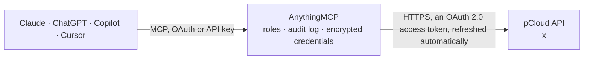

<!-- Generated by scripts/export-github-catalog.mjs in the anythingmcp-website repository. Do not edit by hand. -->

# pCloud MCP connector

Let your AI work with your pCloud files: browse folders, read file details, revisions and small text files, get download links and list public links, and create folders, copy, move and rename, or … The AnythingMCP connector gives Claude, ChatGPT, Microsoft Copilot, Cursor and Gemini 16 MCP tools for pCloud: 7 read and 9 can change data.

**Category:** [File Storage](../storage.md) · **Tools:** 16 · **Setup guide:** [anythingmcp.com](https://anythingmcp.com/guides/pcloud-to-mcp) · [Deutsch](https://anythingmcp.com/de/guides/pcloud-to-mcp) · [Italiano](https://anythingmcp.com/it/guides/pcloud-to-mcp) · [Español](https://anythingmcp.com/es/guides/pcloud-to-mcp) · [日本語](https://anythingmcp.com/ja/guides/pcloud-to-mcp) · [Русский](https://anythingmcp.com/ru/guides/pcloud-to-mcp) · [中文](https://anythingmcp.com/zh/guides/pcloud-to-mcp)

## Start without code

No installation and no terminal: AnythingMCP Cloud runs the pCloud connector for you, operated by helpcode.ai in Frankfurt, Germany.

1. **Click the button above** and create an account or sign in. The pCloud connector opens, ready to install.
2. **Sign in with your pCloud account** when AnythingMCP asks. The first time, an admin creates a small app in the pCloud developer console. Every click is in the [step-by-step guide](https://anythingmcp.com/guides/pcloud-to-mcp).
3. **Click Install.** AnythingMCP shows the address of your MCP server.
4. **Add that address to your assistant:** [Claude](https://anythingmcp.com/guides/connect-pcloud-to-claude) · [ChatGPT](https://anythingmcp.com/guides/connect-pcloud-to-chatgpt) · [Microsoft Copilot](https://anythingmcp.com/guides/connect-pcloud-to-copilot) · [Cursor](https://anythingmcp.com/guides/connect-pcloud-to-cursor) · [Gemini CLI](https://anythingmcp.com/guides/connect-pcloud-to-gemini) · [Meta Muse](https://anythingmcp.com/guides/connect-pcloud-to-muse).
5. **Ask your first question**, for example: *Find /Invoices/2026/INV-2026-037.pdf and tell me its size and last modified date.*

Prefer help with the setup? [Talk to us](https://anythingmcp.com/contact).

## How it works

- **The AI client** speaks MCP (Streamable HTTP) to AnythingMCP and only sees tool names, descriptions and results. It never gets the pCloud credentials.
- **AnythingMCP** checks the client's role, builds the call from the tool definition, adds the credentials (an OAuth 2.0 access token, refreshed automatically), calls pCloud, logs the call and returns the result.
- **pCloud** sees an ordinary API client with the rights of the account the credentials belong to.

## Tools

| Tool | What it does | Access |
|---|---|---|
| [`pcloud_get_user_info`](#pcloud_get_user_info) | Read the pCloud account: e-mail, whether it is verified, premium plan and its end date, storage quota and used space in bytes, language and sign-up date. | read |
| [`pcloud_list_folder`](#pcloud_list_folder) | List the contents of a folder: name, file or folder id, whether it is a folder, size in bytes, content type and modification date of each item. | read |
| [`pcloud_stat`](#pcloud_stat) | Read the details of one file: name, id, parent folder id, size in bytes, content type, created and modified dates, content hash and, for images and videos,… | read |
| [`pcloud_read_text_file`](#pcloud_read_text_file) | Read the text of a small text file (txt, csv, md, json, xml, html, source code) as UTF-8. | read |
| [`pcloud_get_file_link`](#pcloud_get_file_link) | Get a temporary download address for a file. | read |
| [`pcloud_list_revisions`](#pcloud_list_revisions) | List the earlier revisions of a file: revision id, size in bytes, content hash and the date it was created. | read |
| [`pcloud_list_public_links`](#pcloud_list_public_links) | List your public links: link id, the link address, code, the file or folder it points to, created date, downloads and traffic so far, and its expiry and… | read |
| [`pcloud_create_folder`](#pcloud_create_folder) | Create a folder: either path (e.g. /Projects/2026) or parent folder_id plus name. | write |
| [`pcloud_copy_file`](#pcloud_copy_file) | Copy a file into a folder (to_folder_id or to_path), optionally under a new name. | write |
| [`pcloud_move_file`](#pcloud_move_file) | Move and/or rename a file: give a new to_name, a destination folder (to_folder_id or to_path ending in /), or both. | write |
| [`pcloud_move_folder`](#pcloud_move_folder) | Move and/or rename a folder with everything in it: give a new to_name, a destination folder (to_folder_id or to_path ending in /), or both. | write |
| [`pcloud_copy_folder`](#pcloud_copy_folder) | Copy a folder with everything in it into another folder (to_folder_id or to_path). | write |
| [`pcloud_create_file_public_link`](#pcloud_create_file_public_link) | Create a public link to a file: anyone with the address can download it. | write |
| [`pcloud_create_folder_public_link`](#pcloud_create_folder_public_link) | Create a public link to a folder: anyone with the address can browse and download everything in it. | write |
| [`pcloud_delete_file`](#pcloud_delete_file) | Delete a file (it goes to pCloud's trash). | write |
| [`pcloud_delete_folder`](#pcloud_delete_folder) | Delete an empty folder (it goes to pCloud's trash); a folder with contents is refused. | write |

## Tool reference

Every parameter as the AI client sees it in `tools/list`. Source: [`packages/backend/src/adapters/intl/pcloud.json`](../../../packages/backend/src/adapters/intl/pcloud.json).

### `pcloud_get_user_info`

Read the pCloud account: e-mail, whether it is verified, premium plan and its end date, storage quota and used space in bytes, language and sign-up date. Use it first to check the connection.

**Access:** read · **Call:** `GET /userinfo`

No parameters.

### `pcloud_list_folder`

List the contents of a folder: name, file or folder id, whether it is a folder, size in bytes, content type and modification date of each item. Start at folder_id 0 (the root). Set nofiles to 1 to see only subfolders.

**Access:** read · **Call:** `GET /listfolder`

| Parameter | Type | Required | Description |
|---|---|---|---|
| `folder_id` | integer | no | Id of the folder (folderid); 0 is the root folder. Give folder_id or path. |
| `path` | string | no | Full path of the folder, e.g. /Documents, when you have no folder_id. |
| `nofiles` | `1` | no | Only return subfolders, no files. Pass 1 to switch it on; leave it out otherwise. |

### `pcloud_stat`

Read the details of one file: name, id, parent folder id, size in bytes, content type, created and modified dates, content hash and, for images and videos, width and height.

**Access:** read · **Call:** `GET /stat`

| Parameter | Type | Required | Description |
|---|---|---|---|
| `file_id` | integer | no | Id of the file (fileid), preferred. Give file_id or path. |
| `path` | string | no | Full path of the file, e.g. /Documents/report.pdf, when you have no file_id. |

### `pcloud_read_text_file`

Read the text of a small text file (txt, csv, md, json, xml, html, source code) as UTF-8. Answers over about 100 KB are cut off; check the size with pcloud_stat first and do not use it for PDFs, Office documents, images or other binary files (use pcloud_get_file_link).

**Access:** read · **Call:** `GET /gettextfile`

| Parameter | Type | Required | Description |
|---|---|---|---|
| `file_id` | integer | no | Id of the file (fileid), preferred. Give file_id or path. |
| `path` | string | no | Full path of the file, e.g. /Documents/report.pdf, when you have no file_id. |
| `fromencoding` | string | no | Character encoding of the file, e.g. windows-1252. Leave out to let pCloud guess. |

### `pcloud_get_file_link`

Get a temporary download address for a file. Build the URL as https:// + hosts[0] + path; it stops working at expires and is meant for the user, not for sharing (use a public link for that). Set forcedownload to 1 to make browsers save rather than open the file.

**Access:** read · **Call:** `GET /getfilelink`

| Parameter | Type | Required | Description |
|---|---|---|---|
| `file_id` | integer | no | Id of the file (fileid), preferred. Give file_id or path. |
| `path` | string | no | Full path of the file, e.g. /Documents/report.pdf, when you have no file_id. |
| `forcedownload` | `1` | no | Serve the file as a download. Pass 1 to switch it on; leave it out otherwise. |
| `revision_id` | integer | no | Link to this earlier revision instead of the current file (from pcloud_list_revisions). |

### `pcloud_list_revisions`

List the earlier revisions of a file: revision id, size in bytes, content hash and the date it was created. Use a revision id with pcloud_get_file_link to download that version.

**Access:** read · **Call:** `GET /listrevisions`

| Parameter | Type | Required | Description |
|---|---|---|---|
| `file_id` | integer | no | Id of the file (fileid), preferred. Give file_id or path. |
| `path` | string | no | Full path of the file, e.g. /Documents/report.pdf, when you have no file_id. |

### `pcloud_list_public_links`

List your public links: link id, the link address, code, the file or folder it points to, created date, downloads and traffic so far, and its expiry and limits if set.

**Access:** read · **Call:** `GET /listpublinks`

No parameters.

### `pcloud_create_folder`

Create a folder: either path (e.g. /Projects/2026) or parent folder_id plus name. If the folder already exists it is returned unchanged. Show the user where the folder will be created and confirm before calling.

**Access:** write · **Call:** `POST /createfolderifnotexists`

| Parameter | Type | Required | Description |
|---|---|---|---|
| `path` | string | no | Full path of the folder, e.g. /Documents, when you have no folder_id. |
| `folder_id` | integer | no | Id of the parent folder; 0 is the root. Use with name. |
| `name` | string | no | Name of the new folder, with folder_id. |

### `pcloud_copy_file`

Copy a file into a folder (to_folder_id or to_path), optionally under a new name. An existing file with that name is overwritten unless noover is 1. Show the user the source, destination and name and confirm before calling.

**Access:** write · **Call:** `POST /copyfile`

| Parameter | Type | Required | Description |
|---|---|---|---|
| `file_id` | integer | no | Id of the file (fileid), preferred. Give file_id or path. |
| `path` | string | no | Full path of the file, e.g. /Documents/report.pdf, when you have no file_id. |
| `to_folder_id` | integer | no | Destination folder id; 0 is the root. |
| `to_path` | string | no | Destination path: a folder ending in / or a full new file path. |
| `to_name` | string | no | New name for the copy, with to_folder_id. |
| `noover` | `1` | no | Fail instead of overwriting an existing file. Pass 1 to switch it on; leave it out otherwise. |

### `pcloud_move_file`

Move and/or rename a file: give a new to_name, a destination folder (to_folder_id or to_path ending in /), or both. A file already at the destination is replaced. Show the user the change and confirm before calling.

**Access:** write · **Call:** `POST /renamefile`

| Parameter | Type | Required | Description |
|---|---|---|---|
| `file_id` | integer | no | Id of the file (fileid), preferred. Give file_id or path. |
| `path` | string | no | Full path of the file, e.g. /Documents/report.pdf, when you have no file_id. |
| `to_folder_id` | integer | no | Destination folder id; 0 is the root. |
| `to_path` | string | no | Destination: a folder ending in / or a full new path. |
| `to_name` | string | no | New file name. |

### `pcloud_move_folder`

Move and/or rename a folder with everything in it: give a new to_name, a destination folder (to_folder_id or to_path ending in /), or both. Show the user the change and confirm before calling.

**Access:** write · **Call:** `POST /renamefolder`

| Parameter | Type | Required | Description |
|---|---|---|---|
| `folder_id` | integer | no | Id of the folder to move. |
| `path` | string | no | Full path of the folder, e.g. /Documents, when you have no folder_id. |
| `to_folder_id` | integer | no | Destination parent folder id; 0 is the root. |
| `to_path` | string | no | Destination: an existing folder ending in / or a full new path. |
| `to_name` | string | no | New folder name. |

### `pcloud_copy_folder`

Copy a folder with everything in it into another folder (to_folder_id or to_path). Files with the same name are overwritten unless noover or skipexisting is 1. Large folders take time and space. Show the user the source and destination and confirm before calling.

**Access:** write · **Call:** `POST /copyfolder`

| Parameter | Type | Required | Description |
|---|---|---|---|
| `folder_id` | integer | no | Id of the folder to copy. |
| `path` | string | no | Full path of the folder, e.g. /Documents, when you have no folder_id. |
| `to_folder_id` | integer | no | Destination folder id; 0 is the root. |
| `to_path` | string | no | Destination folder path. |
| `noover` | `1` | no | Fail with error 2004 instead of overwriting files. Pass 1 to switch it on; leave it out otherwise. |
| `skipexisting` | `1` | no | Skip files that already exist. Pass 1 to switch it on; leave it out otherwise. |
| `copycontentonly` | `1` | no | Copy only the contents, not the folder itself. Pass 1 to switch it on; leave it out otherwise. |

### `pcloud_create_file_public_link`

Create a public link to a file: anyone with the address can download it. Optional expiry date, download limit and (premium) password. Show the user the file and the link settings and confirm before calling.

**Access:** write · **Call:** `POST /getfilepublink`

| Parameter | Type | Required | Description |
|---|---|---|---|
| `file_id` | integer | no | Id of the file (fileid), preferred. Give file_id or path. |
| `path` | string | no | Full path of the file, e.g. /Documents/report.pdf, when you have no file_id. |
| `expire` | string | no | When the link stops working, e.g. 2026-12-31T23:59:59Z. |
| `maxdownloads` | integer | no | Maximum number of downloads. |
| `linkpassword` | string | no | Password for the link (premium accounts). |
| `shortlink` | `1` | no | Also create a short pc.cd link. Pass 1 to switch it on; leave it out otherwise. |

### `pcloud_create_folder_public_link`

Create a public link to a folder: anyone with the address can browse and download everything in it. Optional expiry date, download limit and (premium) password. Show the user the folder and the link settings and confirm before calling.

**Access:** write · **Call:** `POST /getfolderpublink`

| Parameter | Type | Required | Description |
|---|---|---|---|
| `folder_id` | integer | no | Id of the folder. |
| `path` | string | no | Full path of the folder, e.g. /Documents, when you have no folder_id. |
| `expire` | string | no | When the link stops working, e.g. 2026-12-31T23:59:59Z. |
| `maxdownloads` | integer | no | Maximum number of downloads from the folder. |
| `linkpassword` | string | no | Password for the link (premium accounts). |
| `shortlink` | `1` | no | Also create a short pc.cd link. Pass 1 to switch it on; leave it out otherwise. |

### `pcloud_delete_file`

Delete a file (it goes to pCloud's trash). Installed switched off. Only when the user explicitly asks; confirm the file first.

**Access:** write · **Call:** `POST /deletefile`

| Parameter | Type | Required | Description |
|---|---|---|---|
| `file_id` | integer | no | Id of the file (fileid), preferred. Give file_id or path. |
| `path` | string | no | Full path of the file, e.g. /Documents/report.pdf, when you have no file_id. |

### `pcloud_delete_folder`

Delete an empty folder (it goes to pCloud's trash); a folder with contents is refused. Installed switched off. Only when the user explicitly asks; confirm the folder first.

**Access:** write · **Call:** `POST /deletefolder`

| Parameter | Type | Required | Description |
|---|---|---|---|
| `folder_id` | integer | no | Id of the folder. |
| `path` | string | no | Full path of the folder, e.g. /Documents, when you have no folder_id. |

## Run it yourself

AnythingMCP is open source (AGPL-3.0). [Run it with Docker](../../../README.md#run-it-yourself), open **Connectors → Store**, pick **pCloud** and enter `PCLOUD_CLIENT_ID`, `PCLOUD_CLIENT_SECRET`, `PCLOUD_API_HOST`, then add your MCP server URL to the AI client.

[← File Storage connectors](../storage.md) · [All categories](../README.md)
