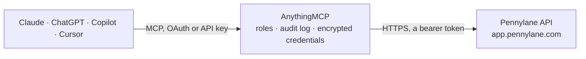

<!-- Generated by scripts/export-github-catalog.mjs in the anythingmcp-website repository. Do not edit by hand. -->

# Pennylane MCP connector

Pennylane — French accounting and finance for SMBs and their accountants: customer and supplier invoices, customers, suppliers, products, ledger entries and bank transactions. The AnythingMCP connector gives Claude, ChatGPT, Microsoft Copilot, Cursor and Gemini 10 MCP tools for Pennylane, all read-only.

**Category:** [Accounting](../accounting.md) · **Tools:** 10 · **Setup guide:** [anythingmcp.com](https://anythingmcp.com/guides/pennylane-to-mcp) · [Deutsch](https://anythingmcp.com/de/guides/pennylane-to-mcp) · [Italiano](https://anythingmcp.com/it/guides/pennylane-to-mcp) · [Español](https://anythingmcp.com/es/guides/pennylane-to-mcp) · [日本語](https://anythingmcp.com/ja/guides/pennylane-to-mcp) · [Русский](https://anythingmcp.com/ru/guides/pennylane-to-mcp) · [中文](https://anythingmcp.com/zh/guides/pennylane-to-mcp)

## Start without code

No installation and no terminal: AnythingMCP Cloud runs the Pennylane connector for you, operated by helpcode.ai in Frankfurt, Germany.

1. **Click the button above** and create an account or sign in. The Pennylane connector opens, ready to install.
2. **Paste the API key or token from your Pennylane account.** Every click is in the [step-by-step guide](https://anythingmcp.com/guides/pennylane-to-mcp).
3. **Click Install.** AnythingMCP shows the address of your MCP server.
4. **Add that address to your assistant:** [Claude](https://anythingmcp.com/guides/connect-pennylane-to-claude) · [ChatGPT](https://anythingmcp.com/guides/connect-pennylane-to-chatgpt) · [Microsoft Copilot](https://anythingmcp.com/guides/connect-pennylane-to-copilot) · [Cursor](https://anythingmcp.com/guides/connect-pennylane-to-cursor) · [Gemini CLI](https://anythingmcp.com/guides/connect-pennylane-to-gemini) · [Meta Muse](https://anythingmcp.com/guides/connect-pennylane-to-muse).
5. **Ask your first question**, for example: *What is the recorded balance and default payment terms for customer Société Lumière SARL (SIRET 54281234700029)?*

Prefer help with the setup? [Talk to us](https://anythingmcp.com/contact).

## How it works

- **The AI client** speaks MCP (Streamable HTTP) to AnythingMCP and only sees tool names, descriptions and results. It never gets the Pennylane credentials.
- **AnythingMCP** checks the client's role, builds the call from the tool definition, adds the credentials (a bearer token), calls Pennylane, logs the call and returns the result.
- **Pennylane** sees an ordinary API client with the rights of the account the credentials belong to.

## Tools

| Tool | What it does | Access |
|---|---|---|
| [`pennylane_list_customers`](#pennylane_list_customers) | List customers with their name, SIREN/SIRET, VAT number, address and payment terms. | read |
| [`pennylane_get_customer`](#pennylane_get_customer) | Read one customer by id, with their full billing address, tax identifiers, default payment conditions and recorded balance. | read |
| [`pennylane_list_customer_invoices`](#pennylane_list_customer_invoices) | List invoices you issued, with their number, date, deadline, customer, currency amount and paid status — the receivables view. | read |
| [`pennylane_get_customer_invoice`](#pennylane_get_customer_invoice) | Read one issued invoice: number, dates, customer, totals in the document currency and in euros, and paid status. | read |
| [`pennylane_list_customer_invoice_lines`](#pennylane_list_customer_invoice_lines) | List the lines of one issued invoice with their label, quantity, unit price, VAT rate and amounts. | read |
| [`pennylane_list_supplier_invoices`](#pennylane_list_supplier_invoices) | List supplier invoices you received, with their number, date, deadline, supplier, amount and paid status — the payables view. | read |
| [`pennylane_list_suppliers`](#pennylane_list_suppliers) | List suppliers with their name, SIREN, VAT number and address, to resolve who a received invoice belongs to. | read |
| [`pennylane_list_products`](#pennylane_list_products) | List products and services with their label, unit price, VAT rate and the ledger account they book to. | read |
| [`pennylane_list_ledger_entries`](#pennylane_list_ledger_entries) | List ledger entry lines with their account, label, debit, credit and journal — the bookkeeping view underneath the invoices. | read |
| [`pennylane_list_bank_transactions`](#pennylane_list_bank_transactions) | List bank transactions with their date, label, amount and reconciliation state, so unpaid invoices can be matched against money that actually arrived. | read |

## Tool reference

Every parameter as the AI client sees it in `tools/list`. Source: [`packages/backend/src/adapters/fr/pennylane.json`](../../../packages/backend/src/adapters/fr/pennylane.json).

### `pennylane_list_customers`

List customers with their name, SIREN/SIRET, VAT number, address and payment terms. The quickest call for checking that the token works.

**Access:** read · **Call:** `GET /customers`

| Parameter | Type | Required | Description |
|---|---|---|---|
| `limit` | number | no | Rows per page (default 20, max 100). |
| `cursor` | string | no | Cursor from the previous page's next_cursor. |
| `filter` | string | no | Filter JSON array, e.g. [{"field":"name","operator":"start_with","value":"Dupont"}]. Fields: name (start_with, eq), id, customer_type, ledger_account_id, external_reference, reg_no, emails (in). |

### `pennylane_get_customer`

Read one customer by id, with their full billing address, tax identifiers, default payment conditions and recorded balance.

**Access:** read · **Call:** `GET /customers/{customerId}`

| Parameter | Type | Required | Description |
|---|---|---|---|
| `customerId` | string | yes | Pennylane customer id. |

### `pennylane_list_customer_invoices`

List invoices you issued, with their number, date, deadline, customer, currency amount and paid status — the receivables view.

**Access:** read · **Call:** `GET /customer_invoices`

| Parameter | Type | Required | Description |
|---|---|---|---|
| `limit` | number | no | Rows per page (default 20, max 100). |
| `cursor` | string | no | Cursor from the previous page's next_cursor. |
| `filter` | string | no | Filter JSON array, e.g. [{"field":"date","operator":"gteq","value":"2026-01-01"}]. |
| `sort` | string | no | Sort field, prefix with `-` for descending, e.g. -date. |

### `pennylane_get_customer_invoice`

Read one issued invoice: number, dates, customer, totals in the document currency and in euros, and paid status. Lines, payments and matched transactions are only linked, not embedded: use pennylane_list_customer_invoice_lines for the lines.

**Access:** read · **Call:** `GET /customer_invoices/{invoiceId}`

| Parameter | Type | Required | Description |
|---|---|---|---|
| `invoiceId` | string | yes | Pennylane invoice id. |

### `pennylane_list_customer_invoice_lines`

List the lines of one issued invoice with their label, quantity, unit price, VAT rate and amounts.

**Access:** read · **Call:** `GET /customer_invoices/{invoiceId}/invoice_lines`

| Parameter | Type | Required | Description |
|---|---|---|---|
| `invoiceId` | string | yes | Pennylane customer invoice id. |
| `limit` | number | no | Rows per page (max 100). |
| `cursor` | string | no | Cursor from the previous page's next_cursor. |

### `pennylane_list_supplier_invoices`

List supplier invoices you received, with their number, date, deadline, supplier, amount and paid status — the payables view.

**Access:** read · **Call:** `GET /supplier_invoices`

| Parameter | Type | Required | Description |
|---|---|---|---|
| `limit` | number | no | Rows per page (default 20, max 100). |
| `cursor` | string | no | Cursor from the previous page's next_cursor. |
| `filter` | string | no | Filter JSON array over supplier-invoice fields. |
| `sort` | string | no | Sort field, prefix with `-` for descending. |

### `pennylane_list_suppliers`

List suppliers with their name, SIREN, VAT number and address, to resolve who a received invoice belongs to.

**Access:** read · **Call:** `GET /suppliers`

| Parameter | Type | Required | Description |
|---|---|---|---|
| `limit` | number | no | Rows per page. |
| `cursor` | string | no | Cursor from the previous page's next_cursor. |
| `filter` | string | no | Filter JSON array over supplier fields. |

### `pennylane_list_products`

List products and services with their label, unit price, VAT rate and the ledger account they book to.

**Access:** read · **Call:** `GET /products`

| Parameter | Type | Required | Description |
|---|---|---|---|
| `limit` | number | no | Rows per page. |
| `cursor` | string | no | Cursor from the previous page's next_cursor. |

### `pennylane_list_ledger_entries`

List ledger entry lines with their account, label, debit, credit and journal — the bookkeeping view underneath the invoices.

**Access:** read · **Call:** `GET /ledger_entry_lines`

| Parameter | Type | Required | Description |
|---|---|---|---|
| `limit` | number | no | Rows per page. |
| `cursor` | string | no | Cursor from the previous page's next_cursor. |
| `filter` | string | no | Filter JSON array. Fields: id, journal_id, ledger_account_id, date; operators lt, lteq, gt, gteq, eq, not_eq, in, not_in. |

### `pennylane_list_bank_transactions`

List bank transactions with their date, label, amount and reconciliation state, so unpaid invoices can be matched against money that actually arrived.

**Access:** read · **Call:** `GET /transactions`

| Parameter | Type | Required | Description |
|---|---|---|---|
| `limit` | number | no | Rows per page. |
| `cursor` | string | no | Cursor from the previous page's next_cursor. |
| `filter` | string | no | Filter JSON array. Fields: id, bank_account_id, journal_id (eq, not_eq, in, not_in), date (eq, not_eq, gt, gteq, lt, lteq), e.g. [{"field":"date","operator":"gteq","value":"2026-09-01"}]. |

## Run it yourself

AnythingMCP is open source (AGPL-3.0). [Run it with Docker](../../../README.md#run-it-yourself), open **Connectors → Store**, pick **Pennylane** and enter `PENNYLANE_API_TOKEN`, then add your MCP server URL to the AI client.

[← Accounting connectors](../accounting.md) · [All categories](../README.md)
