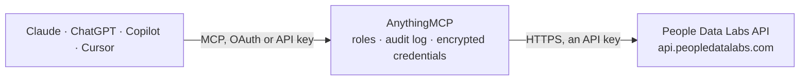

<!-- Generated by scripts/export-github-catalog.mjs in the anythingmcp-website repository. Do not edit by hand. -->

# People Data Labs MCP connector

Give your AI B2B people and company data from People Data Labs: enrich a person or company from an email, profile or website, identify people from loose details, search people and companies with SQL, … The AnythingMCP connector gives Claude, ChatGPT, Microsoft Copilot, Cursor and Gemini 11 MCP tools for People Data Labs, all read-only.

**Category:** [Data Enrichment](../enrichment.md) · **Tools:** 11 · **Setup guide:** [anythingmcp.com](https://anythingmcp.com/guides/people-data-labs-to-mcp) · [Deutsch](https://anythingmcp.com/de/guides/people-data-labs-to-mcp) · [Italiano](https://anythingmcp.com/it/guides/people-data-labs-to-mcp) · [Español](https://anythingmcp.com/es/guides/people-data-labs-to-mcp) · [日本語](https://anythingmcp.com/ja/guides/people-data-labs-to-mcp) · [Русский](https://anythingmcp.com/ru/guides/people-data-labs-to-mcp) · [中文](https://anythingmcp.com/zh/guides/people-data-labs-to-mcp)

## Start without code

No installation and no terminal: AnythingMCP Cloud runs the People Data Labs connector for you, operated by helpcode.ai in Frankfurt, Germany.

1. **Click the button above** and create an account or sign in. The People Data Labs connector opens, ready to install.
2. **Paste the API key or token from your People Data Labs account.** Every click is in the [step-by-step guide](https://anythingmcp.com/guides/people-data-labs-to-mcp).
3. **Click Install.** AnythingMCP shows the address of your MCP server.
4. **Add that address to your assistant:** [Claude](https://anythingmcp.com/guides/connect-people-data-labs-to-claude) · [ChatGPT](https://anythingmcp.com/guides/connect-people-data-labs-to-chatgpt) · [Microsoft Copilot](https://anythingmcp.com/guides/connect-people-data-labs-to-copilot) · [Cursor](https://anythingmcp.com/guides/connect-people-data-labs-to-cursor) · [Gemini CLI](https://anythingmcp.com/guides/connect-people-data-labs-to-gemini) · [Meta Muse](https://anythingmcp.com/guides/connect-people-data-labs-to-muse).
5. **Ask your first question**, for example: *Who is the billing contact for invoice INV-2026-0897, email alex.martin@solariq.fi — get their current title and company*

Prefer help with the setup? [Talk to us](https://anythingmcp.com/contact).

## How it works

- **The AI client** speaks MCP (Streamable HTTP) to AnythingMCP and only sees tool names, descriptions and results. It never gets the People Data Labs credentials.
- **AnythingMCP** checks the client's role, builds the call from the tool definition, adds the credentials (an API key), calls People Data Labs, logs the call and returns the result.
- **People Data Labs** sees an ordinary API client with the rights of the account the credentials belong to.

## Tools

| Tool | What it does | Access |
|---|---|---|
| [`people_data_labs_enrich_person`](#people_data_labs_enrich_person) | Find one person in People Data Labs from what you know about them and get their profile: name, current job title and company, work history, education,… | read |
| [`people_data_labs_identify_person`](#people_data_labs_identify_person) | Find up to 20 people who could match loose information (for example only a name and a city), ranked by match score, when people_data_labs_enrich_person is… | read |
| [`people_data_labs_search_people`](#people_data_labs_search_people) | Search the People Data Labs person dataset with SQL or an Elasticsearch query, e.g. everyone with a given job title at a company or in a country. | read |
| [`people_data_labs_enrich_company`](#people_data_labs_enrich_company) | Find one company in People Data Labs and get its profile: name, website, industry, size and employee count, founding year, headquarters and locations,… | read |
| [`people_data_labs_search_companies`](#people_data_labs_search_companies) | Search the People Data Labs company dataset with SQL or an Elasticsearch query, e.g. software companies in Germany with 51 to 200 employees. | read |
| [`people_data_labs_clean_company`](#people_data_labs_clean_company) | Normalize a messy company name, website or profile URL to PDL's canonical company: name, website, linkedin_url, size, industry, location and the PDL id to… | read |
| [`people_data_labs_clean_location`](#people_data_labs_clean_location) | Normalize free-text location to PDL's canonical form: name, locality, region, country, continent and geo coordinates, as used by the location fields in… | read |
| [`people_data_labs_clean_school`](#people_data_labs_clean_school) | Normalize a school or university name, website or profile URL to PDL's canonical school: name, type, website, location, profiles and the PDL id. | read |
| [`people_data_labs_autocomplete`](#people_data_labs_autocomplete) | Suggest the exact values PDL uses for a field, from a few letters, with how many person records carry each: companies, schools, titles, skills, industries,… | read |
| [`people_data_labs_enrich_job_title`](#people_data_labs_enrich_job_title) | Clean a job title and get up to five similar titles and the most relevant skills for it, from PDL's resume data, e.g. for widening a people search. | read |
| [`people_data_labs_enrich_ip`](#people_data_labs_enrich_ip) | Find the company behind an IP address (for example a website visitor) and optionally its location and network metadata (mobile, hosting, proxy, VPN, Tor). | read |

## Tool reference

Every parameter as the AI client sees it in `tools/list`. Source: [`packages/backend/src/adapters/intl/people-data-labs.json`](../../../packages/backend/src/adapters/intl/people-data-labs.json).

### `people_data_labs_enrich_person`

Find one person in People Data Labs from what you know about them and get their profile: name, current job title and company, work history, education, location, social profiles and, depending on the plan, emails and phone numbers. Give at least one of email, phone, profile, lid, email_hash, or a name (name, or first_name plus last_name) together with company, school, location, locality, region or postal_code; more inputs give a better match. Returns status, likelihood (1 to 10, how sure PDL is that it is the same person) and data. Costs 1 Person Enrichment credit only when a person is found (200); 404 means no match and costs nothing. Read-only. Returns personal data: use it only for a legitimate purpose and handle it under GDPR and similar laws.

**Access:** read · **Call:** `GET /person/enrich`

| Parameter | Type | Required | Description |
|---|---|---|---|
| `email` | string | no | An email address the person has used. |
| `phone` | string | no | A phone number the person has used, starting with +country code (e.g. +49 761 1234567), otherwise it never matches. |
| `profile` | string | no | A social profile URL, e.g. linkedin.com/in/username. |
| `lid` | string | no | The person's numeric LinkedIn ID. |
| `email_hash` | string | no | SHA-256 or MD5 hash of an email address. |
| `name` | string | no | Full name, at least first and last, e.g. Anna Maria Schmidt. Needs a second data point such as company, school, location, locality, region or postal_code. |
| `first_name` | string | no | First name (with last_name, instead of name). |
| `last_name` | string | no | Last name (with first_name, instead of name). |
| `middle_name` | string | no | Middle name. |
| `company` | string | no | Name, website or social URL of a company the person has worked at. |
| `school` | string | no | Name, website or social URL of a school or university the person attended. |
| `location` | string | no | Where the person lives, anything from a street address to a country, e.g. Freiburg, Germany. |
| `street_address` | string | no | Street address. |
| `locality` | string | no | City or town. |
| `region` | string | no | State or region. |
| `country` | string | no | Country. |
| `postal_code` | string | no | Postal code (assumed US when country is missing). |
| `birth_date` | string | no | Birth year or full date, YYYY or YYYY-MM-DD. |
| `pdl_id` | string | no | A PDL person ID from an earlier result. When given, every other input is ignored. |
| `min_likelihood` | integer | no | Only return a match at least this confident, 1 to 10 (PDL default 2). Raise it (e.g. 6) when only a few weak inputs are known, to avoid paying for the wrong person. |
| `required` | string | no | Fields the match must have, otherwise 404 and no charge, e.g. emails, phone_numbers or education AND (emails OR phone_numbers). |
| `data_include` | string | no | Only return these fields, comma-separated, e.g. full_name,job_title,job_company_name,linkedin_url,emails. Start with - to exclude fields instead. Keeps the answer short; the charge is the same. |
| `titlecase` | boolean | no | Return names and text in title case instead of PDL's default lower case. |
| `include_if_matched` | boolean | no | Add a matched field listing which inputs PDL matched on. |

### `people_data_labs_identify_person`

Find up to 20 people who could match loose information (for example only a name and a city), ranked by match score, when people_data_labs_enrich_person is too strict. Give at least a name (or first_name plus last_name) with a location, company or school, or a direct identifier (email, phone, profile, lid). Returns matches with match_score and each person's data. Costs 1 Person Identify credit per call, also when nothing is found (404), whatever the number of profiles returned; PDL allows 10 calls a minute. Read-only. Returns personal data: use it only for a legitimate purpose and handle it under GDPR and similar laws.

**Access:** read · **Call:** `GET /person/identify`

| Parameter | Type | Required | Description |
|---|---|---|---|
| `email` | string | no | An email address the person has used. |
| `phone` | string | no | A phone number the person has used, starting with +country code (e.g. +49 761 1234567), otherwise it never matches. |
| `profile` | string | no | A social profile URL, e.g. linkedin.com/in/username. |
| `lid` | string | no | The person's numeric LinkedIn ID. |
| `email_hash` | string | no | SHA-256 or MD5 hash of an email address. |
| `name` | string | no | Full name, at least first and last, e.g. Anna Maria Schmidt. Needs a second data point such as company, school, location, locality, region or postal_code. |
| `first_name` | string | no | First name (with last_name, instead of name). |
| `last_name` | string | no | Last name (with first_name, instead of name). |
| `middle_name` | string | no | Middle name. |
| `company` | string | no | Name, website or social URL of a company the person has worked at. |
| `school` | string | no | Name, website or social URL of a school or university the person attended. |
| `location` | string | no | Where the person lives, anything from a street address to a country, e.g. Freiburg, Germany. |
| `street_address` | string | no | Street address. |
| `locality` | string | no | City or town. |
| `region` | string | no | State or region. |
| `country` | string | no | Country. |
| `postal_code` | string | no | Postal code (assumed US when country is missing). |
| `birth_date` | string | no | Birth year or full date, YYYY or YYYY-MM-DD. |
| `titlecase` | boolean | no | Return names and text in title case instead of PDL's default lower case. |
| `include_if_matched` | boolean | no | Add a matched field listing which inputs PDL matched on. |

### `people_data_labs_search_people`

Search the People Data Labs person dataset with SQL or an Elasticsearch query, e.g. everyone with a given job title at a company or in a country. Pass exactly one of sql or query. SQL form: SELECT * FROM person WHERE job_company_name='people data labs' AND location_country='germany' (column selection and LIMIT are ignored; use size). Field values are lower case. Returns status, total (how many match), data (the records) and scroll_token for the next page. Costs 1 Person Search credit per record returned, so start with a small size and check total first. Read-only. Returns personal data: use it only for a legitimate purpose and handle it under GDPR and similar laws.

**Access:** read · **Call:** `POST /person/search`

| Parameter | Type | Required | Description |
|---|---|---|---|
| `sql` | string | no | A query of the form SELECT * FROM person WHERE ..., with PDL person fields such as job_title, job_title_role, job_company_name, job_company_website, location_country, location_locality, skills, industry. |
| `query` | object | no | An Elasticsearch 7.7 query object instead of sql, e.g. {"bool": {"must": [{"term": {"location_country": "germany"}}, {"term": {"job_title_role": "engineering"}}]}}. |
| `size` | integer | no | How many records to return, 1 to 100 (default 1). Every record returned costs 1 credit, so ask for only what the user needs. |
| `scroll_token` | string | no | scroll_token from the previous page, to fetch the next size records of the same query (pass the same query or sql again). |
| `dataset` | string | no | Which slices to search, comma-separated: resume (default), email, phone, mobile_phone, street_address, consumer_social, developer or all; a leading - excludes one. |
| `titlecase` | boolean | no | Return names and text in title case instead of PDL's default lower case. |

### `people_data_labs_enrich_company`

Find one company in People Data Labs and get its profile: name, website, industry, size and employee count, founding year, headquarters and locations, social profiles, tags and, on some plans, funding and revenue estimates. Give at least one of name, website, profile or ticker (website or profile match best). Returns status, likelihood and the company fields. Costs 1 Company Enrichment credit only when a company is found (200); 404 means no match and costs nothing. Read-only.

**Access:** read · **Call:** `GET /company/enrich`

| Parameter | Type | Required | Description |
|---|---|---|---|
| `name` | string | no | Company name, e.g. Google. |
| `website` | string | no | Company website, e.g. google.com (the most reliable input). |
| `profile` | string | no | Company social profile, e.g. linkedin.com/company/google. |
| `ticker` | string | no | Stock ticker of a listed company, e.g. GOOGL. |
| `pdl_id` | string | no | A PDL company ID from an earlier result. When given, every other input is ignored. |
| `location` | string | no | Full or partial company location, to tell apart companies with the same name. |
| `street_address` | string | no | Street address. |
| `locality` | string | no | City. |
| `region` | string | no | State or region. |
| `country` | string | no | Country. |
| `postal_code` | string | no | Postal code. |
| `min_likelihood` | integer | no | Only return a match at least this confident, 1 to 10 (PDL default 2). |
| `required` | string | no | Fields the match must have, otherwise 404 and no charge, e.g. ticker. |
| `data_include` | string | no | Only return these fields, comma-separated, e.g. name,website,size,employee_count,industry,location. Start with - to exclude fields instead. |
| `titlecase` | boolean | no | Return names and text in title case instead of PDL's default lower case. |
| `include_if_matched` | boolean | no | Add a matched field listing which inputs PDL matched on. |

### `people_data_labs_search_companies`

Search the People Data Labs company dataset with SQL or an Elasticsearch query, e.g. software companies in Germany with 51 to 200 employees. Pass exactly one of sql or query. SQL form: SELECT * FROM company WHERE industry='computer software' AND location_country='germany' AND size='51-200' (column selection and LIMIT are ignored; use size). Field values are lower case. Returns status, total, data and scroll_token for the next page. Costs 1 Company Search credit per record returned, so start with a small size. Read-only.

**Access:** read · **Call:** `POST /company/search`

| Parameter | Type | Required | Description |
|---|---|---|---|
| `sql` | string | no | A query of the form SELECT * FROM company WHERE ..., with PDL company fields such as name, website, industry, size, employee_count, founded, location_country, location_locality, tags. |
| `query` | object | no | An Elasticsearch 7.7 query object instead of sql, e.g. {"bool": {"must": [{"term": {"location_country": "germany"}}, {"term": {"industry": "computer software"}}]}}. |
| `size` | integer | no | How many records to return, 1 to 100 (default 1). Every record returned costs 1 credit, so ask for only what the user needs. |
| `scroll_token` | string | no | scroll_token from the previous page, to fetch the next size records of the same query (pass the same query or sql again). |
| `titlecase` | boolean | no | Return names and text in title case instead of PDL's default lower case. |

### `people_data_labs_clean_company`

Normalize a messy company name, website or profile URL to PDL's canonical company: name, website, linkedin_url, size, industry, location and the PDL id to use in searches (e.g. job_company_id). Give at least one of name, website or profile. Free: does not use credits (default 10,000 calls a month, 10 a minute). Read-only.

**Access:** read · **Call:** `GET /company/clean`

| Parameter | Type | Required | Description |
|---|---|---|---|
| `name` | string | no | Company name as written anywhere, e.g. people data LABS inc. |
| `website` | string | no | Company website, e.g. www.peopledatalabs.com. |
| `profile` | string | no | Company social profile URL. |

### `people_data_labs_clean_location`

Normalize free-text location to PDL's canonical form: name, locality, region, country, continent and geo coordinates, as used by the location fields in searches. Free: does not use credits (default 10,000 calls a month, 10 a minute). Read-only.

**Access:** read · **Call:** `GET /location/clean`

| Parameter | Type | Required | Description |
|---|---|---|---|
| `location` | string | yes | The location as written, e.g. sf ca or Freiburg im Breisgau. |

### `people_data_labs_clean_school`

Normalize a school or university name, website or profile URL to PDL's canonical school: name, type, website, location, profiles and the PDL id. Give at least one of name, website or profile. Free: does not use credits (default 10,000 calls a month, 10 a minute). Read-only.

**Access:** read · **Call:** `GET /school/clean`

| Parameter | Type | Required | Description |
|---|---|---|---|
| `name` | string | no | School name as written, e.g. uni freiburg. |
| `website` | string | no | School website. |
| `profile` | string | no | School social profile URL. |

### `people_data_labs_autocomplete`

Suggest the exact values PDL uses for a field, from a few letters, with how many person records carry each: companies, schools, titles, skills, industries, locations, countries, regions, majors, job roles and subroles. Use it to write searches with values that really exist (e.g. field title, text sales dir). Free: does not use credits (self-serve limit 60 calls a minute, 1,000 a day). Read-only.

**Access:** read · **Call:** `GET /autocomplete`

| Parameter | Type | Required | Description |
|---|---|---|---|
| `field` | `all_location` \| `class` \| `company` \| `country` \| `industry` \| `location_name` \| `major` \| `region` \| `role` \| `school` \| `skill` \| `sub_role` \| `title` \| `website` | yes | Which kind of value to suggest. |
| `text` | string | no | The beginning of the value, e.g. goog or data sci. Empty returns the most common values. |
| `size` | integer | no | How many suggestions, 1 to 100 (default 10). |
| `titlecase` | boolean | no | Return names and text in title case instead of PDL's default lower case. |

### `people_data_labs_enrich_job_title`

Clean a job title and get up to five similar titles and the most relevant skills for it, from PDL's resume data, e.g. for widening a people search. Costs 1 credit only when the title is found (200); 404 costs nothing. Read-only.

**Access:** read · **Call:** `GET /job_title/enrich`

| Parameter | Type | Required | Description |
|---|---|---|---|
| `job_title` | string | yes | The job title, e.g. head of procurement. |
| `titlecase` | boolean | no | Return names and text in title case instead of PDL's default lower case. |

### `people_data_labs_enrich_ip`

Find the company behind an IP address (for example a website visitor) and optionally its location and network metadata (mobile, hosting, proxy, VPN, Tor). Returns data.company with a confidence (very high to very low) and, when asked, data.ip.location and data.ip.metadata. Costs 1 IP Enrichment credit only on a match (200); 404 costs nothing. IPs of hosting providers, proxies, Tor or relays answer 400 because they cannot be tied to a company. Read-only.

**Access:** read · **Call:** `GET /ip/enrich`

| Parameter | Type | Required | Description |
|---|---|---|---|
| `ip` | string | yes | An IPv4 or IPv6 address, e.g. 72.212.42.169. |
| `return_ip_location` | boolean | no | Also return where the IP is located. |
| `return_ip_metadata` | boolean | no | Also return network metadata (mobile, hosting, proxy, Tor, VPN, relay, ASN domain). |
| `return_if_unmatched` | boolean | no | Return the location or metadata even when no company matches. |
| `return_person` | boolean | no | Also return the likely job role and level of the person behind the IP. |
| `min_confidence` | `very high` \| `high` \| `moderate` \| `low` \| `very low` | no | Only return a company match at least this confident. |
| `titlecase` | boolean | no | Return names and text in title case instead of PDL's default lower case. |

## Run it yourself

AnythingMCP is open source (AGPL-3.0). [Run it with Docker](../../../README.md#run-it-yourself), open **Connectors → Store**, pick **People Data Labs** and enter `PEOPLE_DATA_LABS_API_KEY`, then add your MCP server URL to the AI client.

[← Data Enrichment connectors](../enrichment.md) · [All categories](../README.md)
