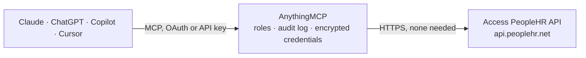

<!-- Generated by scripts/export-github-catalog.mjs in the anythingmcp-website repository. Do not edit by hand. -->

# Access PeopleHR MCP connector

Access PeopleHR, UK HR software: employees, holidays, absences, holiday entitlements, salaries, saved Query Builder reports, appraisals, training, timesheets, work patterns and recruitment vacancies. The AnythingMCP connector gives Claude, ChatGPT, Microsoft Copilot, Cursor and Gemini 26 MCP tools for Access PeopleHR: 24 read and 2 can change data.

**Category:** [HR](../hr.md) · **Tools:** 26 · **Setup guide:** [anythingmcp.com](https://anythingmcp.com/guides/peoplehr-to-mcp) · [Deutsch](https://anythingmcp.com/de/guides/peoplehr-to-mcp) · [Italiano](https://anythingmcp.com/it/guides/peoplehr-to-mcp) · [Español](https://anythingmcp.com/es/guides/peoplehr-to-mcp) · [日本語](https://anythingmcp.com/ja/guides/peoplehr-to-mcp) · [Русский](https://anythingmcp.com/ru/guides/peoplehr-to-mcp) · [中文](https://anythingmcp.com/zh/guides/peoplehr-to-mcp)

## Start without code

No installation and no terminal: AnythingMCP Cloud runs the Access PeopleHR connector for you, operated by helpcode.ai in Frankfurt, Germany.

1. **Click the button above** and create an account or sign in. The Access PeopleHR connector opens, ready to install.
2. **Nothing to enter:** this connector needs no credentials. Every click is in the [step-by-step guide](https://anythingmcp.com/guides/peoplehr-to-mcp).
3. **Click Install.** AnythingMCP shows the address of your MCP server.
4. **Add that address to your assistant:** [Claude](https://anythingmcp.com/guides/connect-peoplehr-to-claude) · [ChatGPT](https://anythingmcp.com/guides/connect-peoplehr-to-chatgpt) · [Microsoft Copilot](https://anythingmcp.com/guides/connect-peoplehr-to-copilot) · [Cursor](https://anythingmcp.com/guides/connect-peoplehr-to-cursor) · [Gemini CLI](https://anythingmcp.com/guides/connect-peoplehr-to-gemini) · [Meta Muse](https://anythingmcp.com/guides/connect-peoplehr-to-muse).
5. **Ask your first question**, for example: *What's Emily Carter's EmployeeId, job title, department and start date in PeopleHR?*

Prefer help with the setup? [Talk to us](https://anythingmcp.com/contact).

## How it works

- **The AI client** speaks MCP (Streamable HTTP) to AnythingMCP and only sees tool names, descriptions and results. It never gets the Access PeopleHR credentials.
- **AnythingMCP** checks the client's role, builds the call from the tool definition, adds the credentials (none needed), calls Access PeopleHR, logs the call and returns the result.
- **Access PeopleHR** sees an ordinary API client with the rights of the account the credentials belong to.

## Tools

| Tool | What it does | Access |
|---|---|---|
| [`peoplehr_get_company_information`](#peoplehr_get_company_information) | Return the company (tenant) the API key belongs to: CompanyId, SubDomain and CompanyName. | read |
| [`peoplehr_get_employee_directory`](#peoplehr_get_employee_directory) | Return every employee in one call as a compact directory: id, name, e-mail, job role, department, location, company, manager, start date and status (1… | read |
| [`peoplehr_list_employees`](#peoplehr_list_employees) | Page through full employee records (contact, employment, bank and right-to-work details, each field as {DisplayValue, FieldHistory}). | read |
| [`peoplehr_get_employee`](#peoplehr_get_employee) | Return one employee's full record by EmployeeId: personal and contact details, job role, department, location, manager, employment type, holiday allowance,… | read |
| [`peoplehr_list_leavers`](#peoplehr_list_leavers) | List the employees who have left the company with their leaving details. | read |
| [`peoplehr_get_employee_absences`](#peoplehr_get_employee_absences) | List one employee's absence (sickness and other absence) records: reason, start and end dates, duration, paid status, part of day, back-to-work interview… | read |
| [`peoplehr_list_absences`](#peoplehr_list_absences) | List absence records for all employees in a date window. | read |
| [`peoplehr_get_employee_holidays`](#peoplehr_get_employee_holidays) | List one employee's annual leave bookings: dates, duration in days or minutes, part of day, approval status, approver and comments. | read |
| [`peoplehr_list_holidays`](#peoplehr_list_holidays) | List annual leave bookings for all employees in a date window. | read |
| [`peoplehr_get_holiday_entitlement`](#peoplehr_get_holiday_entitlement) | Return one employee's holiday entitlement per holiday year: period start and end, whether it is measured in days or hours, and the entitlement amount. | read |
| [`peoplehr_list_holiday_entitlements`](#peoplehr_list_holiday_entitlements) | Return holiday entitlement rows for every employee and holiday year in a date window: FullName, UniqueId, period, unit (days or hours) and amount. | read |
| [`peoplehr_get_employee_salary`](#peoplehr_get_employee_salary) | Return one employee's salary records: effective date, salary type, payment frequency, amount, total including entitlements, currency, deductions,… | read |
| [`peoplehr_list_salaries`](#peoplehr_list_salaries) | Return salary records for all employees. | read |
| [`peoplehr_run_query`](#peoplehr_run_query) | Run a saved Query Builder query by its exact name and return its rows, keyed by the query's own column headings. | read |
| [`peoplehr_get_employee_appraisals`](#peoplehr_get_employee_appraisals) | List one employee's appraisals (performance reviews): AppraisalId, review date, reviewer, notes, objectives, action plan and the tenant's custom appraisal… | read |
| [`peoplehr_get_appraisal`](#peoplehr_get_appraisal) | Return one appraisal by its AppraisalId with review date, reviewer, notes, objectives, action plan and custom columns. | read |
| [`peoplehr_get_employee_training`](#peoplehr_get_employee_training) | List training records: TrainingId, training type, description, importance, status, start, end and expiry dates, cost, provider and notes. | read |
| [`peoplehr_get_employee_other_events`](#peoplehr_get_employee_other_events) | List one employee's other events (leave types beyond holiday and absence, such as jury duty, training days or appointments) with reason, dates, duration,… | read |
| [`peoplehr_get_employee_lateness`](#peoplehr_get_employee_lateness) | List one employee's lateness records: the date, how many minutes late and comments, optionally within a date window. | read |
| [`peoplehr_get_employee_timesheets`](#peoplehr_get_employee_timesheets) | List one employee's timesheets per day with up to 15 time-in and time-out pairs (HH:mm:ss) and comments, within a date window. | read |
| [`peoplehr_list_work_patterns`](#peoplehr_list_work_patterns) | List the company's work patterns with, per week and weekday, the working days and minutes. | read |
| [`peoplehr_list_vacancies`](#peoplehr_list_vacancies) | List the recruitment vacancies (ATS): name, reference, job title, company, location, department, status, closing date, salary range and vacancy type. | read |
| [`peoplehr_get_vacancy`](#peoplehr_get_vacancy) | Return one vacancy by its reference with description, job description, closing date, salary range and application questions. | read |
| [`peoplehr_list_applicants`](#peoplehr_list_applicants) | List the applicants of one vacancy with ApplicantId, first and last name and e-mail address. | read |
| [`peoplehr_add_holiday`](#peoplehr_add_holiday) | Book annual leave for an employee. | write |
| [`peoplehr_add_absence`](#peoplehr_add_absence) | Record an absence (e.g. sickness) for an employee with reason, dates, duration and paid status. | write |

## Tool reference

Every parameter as the AI client sees it in `tools/list`. Source: [`packages/backend/src/adapters/gb/peoplehr.json`](../../../packages/backend/src/adapters/gb/peoplehr.json).

### `peoplehr_get_company_information`

Return the company (tenant) the API key belongs to: CompanyId, SubDomain and CompanyName. No parameters; use it first to confirm the key works.

**Access:** read · **Call:** `POST /Employee`

No parameters.

### `peoplehr_get_employee_directory`

Return every employee in one call as a compact directory: id, name, e-mail, job role, department, location, company, manager, start date and status (1 current, 2 leaver). Use it to find an EmployeeId by name.

**Access:** read · **Call:** `POST /Employee`

| Parameter | Type | Required | Description |
|---|---|---|---|
| `include_leavers` | `true` \| `false` | no | "true" to include people who have left, "false" (default) for current staff only. |

### `peoplehr_list_employees`

Page through full employee records (contact, employment, bank and right-to-work details, each field as {DisplayValue, FieldHistory}). Result.Result holds the rows and Result.Pagination.TotalRows the total; raise offset by limit until you have them all.

**Access:** read · **Call:** `POST /Employee`

| Parameter | Type | Required | Description |
|---|---|---|---|
| `limit` | integer | no | Rows per page, 1 to 500. Default 50. |
| `offset` | integer | no | Number of rows to skip (a row offset, not a page number). Default 0. |
| `include_leavers` | `true` \| `false` | no | "true" to include leavers, "false" (default) for current staff only. |

### `peoplehr_get_employee`

Return one employee's full record by EmployeeId: personal and contact details, job role, department, location, manager, employment type, holiday allowance, bank and right-to-work details, with each field's change history.

**Access:** read · **Call:** `POST /Employee`

| Parameter | Type | Required | Description |
|---|---|---|---|
| `employee_id` | string | yes | PeopleHR employee id as shown on the employee's profile, e.g. PW15 (at most 15 characters). Get it from peoplehr_get_employee_directory. |

### `peoplehr_list_leavers`

List the employees who have left the company with their leaving details. Needs its own grant on the API key (GetAllLeavers); without it PeopleHR answers Status 5 Access Denied.

**Access:** read · **Call:** `POST /Employee`

No parameters.

### `peoplehr_get_employee_absences`

List one employee's absence (sickness and other absence) records: reason, start and end dates, duration, paid status, part of day, back-to-work interview and medical certificate details.

**Access:** read · **Call:** `POST /Absence`

| Parameter | Type | Required | Description |
|---|---|---|---|
| `employee_id` | string | yes | PeopleHR employee id as shown on the employee's profile, e.g. PW15 (at most 15 characters). Get it from peoplehr_get_employee_directory. |
| `start_date` | string | no | Start of the absence window, yyyy-MM-dd. Optional; omit together with end_date for all records. |
| `end_date` | string | no | End of the absence window, yyyy-MM-dd. Must be on or after start_date. |

### `peoplehr_list_absences`

List absence records for all employees in a date window. Result is an object keyed by EmployeeId, each holding that employee's absences; employees without absences are left out.

**Access:** read · **Call:** `POST /Absence`

| Parameter | Type | Required | Description |
|---|---|---|---|
| `start_date` | string | no | Start of the absence window, yyyy-MM-dd. Optional; omit together with end_date for all records. |
| `end_date` | string | no | End of the absence window, yyyy-MM-dd. Must be on or after start_date. |

### `peoplehr_get_employee_holidays`

List one employee's annual leave bookings: dates, duration in days or minutes, part of day, approval status, approver and comments. Use it to answer who is off when.

**Access:** read · **Call:** `POST /Holiday`

| Parameter | Type | Required | Description |
|---|---|---|---|
| `employee_id` | string | yes | PeopleHR employee id as shown on the employee's profile, e.g. PW15 (at most 15 characters). Get it from peoplehr_get_employee_directory. |
| `start_date` | string | no | Start of the holiday window, yyyy-MM-dd. Optional; omit together with end_date for all records. |
| `end_date` | string | no | End of the holiday window, yyyy-MM-dd. Must be on or after start_date. |

### `peoplehr_list_holidays`

List annual leave bookings for all employees in a date window. Result is an object keyed by EmployeeId with each employee's bookings; good for team calendars and cover planning.

**Access:** read · **Call:** `POST /Holiday`

| Parameter | Type | Required | Description |
|---|---|---|---|
| `start_date` | string | no | Start of the holiday window, yyyy-MM-dd. Optional; omit together with end_date for all records. |
| `end_date` | string | no | End of the holiday window, yyyy-MM-dd. Must be on or after start_date. |

### `peoplehr_get_holiday_entitlement`

Return one employee's holiday entitlement per holiday year: period start and end, whether it is measured in days or hours, and the entitlement amount.

**Access:** read · **Call:** `POST /HolidayEntitlements`

| Parameter | Type | Required | Description |
|---|---|---|---|
| `employee_id` | string | yes | PeopleHR employee id as shown on the employee's profile, e.g. PW15 (at most 15 characters). Get it from peoplehr_get_employee_directory. |
| `start_date` | string | no | Start of the entitlement window, yyyy-MM-dd. Optional; omit together with end_date for all records. |
| `end_date` | string | no | End of the entitlement window, yyyy-MM-dd. Must be on or after start_date. |

### `peoplehr_list_holiday_entitlements`

Return holiday entitlement rows for every employee and holiday year in a date window: FullName, UniqueId, period, unit (days or hours) and amount. Without a window this is every year on record, so always pass one.

**Access:** read · **Call:** `POST /HolidayEntitlements`

| Parameter | Type | Required | Description |
|---|---|---|---|
| `start_date` | string | no | Start of the entitlement window, yyyy-MM-dd. Optional; omit together with end_date for all records. |
| `end_date` | string | no | End of the entitlement window, yyyy-MM-dd. Must be on or after start_date. |

### `peoplehr_get_employee_salary`

Return one employee's salary records: effective date, salary type, payment frequency, amount, total including entitlements, currency, deductions, entitlements and change reason. Needs the SALARY schema on the key.

**Access:** read · **Call:** `POST /Salary`

| Parameter | Type | Required | Description |
|---|---|---|---|
| `employee_id` | string | yes | PeopleHR employee id as shown on the employee's profile, e.g. PW15 (at most 15 characters). Get it from peoplehr_get_employee_directory. |
| `include_history` | `true` \| `false` | no | "true" for every salary record, "false" (default) for the current one only. |

### `peoplehr_list_salaries`

Return salary records for all employees. Result is an object keyed by EmployeeId with an array of salary records each; employees without a salary record are left out.

**Access:** read · **Call:** `POST /Salary`

| Parameter | Type | Required | Description |
|---|---|---|---|
| `include_history` | `true` \| `false` | no | "true" for every salary record, "false" (default) for the current ones only. |

### `peoplehr_run_query`

Run a saved Query Builder query by its exact name and return its rows, keyed by the query's own column headings. Use it for reports the other tools do not cover; the query must exist in PeopleHR.

**Access:** read · **Call:** `POST /Query`

| Parameter | Type | Required | Description |
|---|---|---|---|
| `query_name` | string | yes | Exact name of a query saved in PeopleHR's Query Builder (Reports > Query Builder), including spaces and capitals. The API cannot list them. |

### `peoplehr_get_employee_appraisals`

List one employee's appraisals (performance reviews): AppraisalId, review date, reviewer, notes, objectives, action plan and the tenant's custom appraisal columns.

**Access:** read · **Call:** `POST /Appraisal`

| Parameter | Type | Required | Description |
|---|---|---|---|
| `employee_id` | string | yes | PeopleHR employee id as shown on the employee's profile, e.g. PW15 (at most 15 characters). Get it from peoplehr_get_employee_directory. |

### `peoplehr_get_appraisal`

Return one appraisal by its AppraisalId with review date, reviewer, notes, objectives, action plan and custom columns. Get the id from peoplehr_get_employee_appraisals.

**Access:** read · **Call:** `POST /Appraisal`

| Parameter | Type | Required | Description |
|---|---|---|---|
| `appraisal_id` | string | yes | AppraisalId from peoplehr_get_employee_appraisals. |
| `employee_id` | string | yes | PeopleHR employee id as shown on the employee's profile, e.g. PW15 (at most 15 characters). Get it from peoplehr_get_employee_directory. |

### `peoplehr_get_employee_training`

List training records: TrainingId, training type, description, importance, status, start, end and expiry dates, cost, provider and notes. Training is read per employee.

**Access:** read · **Call:** `POST /Training`

| Parameter | Type | Required | Description |
|---|---|---|---|
| `employee_id` | string | yes | PeopleHR employee id as shown on the employee's profile, e.g. PW15 (at most 15 characters). Get it from peoplehr_get_employee_directory. |

### `peoplehr_get_employee_other_events`

List one employee's other events (leave types beyond holiday and absence, such as jury duty, training days or appointments) with reason, dates, duration, status and approver.

**Access:** read · **Call:** `POST /OtherEvent`

| Parameter | Type | Required | Description |
|---|---|---|---|
| `employee_id` | string | yes | PeopleHR employee id as shown on the employee's profile, e.g. PW15 (at most 15 characters). Get it from peoplehr_get_employee_directory. |
| `start_date` | string | no | Start of the event window, yyyy-MM-dd. Optional; omit together with end_date for all records. |
| `end_date` | string | no | End of the event window, yyyy-MM-dd. Must be on or after start_date. |

### `peoplehr_get_employee_lateness`

List one employee's lateness records: the date, how many minutes late and comments, optionally within a date window.

**Access:** read · **Call:** `POST /Late`

| Parameter | Type | Required | Description |
|---|---|---|---|
| `employee_id` | string | yes | PeopleHR employee id as shown on the employee's profile, e.g. PW15 (at most 15 characters). Get it from peoplehr_get_employee_directory. |
| `start_date` | string | no | Start of the lateness window, yyyy-MM-dd. Optional; omit together with end_date for all records. |
| `end_date` | string | no | End of the lateness window, yyyy-MM-dd. Must be on or after start_date. |

### `peoplehr_get_employee_timesheets`

List one employee's timesheets per day with up to 15 time-in and time-out pairs (HH:mm:ss) and comments, within a date window. Needs the TIMESHEET schema on the key.

**Access:** read · **Call:** `POST /Timesheet`

| Parameter | Type | Required | Description |
|---|---|---|---|
| `employee_id` | string | yes | PeopleHR employee id as shown on the employee's profile, e.g. PW15 (at most 15 characters). Get it from peoplehr_get_employee_directory. |
| `start_date` | string | no | Start of the timesheet window, yyyy-MM-dd. Optional; omit together with end_date for all records. |
| `end_date` | string | no | End of the timesheet window, yyyy-MM-dd. Must be on or after start_date. |

### `peoplehr_list_work_patterns`

List the company's work patterns with, per week and weekday, the working days and minutes. Filter by name or id; use it to explain how holiday and absence durations are counted.

**Access:** read · **Call:** `POST /WorkPattern`

| Parameter | Type | Required | Description |
|---|---|---|---|
| `work_pattern_name` | string | no | Optional work pattern name to filter on. |
| `work_pattern_id` | string | no | Optional work pattern id to filter on. |

### `peoplehr_list_vacancies`

List the recruitment vacancies (ATS): name, reference, job title, company, location, department, status, closing date, salary range and vacancy type. Needs the ATS schema on the key.

**Access:** read · **Call:** `POST /Vacancy`

No parameters.

### `peoplehr_get_vacancy`

Return one vacancy by its reference with description, job description, closing date, salary range and application questions. Get the reference from peoplehr_list_vacancies.

**Access:** read · **Call:** `POST /Vacancy`

| Parameter | Type | Required | Description |
|---|---|---|---|
| `vacancy_reference` | string | yes | The vacancy's Reference value from peoplehr_list_vacancies, e.g. VA4. |

### `peoplehr_list_applicants`

List the applicants of one vacancy with ApplicantId, first and last name and e-mail address. Get the vacancy reference from peoplehr_list_vacancies.

**Access:** read · **Call:** `POST /Applicant`

| Parameter | Type | Required | Description |
|---|---|---|---|
| `vacancy_reference` | string | yes | The vacancy's Reference value from peoplehr_list_vacancies. |

### `peoplehr_add_holiday`

Book annual leave for an employee. For a day or more set duration_type 1 and duration_in_days; for less than a day set duration_type 2, duration_in_minutes and part_of_day. Rejected when it overlaps other leave.

**Access:** write · **Call:** `POST /Holiday`

| Parameter | Type | Required | Description |
|---|---|---|---|
| `employee_id` | string | yes | PeopleHR employee id as shown on the employee's profile, e.g. PW15 (at most 15 characters). Get it from peoplehr_get_employee_directory. |
| `duration_type` | `1` \| `2` | yes | 1 for a day or more, 2 for less than a day. |
| `start_date` | string | yes | First day of leave, yyyy-MM-dd. |
| `end_date` | string | yes | Last day of leave, yyyy-MM-dd. |
| `duration_in_days` | string | yes | Number of working days, e.g. "1" or "0.5". Required by the API; send "0" for part-day leave. |
| `duration_in_minutes` | string | yes | Minutes of leave for part-day bookings, e.g. "240". Required by the API; send "0" for whole days. |
| `part_of_day` | `AM` \| `PM` | no | AM or PM, for part-day leave. |
| `comments` | string | no | Optional comment stored with the booking. |

### `peoplehr_add_absence`

Record an absence (e.g. sickness) for an employee with reason, dates, duration and paid status. The reason must exist in the tenant's absence reason list; overlapping leave is rejected.

**Access:** write · **Call:** `POST /Absence`

| Parameter | Type | Required | Description |
|---|---|---|---|
| `employee_id` | string | yes | PeopleHR employee id as shown on the employee's profile, e.g. PW15 (at most 15 characters). Get it from peoplehr_get_employee_directory. |
| `duration_type` | `1` \| `2` \| `3` | yes | 1 for a day or more, 2 for half a day, 3 for a quarter day. |
| `reason` | string | yes | Absence reason exactly as in the tenant's absence reason list, e.g. Sickness. |
| `start_date` | string | yes | First day of absence, yyyy-MM-dd. |
| `end_date` | string | yes | Last day of absence, yyyy-MM-dd. |
| `duration` | string | yes | Duration in days, e.g. "1". |
| `part_of_day` | `AM` \| `PM` | no | AM or PM, for part-day absences. |
| `absence_paid_status` | string | yes | Paid status code as configured in PeopleHR, e.g. "1" for paid. |
| `emergency_leave` | `true` \| `false` | yes | "true" if this is emergency leave, otherwise "false". |

## Run it yourself

AnythingMCP is open source (AGPL-3.0). [Run it with Docker](../../../README.md#run-it-yourself), open **Connectors → Store**, pick **Access PeopleHR** and enter `PEOPLEHR_API_KEY`, then add your MCP server URL to the AI client.

[← HR connectors](../hr.md) · [All categories](../README.md)
