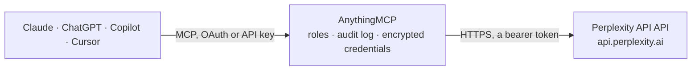

<!-- Generated by scripts/export-github-catalog.mjs in the anythingmcp-website repository. Do not edit by hand. -->

# Perplexity API MCP connector

Let your AI ask Perplexity with your own API key: answers grounded in live web search with their sources, raw ranked search results, Sonar models, and longer deep research that runs in the background. The AnythingMCP connector gives Claude, ChatGPT, Microsoft Copilot, Cursor and Gemini 7 MCP tools for Perplexity API: 5 read and 2 can change data.

**Category:** [Public Data](../data.md) · **Tools:** 7 · **Setup guide:** [anythingmcp.com](https://anythingmcp.com/guides/perplexity-to-mcp) · [Deutsch](https://anythingmcp.com/de/guides/perplexity-to-mcp) · [Italiano](https://anythingmcp.com/it/guides/perplexity-to-mcp) · [Español](https://anythingmcp.com/es/guides/perplexity-to-mcp) · [日本語](https://anythingmcp.com/ja/guides/perplexity-to-mcp) · [Русский](https://anythingmcp.com/ru/guides/perplexity-to-mcp) · [中文](https://anythingmcp.com/zh/guides/perplexity-to-mcp)

## Start without code

No installation and no terminal: AnythingMCP Cloud runs the Perplexity API connector for you, operated by helpcode.ai in Frankfurt, Germany.

1. **Click the button above** and create an account or sign in. The Perplexity API connector opens, ready to install.
2. **Paste the API key or token from your Perplexity API account.** Every click is in the [step-by-step guide](https://anythingmcp.com/guides/perplexity-to-mcp).
3. **Click Install.** AnythingMCP shows the address of your MCP server.
4. **Add that address to your assistant:** [Claude](https://anythingmcp.com/guides/connect-perplexity-to-claude) · [ChatGPT](https://anythingmcp.com/guides/connect-perplexity-to-chatgpt) · [Microsoft Copilot](https://anythingmcp.com/guides/connect-perplexity-to-copilot) · [Cursor](https://anythingmcp.com/guides/connect-perplexity-to-cursor) · [Gemini CLI](https://anythingmcp.com/guides/connect-perplexity-to-gemini) · [Meta Muse](https://anythingmcp.com/guides/connect-perplexity-to-muse).
5. **Ask your first question**, for example: *Find the EU VAT registration document for BlueHarbor GmbH (VAT DE301279843) and its filing date.*

Prefer help with the setup? [Talk to us](https://anythingmcp.com/contact).

## How it works

- **The AI client** speaks MCP (Streamable HTTP) to AnythingMCP and only sees tool names, descriptions and results. It never gets the Perplexity API credentials.
- **AnythingMCP** checks the client's role, builds the call from the tool definition, adds the credentials (a bearer token), calls Perplexity API, logs the call and returns the result.
- **Perplexity API** sees an ordinary API client with the rights of the account the credentials belong to.

## Tools

| Tool | What it does | Access |
|---|---|---|
| [`perplexity_ask`](#perplexity_ask) | Ask Perplexity a question and get an answer grounded in live web search, with its sources (Agent API). | read |
| [`perplexity_search`](#perplexity_search) | Search the web with Perplexity's Search API and get ranked results with title, URL, date and a content snippet, without a written answer. | read |
| [`perplexity_sonar`](#perplexity_sonar) | Ask a Perplexity Sonar model (chat completions) and get an answer with citations and the search results it used. | read |
| [`perplexity_start_research`](#perplexity_start_research) | Start a long Perplexity research run in the background (Agent API background mode) and get its id at once. | write |
| [`perplexity_get_response`](#perplexity_get_response) | Get a Perplexity Agent API run by id, for example a research run from perplexity_start_research. | read |
| [`perplexity_cancel_response`](#perplexity_cancel_response) | Cancel a Perplexity background run that is still queued or in progress, so it stops using credits. | write |
| [`perplexity_list_models`](#perplexity_list_models) | List the model ids the Perplexity Agent API accepts in the model parameter of perplexity_ask, in provider/model form (for example openai/gpt-5.6-luna). | read |

## Tool reference

Every parameter as the AI client sees it in `tools/list`. Source: [`packages/backend/src/adapters/intl/perplexity.json`](../../../packages/backend/src/adapters/intl/perplexity.json).

### `perplexity_ask`

Ask Perplexity a question and get an answer grounded in live web search, with its sources (Agent API). Billed to the user's Perplexity credits per search and per token; the default preset fast is the cheapest. Returns answer (with [n] markers pointing to sources[].id), sources, citations, status and usage with total_cost in USD. Read-only: it changes nothing in the account.

**Access:** read · **Call:** `POST /v1/agent`

| Parameter | Type | Required | Description |
|---|---|---|---|
| `input` | string | yes | The question or task, as the user would write it. |
| `preset` | `fast` \| `low` | no | fast (default) for single facts, definitions and short summaries; low for everyday research needing a few searches. For deeper research use perplexity_start_research. |
| `model` | string | no | Optional model id in provider/model form (see perplexity_list_models) to use instead of the preset's model. Anthropic models also need max_output_tokens. |
| `instructions` | string | no | How to answer: role, tone, language, format. Replaces the preset's system prompt, so keep a request for citations in it if you need them. |
| `search_domain_filter` | string[] | no | Up to 20 domains or URLs: all to include, e.g. ["nasa.gov"], or all to exclude with a leading minus, e.g. ["-reddit.com"]. Never mix the two. |
| `search_recency_filter` | `hour` \| `day` \| `week` \| `month` \| `year` | no | Only sources published within this period back from now. |
| `search_after_date_filter` | string | no | Only sources published after this date, MM/DD/YYYY. |
| `search_before_date_filter` | string | no | Only sources published before this date, MM/DD/YYYY. |
| `max_results` | integer | no | Upper bound on search results collected per search, 1 to 50. Preset default when left out. |
| `search_type` | `fast` \| `web` | no | fast ($1 per 1,000 searches, the presets' default) or web ($2.50 per 1,000, for hard or ambiguous questions). |
| `language_preference` | string | no | ISO 639-1 code of the language the answer should be in, e.g. de. |
| `max_output_tokens` | integer | no | Upper limit for the answer in tokens. Required for anthropic/ models. |
| `previous_response_id` | string | no | id of an earlier completed answer to continue that conversation without resending it. |
| `response_format` | object | no | For a JSON answer: {"type": "json_schema", "json_schema": {"name": "answer", "schema": {...}}}. |

### `perplexity_search`

Search the web with Perplexity's Search API and get ranked results with title, URL, date and a content snippet, without a written answer. Billed to the user's Perplexity credits per request: search_type fast (the default) costs $1 per 1,000, web $5 per 1,000. Returns results and the request id. Read-only: it changes nothing in the account.

**Access:** read · **Call:** `POST /search`

| Parameter | Type | Required | Description |
|---|---|---|---|
| `query` | string | yes | What to search for. |
| `max_results` | integer | no | Number of results, 1 to 20. Default 5. |
| `search_type` | `fast` \| `web` | no | fast (default) is quicker and cheaper; web is the standard search for harder questions. |
| `max_tokens_per_page` | integer | no | Cap on the content tokens taken from each result page, to keep snippets short. |
| `max_tokens` | integer | no | Cap on the content tokens across all results. |
| `search_domain_filter` | string[] | no | Up to 20 domains: all to include, e.g. ["nasa.gov"], or all to exclude with a leading minus, e.g. ["-reddit.com"]. Never mix the two. |
| `search_recency_filter` | `hour` \| `day` \| `week` \| `month` \| `year` | no | Only results published within this period back from now. |
| `search_after_date_filter` | string | no | Only results published after this date, MM/DD/YYYY. |
| `search_before_date_filter` | string | no | Only results published before this date, MM/DD/YYYY. |
| `search_language_filter` | string[] | no | ISO 639-1 language codes of the pages to keep, e.g. ["en", "de"]. |
| `country` | string | no | ISO 3166-1 alpha-2 country code to search from, e.g. DE. |

### `perplexity_sonar`

Ask a Perplexity Sonar model (chat completions) and get an answer with citations and the search results it used. Billed to the user's Perplexity credits per request and per token; sonar is the cheapest. Perplexity ended support for Sonar on 27 September 2026 and reroutes these calls to the Agent API, so prefer perplexity_ask. Returns answer, citations, search_results, related_questions and usage with total_cost in USD. Read-only.

**Access:** read · **Call:** `POST /v1/sonar`

| Parameter | Type | Required | Description |
|---|---|---|---|
| `prompt` | string | yes | The question or task, as the user would write it. |
| `model` | `sonar` \| `sonar-pro` \| `sonar-reasoning-pro` | no | sonar (default, cheapest), sonar-pro for harder questions with more sources, sonar-reasoning-pro for multi-step reasoning (slower). For Sonar Deep Research use perplexity_start_research with preset high. |
| `system_prompt` | string | no | How the model should answer: role, tone, language, format. |
| `search_domain_filter` | string[] | no | Up to 20 domains: all to include, e.g. ["nasa.gov"], or all to exclude with a leading minus, e.g. ["-reddit.com"]. Never mix the two. |
| `search_recency_filter` | `hour` \| `day` \| `week` \| `month` \| `year` | no | Only sources published within this period back from now. |
| `search_after_date_filter` | string | no | Only sources published after this date, MM/DD/YYYY. |
| `search_before_date_filter` | string | no | Only sources published before this date, MM/DD/YYYY. |
| `search_mode` | `web` \| `academic` \| `sec` | no | web (default), academic for scholarly sources, sec for SEC filings. |
| `search_context_size` | `low` \| `medium` \| `high` | no | How much search content the model reads: low (default, cheapest request fee), medium or high. |
| `return_related_questions` | boolean | no | Also suggest a few follow-up questions. |
| `max_tokens` | integer | no | Upper limit for the answer in tokens. |
| `language_preference` | string | no | ISO 639-1 code of the language the answer should be in, e.g. de. |

### `perplexity_start_research`

Start a long Perplexity research run in the background (Agent API background mode) and get its id at once. Billed to the user's Perplexity credits; medium (default) is the cheapest research preset, high and xhigh cost more, so confirm with the user before using them. Then call perplexity_get_response every 30 to 60 seconds until status is completed, failed, cancelled or incomplete.

**Access:** write · **Call:** `POST /v1/agent`

| Parameter | Type | Required | Description |
|---|---|---|---|
| `input` | string | yes | The research question or task, with the scope and the form of the report wanted. |
| `preset` | `medium` \| `high` \| `xhigh` | no | medium (default) chains evidence across many sources; high is expert-level with the broadest coverage (the replacement for Sonar Deep Research); xhigh is the most thorough and can run code. |
| `instructions` | string | no | How the report should be written: role, tone, language, structure. Replaces the preset's system prompt. |
| `search_domain_filter` | string[] | no | Up to 20 domains or URLs: all to include, or all to exclude with a leading minus. Never mix the two. |
| `search_recency_filter` | `hour` \| `day` \| `week` \| `month` \| `year` | no | Only sources published within this period back from now. |
| `search_after_date_filter` | string | no | Only sources published after this date, MM/DD/YYYY. |
| `search_before_date_filter` | string | no | Only sources published before this date, MM/DD/YYYY. |
| `language_preference` | string | no | ISO 639-1 code of the language the report should be in, e.g. de. |
| `response_format` | object | no | For a JSON report: {"type": "json_schema", "json_schema": {"name": "report", "schema": {...}}}. |

### `perplexity_get_response`

Get a Perplexity Agent API run by id, for example a research run from perplexity_start_research. While status is queued or in_progress call again in 30 to 60 seconds; once completed it returns answer (with [n] markers pointing to sources[].id), sources, citations and usage with total_cost in USD. A failed run comes back as an error with Perplexity's message.

**Access:** read · **Call:** `GET /v1/agent/{id}`

| Parameter | Type | Required | Description |
|---|---|---|---|
| `id` | string | yes | The id returned by perplexity_start_research or perplexity_ask (starts with resp_). |

### `perplexity_cancel_response`

Cancel a Perplexity background run that is still queued or in progress, so it stops using credits. Cancelling is asynchronous: the answer says cancelling, and perplexity_get_response shows cancelled shortly after. A run that already finished cannot be cancelled (400). Confirm with the user first: a cancelled run cannot be resumed.

**Access:** write · **Call:** `POST /v1/agent/{id}/cancel`

| Parameter | Type | Required | Description |
|---|---|---|---|
| `id` | string | yes | The id of the run, as returned by perplexity_start_research. |

### `perplexity_list_models`

List the model ids the Perplexity Agent API accepts in the model parameter of perplexity_ask, in provider/model form (for example openai/gpt-5.6-luna). Free: nothing is billed.

**Access:** read · **Call:** `GET /v1/models`

No parameters.

## Run it yourself

AnythingMCP is open source (AGPL-3.0). [Run it with Docker](../../../README.md#run-it-yourself), open **Connectors → Store**, pick **Perplexity API** and enter `PERPLEXITY_API_KEY`, then add your MCP server URL to the AI client.

[← Public Data connectors](../data.md) · [All categories](../README.md)
