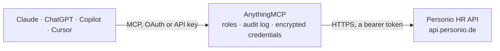

<!-- Generated by scripts/export-github-catalog.mjs in the anythingmcp-website repository. Do not edit by hand. -->

# Personio HR MCP connector

Access employee records, attendances, absences, and time-offs via the Personio REST API. The AnythingMCP connector gives Claude, ChatGPT, Microsoft Copilot, Cursor and Gemini 5 MCP tools for Personio HR, all read-only.

**Category:** [HR](../hr.md) · **Tools:** 5 · **Setup guide:** [anythingmcp.com](https://anythingmcp.com/guides/personio-to-mcp) · [Deutsch](https://anythingmcp.com/de/guides/personio-to-mcp) · [Italiano](https://anythingmcp.com/it/guides/personio-to-mcp) · [Español](https://anythingmcp.com/es/guides/personio-to-mcp) · [日本語](https://anythingmcp.com/ja/guides/personio-to-mcp) · [Русский](https://anythingmcp.com/ru/guides/personio-to-mcp) · [中文](https://anythingmcp.com/zh/guides/personio-to-mcp)

## Start without code

No installation and no terminal: AnythingMCP Cloud runs the Personio HR connector for you, operated by helpcode.ai in Frankfurt, Germany.

1. **Click the button above** and create an account or sign in. The Personio HR connector opens, ready to install.
2. **Paste the API key or token from your Personio HR account.** Every click is in the [step-by-step guide](https://anythingmcp.com/guides/personio-to-mcp).
3. **Click Install.** AnythingMCP shows the address of your MCP server.
4. **Add that address to your assistant:** [Claude](https://anythingmcp.com/guides/connect-personio-to-claude) · [ChatGPT](https://anythingmcp.com/guides/connect-personio-to-chatgpt) · [Microsoft Copilot](https://anythingmcp.com/guides/connect-personio-to-copilot) · [Cursor](https://anythingmcp.com/guides/connect-personio-to-cursor) · [Gemini CLI](https://anythingmcp.com/guides/connect-personio-to-gemini) · [Meta Muse](https://anythingmcp.com/guides/connect-personio-to-muse).
5. **Ask your first question**, for example: *Show me Jana Müller at Softline Solutions GmbH — her employee record by email jana.mueller@softline.de*

Prefer help with the setup? [Talk to us](https://anythingmcp.com/contact).

## How it works

- **The AI client** speaks MCP (Streamable HTTP) to AnythingMCP and only sees tool names, descriptions and results. It never gets the Personio HR credentials.
- **AnythingMCP** checks the client's role, builds the call from the tool definition, adds the credentials (a bearer token), calls Personio HR, logs the call and returns the result.
- **Personio HR** sees an ordinary API client with the rights of the account the credentials belong to.

## Tools

| Tool | What it does | Access |
|---|---|---|
| [`personio_list_employees`](#personio_list_employees) | List all employees. | read |
| [`personio_get_employee`](#personio_get_employee) | Retrieve a single employee by id. | read |
| [`personio_list_absences`](#personio_list_absences) | List absences (Abwesenheiten) — vacation, sick leave, parental leave, etc. | read |
| [`personio_list_attendances`](#personio_list_attendances) | List attendance records (working hours). | read |
| [`personio_list_absence_types`](#personio_list_absence_types) | List the configured absence types (vacation, sick, parental leave, etc.) with id, name, category, and unit (days vs hours). | read |

## Tool reference

Every parameter as the AI client sees it in `tools/list`. Source: [`packages/backend/src/adapters/de/personio.json`](../../../packages/backend/src/adapters/de/personio.json).

### `personio_list_employees`

List all employees. Returns id, first/last name, email, position, department, office, hire date, status (active/inactive/onboarding/leave/offboarded) and supervisor. Supports filtering by email, department, or status.

**Access:** read · **Call:** `GET /company/employees`

| Parameter | Type | Required | Description |
|---|---|---|---|
| `email` | string | no | Filter by employee email (exact match). |
| `limit` | number | no | Max results (default: 200, max: 200). |
| `offset` | number | no | Offset for pagination. |

### `personio_get_employee`

Retrieve a single employee by id. Returns all custom attributes, contract details, salary band (if token has permission), and personal data.

**Access:** read · **Call:** `GET /company/employees/{id}`

| Parameter | Type | Required | Description |
|---|---|---|---|
| `id` | string | yes | Personio employee id. |

### `personio_list_absences`

List absences (Abwesenheiten) — vacation, sick leave, parental leave, etc. Returns type, start/end date, half-day flag, certificate URL, and approval status.

**Access:** read · **Call:** `GET /company/time-offs`

| Parameter | Type | Required | Description |
|---|---|---|---|
| `start_date` | string | no | Filter: absences overlapping on or after this ISO date (e.g. '2026-01-01'). |
| `end_date` | string | no | Filter: absences overlapping on or before this date. |
| `employees` | string | no | Comma-separated employee ids to filter by. |
| `limit` | number | no | Max results (default 200). |
| `offset` | number | no | Offset for pagination. |

### `personio_list_attendances`

List attendance records (working hours). Returns date, employee, start/end time, break minutes, project (if project tracking enabled), and comment.

**Access:** read · **Call:** `GET /company/attendances`

| Parameter | Type | Required | Description |
|---|---|---|---|
| `start_date` | string | yes | Earliest attendance date (ISO, e.g. '2026-04-01'). Required. |
| `end_date` | string | yes | Latest attendance date (ISO). Required. |
| `employees` | string | no | Comma-separated employee ids to scope the query. |
| `limit` | number | no | Max results. |
| `offset` | number | no | Offset for pagination. |

### `personio_list_absence_types`

List the configured absence types (vacation, sick, parental leave, etc.) with id, name, category, and unit (days vs hours). Use ids when creating new absences.

**Access:** read · **Call:** `GET /company/time-off-types`

| Parameter | Type | Required | Description |
|---|---|---|---|
| `limit` | number | no | Max results. |
| `offset` | number | no | Offset for pagination. |

## Run it yourself

AnythingMCP is open source (AGPL-3.0). [Run it with Docker](../../../README.md#run-it-yourself), open **Connectors → Store**, pick **Personio HR** and enter `PERSONIO_TOKEN`, then add your MCP server URL to the AI client.

[← HR connectors](../hr.md) · [All categories](../README.md)
