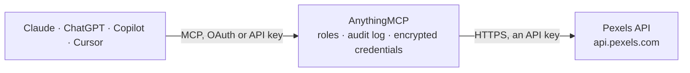

<!-- Generated by scripts/export-github-catalog.mjs in the anythingmcp-website repository. Do not edit by hand. -->

# Pexels MCP connector

Pexels free stock media: search photos and videos with orientation, size, colour and locale filters, curated photos, popular videos, single photo or video details, and featured or own collections. The AnythingMCP connector gives Claude, ChatGPT, Microsoft Copilot, Cursor and Gemini 9 MCP tools for Pexels, all read-only.

**Category:** [Publishing](../publishing.md) · **Tools:** 9 · **Setup guide:** [anythingmcp.com](https://anythingmcp.com/guides/pexels-to-mcp) · [Deutsch](https://anythingmcp.com/de/guides/pexels-to-mcp) · [Italiano](https://anythingmcp.com/it/guides/pexels-to-mcp) · [Español](https://anythingmcp.com/es/guides/pexels-to-mcp) · [日本語](https://anythingmcp.com/ja/guides/pexels-to-mcp) · [Русский](https://anythingmcp.com/ru/guides/pexels-to-mcp) · [中文](https://anythingmcp.com/zh/guides/pexels-to-mcp)

## Start without code

No installation and no terminal: AnythingMCP Cloud runs the Pexels connector for you, operated by helpcode.ai in Frankfurt, Germany.

1. **Click the button above** and create an account or sign in. The Pexels connector opens, ready to install.
2. **Paste the API key or token from your Pexels account.** Every click is in the [step-by-step guide](https://anythingmcp.com/guides/pexels-to-mcp).
3. **Click Install.** AnythingMCP shows the address of your MCP server.
4. **Add that address to your assistant:** [Claude](https://anythingmcp.com/guides/connect-pexels-to-claude) · [ChatGPT](https://anythingmcp.com/guides/connect-pexels-to-chatgpt) · [Microsoft Copilot](https://anythingmcp.com/guides/connect-pexels-to-copilot) · [Cursor](https://anythingmcp.com/guides/connect-pexels-to-cursor) · [Gemini CLI](https://anythingmcp.com/guides/connect-pexels-to-gemini) · [Meta Muse](https://anythingmcp.com/guides/connect-pexels-to-muse).
5. **Ask your first question**, for example: *Show details for photo 2012345 so I can confirm photographer and size for the product invoice header*

Prefer help with the setup? [Talk to us](https://anythingmcp.com/contact).

## How it works

- **The AI client** speaks MCP (Streamable HTTP) to AnythingMCP and only sees tool names, descriptions and results. It never gets the Pexels credentials.
- **AnythingMCP** checks the client's role, builds the call from the tool definition, adds the credentials (an API key), calls Pexels, logs the call and returns the result.
- **Pexels** sees an ordinary API client with the rights of the account the credentials belong to.

## Tools

| Tool | What it does | Access |
|---|---|---|
| [`pexels_search_photos`](#pexels_search_photos) | Search free stock photos by keyword, with optional orientation, minimum size, colour and locale. | read |
| [`pexels_list_curated_photos`](#pexels_list_curated_photos) | List photos hand-picked by the Pexels team, updated at least hourly. | read |
| [`pexels_get_photo`](#pexels_get_photo) | Get one photo by id: width, height, photographer and profile link, average colour, alt text and image URLs (original, large2x, large, medium, small,… | read |
| [`pexels_search_videos`](#pexels_search_videos) | Search free stock videos by keyword, with optional orientation, minimum size and locale. | read |
| [`pexels_list_popular_videos`](#pexels_list_popular_videos) | List the currently popular videos on Pexels, optionally limited by minimum width or height and by duration. | read |
| [`pexels_get_video`](#pexels_get_video) | Get one video by id: width, height, duration, user, preview image, video files (quality, file type, size, link) and preview pictures. | read |
| [`pexels_list_featured_collections`](#pexels_list_featured_collections) | List the collections featured by Pexels with id, title, description and the number of photos and videos. | read |
| [`pexels_list_my_collections`](#pexels_list_my_collections) | List the collections of the Pexels account that owns the API key, with id, title, description, privacy and media counts. | read |
| [`pexels_get_collection_media`](#pexels_get_collection_media) | List the photos and videos in one featured collection or one of the key owner's collections, optionally only photos or only videos. | read |

## Tool reference

Every parameter as the AI client sees it in `tools/list`. Source: [`packages/backend/src/adapters/intl/pexels.json`](../../../packages/backend/src/adapters/intl/pexels.json).

### `pexels_search_photos`

Search free stock photos by keyword, with optional orientation, minimum size, colour and locale. Returns photos with photographer, page URL, average colour, alt text and image URLs in several sizes.

**Access:** read · **Call:** `GET /search`

| Parameter | Type | Required | Description |
|---|---|---|---|
| `query` | string | yes | What to search for, for example ocean sunset, people working, Tigers. |
| `orientation` | `landscape` \| `portrait` \| `square` | no | Orientation of the media. |
| `size` | `large` \| `medium` \| `small` | no | Minimum size: large (24 MP photos / 4K video), medium (12 MP / Full HD), small (4 MP / HD). |
| `color` | string | no | Desired colour: red, orange, yellow, green, turquoise, blue, violet, pink, brown, black, gray, white, or a hex code such as #ffffff. |
| `locale` | string | no | Search locale, for example en-US, de-DE, it-IT, pt-BR, ja-JP. Default en-US. |
| `page` | integer | no | Page number, starting at 1. |
| `per_page` | integer | no | Results per page, default 15, at most 80. |

### `pexels_list_curated_photos`

List photos hand-picked by the Pexels team, updated at least hourly. Returns the same photo fields as search. Use it for generic, high-quality imagery without a keyword.

**Access:** read · **Call:** `GET /curated`

| Parameter | Type | Required | Description |
|---|---|---|---|
| `page` | integer | no | Page number, starting at 1. |
| `per_page` | integer | no | Results per page, default 15, at most 80. |

### `pexels_get_photo`

Get one photo by id: width, height, photographer and profile link, average colour, alt text and image URLs (original, large2x, large, medium, small, portrait, landscape, tiny).

**Access:** read · **Call:** `GET /photos/{id}`

| Parameter | Type | Required | Description |
|---|---|---|---|
| `id` | integer | yes | Photo id from a search or curated list, for example 2014422. |

### `pexels_search_videos`

Search free stock videos by keyword, with optional orientation, minimum size and locale. Returns videos with duration, user, preview image and video files in several resolutions.

**Access:** read · **Call:** `GET /videos/search`

| Parameter | Type | Required | Description |
|---|---|---|---|
| `query` | string | yes | What to search for, for example city traffic, drone mountains. |
| `orientation` | `landscape` \| `portrait` \| `square` | no | Orientation of the media. |
| `size` | `large` \| `medium` \| `small` | no | Minimum size: large (24 MP photos / 4K video), medium (12 MP / Full HD), small (4 MP / HD). |
| `locale` | string | no | Search locale, for example en-US, de-DE, it-IT, pt-BR, ja-JP. Default en-US. |
| `page` | integer | no | Page number, starting at 1. |
| `per_page` | integer | no | Results per page, default 15, at most 80. |

### `pexels_list_popular_videos`

List the currently popular videos on Pexels, optionally limited by minimum width or height and by duration. Returns the same video fields as search.

**Access:** read · **Call:** `GET /videos/popular`

| Parameter | Type | Required | Description |
|---|---|---|---|
| `min_width` | integer | no | Minimum width in pixels. |
| `min_height` | integer | no | Minimum height in pixels. |
| `min_duration` | integer | no | Minimum duration in seconds. |
| `max_duration` | integer | no | Maximum duration in seconds. |
| `page` | integer | no | Page number, starting at 1. |
| `per_page` | integer | no | Results per page, default 15, at most 80. |

### `pexels_get_video`

Get one video by id: width, height, duration, user, preview image, video files (quality, file type, size, link) and preview pictures.

**Access:** read · **Call:** `GET /videos/videos/{id}`

| Parameter | Type | Required | Description |
|---|---|---|---|
| `id` | integer | yes | Video id from a search or popular list. |

### `pexels_list_featured_collections`

List the collections featured by Pexels with id, title, description and the number of photos and videos. Use a collection id with pexels_get_collection_media.

**Access:** read · **Call:** `GET /collections/featured`

| Parameter | Type | Required | Description |
|---|---|---|---|
| `page` | integer | no | Page number, starting at 1. |
| `per_page` | integer | no | Results per page, default 15, at most 80. |

### `pexels_list_my_collections`

List the collections of the Pexels account that owns the API key, with id, title, description, privacy and media counts.

**Access:** read · **Call:** `GET /collections`

| Parameter | Type | Required | Description |
|---|---|---|---|
| `page` | integer | no | Page number, starting at 1. |
| `per_page` | integer | no | Results per page, default 15, at most 80. |

### `pexels_get_collection_media`

List the photos and videos in one featured collection or one of the key owner's collections, optionally only photos or only videos. Other collections answer 404.

**Access:** read · **Call:** `GET /collections/{id}`

| Parameter | Type | Required | Description |
|---|---|---|---|
| `id` | string | yes | Collection id from pexels_list_featured_collections or pexels_list_my_collections. Only featured collections and the key owner's own collections can be read. |
| `type` | `photos` \| `videos` | no | Only photos or only videos; both by default. |
| `sort` | `asc` \| `desc` | no | Order of the media in the collection, asc (default) or desc. |
| `page` | integer | no | Page number, starting at 1. |
| `per_page` | integer | no | Results per page, default 15, at most 80. |

## Run it yourself

AnythingMCP is open source (AGPL-3.0). [Run it with Docker](../../../README.md#run-it-yourself), open **Connectors → Store**, pick **Pexels** and enter `PEXELS_API_KEY`, then add your MCP server URL to the AI client.

[← Publishing connectors](../publishing.md) · [All categories](../README.md)
